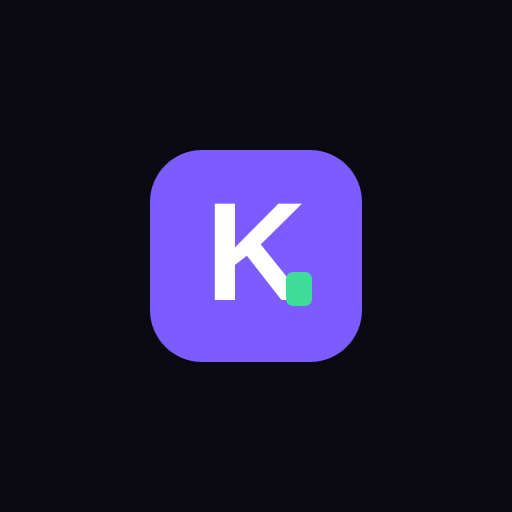
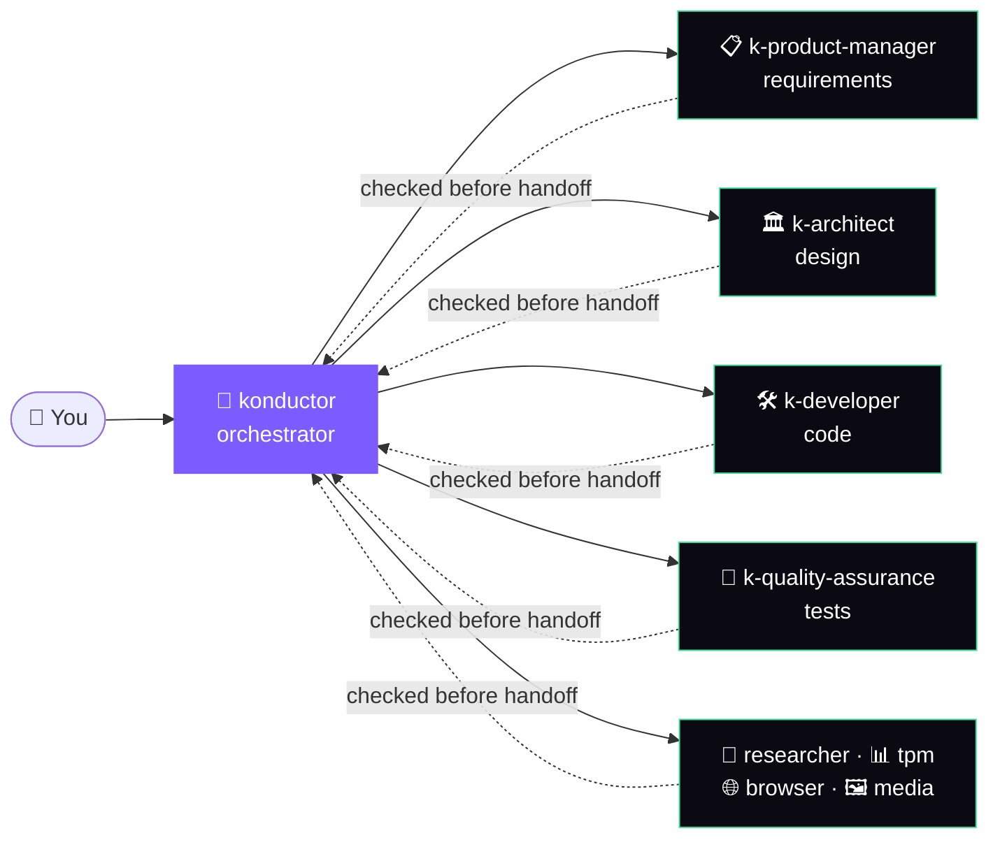

<div align="center">



# Konductor

**A team of AI agents that takes your work from idea to reviewed code.**

One install gives Kiro and Claude Code a product manager, an architect, a developer, a QA engineer
and more, plus an orchestrator that hands work between them and checks every result.

[](https://github.com/aws-solutions/konductor/releases/latest)
[](LICENSE.txt)
[](https://kiro.dev)
[](https://claude.ai/download)

[**User Guide**](https://aws-solutions.github.io/konductor/) ·
[**Workshop**](https://catalog.us-east-1.prod.workshops.aws/workshops/b2bfcd20-ddbe-4ee3-bea8-351c4e2f6156) ·
[**Quick start**](#quick-start) ·
[**Report a bug**](https://github.com/aws-solutions/konductor/issues/new?labels=bug&template=bug_report.md) ·
[**Request a feature**](https://github.com/aws-solutions/konductor/issues/new?labels=enhancement&template=feature_request.md)

</div>

---

## Why Konductor?

Most AI coding assistants are one agent in one conversation. You end up as the project manager:
writing the requirements, asking for a design, pasting it back for implementation, then
remembering to ask for tests.

Konductor installs a team that already knows how to work together. Ask the `konductor`
orchestrator for something in plain language. It breaks the request down, sends each piece to the
right specialist, checks what comes back, and sends it back for fixes when it falls short.

- 🎼 **One request, the whole lifecycle.** Requirements, design, code, tests and docs, without
  hand-carrying artifacts between chats.
- ✅ **Every deliverable gets checked.** Work passes a maker-checker gate, and failed checks
  go back for up to two fix cycles.
- 🧠 **Expertise built in.** 82 skills and 19 step-by-step workflows (SOPs) cover threat models,
  IAM policies, DynamoDB design, code review, E2E testing and more.
- 🪶 **No infrastructure.** Agents are configuration (prompts, skills, SOPs) that your Kiro or
  Claude Code runtime runs directly. No servers, no extra accounts.



> [!TIP]
> **Learn it hands-on.** [A-SDLC: Conducting Agents with Konductor on Kiro](https://catalog.us-east-1.prod.workshops.aws/workshops/b2bfcd20-ddbe-4ee3-bea8-351c4e2f6156)
> is a self-paced workshop of about 5 hours. You drive the agents through ambiguous,
> problem-based scenarios and learn to judge when the work is actually done. It runs on your own
> machine with Kiro CLI. You don't need an AWS account, but the agents use your own Kiro credits.

---

## Quick start

**1. Install** (Linux x86_64/aarch64 or Apple Silicon macOS):

```bash
curl -fsSL https://raw.githubusercontent.com/aws-solutions/konductor/refs/heads/main/scripts/konductor-bootstrap.sh | bash
```

That installs for Kiro CLI. For Claude Code, run the same command with `| KONDUCTOR_HARNESS=claude bash`
at the end. Piping a script to `bash` runs code you haven't read; to check it first, see
[what the install script does](#what-the-install-script-does) below.
Using the Claude Code plugin marketplace instead? Run `/plugin marketplace add aws-solutions/konductor`,
then `/plugin install konductor@konductor`
([details](docs/user-guide/tasks/install-claude-plugin-marketplace.md)).
Using Kiro IDE? [Install via a Kiro Power](#install-via-kiro-power).

**2. Start the orchestrator:**

```bash
kiro-cli chat --agent konductor     # Kiro CLI
claude --agent konductor            # Claude Code
```

**3. Ask for something real:**

```text
Design and implement a service that ingests IoT sensor events and alerts on anomalies.
```

The orchestrator sends the design to `k-architect`, the implementation to `k-developer` and the
test plan to `k-quality-assurance`, and verifies each handoff before moving on.

<details>
<summary id="what-the-install-script-does"><b>What the install script does, and how to audit it</b></summary>

<br/>

[`scripts/konductor-bootstrap.sh`](scripts/konductor-bootstrap.sh) downloads the real installer,
[`scripts/konductor-install.sh`](scripts/konductor-install.sh), checks it against the checksum
GitHub's Contents API reports for that file, and runs it. It needs `jq` to read that checksum.
Piping a script into `bash` runs code you haven't read, so read both scripts first if you want to
audit them.

The installer detects your OS and architecture, resolves the latest release, downloads that
platform's `konductor` binary and its `.sha256` file, verifies the checksum, and links the binary
into `~/.local/bin`. It needs no authentication beyond an unauthenticated GitHub release download.
It then runs `konductor install` against `$HOME`, which fetches the agents, skills, SOPs and the
`skill-lookup-mcp` server binary from the same release.

- **Runtime:** `kiro-cli-v2` by default. Set `KONDUCTOR_HARNESS=claude` or `kiro-v3` to target
  another one.
- **Pinning:** re-running always installs the latest release. Set `KONDUCTOR_TAG=v1.0.3` (or any
  release tag) to pin one.
- **PATH:** if `~/.local/bin` isn't on your `PATH`, the script tells you to add it, for example
  `export PATH="$HOME/.local/bin:$PATH"`.
- **Other platforms** (Intel macOS, Windows): the script stops with an error naming the supported
  ones. [Install from source](#install-from-source) instead.

</details>

<details>
<summary id="install-from-source"><b>Install from source</b></summary>

<br/>

Use this for a pinned commit, a platform without a published binary, or to audit the code before
installing. The CLI builds with plain `cargo` and a public Rust toolchain.
[`scripts/konductor-clone-install.sh`](scripts/konductor-clone-install.sh) does all of this in one
command and keeps a checkout under `~/.konductor/git/konductor` up to date on re-runs. It honors the
same `KONDUCTOR_HARNESS` variable.

```bash
git clone https://github.com/aws-solutions/konductor.git
cd konductor
make build
make link
konductor synth --from .
```

**Kiro CLI:**

```bash
konductor install --from . --harness kiro-cli-v2
kiro-cli chat --agent konductor
```

**Claude Code** (point `--target` at a directory with a `.claude/` marker, which Claude Code
creates on first run in a project):

```bash
konductor install --from . --harness claude --target <dir-with-.claude-marker>
claude --agent konductor
```

See [`cli/README.md`](cli/README.md#getting-started) for prerequisites and a full walkthrough.

</details>

<details>
<summary id="install-via-kiro-power"><b>Install via a Kiro Power (Kiro IDE and Kiro CLI v3)</b></summary>

<br/>

[`powers/konductor/`](powers/konductor/) is a Kiro [Power](https://kiro.dev/docs/powers/), imported
straight from GitHub. It's a third install path, alongside the install script and a source build.

1. In Kiro, open the Powers panel and choose **Add Custom Power** → **Import power from GitHub**.
2. Enter `https://github.com/aws-solutions/konductor/tree/v1.2.0/powers/konductor`.
3. Choose **Install**. This registers the Power's manifest; onboarding itself runs separately, the first time you invoke it (step 4 below).
4. Either say "konductor", "install konductor", or "set up konductor" in a chat session, or use the Try-power action in the installed Powers list. Both trigger the same onboarding skill.

The `konductor-setup` skill then does what the install script does: it detects your platform,
downloads and checksum-verifies the pinned `konductor` release (or builds it from source on Intel
macOS; on Windows, use WSL), and runs `konductor install --harness kiro-v3`. It installs into the
project you invoked it from, never `$HOME`, and shows you the plan and asks once before it starts.
A second skill, `konductor-help`, answers questions about the install afterward.

See [Install via Kiro Power](docs/user-guide/tasks/install-kiro-power.md) for supported platforms,
updating, uninstalling, MCP server setup and troubleshooting.

</details>

<details>
<summary><b>How <code>synth</code> and <code>install</code> work</b></summary>

<br/>

`konductor synth --from <repo-root>` renders this repo's agents, skills and SOPs into a
runtime-ready tree. `konductor install` copies that output into your runtime's config directories
and writes a manifest, so `konductor update` and `konductor uninstall` know what they own.

`install` requires `--harness <kiro-cli-v2|kiro-v3|claude>`; there's no default and no
auto-detection. Paths are relative to `--target <dir>`, or `$HOME` if you don't pass one:

| Harness       | Agents           | Skills                          | SOPs                                    |
| ------------- | ---------------- | ------------------------------- | --------------------------------------- |
| `kiro-cli-v2` | `.kiro/agents/`  | `.konductor/skills/<name>/`     | `.konductor/sops/` (as `.sop.md`)       |
| `kiro-v3`     | `.kiro/agents/`  | `.konductor/skills/<name>/`     | `.konductor/sops/` (as `.sop.md`)       |
| `claude`      | `.claude/agents/` | `.claude/skills/`              | `.claude/skills/sop-<name>/SKILL.md`    |

Kiro skills live in `.konductor/skills/`, not `.kiro/skills/`, so Kiro doesn't expose every skill
body to every agent. Each skill also gets a short `ks-<name>/SKILL.md` pointer under `.kiro/skills/`
that carries its name and description, so Kiro lists it natively; the pointer tells the agent to load
the body through the `konductor-skills` MCP server, or read `.konductor/skills/<name>/SKILL.md` if that
tool is unavailable. `kiro-cli-v2` and `kiro-v3` share those paths, so installing one over the other
replaces it (with a warning). `claude` installs alongside either one in the same target.

Without `--from`, `install` fetches a published GitHub release, including the platform's
`skill-lookup-mcp` binary. On a platform with no published binary, install still succeeds and only
skill lookups are unavailable. See
[`cli/README.md`](cli/README.md#installing-without---from-the-github-release--main-branch-dist-fallback-chain)
for the full fallback chain.

| Command               | Purpose                                                                              |
| --------------------- | ------------------------------------------------------------------------------------ |
| `konductor install`   | Install synthed agents and skills into a runtime                                     |
| `konductor update`    | Refresh a tracked install in place                                                   |
| `konductor uninstall` | Remove a tracked install and its entry in `~/.konductor/installs`                    |
| `konductor synth`     | Render agent specs for `kiro-cli-v2`, `kiro-v3` or `claude`                          |
| `konductor init`      | Scaffold `.konductor/` and a starter `config.yml` from a preset (`solo`, `team`, `org`) |
| `konductor doctor`    | Check an install or checkout and suggest fixes                                       |

</details>

---

## Meet the team

`konductor` is where you start. It never writes code itself: it delegates, verifies, and re-delegates
when a quality gate fails (up to two fix cycles).

| Agent | What it does |
| --- | --- |
| `konductor` | Coordinates every specialist across the lifecycle, tracks progress and enforces quality gates |
| `konductor-mux-orchestrator` | Same job, with specialists running in parallel tmux or zellij panes (auto-detected) |
| `konductor-cmux-orchestrator` | Same job, with specialists in parallel [cmux](https://github.com/manaflow-ai/cmux) surfaces |
| `k-product-manager` | User stories, requirements summaries and decision research, validated before handoff |
| `k-architect` | System designs, API specs, data models and threat models, validated before implementation |
| `k-developer` | Task breakdown, backend and frontend code, code review, infrastructure-as-code checks |
| `k-quality-assurance` | Test coverage analysis, E2E test strategy, security tests, Cypress tracking |
| `k-researcher` | External docs, web and AWS documentation; Slack search with a Slack MCP server |
| `k-tpm` | Program plans, status reports, risk tracking and program-level decision docs |
| `k-browser` | Browser automation with Playwright: navigation, forms, screenshots, E2E runs |
| `k-media-analyzer` | PDFs, images and diagrams that need more than text extraction |

Every agent runs `claude-sonnet-5.5`. Full details, including each agent's tools, are in the
[agents reference](docs/user-guide/agents.md).

---

## See it in action

**Review your branch before opening a PR** (Kiro CLI):

```bash
kiro-cli chat --agent konductor
> Run the k-code-review-workflow SOP against my current branch.
```

**Get a threat model in one shot** (Claude Code):

```bash
claude --agent konductor -p "Create a threat model for a public REST API backed by DynamoDB."
```

**Run the whole lifecycle** with the `k-full-sdlc` SOP, from codebase analysis through
documentation. Artifacts land in `.konductor/`.

```bash
# Kiro CLI
kiro-cli chat --agent konductor
> /agent-sop:k-full-sdlc project_description: "JSON parser" max_fix_cycles: 5

# Claude Code
claude --agent konductor -p "/sop-k-full-sdlc project_description: 'a CLI tool that tails a log file and alerts on error spikes'"
```

<details>
<summary><b><code>k-full-sdlc</code> parameters</b></summary>

<br/>

Use named parameters. A bare positional string can land words in the wrong slot (for example
`output_dir: parser`). In Kiro CLI, SOPs load only through `/agent-sop:`; asking for one in prose
doesn't work, and `/prompts` lists what's available.

| Parameter             | Required | Default           | Notes |
| --------------------- | -------- | ----------------- | ----- |
| `project_description` | yes      |                   | The project or feature to build |
| `codebase_path`       | no       | current directory | |
| `skip_phases`         | no       | none              | Comma-separated: `elicitation`, `codebase-analysis`, `requirements`, `design`, `design-review`, `feature-splitting`, `specs`, `implementation`, `code-review`, `testing`, `documentation` |
| `output_dir`          | no       | `.konductor/`     | |
| `elicitation_depth`   | no       | `standard`        | `quick`, `standard` or `deep` |
| `max_fix_cycles`      | no       | `2`               | |
| `deployed_url`        | no       | none              | Used only by the UI/functional test phase |
| `credentials_file`    | no       | none              | Same phase |
| `feature_isolation`   | no       | `branch`          | `branch` or `worktree` |

</details>

More walkthroughs: [understand a codebase](docs/user-guide/use-cases/understand-a-codebase.md),
[design a system](docs/user-guide/use-cases/design-a-system.md),
[plan and verify work](docs/user-guide/use-cases/plan-and-verify-work.md) and
[review code and tests](docs/user-guide/use-cases/review-code-and-tests.md).

---

## What's inside

### 🧠 82 skills

Skills are packaged expertise the agents load when they need it. For Claude Code, every skill in an
agent's `skills:` frontmatter is injected in full at session start; other skills load on demand
([how loading works](docs/guides/getting-started-claude.md#skills-how-they-load-and-who-can-invoke-them)).

| Area | Count | Examples |
| --- | ---: | --- |
| Architecture & design | 22 | `system-design-patterns`, `threat-modeling`, `dynamodb-design`, `iam-policy-design`, `smithy-modeling`, `cost-estimation`, `adr-generator` |
| Planning & tracking | 14 | `user-story-writing`, `task-decomposition`, `sprint-planning`, `risk-management`, `program-planning`, `progress-tracking` |
| Development & review | 14 | `backend-development`, `frontend-development`, `infra-validation`, `code-review`, `git-workflow`, `adversarial-code-review` |
| Orchestration & delegation | 13 | `delegation-protocol`, `sdlc-navigator`, `pre-planning-analysis`, `persistent-memory`, `workspace-skills`, `mux-dispatch` |
| Testing & QA | 8 | `test-coverage-analysis`, `e2e-test-strategy`, `cypress-test-implementation`, `security-test-generation` |
| Documentation & writing | 4 | `document-formats`, `doc-accuracy-analyzer`, `humanize-writing`, `agents-md-authoring` |
| Research & security | 4 | `external-research`, `security-remediation`, `find-aws-skills`, `about-konductor` |
| Kiro spec generation | 3 | `kiro-requirements-generation`, `kiro-design-generation`, `kiro-task-generation` |

Browse them all in the [skills catalog](docs/user-guide/skills.md).

### 📜 19 SOPs

SOPs are repeatable, multi-step workflows. Run them as `/agent-sop:<name>` in Kiro CLI or
`/sop-<name>` in Claude Code.

| Plan & verify | Design | Build & review | Test |
| --- | --- | --- | --- |
| `k-plan` | `k-design-doc-creation` | `k-code-review-workflow` | `k-test-coverage-review` |
| `k-context-gathering` | `k-existing-design-review` | `k-pre-cr-critique` | `k-e2e-test-generation` |
| `k-comprehensive-search` | `k-principal-engineer-design-review` | `k-code-cleanup` | `k-light-ui-testing` |
| `k-verify` | `kiro-spec-workflow` | `k-adversarial-pull-request-review` | |
| `k-full-sdlc` | | `k-codebase-analysis` | |

Plus `about-konductor` for onboarding and `k-delegate`, which the orchestrator uses internally.
Each one is explained, with a flowchart, in [SOP workflows](docs/user-guide/sop-workflows/README.md).

### 💾 Persistent memory

Agents with the `persistent-memory` skill keep a small scratchpad across sessions, with no setup.
The directory is created on first write and added to `.gitignore`.

| File | Holds |
| --- | --- |
| `.konductor/memory/MEMORY.md` | Project, codebase and environment facts |
| `.konductor/memory/USER.md` | Your preferences and working style |

Tune the size limits and an allowlist of external domains with an optional config. A validator
rejects any write that breaks the rules and tells you why; nothing is dropped silently.

```bash
mkdir -p .konductor && cp skills/persistent-memory/memory-config.json.template .konductor/memory-config.json
```

### 🔌 Integrations

AWS MCP comes pre-wired for `k-architect` and `k-developer` on Claude Code, launched through
`mcp-proxy-for-aws-cli==1.7.0`. You need `uvx` and AWS credentials. Both agents get the full server,
including AWS API tools, so scope agent-initiated calls with the `aws:ViaAWSMCPService` and
`aws:CalledViaAWSMCP` IAM condition keys. Kiro CLI users add `aws-mcp` to their own MCP config,
where knowledge tools are auto-approved and API tools ask first. See
[Install for Claude Code](docs/user-guide/tasks/install-claude-code.md#optional-integrations) or
[Install for Kiro CLI](docs/user-guide/tasks/install-kiro-cli.md).
The [AWS Agent Toolkit](https://github.com/aws/agent-toolkit-for-aws) also offers an OAuth
connection, an AWS-managed plugin and standalone skills.

Everything else is bring-your-own:

- **Browser automation:** `k-browser` uses a [`@playwright/mcp`](https://github.com/microsoft/playwright-mcp)
  server. Install Chromium after configuring it.
- **Slack search:** `k-researcher` with a Slack MCP server ([guide](docs/guides/slack-integration.md)).
- **Asana:** `k-product-manager` with an Asana MCP server ([guide](docs/guides/asana-integration.md)).

---

## Project layout

```text
konductor/
├── agents/        11 agent specs (*.agent-spec.json)
├── agent-sops/    19 SOPs (*.sop.md)
├── skills/        82 skills (skills/<name>/SKILL.md)
├── context/       Context loaded at agent startup (core rules for every agent, orchestrator routing rules)
├── cli/           The konductor CLI (Rust)
├── mcp/           The skill-lookup MCP server
├── shared/        Shared Rust crates (telemetry)
├── docs/          User guide, integration guides, GitHub Pages site
├── scripts/       Install, release and plugin tooling
└── tests/         Benchmark scenarios and script tests
```

## Contributing

Bug reports, ideas and pull requests are welcome. Start with [CONTRIBUTING.md](CONTRIBUTING.md),
and see the [Code of Conduct](CODE_OF_CONDUCT.md). To change agent behavior or build the CLI from
source, read [contributing and customizing](docs/user-guide/appendix/contributing.md).

## Security

See [SECURITY.md](SECURITY.md) to report a vulnerability. Please don't open a public issue.

## License

Apache License 2.0. See [LICENSE.txt](LICENSE.txt); third-party attributions are in
[NOTICE.txt](NOTICE.txt).

## Data Collection

Konductor sends usage metrics to AWS. They are **not anonymous**: every event carries an identifier
that stays the same across all projects on your machine.

**What's sent**

- **Seven event types:** `agent_invocation`, `subagent_invocation`, `mcp_tool_call`, `cli_error`,
  `package_installed`, `package_version_updated` and `package_uninstalled`.
- **Agent events** cover only Konductor's own agents (the orchestrators and `k-*` specialists),
  never your agents or a runtime's built-in ones. They carry the agent's name and, for a
  delegation, the delegating Konductor agent's name when the runtime exposes it.
- **Other events** carry the failed CLI subcommand (for errors), the runtime (`kiro-cli-v2`,
  `kiro-v3` or `claude`), the CLI version and, for install and update events, the installed content
  version.
- **Session IDs**, when the runtime exposes one, are hashed with a per-install identifier first, so
  the raw value is never sent and the same session hashes differently on another install.

**What's never sent:** project paths, directory names or file contents. The exact schema is in
[`docs/telemetry-schema.json`](docs/telemetry-schema.json).

**The machine identifier.** The first time an event is reported on a machine, Konductor creates a
UUID and stores it in `$HOME/.konductor/telemetry.json`. Every project on that machine sends the same
UUID, so events from different projects can be linked to one machine, though not to which projects.

**Claude Code plugin.** The marketplace plugin sends `agent_invocation` and
`subagent_invocation` the same way, through a plugin hook, with `claude-plugin` as the runtime. It
shares the machine identifier in `$HOME/.konductor/telemetry.json` with the CLI. See
[Install via the Claude Code plugin marketplace](docs/user-guide/tasks/install-claude-plugin-marketplace.md#telemetry).

**Opting out**

| To stop reporting for | Do this |
| --- | --- |
| One project | Run `konductor install` or `konductor update` with `--no-telemetry`, or set `telemetry.enabled: false` in `.konductor/config.yml` |
| Any process with the variable set (a shell, a CI job, a fleet) | Set `KONDUCTOR_TELEMETRY=off` |
| The whole machine | Set `"telemetry_consent": false` in `$HOME/.konductor/telemetry.json` |
| The Claude Code plugin | Turn off the plugin's `telemetry_enabled` option. The variable, `config.yml` and machine settings above also apply; `--no-telemetry` doesn't |

- `--no-telemetry` also removes an opt-in record left by an earlier install, and stops a global
  install's hooks from reporting in that project.
- `telemetry.json` exists only after the first event is reported; a `--no-telemetry` install never
  creates it. Konductor never resets a consent value you set.
- Reporting needs both the project and the machine setting to allow it. `konductor doctor` shows
  which one is in effect.
- Keep `telemetry.json` valid. It needs all four fields (`schema_version`, `UUID`, `created_at`,
  `telemetry_consent`) and a `UUID` of exactly 64 lowercase hex characters. Konductor never repairs,
  replaces or deletes the file, so if it's malformed, events fall back to an untraceable placeholder
  identifier and your consent setting is ignored until you fix or delete it by hand.

This solution sends operational metrics to AWS (the "Data") about the use of this solution. We use this Data to better understand how customers use this solution and related services and products. AWS's collection of this Data is subject to the [AWS Privacy Notice](https://aws.amazon.com/privacy/).

---

Copyright Amazon.com, Inc. or its affiliates. All Rights Reserved.

Licensed under the Apache License, Version 2.0 (the "License"); you may not use this file except in compliance with the License. You may obtain a copy of the License at <http://www.apache.org/licenses/LICENSE-2.0>

Unless required by applicable law or agreed to in writing, software distributed under the License is distributed on an "AS IS" BASIS, WITHOUT WARRANTIES OR CONDITIONS OF ANY KIND, either express or implied. See the License for the specific language governing permissions and limitations under the License.
