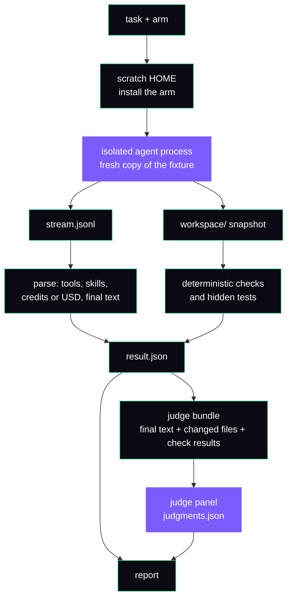

<div align="center">

# bench

**Find out whether a change to an AI coding agent helps, what it costs, and how much of the result is noise.**

bench runs the same tasks with and without a change, scores the output with checks and a panel of judge models,
and reports quality, cost and run-to-run spread.

[**Quick start**](#quick-start) ·
[**How it works**](#how-it-works) ·
[**Reading results**](#reading-results) ·
[**Write a task**](#write-a-task) ·
[**Other agents**](#other-agents) ·
[**Reference**](README.md)

</div>

---

## What bench answers

You changed something about an agent setup: a skill, a system prompt, an orchestrator, a whole release.
Is the agent better for it? bench gives a number for each of three things:

- **Quality.** Does the output pass the task's deterministic checks and a judge panel's rubric?
- **Cost.** What did the runs spend, in credits (Kiro CLI) or USD (opencode, Claude Code)?
- **Noise.** If you run the same setup twice, how far apart are the results? A difference smaller than that is not a result.

It is for people who ship an agent setup and want evidence before they keep a change. Today the setup under test is
Konductor (the repository this lives in) and the agent is Kiro CLI, opencode or Claude Code. Section [Other agents](#other-agents) says what that rules out.

> [!NOTE]
> bench is plain Node. There is no install step beyond the tools in [Prerequisites](#prerequisites).
> Everything below runs from the repository root.

---

## How it works

An **arm** is one setup under test, for example `vanilla` (the bare agent) or `main` (the agent with Konductor from `origin/main`).
A **task** is a prompt plus a starting project and the ways to score the result. bench runs every task on every arm, several times, and compares.



Purple boxes call a model and spend credits. The rest is local work.

1. **Install.** The runner builds the arm from its git ref, then installs it into a throwaway home directory. Your real home is never written.
2. **Run.** The agent starts in a fresh copy of the task's fixture, in an isolated process (`unshare` on Linux, `sandbox-exec` on macOS). It sees an allowlisted environment, and credentials, SSH keys and the answer keys are hidden from it. The network stays open.
3. **Record.** The agent's event stream is saved as `stream.jsonl`. The parser reads it for tool calls, skill loads, metered spend and the final answer.
4. **Snapshot and check.** After the agent exits, the workspace is copied out and the task's checks run on it in a separate scratch home, with network access denied where the platform supports it. Checks are regular expressions, file tests, shell commands and, for some tasks, hidden acceptance tests.
5. **Judge.** `judge` builds a bundle from the final text, the files the agent changed and the check results. The judges never see the transcript or the arm name. Each judge scores the rubric items pass, partial or fail, and quotes evidence. A quote that is not in the output lowers the verdict one level.
6. **Report.** `report` combines checks and judgments into a score per run, then compares arms, with intervals.

### What a run leaves behind

One run is a directory `<out>/<arm>/<task>/<replicate>/`:

```
<out>/
  run-config.json  summary.json  env.json  credit-ledger.jsonl  isolation-gate.json   # one per results directory
  judgments.json   judge/ (cache/, raw/)                                              # after `judge`
  <arm>/<task>/1/
    result.json            status, checks, credits or USD, tool and skill counts, flags
    stream.jsonl           the agent's event stream, as it arrived
    stderr.txt             the agent's stderr
    command.txt            the command line that started the agent
    install.log            output of the arm install
    installed-agent.json   what the install put in front of the agent (Kiro CLI)
    session/               the agent's own session files (Kiro CLI)
    workspace/             the project as the agent left it
```

`result.json` follows `schema/result.schema.json`. The runs of one task on one arm are the replicates `1`, `2`, and so on.

---

## Core concepts

| Term | What it is |
| --- | --- |
| Task | A JSON file in `tasks/`: a prompt, a fixture, checks, a rubric and a timeout. |
| Arm | One setup under test. `vanilla`, `v1.2.0`, `main`, `name=<git ref>` or `name=dir:<path>`. Add `oc-` or `cc-` for opencode or Claude Code. |
| Suite | A named list of tasks, arms, replicates and judges, such as `lite` or `hard`. |
| Fixture | A small project the task starts from, copied fresh for every run. |
| Check | A deterministic test on the final workspace: a regex, a file test, a command or hidden tests. |
| Rubric | Three to six weighted criteria a judge scores for each output. |
| Judge panel | At least three judge models from different families. The subject model's own family is excluded. |
| Replicate | One more run of the same task on the same arm. Replicates measure run-to-run spread. |
| A/A arm | The same ref run twice under two names. The gap between them is the noise floor. |
| Credit ledger | `credit-ledger.jsonl`: one line per agent run and per judge call. |
| Censored run | A run that timed out or died before its last metering event. Its true cost is unknown, only bounded below. |
| Isolation, tripwire | The sandbox around the agent, and a scan afterwards for changes to your real home. |

---

## Quick start

### Prerequisites

- Node 22 or newer, `git`, `tar`.
- To run the Konductor arms: `cargo` (an offline cache, or pass `--cargo-online`). The arm is built from a local git ref. bench never fetches, so fetch the ref first.
- For Kiro CLI runs: `kiro-cli` on PATH and logged in. On Linux, `unshare` and `setpriv` as well.
- For opencode or Claude Code runs, and for the opencode judge backend: AWS credentials for Amazon Bedrock. See the harness sections in [README.md](README.md).

### Free first

These call no model. The marks in the table say what each command costs.

| You want to know | Command | Cost |
| --- | --- | --- |
| Do the shipped tasks hold together? | `node bench/tasks/validate-tasks.js` | free |
| Which arms exist, and what do they mean? | `node bench/runner/bench.js list-arms` | free |
| What will this cost, and which commands do I run? | `node bench/runner/bench.js pr-plan --ref opt-a=REF --suite lite --budget-credits 100` | free, runs nothing |
| Do all arms build and install? | add `--prepare-only` to any `run` command | free, builds arms, starts no agent |
| What will judging cost? | `node bench/runner/bench.js judge --run DIR --plan` | free, calls no model |
| Is the code healthy? | `node --test "bench/runner/test/*.test.js" "bench/skilleval/test/*.test.js"` | free |

`pr-plan` prints the next commands in order, with an estimate:

```
Plan: opt-a against v1.2.0 on the lite suite (5 task(s), 1 replicate). This prints the plan and runs nothing.
  total for 1 replicate: 61.10 credits; cap 100 (1.5x, rounded up). Judge credits are not included.
```

### A first real run

Compare the bare agent with Konductor on one task, three times each. This spends credits.

```bash
OUT=/var/tmp/bench-first

# spends credits: 2 arms x 1 task x 3 replicates = 6 agent runs, stops launching new runs at 90% of the budget
node bench/runner/bench.js run --suite lite --arms vanilla,main \
  --tasks simple-fix-failing-test --replicates 3 --budget-credits 40 --out $OUT

# spends credits: three judges score every output (add --plan first for the estimate)
node bench/runner/bench.js judge --run $OUT

# free: report.md, report.html, report.json and charts/ in $OUT
node bench/runner/bench.js report --run $OUT
```

One task cannot support a platform verdict (it needs five paired task cells), but the report and `explain` work. The runs use `claude-sonnet-5.5` at effort `high` unless you pass `--model` or `--effort`. `main` means `origin/main` as last fetched in your clone.
Add `--prepare-only` to the first command to check that both arms build before you spend anything.

> [!TIP]
> Three replicates is the smallest number the report treats as more than anecdotal. For a real decision use `--profile detailed`,
> which runs at least five replicates, adds an A/A arm and adds graded judging.

To check one run without the whole report, use `explain` (why this quality number) or `trace` (what the agent did, in order). Both are free and read files only.

```bash
node bench/runner/bench.js explain --run $OUT --arm main --task simple-fix-failing-test --rep 1
node bench/runner/bench.js trace   --run $OUT --arm main --task simple-fix-failing-test --rep 1
```

---

## Reading results

`report.md` opens with a diligence scorecard, then the scores. For each arm you get:

| Column | Meaning |
| --- | --- |
| Quality /100 [95% CI] | Per run, the weighted mean of what the run has: hidden tests, checks and the judges' rubric score. Default weights are 0.5, 0.2 and 0.3. Without hidden tests they become checks 0.4 and rubric 0.6. |
| n | Runs that contributed. Infrastructure errors and model mismatches are left out and counted separately. |
| Reliability /100 | 100 minus the share of runs that timed out, errored or hit an infrastructure problem. |
| Cost ratio | Cost per successful run, as arm over baseline. A ratio, never a 0 to 100 score. |

A run is a clean pass when its status is success, there is no infrastructure error or model mismatch, and every check passed.
"Cost per successful run" is all charged cost divided by clean passes, so failures raise it.

**Same, better or worse.** Read a difference against the noise, not against zero.

- `contrast` labels each metric `improved`, `worse` or `within noise`, and `n too small` below three runs per side. A change counts only when it is at least 15% (`--min-rel`) and, with three or more runs per side, the intervals do not overlap (`--rule any` asks for either).
- `report --verdict platform` turns that into KEEP, DISCARD or NOT ENOUGH EVIDENCE for each arm. KEEP needs the quality gain to beat the A/A noise, a paired 95% interval above zero, no clear drop in reliability and a cost of at most 2.0x the baseline per successful run.
- The A/A noise band is never smaller than 5 quality points. A gain inside it is reported as noise.
- NOT ENOUGH EVIDENCE is a normal answer. It means this study cannot tell, not that nothing happened.

**Thin n.** Fewer than three runs on a side is labelled anecdotal. A cell with fewer than three replicates is flagged. Five paired task cells are the minimum for a platform verdict.

**Censored runs.** A run that timed out has unobserved spend. The ledger charges it the median of the arm's completed runs, or `--censored-floor` (default 1.0), never 0. `result.json` keeps the known floor as `creditsLowerBound` and the charge as `creditsCharged`. Treat the cost of an arm with many censored runs as a lower bound.

**Judge agreement.** The scorecard shows how far the judges agree with each other (within-one agreement of 0.9 or more and exact agreement of 0.6 or more pass). It also shows the share of quotes the judges could not back with evidence. Human calibration is a separate step: `cap review` writes a page for a person to rate a sample, `cap review-import` scores the ratings, and a kappa of 0.6 or more passes. See [Calibration](README.md#calibration).

**Runs kept out of judging.** Some runs are not sent to the judges. For new studies the rubric number treats them in one of two ways, by reason:

| Reason | Class | In the main rubric number |
| --- | --- | --- |
| credsUnscrubbed | integrity | counted as a failure (0 on every rubric item) |
| stdioTampered | integrity | counted as a failure |
| usageDbTampered | integrity | counted as a failure |
| infraError | gap | left out |
| no workspace | gap | left out |
| budget_skipped | gap | left out, the run never executed |

Reports of new studies show both numbers side by side, always, so the table keeps its shape: `rubric (excluded runs = 0)` is the main number, `rubric (judged runs only)` is the mean over judged runs, and `excluded runs (counted as 0)` is how many integrity runs sit between them. `report.json` carries them per arm and scope as `rubricAll`, `rubricJudged` and `excludedCount`; `rubricJudged` equals the number older reports gave. The score rows behind the verdict, the quality score and `contrast` use the main number; `compare` reports both and labels them. The diligence scorecard is unchanged: judge coverage still counts these runs as unjudged.

A study follows this policy when its `judgments.json` has `"rubricPolicy": "excluded-as-failures"`. The judge writes it when it creates the file. A file made before that has no stamp and keeps the older rule, excluded runs are gaps; such a report renders as it always did, plus the line `legacy: excluded runs are gaps`. Judging more into an unstamped file does not stamp it, and `report --run DIR,DIR` over a mix of stamped and unstamped directories is treated as legacy. `compare` refuses to compare a legacy study with a stamped one unless you pass `--force`. The class of each reason is defined once, in `judge/exclusion.js` (`exclusionClass(run)` in `judge/run.js` applies it to a run).

**Interim tables.** To look at a study while it runs, point `report` at the finished cells with `--run DIR,DIR` and an `--out`. Several directories are merged read-only. `report --detail quick` gives one page. `contrast --run DIR --base vanilla` gives each arm against a base, by task class.

---

## Write a task

A task is one JSON file. This one asks for a small function in the `textkit` fixture. It is a trimmed copy of `tasks/simple-add-function.json`.

```json
{
  "id": "guide-title-case",
  "class": "simple",
  "target": null,
  "prompt": "Add a titleCase(text) function to textkit. It should upper-case the first letter of every word and lower-case the rest, and return an empty string for empty input. Export it from the package entry point and add tests for it. Do not ask me questions; if something is unclear, make a reasonable assumption, list your assumptions in your final message, and finish the work.",
  "fixture": "textkit",
  "timeoutSec": 300,
  "checks": [
    { "type": "contains", "path": "src/index.js", "pattern": "titleCase" },
    { "type": "cmd", "cmd": "node -e 'const t=require(\"./src\").titleCase;process.exit(t(\"hELLO wORLD\")===\"Hello World\"&&t(\"\")===\"\"?0:1)'", "expectExit": 0 }
  ],
  "rubric": [
    { "id": "exported", "criterion": "titleCase is implemented in src/ and exported from src/index.js.", "weight": 3 },
    { "id": "tests", "criterion": "Adds tests for titleCase covering mixed-case input and the empty string, and they pass.", "weight": 2 }
  ],
  "tiers": ["cap"]
}
```

Rules that trip people up:

- Every prompt ends with the "Do not ask me questions" sentence. Runs are unattended, so a question ends the turn with nothing written.
- The prompt never names a skill, agent or procedure. The same prompt goes to every arm.
- At least one check must fail on the untouched fixture, so doing nothing cannot pass.
- A task needs a reference solution under `solutions/<id>/` that passes every check. The validator enforces this.
- A task has three to six rubric criteria, tied to the fixture's `.bench-answer-key.md`, which only the judges read.
- The task schema is closed (`schema/task.schema.json`). An unknown field fails validation.

Put your own tasks in a directory laid out like `bench/rootcause/`: task files beside `solutions/`, with fixtures taken from `bench/fixtures`. Validate and run them with `--extra-tasks`:

```bash
node bench/tasks/validate-tasks.js --extra-tasks DIR --only-extra     # free
node bench/runner/bench.js run --suite cap --extra-tasks DIR --tasks guide-title-case --arms vanilla,main --out $OUT   # spends credits
```

The example above, with a copy of `tasks/solutions/simple-add-function/` as its reference solution, passes the validator. The full format, the check types and the rules for hidden-test tasks are in [README-tasks.md](README-tasks.md).

---

## Run a long study safely

For studies that run for hours, read [RUNBOOK.md](RUNBOOK.md). It covers the unattended scripts, the credential flow and the monitor. The points below are the ones that cost people credits.

| Risk | What bench does | What you do |
| --- | --- | --- |
| Kiro CLI login expires mid-run | `run` checks `kiro-cli whoami` before building and again between runs, at most every 5 minutes. A run that never started a turn and printed a login error is charged 0 and marked infra. After `--max-auth-failures` such runs in a row (default 3) the rest are skipped and `run` exits 6. | Log in again right before a long chunk. After an exit 6, log in and rerun. |
| Every run failed, or every run was over in under a second | `run` exits 5 and writes `infraFailure` to `summary.json`. A study where each run either errored or took under 1 s measured nothing, because the agent most likely never ran. Exit code 3, 4 or 6 takes its place when it applies. | Read `stderr.txt` of one run before spending more. |
| The agent CLI is updated or removed mid-study | A run whose agent binary could not be started (exit 127, or exit 126 or a spawn error with a "No such file or directory" or "Permission denied" message; no turn, under 5 s) is charged 0, marked infra of kind `launch` and never counted as a timeout. Launch failures count toward the same consecutive-failure stop as login failures (default 3, `--max-auth-failures` or `BENCH_MAX_AUTH_FAILURES`), with their own message ("agent binary missing or replaced during the run"). The rest are skipped and `run` exits 6. | Do not update, reinstall or move the agent CLI while a study runs. After an exit 6 with a launch message, check that the binary is in place, then rerun the skipped cells in a new `--out` or with `--replicate-offset`. |
| A task hangs | Each task has a `timeoutSec`. | `--timeout-sec N` replaces it for every selected task. |
| Spend runs away | `--budget-credits X` stops launching new runs at 90% of X. A command that ends past 100% exits 3. Without it nothing stops a run. | Always pass a budget on a new study. `--run-credit-limit` kills one run on engine v2 only. |
| Something wrote to your real home | The tripwire scans for changes after each run. A hash of `~/.konductor/installs` before and after fails the batch with exit 4. | Do not run `konductor install` or switch branches while a study runs. |
| Disk fills up | Runs keep a full workspace each. | `gc` lists what bench made and may reclaim (a dry run). `archive --run DIR` packs finished workspaces. |

**State directory.** The unattended scripts keep their state in a per-user directory now, so the default location changed. A chain started before the upgrade is not found by `monitor.sh`; set `STATE_DIR` to the old path (`/tmp/konductor-bench`) to watch it. `bench/real/lib.js` still defaults its real-repo cache to `/tmp/konductor-bench/realrepos`, outside that directory.

Exit codes of `run`: 0 ok, 1 error, 2 bad arguments, 3 credit guard stop, 4 isolation failure, 5 infra check (every run errored or finished in under 1 s), 6 login or launch failure stop.

**Charged and observed.** Observed credits are what the stream metered. Charged credits are what the ledger counts. They match for a finished run. For a censored run the charge is an estimate (above), and the report says how many runs it covers.
Kiro engine v3 meters only at the end of a turn, so a killed v3 run has no observed spend at all.

### What the sandbox does not hide

The sandbox hides credentials, answer keys, hidden tests, partial and reference solutions, stubs and the output directory. An agent can still read the following. Reads leave no trace, so the tripwire does not report them. Checked on Linux with the mount namespace; the macOS profile uses the same path lists and was not run for this check.

| Readable by the agent | Why it matters | What to do |
| --- | --- | --- |
| The Konductor checkout the bench runs from (skills, agents, `AGENTS.md`, this guide) | A vanilla agent that searches the disk can find Konductor skill text, so the arms are not cleanly apart. | Pass `--hide <checkout>` (or set `BENCH_HIDE_EXTRA`). The checkout must not hold the output directory, the scratch directory, the cache or a tool on `PATH`, because everything under a hidden path disappears. The run record lists it under `isolation.hide`. |
| `bench/tasks/*.json` (check patterns and rubric items) | Any agent can read how it is graded. Only `hidden`, `partials`, `solutions` and `stubs` under `bench/tasks` are masked, and a test pins that the task files stay readable. | Covered by `--hide <checkout>` when the bench runs from that checkout. Masking `bench/tasks` as a whole is safe for the runner (everything under it is read on the host) but changes that test and what existing studies could see, so it is a decision for the maintainers. |
| The arm cache (default `/tmp/b-cache`, `--cache`) | It holds every arm's exported source and build. A Konductor arm must read its own entry, because the installed agent files point into it, so the whole cache cannot be hidden. A vanilla agent can read the Konductor entries. | No flag covers this yet. Recommended change: for each run, hide every cache entry except the one the arm uses. Until then, treat a vanilla-versus-Konductor result as measured with a readable cache and say so. |

**Stream integrity on Linux.** `stream.jsonl` is not protected against a hostile agent on Linux. The runner hands the child a writable file descriptor for it, and a process can rewrite its own descriptor through `/proc/<pid>/fd/1` even though the file's path is hidden. Credit limits, the fetch audit, tool counts and the judge's final text are all derived from that file, so a hostile agent can forge them without setting `stdioTampered`. Plan a runner-owned pipe (the runner reads the child's output and writes the file itself) as a follow-up. Do not run an agent you do not trust and rely on those numbers.

**Mounts below the home or `/tmp`.** The namespace makes the home, `/tmp`, `/var/tmp` and `/dev/shm` read-only by remounting the top mount. A separate mount below one of them stays writable inside the namespace (reproduced with a tmpfs under a read-only `/tmp` subtree). `findmnt -R /tmp` and `findmnt -R "$HOME"` list such mounts; an NFS or cloud-desktop home often has some. If the list is not empty, treat host files under those mounts as writable by the agent. `sandbox-exec` on macOS denies writes by path, so submounts there should be covered (not run).

---

## Supported agent runtimes

One run uses one runtime. The runtime is chosen by the arm name, and arms from different runtimes cannot share a run.

| Runtime | Arm names | Cost unit | Limits |
| --- | --- | --- | --- |
| `kiro-cli` | `vanilla`, `v1.2.0`, `main`, `name=<ref>` | Kiro credits | Engine v2 by default, `--agent-engine v3` available. The only runtime for per-skill studies (`cap skill-study`). |
| `opencode` on Amazon Bedrock | `oc-vanilla`, `oc-v1.2.0`, `oc-main`, `oc-name=<ref>` | USD | Pinned `opencode-ai` 1.19.5. `trace` is not supported. Subagent activity is read from opencode's database, not the stream. |
| `claude-code` on Amazon Bedrock | `cc-vanilla`, `cc-main`, `cc-name=<ref>` | USD | Needs the real `claude` binary (`--claude-bin` or `--claude-tools-dir`). Multi-turn (autonomy) tasks are refused. `--effort`, `--stop-on` and `--run-credit-limit` do not apply. |

Details, credentials and flags are in the harness sections of [README.md](README.md#opencode-harness).

---

## Other agents

> [!IMPORTANT]
> bench cannot benchmark an arbitrary agent today. That includes agents built with an SDK such as Strands, and agents behind a hosted runtime or an HTTP API.
> Nothing in the code launches or parses them.

An arm is always a Konductor git ref or directory plus a condition, or the bare agent CLI. There is no arm kind for "this other agent definition".
The task generators (`skilleval.js` and `cap scenarios`) read one Konductor `SKILL.md` or one Konductor capability, not a system prompt or a tool list.
`README.md` states the same limit: testing an arbitrary third-party skill or agent definition is not supported yet.
The Strands experiment importer in [agenteval/README.md](agenteval/README.md) only prepares reviewable scenario candidates from generated test cases; it does not run or benchmark any agent.

**What a new runtime has to provide.** [runner/lib/harness/CONTRACT.md](runner/lib/harness/CONTRACT.md) is the written adapter contract: the members a harness module exports, the fields its parser fills, the steps to add a runtime and the places that still switch on the runtime name. It is derived from reading the code and is not tested yet. No conformance test exists, so a missing member shows up as an error in the middle of a run. In short:

- A local executable the runner can start (a small wrapper, for an in-process agent).
- A stream of JSON lines on stdout, and a parser that turns it into the fields `result.json` needs: session id, finished status, final text, tool calls and tool names, and spend as credits or USD.
- An install step that fills a scratch home, an environment allowlist, and a step that removes credentials afterwards.
- A source for the arm. Arms are Konductor refs today, so the arm preparation and trial install assume Konductor.
- Runtime-specific branches outside the harness folder. CONTRACT.md lists them in its last section: skill-load capture, early stop, `trace`, the cost unit, the judge bundle's final-text reader, the report, and the result schema's runtime list.

The contract documents the adapter surface for the runtimes above. It does not add support for third-party agents.

**What is not available.**

- A normalized trajectory. Tool calls are reduced to counts and names. Per-call arguments and results stay in the raw `stream.jsonl`.
- Checks on tool sequences. Checks run on the final files, and judges never see tool calls, so a rule like "called tool X before tool Y" cannot be written.
- Scenario generation from an agent description. Generators take one skill file, and the task schema has no field for expected tool use.

---

## Where to go next

| You want | Read |
| --- | --- |
| Every command, flag and metric | [README.md](README.md) |
| The task, fixture, check and rubric format, and how to add one | [README-tasks.md](README-tasks.md) |
| Running and monitoring a study that takes hours | [RUNBOOK.md](RUNBOOK.md) |
| Deciding whether one skill is needed, trimmable or removable | [CAP-PLAYBOOK.md](CAP-PLAYBOOK.md) |
| Quality dimensions beyond the task rubric | [QUALITY-PACK.md](QUALITY-PACK.md) |
| The committed skill eval data | [skill-evals/README.md](skill-evals/README.md) |

> [!NOTE]
> `docs/guides/benchmarking.md` at the repository root describes a different, older runner. This guide and `bench/README.md` describe `bench/runner/bench.js`.
