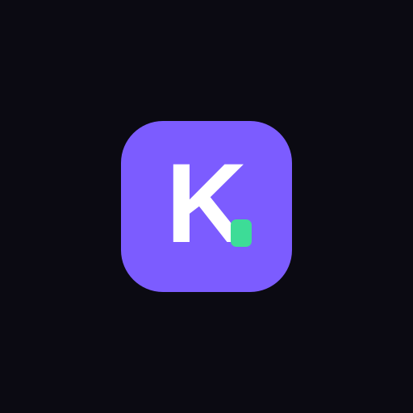
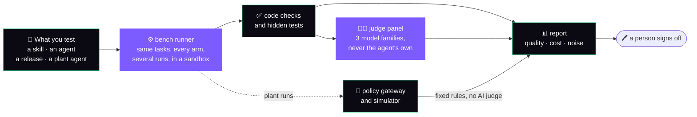

<div align="center">



# Konductor bench

**Find out if a change to an AI agent really helps, and how sure you can be.**

bench runs the same tasks with and without a change, scores the results with code first and judge models second,
and reports quality, cost and noise. It can also put an agent in charge of a simulated machine and count every
unsafe move with fixed rules, with no AI judge.

[](../LICENSE.txt)
[](https://kiro.dev)
[](https://claude.ai/download)
[](https://strandsagents.com/)
[](#-try-it-free-in-5-minutes)

[**Try it free**](#-try-it-free-in-5-minutes) ·
[**Quick start in 15 minutes**](docs/quickstart.md) ·
[**Pick your question**](#-pick-your-question) ·
[**Glossary**](docs/glossary.md) ·
[**Repeat it yourself**](docs/repeat-it-yourself.md) ·
[**Full reference**](docs/reference.md)

</div>

---

## 🎯 Why bench?

You changed an agent: a skill, a prompt, an orchestrator, a whole release. Did it get better? One run cannot tell
you. Agents give a different answer each time, and a longer answer is not a better one.

bench runs every setup several times on the same tasks. Code checks and hidden tests score first. Judge models score
only what code cannot check, and never come from the model family of the agent they judge. A run of the same setup
twice shows the noise, and a gap smaller than the noise is not a result. When bench cannot tell, it says
**NO DATA** or **unsettled** instead of guessing.



---

## 🧭 Pick your question

| You want to know | Read | Costs |
| --- | --- | --- |
| Does this **skill** load when it should, and does it help once loaded? | [Benchmark a skill](docs/skills.md) | many steps free |
| How do I test **my agent**: Kiro CLI, Claude Code, Strands, or a new kind? | [Benchmark an agent](docs/agents.md) | runs cost credits or USD |
| How do I test an agent that **drives a machine**, and count its unsafe moves? | [Benchmark a physical AI agent](docs/physical-ai.md) | tests free, runs paid |
| How do I bring **my own agent**, not Kiro CLI or Konductor, and what works today? | [Benchmark your own agent](docs/benchmark-your-own-agent.md) | reading free, runs paid |
| Is **Konductor itself** better than the bare agent? How do we know? | [How Konductor is benchmarked](docs/konductor-bench.md) | paid, approved first |
| I want to **run it myself**, start to finish | [Repeat it yourself](docs/repeat-it-yourself.md) | free first, then a small run |

New to bench and about to run something? Read [Benchmark an agent](docs/agents.md) first. It shows how one run
works and how to read a report, and the other pages build on it.

---

## ⚡ Try it free in 5 minutes

These commands call no model and spend nothing. You need Node 22 or later and `git`. Run them from the
repository root. The `cap` commands read `origin/main`, so fetch it once.

```bash
git fetch origin main

# 1. A keep-or-prune scoreboard for one skill, made from built-in stub data
node bench/runner/bench.js cap keep-prune --skill plan-review --run stub-pilot --out /tmp/kp

# 2. Every agent, skill and SOP in this repo, who can reach it, and which have no test task
node bench/runner/bench.js cap list --base main

# 3. Every arm you can run, and what each one installs
node bench/runner/bench.js list-arms
```

The first command prints a scoreboard. Here it is, cut down with `...` (real output, 2026-11-19):

```text
# Keep or prune: plan-review

Measures: conditional effect after load (the with arm was made to load the skill).

| | quick | deep |
|---|---|---|
| label | NO DATA | NO DATA |
| suggested verdict | no data | no data |
| action | SKILL.md changed after the baseline's rules were written (rules 989e60e15d61, now 091ed8d9b24c) | ... |
| gap A | -0.122 [-0.2305,-0.0136] | -0.0956 [-0.1725,-0.0188] |
| tasks counted | 16 of 16 | 16 of 16 |
| controls | PASS (convention-control, dose-ladder) | PASS (convention-control, dose-ladder) |
| judges | deepseek-v3.2 (deepseek), glm-4.6 (glm), grok-4 (grok) | ... |

Stale: YES: SKILL.md changed after the baseline's rules were written ...
Selection: not measured.
Whole-skill call: NO DATA: no selection result (trigger precision and recall, observed use) ...
Agree: yes. Sign-off: none yet.
```

The numbers are stub data, never a measurement. Read the shape instead. Each row is one measure with its 95%
interval. The controls had to pass first. Three judges from three model families scored it. And the answer is
**NO DATA**, for two stated reasons: the skill changed after its baseline was frozen, and nobody measured whether it
loads at the right time. bench refuses to give a verdict it cannot back. A person signs off before anything is cut.

---

## 📖 Words you will meet

| Word | What it means |
| --- | --- |
| **Arm** | One setup under test. `vanilla` is the bare agent. `main` is the agent with Konductor from `origin/main`. |
| **Runtime** | The agent program an arm runs on: Kiro CLI, Claude Code, opencode or Strands. A prefix picks it: `cc-main` is Konductor on Claude Code. |
| **Task** | A request in a user's words, a small starting project, and the checks that score the result. |
| **Run** | One agent working one task once, in a fresh sandbox. Several runs of a task show how much results jump around. |
| **A/A pair** | The same arm run twice under two names. The gap between the two is the noise. |
| **Suite** | A named set of tasks and arms for `run --suite NAME`, such as `hard` or `sdlc`. |
| **Run level** | LITE, STANDARD or FULL: how much of the scenario pack one study of Konductor runs (`run --level`). |
| **Verdict word** | The fixed words a FULL study may use: beats by the margin, beats, ties, loses, loses by the margin, unsettled. |

Every other word is in the [glossary](docs/glossary.md).

> [!WARNING]
> `--suite lite` and `--level lite` are different things. `--suite lite` is an older five-task suite.
> `--level lite` is the LITE run level of the scenario pack. Only FULL may give a verdict.

---

## 📋 What you need

| To do this | You need |
| --- | --- |
| Read help, audit skills, draft tests, run stubs | Node 22 or later, `git`, a clone |
| Run anything that starts an agent | Linux with `unshare` and `setpriv`, or macOS (`sandbox-exec`); the agent CLI logged in; `cargo` to build Konductor arms |
| Judge runs, or run Claude Code and opencode arms | Amazon Bedrock access through an AWS profile; these bill in USD |
| Run the simulated plant | Python 3, plus `cedarpy` for the policy; Python 3.12 with `mujoco` for the robot arm |

Every command that spends takes a budget or a cap, and has a free first step. [Safety and caps](docs/safety-and-caps.md)
lists the walls around a run and every limit on spend.

---

## 🧪 Draft test ideas for any agent (agenteval)

Writing test cases for a new agent is slow, and model-written cases are often wrong. `bench/agenteval/` takes cases
from the Strands Evals generator, drops the broken ones, and writes a list for a person to read. It runs no agent and
scores nothing. The generate step calls a model; the import step is free.

```text
node bench/agenteval/agenteval.js generate-strands --trajectories --context-file context.md \
  --task-description "what your agent does" --out work/experiment.json --python .venv/bin/python
node bench/agenteval/agenteval.js import-strands --experiment work/experiment.json \
  --tools-from-text context.md --out work/candidates
```

Each case comes out `ok`, `needs-edit` or `reject`, with reasons, in `work/candidates/review.md`. A person reads
every case before it becomes a test. It does not make runnable bench tasks yet. Read
[agenteval/README.md](agenteval/README.md), and [Benchmark your own agent](docs/benchmark-your-own-agent.md) for
where it fits.

---

## 📚 More docs

| You need | Page |
| --- | --- |
| A first look, free | [Quick start in 15 minutes](docs/quickstart.md) |
| What the words mean | [Glossary](docs/glossary.md) |
| How results are scored | [How scoring works](docs/scoring.md) |
| What can go wrong, and the fix | [Troubleshooting](docs/troubleshooting.md) |
| The walls around a run and the limits on spend | [Safety and caps](docs/safety-and-caps.md) |
| A skill, an agent, a machine agent, your own agent | [skills](docs/skills.md) · [agents](docs/agents.md) · [physical AI](docs/physical-ai.md) · [your own agent](docs/benchmark-your-own-agent.md) |
| Keep or prune agent files, SOPs and context | [Keep or prune, stages 2 to 4](docs/keep-prune-stages.md) |
| The plant report, the counted test set, Claude Code on the plant | [reading the plant report](docs/physical-ai-report.md) · [the counted test set](docs/physical-ai-counted-set.md) · [Claude Code on the plant](docs/physical-ai-claude-code.md) |
| How Konductor is benchmarked, and the run levels | [how Konductor is benchmarked](docs/konductor-bench.md) · [run levels](docs/run-levels.md) |
| Run it yourself, then a whole study | [repeat it yourself](docs/repeat-it-yourself.md) · [the 2x2 kit](docs/repeat.md) · [run kits](kit/README.md) · [unattended runs](docs/runbook.md) |
| Every command and flag, the task format | [reference](docs/reference.md) · [tasks](docs/tasks.md) · [cap playbook](docs/cap-playbook.md) · [quality pack](docs/quality-pack.md) |
| Draft test ideas for any agent | [agenteval](agenteval/README.md) |
| Design notes | [the 2x2 pilot](docs/pilot-2x2.md) · [paired fill](docs/paired-fill.md) · [introspection runs](docs/introspect.md) · [studies](docs/studies/) · [history](docs/history/) |
| Known debt, with owners and dates | [DEBT.md](DEBT.md) |

## License

Apache License 2.0. See [LICENSE.txt](../LICENSE.txt).

Naming: pages under `docs/` use lowercase kebab-case; `README.md` and `DEBT.md` stay uppercase by convention.
