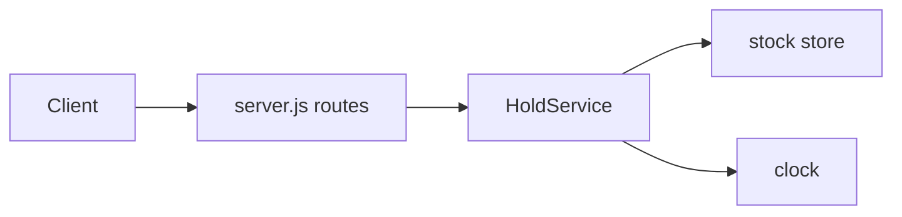
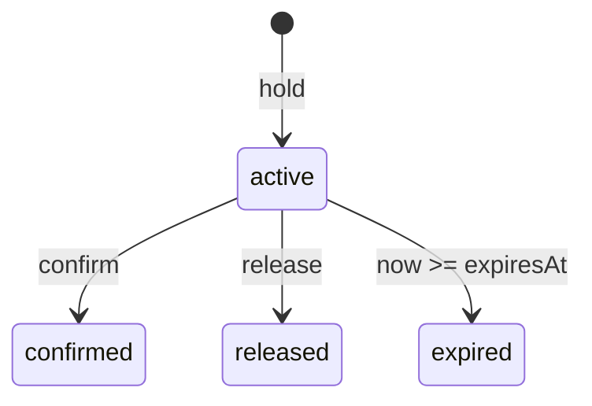
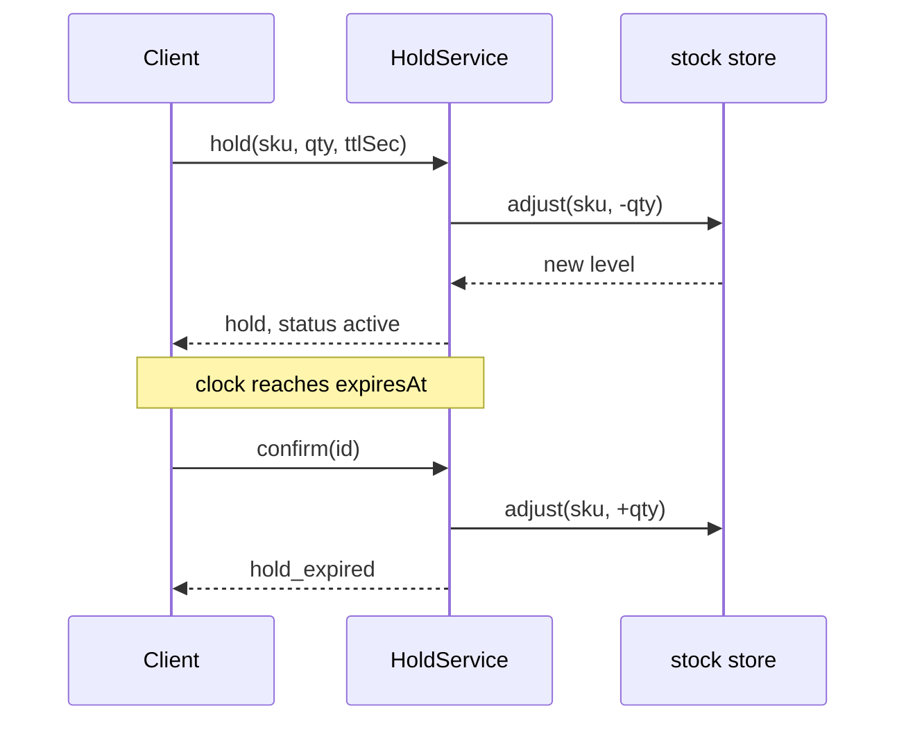

# Design: stock holds

## Problem statement

Checkout needs to set units aside while a customer pays. Today the only choice is to take stock out for
good, which strands units when a customer walks away. We need temporary holds that return their units
on their own, never oversell, and never hand units back twice.

Goals: hold, confirm and release units of one SKU; expire holds without a background job; stay correct
when calls overlap. Non-goals: persistence, holds across SKUs, authentication.

## Proposed architecture

A new `HoldService` sits between the HTTP routes and the stock store. The store stays the only owner of
unit counts. The service owns hold records and the rules for moving between states.

Units held are taken out of the stock store at once, so the store's own level is always "free" units.
That keeps `adjust`, which already rejects a negative result atomically, as the single guard against
overselling.

## Design details

State machine of a hold:

- **Create.** Validate the input, sweep expired holds of the SKU, call `stock.adjust(sku, -qty)`, then
  record the hold with `expiresAt = clock.now() + ttlSec * 1000`.
- **Expire.** There is no timer. Every path that creates a hold or reports a SKU first sweeps that SKU:
  an `active` hold with `now >= expiresAt` becomes `expired` and its units go back to the store.
- **Single return of units.** The status changes before the `await` on the store. Of two overlapping
  callers only the first sees `active`, so units are returned once.
- **Confirm.** An `active` hold becomes `confirmed` and never expires. Confirming twice is a no-op.
  An expired hold is swept first and then fails with `hold_expired`.
- **Release.** An `active` hold becomes `released` and its units return. A confirmed hold fails with
  `hold_confirmed`. Releasing an expired hold reports `expired`.
- **Errors.** `ServiceError` with the codes in the requirements, mapped to HTTP statuses by the router.

Sequence of a hold that is confirmed after the clock passes its expiry:

## Data model

Holds live in a `Map` keyed by `id` inside the service. Stock levels stay in the store.

| field | type | meaning |
|---|---|---|
| `id` | string | random UUID |
| `sku` | string | the stocked item |
| `qty` | integer | units set aside, at least 1 |
| `status` | string | `active`, `confirmed`, `released` or `expired` |
| `expiresAt` | integer | epoch milliseconds, creation time plus `ttlSec` seconds |

## API

| method and path | success | notes |
|---|---|---|
| `POST /holds` | 201 with the hold | body `sku`, `qty`, optional `ttlSec` (1 to 900, default 300) |
| `POST /holds/:id/confirm` | 200 with the hold | `hold_expired` 410, `hold_released` 409 |
| `DELETE /holds/:id` | 200 with the hold | `hold_confirmed` 409 |
| `GET /stock/:sku` | 200 `{ sku, available }` | expired holds count as available |

Errors use the existing `{ error: { code, message } }` shape. The service API is
`createHoldService({ stock, clock })` with `hold`, `confirm`, `release` and `available`.

## Alternatives considered

### Alternative A: background sweeper timer

A timer expires holds every few seconds. Rejected: it adds a lifecycle to start and stop, makes tests
depend on real time, and still leaves a window where an expired hold looks active.

### Alternative B: track held units beside the store

Keep a `held` counter per SKU and compute availability as level minus held. Rejected: availability then
has two sources of truth and every path must keep them in step.

### Alternative C: lock per SKU

Serialize all calls for a SKU with a mutex. Rejected: the store's `adjust` is already atomic, and
flipping the status before awaiting gives the same guarantee without a lock.

## Decision and consequences

Decision: take units out of the store on hold, expire lazily, and flip state before awaiting the store.

Consequences:

- A SKU that nobody looks at keeps its expired hold records and units until the next call. Reports stay
  correct because every reader sweeps first.
- Holds are lost on restart, along with the in-memory stock. Acceptable for this service.
- Sweeping scans all holds. Fine at this size; an index by SKU is the next step if it grows.
