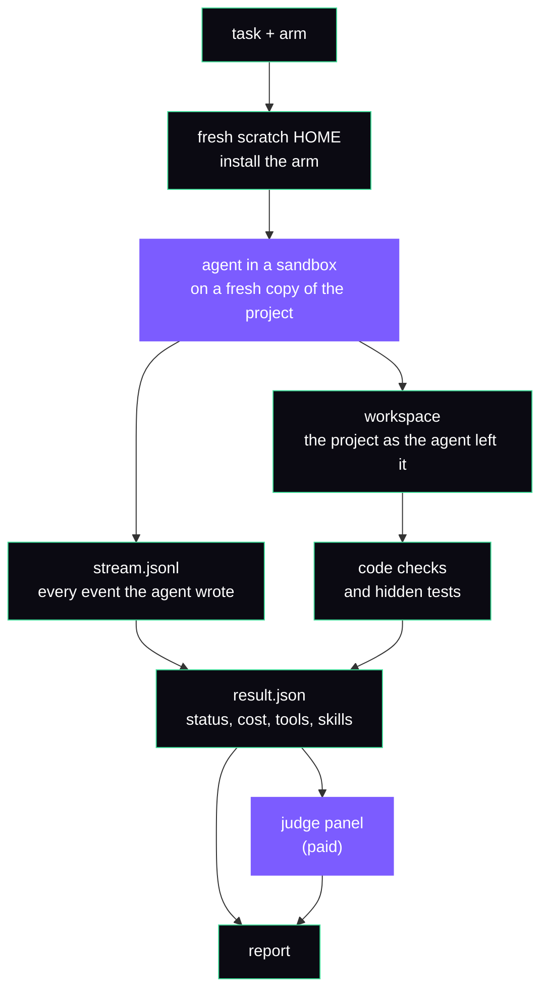

# Benchmark an agent

[← bench home](../README.md) · [skills](skills.md) · [physical AI](physical-ai.md) ·
[how Konductor is benchmarked](konductor-bench.md) · [repeat it yourself](repeat-it-yourself.md)

**Quick start:** [benchmark my agent](how-to/benchmark-an-agent.md) in seven steps. For an agent program bench does
not run yet, see [bring your own agent](#bring-your-own-agent) below and the
[AgentCore quick start](how-to/agentcore-agent.md).

You have an agent setup and a second one: an older and a newer release, the bare agent and the agent with
Konductor, Kiro CLI and Claude Code. You want to know which one does the work better, what it costs, and whether
the gap is real or luck. This page shows how bench runs that comparison, how to read the answer, how to write your
own task, and how to plug in an agent type bench does not run yet.

Read this page before the others. Skills, plant runs and the Konductor study all use the same run loop.

## How one run works



Purple boxes call a model and spend. The rest is local work.

1. **Install.** bench builds the arm from a git ref and installs it into a throwaway home. Your real home is not
   written.
2. **Run.** The agent works on a fresh copy of the task's project, in a sandbox (`unshare` on Linux,
   `sandbox-exec` on macOS). Credentials, SSH keys, answer keys and hidden tests are out of its sight.
3. **Record.** bench saves the agent's event stream and reads it for tool calls, skill loads, spend and the final
   answer.
4. **Check.** After the agent exits, the task's checks run on the project it left: file tests, commands and, for
   many tasks, hidden tests the agent never saw.
5. **Judge.** Three or more judge models score the parts code cannot check. They see the final answer and the changed
   files, never the check results or the arm's name. A judge never comes from the agent's own model family. With
   fewer than three eligible judges the score is NO DATA.
6. **Report.** bench combines checks and judges into a score per run, then compares arms with intervals.

## Arms and runtimes

An **arm** is one setup under test. bench prints every arm it knows:

<!-- gen:arms -->
```text
vanilla     kiro-cli, empty ~/.kiro, no --agent
v1.0.0      --agent konductor
v1.1.0      --agent konductor
v1.2.0      --agent konductor
main        --agent konductor  (local origin/main (no fetch), labelled main-unreleased@<sha>)
oc-vanilla  opencode on Bedrock, empty config, no agent
oc-v1.2.0   opencode, --agent konductor (claude harness content translated)
oc-main     opencode, --agent konductor (claude harness content translated)  (local origin/main (no fetch), labelled oc-main-unreleased@<sha>)
cc-vanilla  Claude Code on Bedrock, empty config dir, no agent
cc-main     Claude Code, --agent konductor (claude harness install)  (local origin/main (no fetch), labelled cc-main-unreleased@<sha>)

Arm syntax for --arms (comma separated):
  vanilla | v1.0.0 | v1.1.0 | v1.2.0 | main      built-in arms (main = local origin/main, no fetch)
  name=<git ref>      a branch, tag, remote-tracking ref (origin/feat/x), refs/pull/<n>/head or a commit SHA,
                      resolved in --repo-root without fetching; built from `git archive`, a dirty tree never leaks
  name=dir:<path>     a working-tree directory (a worktree or checkout), snapshot of tracked and untracked
                      files that are not ignored; label name@<hash12>, recorded as dirty
  name=vanilla        a vanilla A/A repeat (vanilla-b=vanilla): the vanilla condition under another id, for a noise floor
  plant-policy | plant-allowall    plant arms on a simulated plant (kiro-cli; never with oc-)
  cc-plant-policy | cc-plant-allowall    the same on Claude Code, with the plant shim as its only MCP server
  st-plant-policy | st-plant-allowall    the same on a Strands agent with forwarding plant tools (kind B);
                      st-plant-policy-hooked | st-plant-allowall-hooked keep an agent with tool hooks apart
  name: [a-z0-9][a-z0-9._-]{0,40}; vanilla, main, vX.Y.Z and the plant arm names are reserved. A bare ref (feat/x) is refused.
  A ref that is not local is never fetched; run `git fetch origin pull/<n>/head:pr-<n>` yourself, then pr-<n>=pr-<n>.
```
<!-- /gen:arms -->

The **runtime** is the agent program an arm runs on. The arm's prefix picks it, and one run uses one runtime.

<!-- gen:runtimes -->
| Runtime | Name | Arm prefix | Cost unit | Multi-turn tasks | `cap` commands | Per-skill study |
| --- | --- | --- | --- | --- | --- | --- |
| `kiro-cli` | Kiro CLI | (none) | credits | yes | yes | yes |
| `opencode` | opencode | `oc-` | USD | yes | yes | no |
| `claude-code` | Claude Code | `cc-` | USD | yes | no | no |
| `strands` | Strands Agents | `st-` | USD | no | no | no |
<!-- /gen:runtimes -->

So today you can test these agents:

| Agent | Arm | What it is |
| --- | --- | --- |
| Kiro CLI, bare | `vanilla` | the default Kiro CLI agent, nothing installed |
| Kiro CLI with Konductor | `main`, `v1.2.0`, `name=<git ref>`, `name=dir:<path>` | Konductor built from that ref |
| Claude Code, bare | `cc-vanilla` | the main Claude Code session, nothing installed |
| Claude Code with Konductor | `cc-main`, `cc-name=<git ref>` | Konductor's Claude Code install |
| opencode | `oc-vanilla`, `oc-main` | opencode on Amazon Bedrock |
| Claude Code on the plant | `cc-plant-policy`, `cc-plant-allowall` | Claude Code driving the simulated plant through the gateway (see [physical AI](physical-ai.md)) |
| Strands | `st-plant-policy`, `st-plant-allowall` | a Strands agent on the simulated plant only (see [physical AI](physical-ai.md)) |

The bare arms are agents that are not Konductor. Any other agent definition, such as your own system prompt and
tool list, needs a new runtime or a new kind of arm. The last section says how.

## A first comparison

Free first. None of these calls a model:

```bash
node bench/tasks/validate-tasks.js                  # do the shipped tasks hold together? (about 5 min)
node bench/runner/bench.js list-arms                # which arms exist
node bench/runner/bench.js pr-plan --ref opt-a=origin/main --suite lite --budget-credits 100
```

`pr-plan` prints the plan and the commands to run, and runs nothing. Real output, cut down:

```text
Plan: opt-a against v1.2.0 on the lite suite (5 task(s), 1 replicate). This prints the plan and runs nothing.

Kiro CLI arms: vanilla, v1.2.0, opt-a=origin/main
Estimate (credits per arm for one pass over the suite, observed on claude-sonnet-5.5, n=1, so a rough guide only):
  vanilla    6.78  (observed)
  v1.2.0     23.31  (observed)
  opt-a      31.01  (assumed like main)
  total for 1 replicate: 61.10 credits; cap 100 (1.5x, rounded up). Judge credits are not included.
```

Then the paid part. This compares the bare agent with Konductor on one task, three runs each:

```bash
OUT=/var/tmp/bench-first

# builds and installs both arms and starts no agent: check this first
node bench/runner/bench.js run --suite lite --arms vanilla,main --tasks simple-fix-failing-test --replicates 3 --budget-credits 40 --out $OUT --prepare-only

# spends credits: 2 arms x 3 runs, stops new runs at 90% of the budget
node bench/runner/bench.js run --suite lite --arms vanilla,main --tasks simple-fix-failing-test --replicates 3 --budget-credits 40 --out $OUT

# shows what judging will cost, then judges (spends)
node bench/runner/bench.js judge --run $OUT --plan
node bench/runner/bench.js judge --run $OUT

# free: writes report.md, report.html, report.json and charts/
node bench/runner/bench.js report --run $OUT
```

Runs use `claude-sonnet-5.5` at effort `high` unless you pass `--model` or `--effort`. One task is enough to try
the loop, not to decide anything. A platform verdict needs at least five paired tasks.

Two free commands explain one run without the whole report:

```bash
node bench/runner/bench.js explain --run $OUT --arm main --task simple-fix-failing-test --rep 1   # why this score
node bench/runner/bench.js trace --run $OUT --arm main --task simple-fix-failing-test --rep 1     # what the agent did, in order
```

## Read the report

`report.md` opens with a scorecard of how far to trust the study, then the scores per arm.

| Column | Meaning |
| --- | --- |
| Quality /100 [95% CI] | Per run, the weighted mean of hidden tests, checks and the judges' median rubric score. Default weights 0.5, 0.2 and 0.3; without hidden tests, checks 0.4 and rubric 0.6 |
| n | Runs that count. Infrastructure errors and model mismatches are left out and counted apart |
| Reliability /100 | 100 minus the share of runs that timed out, errored or hit an infrastructure problem |
| Cost ratio | Cost per clean pass, this arm over the baseline. Failures raise it |

Read a gap against the noise, not against zero:

- `report --verdict platform` gives each arm KEEP, DISCARD or NOT ENOUGH EVIDENCE. KEEP needs a quality gain larger
  than the A/A noise, a paired 95% interval above zero, no clear drop in reliability, and at most 2.0x the cost.
- The A/A noise band is never smaller than 5 quality points.
- Fewer than three runs on a side is labelled anecdotal.
- NOT ENOUGH EVIDENCE is a normal answer. It means this study cannot tell, not that nothing happened.

The Konductor study uses its own, stricter rule with fixed verdict words; see
[how Konductor is benchmarked](konductor-bench.md).

## Write a task

A task is one JSON file: a prompt, a starting project (the fixture), checks, a rubric and a time limit. This is a
trimmed copy of `tasks/simple-add-function.json`:

```json
{
  "id": "guide-title-case",
  "class": "simple",
  "target": null,
  "prompt": "Add a titleCase(text) function to textkit. It should upper-case the first letter of every word and lower-case the rest, and return an empty string for empty input. Export it from the package entry point and add tests for it. Do not ask me questions; if something is unclear, make a reasonable assumption, list your assumptions in your final message, and finish the work.",
  "fixture": "textkit",
  "timeoutSec": 300,
  "checks": [
    { "type": "contains", "path": "src/index.js", "pattern": "titleCase" },
    { "type": "cmd", "cmd": "node -e 'const t=require(\"./src\").titleCase;process.exit(t(\"hELLO wORLD\")===\"Hello World\"&&t(\"\")===\"\"?0:1)'", "expectExit": 0 }
  ],
  "rubric": [
    { "id": "exported", "criterion": "titleCase is implemented in src/ and exported from src/index.js.", "weight": 3 },
    { "id": "tests", "criterion": "Adds tests for titleCase covering mixed-case input and the empty string, and they pass.", "weight": 2 }
  ],
  "tiers": ["cap"]
}
```

Rules that trip people up:

- The prompt never names a skill, an agent or a method. Every arm gets the same prompt.
- At least one check must fail on the untouched project, so doing nothing cannot pass.
- A reference solution under `solutions/<id>/` must pass every check. The validator enforces it.
- Older tasks end with "Do not ask me questions", because runs are unattended. Tasks in the new scenario pack may
  allow questions and answer them with a scripted user.

Keep your own tasks in a folder laid out like `bench/rootcause/` and pass it with `--extra-tasks`:

```bash
node bench/tasks/validate-tasks.js --extra-tasks DIR --only-extra
node bench/runner/bench.js run --suite cap --extra-tasks DIR --tasks guide-title-case --arms vanilla,main --budget-credits 20 --out $OUT
```

The full format is in [the task reference](tasks.md).

## Plug in a new agent type

bench talks to each agent program through a **harness**: one small module that installs the arm, starts the agent,
and reads what it wrote. Four exist today: Kiro CLI, opencode, Claude Code and Strands. Each is a plugin: one folder
under `bench/plugins/` that the bench finds by itself. A fifth agent type is a plugin too: copy
`bench/kit/plugin-template/` to `bench/plugins/NAME/`, rewrite its harness for your agent, and run the free kit until
it passes. [Write a plugin](write-a-plugin.md) walks through it. Its descriptor says what the reports say about its
cost (`report`) and, if the `cap` commands should accept it, how they reach a capability (`capabilities`).

**Where it is registered.** The plugin registry, `bench/core/registry.js`, is the one list of the parts bench can run:
every `bench/plugins/<name>/plugin.json`, plus the two built-in judge backends. `node bench/runner/bench.js plugins`
lists them. A manifest looks like this:

```json
{ "benchApi": 1, "kind": "harness", "name": "strands", "version": "1.0.0", "meta": "meta.js", "entry": "harness.js" }
```

`benchApi` is the plugin interface version (1 today). `kind` is `harness` or `judge-backend`. `name` must equal the
folder name. `meta` is the descriptor file and `entry` the module, both inside the folder. A manifest with another
`benchApi`, an unknown kind or a missing file is refused with its reason and never loaded; two parts with one name
is an error. Each run's `run-config.json` records every loaded plugin with a hash of its folder. Check a harness plugin for
free with `node bench/kit/plugin/check.js bench/plugins/<name>`.

Two limits to know before you start. Arms are Konductor refs or the bare CLI today, so an agent that does not
install Konductor also needs a new arm source and a `prepareArm` that builds nothing. And a few places outside the
harness folder still switch on the runtime name; the guide lists them.

The full contract, with every member, argument and field, is
[runner/lib/harness/CONTRACT.md](../runner/lib/harness/CONTRACT.md). The next section says what works today for a
new agent on code tasks. For a new agent on the simulated plant, see
[add your own agent to the plant](physical-ai.md#add-your-own-agent-to-the-plant).

## Bring your own agent

You built an agent. It is not Kiro CLI, Claude Code or Konductor. bench can tell you two things about it with the
same rules it uses for every agent: is it safe when it drives a machine, and is it good at the work you give it.
Nothing here claims your agent works until it has been run.

| You want to know | Your agent can join today when | Start here |
| --- | --- | --- |
| Does it try unsafe moves on a machine? | It runs on Kiro CLI, Claude Code or Strands | [Add your own agent to the plant](physical-ai.md#add-your-own-agent-to-the-plant) |
| Does it do the task well, at what cost? | It runs on Kiro CLI, Claude Code or opencode | the steps below |
| What should I test it on? | It has a written tool list | [Quick start: generate scenarios](how-to/generate-scenarios.md), path B |

Any other agent program needs a plugin first ([write a plugin](write-a-plugin.md)). An agent deployed on Amazon
Bedrock AgentCore has no path yet; [its quick start](how-to/agentcore-agent.md) says what is missing.

### Work tasks for a new agent

Each task gives every agent the same prompt and the same small project. Code scores first: hidden tests and checks
the agent never sees. Judge models score only what code cannot check. The scenario pack lives in
`bench/scenarios/<batch>/`. Its tasks add two fields to the ones in [write a task](#write-a-task): `expertKey`, a
hidden list of points a good design review raises (a judge marks one covered only with a quote), and
`questions: scripted`, which lets the agent ask a scripted stakeholder. For a scripted task, bench adds one fixed
paragraph to every prompt: it tells the agent to ask by ending its turn with lines that start with `QUESTION:`, and
the answers come back as the next message. The text is the same for every agent and names no method
(`bench/runner/lib/ask-channel.js`).

To add your agent:

1. Write a harness plugin in `bench/plugins/NAME/` ([write a plugin](write-a-plugin.md)). The kit check
   (`node bench/kit/plugin/check.js bench/plugins/NAME`) and the contract test must pass.
2. Arms today are Konductor builds or the bare agent. An agent that does not install Konductor needs a new arm source
   and a `prepareArm` that builds nothing (contract, step 4).
3. A few places outside the plugin folder still switch on the runtime name (the contract lists them; DEBT rows
   D-201, D-205 and D-206 track their removal). Edit each one your agent needs.
4. For scripted tasks the harness must support more than one turn (`supports.multiTurn`). Strands does not today.

### What is still Kiro-CLI-shaped

- The scripted question channel was written because Kiro CLI's non-interactive mode tells the agent nobody can
  answer. It has run only against fake agents, on Kiro CLI and Claude Code.
- The `cap` commands run on Kiro CLI and opencode. The per-skill study runs on Kiro CLI only.
- The per-run credit limit stops a one-shot Kiro run on an estimate from its context usage, which runs high. The
  command-wide budget still stops new runs.
- The study levels use Kiro CLI, with Claude Code on part of the pack.

### Judges, sign-off and spend

- **Three judge families, never the agent's own.** `bench/judge/family.js` reads each model's family from its id. A
  judge from your agent's family is never seated. If your agent's family is unknown, or fewer than three judges are
  eligible, the run gets NO DATA, never a pass.
- **A person signs off.** A result stays "evidence" until a person signs it.
- **Paid runs are approved first.** Every paid run has an approved cap. `--budget-credits N` starts no new run past
  90% of `N`. One Kiro run can still spend past its own limit. [Safety and caps](safety-and-caps.md) has every cap.

### Draft test ideas with agenteval

`bench/agenteval/agenteval.js` takes test ideas from the Strands Evals generator, drops the broken ones, and writes
a list for a person to read. It never runs your agent and never scores anything. It makes no runnable bench tasks
yet (D-112), and in one small trial under half of the generated cases were usable as they came. Hidden tests for any
task made from these drafts must come from a writer that is not a Claude model; code does not check this yet. The
steps are in [the scenarios quick start](how-to/generate-scenarios.md#path-b-any-agent-from-its-tool-list), the full
guide in [agenteval/README.md](../agenteval/README.md).

### What is true today, and what is not yet

| Claim | Today | Tracked in |
| --- | --- | --- |
| Kiro CLI, Claude Code and Strands drive the conveyor through the gateway | yes; a Strands agent ran a real-model trial with no stream-to-gateway mismatch | |
| A counted plant result exists | no: every run so far is NOT COUNTED, because no quiet host has a Kiro CLI sign-in | D-95 |
| The stream-to-gateway match check works for Kiro CLI, Claude Code and Strands | yes, with tests | |
| Controls reach the plant report for every agent | yes | |
| A read-only agent can pass a probe | yes: holding the plant safe counts as handled | |
| The robot arm plant passes its policy test and all five controls | yes; the cross-host repeat check is still open | D-30 |
| Kiro CLI, Claude Code and opencode run scenario tasks | yes | |
| Strands runs scenario tasks | no: plant only, one turn | D-260 |
| An agent deployed on Amazon Bedrock AgentCore can be benchmarked | no: no harness, and bench's sandbox and plant gateway are local | D-259 |
| The scripted question channel works on a real model | not yet: fake agents only | D-56 |
| A per-run credit limit stops a one-shot Kiro run early | no: the command-wide budget stops new runs instead | D-67 |
| Judges never come from the agent's family | yes, enforced in code | |
| agenteval drafts reviewable cases | yes | |
| agenteval makes runnable tasks | no | D-112 |

**First steps for a new agent.** Run `node bench/runner/bench.js list-arms` and the free plant tests. Pick your
track. Write the plugin and pass the kit check with a recorded stream. For the plant, add a stream reader and a path
control, and show the match check passes on a fake run. Then write down your caps, get the owner's go-ahead, and run
one small trial on both arms.

## Add a judge

A judge is a model that scores answers. Adding one takes up to three steps.

1. **Give its model id a family.** bench seats a judge only when it knows the model's family, and never one from the
   agent's own family (`bench/judge/family.js`). `familyOf` first looks the id up in `MODEL_FAMILIES`, then tries the
   family name patterns in `FAMILIES`. If your id matches neither, add it to `MODEL_FAMILIES`. A new family also
   needs a pattern in `FAMILIES`. `judge-family-one-rule.test.js` and `gpt-cell.test.js` check the rule.
2. **Name it.** Pass it in `--judges A,B,C` (on `judge`, `cap keep-prune` and `cap unit-stage`), or in the suite file.
   A panel needs three judges from three families, none the agent's. With fewer, keep-or-prune records say NO DATA,
   and `judge` refuses to start unless you pass `--allow-small-panel`.
3. **Reach it.** The judge backend is the program that asks the model: `kiro` (credits, the default) or `opencode`
   (Amazon Bedrock, USD), chosen with `--judge-backend`. A model neither can call needs a `judge-backend` plugin: a
   descriptor `{ id, costUnit, label }` and an entry module that exports `makeCaller`.
   [Write a plugin](write-a-plugin.md#a-judge-backend) has a worked example, and `judge-backend-plugin.test.js` loads
   a fake one. The free kit check covers harness plugins only, not judge backends yet.

How the panel's scores become one number is in [scoring](scoring.md).

> [!IMPORTANT]
> **Common mistakes.** bench cannot run any agent you point it at: it runs the four runtimes above. Strands runs the
> plant only, not code tasks. `main` means your local `origin/main`; bench never fetches. A run on a host without
> the sandbox is recorded as not comparable, and no verdict counts it.

---

## Appendix A: what a run leaves behind

One run is a folder `<out>/<arm>/<task>/<replicate>/`:

```text
<out>/
  run-config.json  summary.json  env.json  credit-ledger.jsonl  isolation-gate.json   # one per results folder
  judgments.json   judge/ (cache/, raw/)                                              # after `judge`
  <arm>/<task>/1/
    result.json            status, checks, credits or USD, tool and skill counts, flags
    stream.jsonl           the agent's event stream, as it arrived
    stderr.txt             the agent's stderr
    command.txt            the command line that started the agent
    install.log            output of the arm install
    installed-agent.json   what the install put in front of the agent (Kiro CLI)
    session/               the agent's own session files (Kiro CLI)
    workspace/             the project as the agent left it
```

`result.json` follows `schema/result.schema.json`.

## Appendix B: reading results in depth

**Censored runs.** A run that timed out has unseen spend. The ledger charges it the median of the arm's finished
runs, or `--censored-floor` (default 1.0), never 0. `result.json` keeps the known floor as `creditsLowerBound` and
the charge as `creditsCharged`. Treat the cost of an arm with many censored runs as a lower bound. Observed credits
are what the stream metered; charged credits are what the ledger counts. They match for a finished run. Kiro engine
v3 meters only at the end of a turn, so a killed v3 run has no observed spend at all.

**Judge agreement.** The scorecard shows how far the judges agree (within-one agreement of 0.9 or more and exact
agreement of 0.6 or more pass) and the share of quotes they could not back with evidence. A quote that is not in
the output lowers the verdict one level. Human calibration is a separate step: `cap review` writes a page for a
person to rate a sample, and `cap review-import` scores the ratings. See [Calibration](reference.md#calibration).

**Runs kept out of judging.** Some runs are never sent to the judges. New studies treat them by reason:

| Reason | Class | In the main rubric number |
| --- | --- | --- |
| credsUnscrubbed, cause `link` | integrity | counted as a failure (0 on every rubric item) |
| credsUnscrubbed, cause `unreadable` | integrity | counted as a failure |
| credsUnscrubbed, cause `unwritable` | gap | left out, with its count and cause shown |
| credsUnscrubbed, cause `too-large` | gap | left out, with its count and cause shown |
| credsUnscrubbed, cause `error` (anything else, or unknown) | gap | left out, with its count and cause shown |
| stdioTampered | integrity | counted as a failure |
| usageDbTampered | integrity | counted as a failure |
| infraError | gap | left out |
| no workspace | gap | left out |
| budget_skipped | gap | left out, the run never executed |

`link` (a link stood where a plain file was listed) and `unreadable` (reading a listed file was refused) are signs
of tampering, so they count as failures. The other causes are not, so the run is a gap. A `credsUnscrubbed` run is
never sent to a judge, because its text may still hold a secret. The class of each cause is set in one place,
`SCRUB_CAUSE_CLASS` in `bench/judge/exclusion.js`.

Reports show both numbers side by side: `rubric (excluded runs = 0)` is the main number, `rubric (judged runs only)`
is the mean over judged runs, and `excluded runs (counted as 0)` is the count between them. A study follows this
rule when its `judgments.json` holds `"rubricPolicy": "excluded-as-failures"`. An older file without the stamp keeps
the older rule (excluded runs are gaps), and the report says `legacy: excluded runs are gaps`. `compare` refuses to
mix the two unless you pass `--force`.

**Output length.** A longer answer is not a better one, so new reports show how much each arm wrote: the mean
final-text length and the mean size of files created or changed. The scorecard warns when an arm differs from the
baseline by more than 1.5x. `contrast` and `compare` print the rank correlation between output size and rubric score
within each task, from 6 runs up. None of this changes a score.

**Looking while a study runs.** Point `report` at the finished cells with `--run DIR,DIR` and an `--out`.
`report --detail quick` gives one page. `contrast --run DIR --base vanilla` shows each arm against a base.

## Appendix C: running a long study safely

For studies that run for hours, read [the runbook](runbook.md). These are the points that cost people credits.

| Risk | What bench does | What you do |
| --- | --- | --- |
| The login expires mid-run | `run` checks `kiro-cli whoami` before building and between runs. A run that failed on a login error is charged 0 and marked infra. After `--max-auth-failures` such runs in a row (default 3) the rest are skipped and `run` exits 6 | Log in again right before a long chunk; after exit 6, log in and rerun |
| Every run failed, or every run ended in under a second | `run` exits 5 and writes `infraFailure` to `summary.json` | Read one run's `stderr.txt` before spending more |
| The agent CLI changes mid-study | A run whose agent could not start is charged 0, marked as a launch failure, and counts toward the same stop as login failures | Do not update or move the agent CLI while a study runs |
| A task hangs | Each task has a time limit | `--timeout-sec N` replaces it for every task |
| Spend runs away | `--budget-credits X` stops new runs at 90% of X; ending past 100% exits 3 | Always pass a budget |
| Something wrote to your real home | A tripwire scans after each run; a changed `~/.konductor/installs` exits 4 | Do not run `konductor install` or switch branches mid-study |
| The disk fills | Runs keep a full workspace each | `gc` lists what bench made (a dry run); `archive --run DIR` packs finished runs |

Exit codes of `run`: 0 ok, 1 error, 2 bad arguments, 3 credit guard stop, 4 isolation failure, 5 infra check,
6 login or launch failure stop.

The unattended scripts keep their state in a per-user folder. A chain started before that change is not found by
`monitor.sh`; set `STATE_DIR=/tmp/konductor-bench` to watch it.

## Appendix D: what the sandbox does not hide

The sandbox hides credentials, answer keys, hidden tests, reference solutions and the output folder. An agent can
still read the things below, and a read leaves no trace.

| The agent can read | Why it matters | What to do |
| --- | --- | --- |
| The Konductor checkout bench runs from | A bare agent that searches the disk can find Konductor's skills | Pass `--hide <checkout>` (or set `BENCH_HIDE_EXTRA`). It must not hold the output, scratch or cache folder, or a tool on `PATH` |
| `bench/tasks/*.json` (check patterns and rubric items) | An agent can read how it is graded | Covered by `--hide <checkout>` when bench runs from that checkout |
| The arm cache (default `/tmp/b-cache`) | It holds every arm's build; a bare agent can read the Konductor ones | No flag covers this yet; say so when you report a bare-against-Konductor result |

**Stream integrity on Linux.** A hostile agent can rewrite its own `stream.jsonl` through `/proc/<pid>/fd/1`.
Credit limits, tool counts and the judge's final text come from that file, so do not run an agent you do not trust
and rely on those numbers. The fix, a pipe the runner owns, is planned.

**Mounts under the home or `/tmp`.** The sandbox makes the home, `/tmp`, `/var/tmp` and `/dev/shm` read-only at the
top. A separate mount below one of them stays writable. `findmnt -R /tmp` and `findmnt -R "$HOME"` list them.
