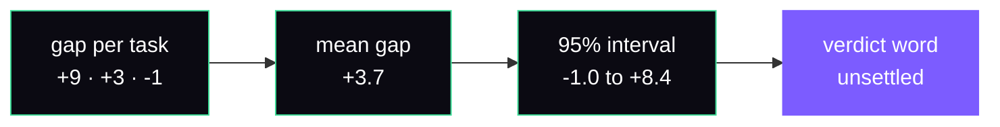

# How Konductor is benchmarked

[← bench home](../README.md) · [skills](skills.md) · [agents](agents.md) · [physical AI](physical-ai.md) ·
[repeat it yourself](repeat-it-yourself.md)

The question sounds simple: is the agent better with Konductor than without it? A study like that is easy to tilt
without meaning to. Four traps do most of the damage:

1. **Scores that reward the wrong thing.** A check that looks for a keyword gives points for the word, not the work.
2. **Tasks that need no help.** If no Konductor skill fits the task, the study measures nothing about skills.
3. **Prompts that teach the method.** A prompt that names the method hands the bare agent Konductor's answer.
4. **Too few runs.** Agents vary run to run. A gap from two runs per side is mostly luck.

The scenario program is built so each trap has a guard. This page walks through it: the task pack, the three arms,
the run levels, the scoring, and the rule that turns numbers into one verdict word.

```mermaid
flowchart LR
    B["📝 blind briefs<br/>public sources only"] --> AU["✍️ authors<br/>two model families,<br/>never see Konductor"]
    AU --> RV["🔎 cross-family review<br/>+ leak lint + dry run"]
    RV --> LK["🔒 lock<br/>hash in PREREG.json"]
    LK --> RUN["⚙️ runs<br/>vanilla · konductor ·<br/>konductor-noskills"]
    RUN --> SC["✅ code first,<br/>judges ≤ 30%"]
    SC --> V["⚖️ one verdict word<br/>HELD-OUT tasks only"]
    V --> P(["🖊️ a person signs off"])
    classDef a fill:#7C5CFF,color:#ffffff,stroke:#7C5CFF
    classDef b fill:#0B0A12,color:#ffffff,stroke:#3DDC97
    class AU,RUN a
    class B,RV,LK,SC,V b
```



## The task pack

Tasks look like real work. Each one has a small real repository or document set, and a request in a user's words.
Every task has one main **phase** of the software lifecycle (14 of them, from ideation to release and incident) and
one main **role** (9: product manager, program manager, architect, developer, frontend developer, QA, security
engineer, SRE, reviewer). The pack is written in batches by role:

| Batch | Work it covers |
| --- | --- |
| T1 | developer core: feature, bug with a failing test, refactor, migration, upgrade, performance |
| T2 | review: code, pull request, security and design review with planted findings |
| T3 | architecture and decisions: API and data design, decision records, trade-offs, cost |
| T4 | security, IAM and infrastructure code |
| T5 | QA: test strategy, weak tests scored by mutants killed, flaky tests |
| T6 | product: requirements with a scripted user, stories, framing |
| T7 | program management: status from a ticket export, plans, risk, estimates |
| T8 | SRE: incidents from logs, postmortems, rollout plans, runbooks |
| T9 | frontend |
| T10 | long work across phases on larger repositories |
| T11 | Konductor's own plumbing: memory across sessions, resuming a procedure, merge conflicts |

The tasks live in `bench/scenarios/t1/` and the folders beside it. Two kinds of control task sit among them. A
**near-miss twin** uses the same project as a real task with a different ask, where the target skill should not
load. A **negative control** is a small, clear job where no skill helps; it measures wasted loads, cost and time.

To see how well the pack covers each phase, role, skill, SOP and agent, build the coverage matrix (free):

```bash
node bench/runner/bench.js scenarios coverage bench/scenarios --base main --out /tmp/coverage
```

Real output on 2026-11-19, while batches were still being written:

```text
wrote /tmp/coverage/coverage.json and coverage.md: 109 units, 16 covered, 0 selection-only, 93 hole(s); 13 phase or role minimum(s) missed
```

A unit counts as covered with three targeted tasks, two of them held out, plus one twin or control.

### How a task is written

No step may tilt a task toward Konductor.

1. **Brief.** A short brief per cell of the phase and role grid, inspired by a public source whose licence is checked
   and recorded in the task. No internal data, ever.
2. **Author, blind.** An author model from one of two families writes the prompt, project, hidden tests and a
   reference answer. Authors never see Konductor's skills.
3. **Map, after.** A third family reads the finished task and only the skill descriptions, and tags which units
   would help. Tasks are never edited to fit a skill.
4. **Review.** A reviewer from a different family checks for leaks, ambiguity, a hidden answer, and tasks too easy
   or impossible.
5. **Leak lint.** Code refuses a prompt that names a skill, SOP, agent or method term:
   `node bench/runner/bench.js scenarios lint bench/scenarios --base main`.
6. **Dry run.** The reference answer must score 95 or more, an empty answer 20 or less, a lazy but plausible
   answer 40 or less, and a different correct answer 80 or more.
7. **Pilot, then lock.** A small paid pilot checks that the task runs and tells arms apart. Then its hash goes into
   the pre-registration file, and it is read only.

## Three arms

All arms use the same model, the same effort, the same limits and a fresh home.

| Arm | What it is | What comparing it shows |
| --- | --- | --- |
| `vanilla` | the bare agent, nothing installed | the baseline |
| `konductor` | Konductor at one frozen commit | the whole package against the baseline |
| `konductor-noskills` | Konductor with every skill removed, prompts unchanged | against `konductor`: what the skills add; against `vanilla`: what the agents and rules add |

`konductor-noskills` is built with `cap variant --preset noskills`. In FULL, each skill, SOP and agent also gets a
drop-one arm, and units that load in under half the runs also get a forced-load arm, so the report shows the
effect as shipped and the effect once loaded.

Every Konductor run also records which units loaded, when, and whether the target loaded before the first edit. A
run where the target skill never loaded does not count toward that skill's effect.

## Three run levels

The same pack, scorer and report, at three sizes:

| | LITE | STANDARD | FULL |
| --- | --- | --- | --- |
| Use it for | a quick check after any change | a broader look; the only level where tuning is allowed | the pre-registered verdict |
| Tasks | about 16: one per phase, plus a twin and a control | every DEV task, about 50 | the whole pack; the verdict from HELD-OUT tasks only |
| Arms | `konductor` against a stored `vanilla` baseline | all three | all three, plus drop-one and forced-load arms |
| Runtime | Kiro CLI | Kiro CLI, plus Claude Code on 15 tasks | Kiro CLI and Claude Code |
| Runs | 1 per task | 2 per arm per task | 3 per arm per task; 5 per side on each unit's effect tasks |
| May say | "no regression seen", "this skill failed to load", "this task is broken" | a direction, labelled "DEV, not a verdict" | one verdict word, and keep-or-prune evidence per unit |

Pick a level with `run --level lite|standard|full`. FULL needs `--prereg FILE`. Only FULL may give a verdict.

**DEV and HELD-OUT.** Every task is split by a fixed hash of its id, decided before any run: one in three is DEV,
the rest HELD-OUT. Tuning happens on DEV only. The verdict comes from HELD-OUT only, so nothing was tuned on the
tasks that judge it.

## Scoring: code first

| Part | How it is scored |
| --- | --- |
| Hidden tests | the share that pass; a test that hangs fails alone, not its whole suite |
| Checks | the weighted share of checks on substance; format checks are shown but do not score |
| Findings key | for reviews and plans: planted items found, at the right severity, with a precision term so a long list does not win |
| Judges | only what code cannot check. Three model families, none the agent's own, take the median. Fewer than three: NO DATA |
| Answer key | design and decision tasks give the judges a hidden list of points a good answer must cover, and weak answers to watch for. A judge marks a point covered only with a quote from the output |

Each task is written so code-checkable parts carry at least 70% of its score and the judges at most 30%. No check
rewards length, headings or a fixed format. Before any verdict, a person rates about 40 real outputs blind, and the
judges must agree with that person.

## From numbers to one word

Here is the idea, with made-up numbers. Three HELD-OUT tasks, each run three times on two arms:

| Task | `vanilla` mean | `konductor` mean | Gap |
| --- | ---: | ---: | ---: |
| fix a flaky test | 61 | 70 | +9 |
| review a pull request | 55 | 58 | +3 |
| write a runbook | 72 | 71 | -1 |

The study takes the gap per task, then the mean of those gaps (+3.7 here). It resamples tasks, then runs, 10,000
times to get a 95% interval for that mean. Say it comes out at -1.0 to +8.4. Then one fixed rule names it:



It is **unsettled**: the interval reaches below 0 and above the 5-point margin, so it fits no other word. More
tasks narrow the interval. The words and their rules come from the code:

<!-- gen:verdict-words -->
Margin: 5 points. The first word that fits, in this order, wins.

| Word | Rule on the 95% interval [L, U] |
| --- | --- |
| **beats by the margin** | lower bound L over +5 |
| **beats** | L over 0 |
| **loses by the margin** | upper bound U under -5 |
| **loses** | U under 0 |
| **ties** | L over -5 and U under +5 |
| **unsettled** | none of the above |

Examples, computed by the same code:

| Interval (points) | Word |
| --- | --- |
| 6 to 9 | beats by the margin |
| 1 to 3 | beats |
| -2 to 4 | ties |
| -3 to -1 | loses |
| -8 to -6 | loses by the margin |
| -7 to 2 | unsettled |
<!-- /gen:verdict-words -->

The same comparison runs for `konductor` against `konductor-noskills` and for `konductor-noskills` against
`vanilla`, and per phase and per role. Cost and time ratios sit beside every quality number.

## What keeps it honest

- **Locked in advance.** `scenarios prereg freeze` writes `PREREG.json`: every task's hash, the DEV and HELD-OUT
  lists, the margin, the verdict words, and the stop rules. A run that does not match the lock is refused.
- **Paid runs are approved first.** Every paid run has an approved credit cap. A batch that spends more than twice
  its estimate stops, and so does a harness fault rate over 5%.
- **One model.** Every claim names the model it was measured on, and holds only for it.
- **A person signs off.** A unit's row in the report says "evidence: keep" or "evidence: prune candidate" until a
  person signs it. Then it says keep or prune.

## What exists today

| Piece | State |
| --- | --- |
| Task batches T1 to T8 | in `bench/scenarios/`; more being written |
| Batches T9 to T11 | not written yet |
| Leak lint, coverage matrix, run levels, pre-registration lock, bootstrap and verdict words | built (`bench/scenarios/`) |
| `konductor-noskills` arm and the per-run load check | built |
| A frozen `PREREG.json` | not yet |
| A FULL run, and any verdict | not yet; no verdict has been published |

> [!IMPORTANT]
> **Common mistakes.** Calling a LITE or STANDARD result a verdict: only FULL may. Taking the older `--suite lite`
> for the LITE level: they are different. Reading the made-up example above as a result. Comparing numbers from two
> different models or pack versions.

## Where to go next

- Run it: [repeat it yourself](repeat-it-yourself.md)
- The earlier 2x2 study and its kit, step by step: [docs/REPEAT.md](REPEAT.md) and [docs/PILOT-2X2.md](PILOT-2X2.md)
- How a single skill's keep-or-prune call is made: [benchmark a skill](skills.md)
