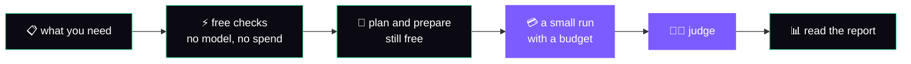

# Repeat it yourself

[← bench home](../README.md) · [skills](skills.md) · [agents](agents.md) · [physical AI](physical-ai.md) ·
[how Konductor is benchmarked](konductor-bench.md) · [your own agent](benchmark-your-own-agent.md)

A benchmark result you cannot repeat is a claim, not evidence. This page takes you from a fresh clone to a result
you can read: what you need, the free checks, a small paid run, and how to read what comes out. Every command runs
from the repository root.



## 1. What you need

| Item | Detail |
| --- | --- |
| Host | Linux with user namespaces (`unshare -Urm true` works), or macOS. About 8 GB free memory for a run |
| Tools | Node 22 or later, `git`, `tar`, `cargo` (to build Konductor arms), Python 3 for task tests |
| Agent | `kiro-cli` on `PATH` and logged in (`kiro-cli whoami`). For Claude Code or opencode arms, their binaries too. Another agent: see [benchmark your own agent](benchmark-your-own-agent.md) |
| Judges | An AWS profile with Amazon Bedrock access. Use a least-privilege profile, never an admin one |
| A budget | Decide what you may spend before you start. bench stops new runs at 90% of `--budget-credits` |

## 2. Free checks

None of these calls a model or spends anything.

```bash
git fetch origin main

node bench/runner/bench.js cap keep-prune --skill plan-review --run stub-pilot --out /tmp/kp   # what an answer looks like
node bench/tasks/validate-tasks.js                                                            # the shipped tasks hold together
node bench/runner/bench.js scenarios lint bench/scenarios --base main                         # no task prompt leaks the method
node bench/runner/bench.js scenarios coverage bench/scenarios --base main --out /tmp/coverage  # what the pack covers
node --test "bench/runner/test/*.test.js" "bench/skilleval/test/*.test.js"                     # the bench's own tests
```

The full test run takes a few minutes. Set `TMPDIR` to a folder outside your home first, because the Claude Code
tests refuse a temp folder under it.

## 3. Plan and prepare, still free

```bash
node bench/runner/bench.js pr-plan --ref opt-a=origin/main --suite lite --budget-credits 100
```

`pr-plan` prints the arms, a credit estimate per arm, and the exact `run`, `judge` and `report` commands to copy.
Add `--prepare-only` to that `run` command first: it builds and installs every arm and starts no agent, so a broken
arm fails before you spend anything.

## 4. A small run

The five-task `lite` suite, one run per task, on three arms. It cost about 61 credits on one earlier pass; your
cost will differ.

```bash
OUT=/var/tmp/bench-repeat
node bench/runner/bench.js run --suite lite --arms vanilla,v1.2.0,main --replicates 1 --budget-credits 100 --out $OUT
node bench/runner/bench.js judge --run $OUT --plan        # free: what judging will cost
node bench/runner/bench.js judge --run $OUT               # paid
node bench/runner/bench.js report --run $OUT              # free
```

One run per task shows that everything works. It does not support a decision: for that you need at least three runs
per task and an A/A pair (see [agents.md](agents.md#read-the-report)).

> [!NOTE]
> This `lite` suite is not the LITE run level of the Konductor study. A LITE run of the scenario pack is not one
> command yet: the task selection exists (`run --level lite`), but no suite file lists the pack and no stored
> vanilla baseline exists. Both are tracked in [DEBT.md](../DEBT.md) (D-77, D-78).

## 5. Read the results

| File | What it holds |
| --- | --- |
| `$OUT/report.md` | the scorecard, then quality, reliability and cost per arm, with intervals |
| `$OUT/report.html`, `charts/` | the same, with charts |
| `$OUT/report.json` | every number, for your own analysis |
| `$OUT/<arm>/<task>/1/result.json` | one run: status, checks, spend, tools and skills |

Read it in this order:

1. **The scorecard first.** It says how far to trust the study: judge agreement, runs left out and why, warnings.
2. **Then the gaps, against the noise.** A gap inside the A/A band is noise, whatever its sign.
3. **Then one run, when something looks odd.** `explain` shows why a run got its score. `trace` shows what the agent
   did, in order. Both are free:

```bash
node bench/runner/bench.js explain --run $OUT --arm main --task simple-fix-failing-test --rep 1
node bench/runner/bench.js trace --run $OUT --arm main --task simple-fix-failing-test --rep 1
```

## 6. Repeat a full study

The earlier 2x2 study (Kiro CLI and Claude Code, each with and without Konductor) has its own kit with pinned
binaries, a freeze step, gates between stages and per-stage caps. Follow [docs/repeat.md](repeat.md) step by step.
Unattended runs are covered in [the runbook](runbook.md).

## Before you share a number

- Name the model, the bench commit, the Konductor commit and the run level.
- Give every number with its run count and interval.
- Say what was left out, and why.
- Keep `run-config.json` and `report.json`. `bench.js archive --run $OUT --apply` shrinks a run and keeps it
  re-scorable.
