# Benchmark a skill

[← bench home](../README.md) · [agents](agents.md) · [physical AI](physical-ai.md) ·
[how Konductor is benchmarked](konductor-bench.md) · [repeat it yourself](repeat-it-yourself.md)

A skill costs something every session: its name and description sit in the agent's context, and its body costs
tokens each time it loads. It earns that cost only if two things are true. The agent must load it when it would
help, and skip it when it would not. And once loaded, it must make the work better.

bench measures the two apart, because they fail apart. A good skill with a vague description never loads. A skill
that loads every time may change nothing.

```mermaid
flowchart LR
    A["🔍 audit<br/>free"] --> S["🎯 selection<br/>does it load at<br/>the right time?"]
    A --> E["📈 effect<br/>does it help<br/>once loaded?"]
    S --> D["⚖️ call<br/>keep · prune · trim<br/>or NO DATA"]
    E --> D
    D --> P(["🖊️ a person signs off"])
    classDef a fill:#7C5CFF,color:#ffffff,stroke:#7C5CFF
    classDef b fill:#0B0A12,color:#ffffff,stroke:#3DDC97
    class S,E a
    class A,D b
```



A keep or prune call on the whole skill needs both sides. An "effect after load" alone, where the skill was made
to load, never stands as a whole-skill verdict. Nothing is deleted for you: every call is a suggestion until a
person who did not write the skill signs it off.

## Step 1: check it for free

```bash
# lint: size, the nearest similar skill, whether any agent can load it
node bench/runner/bench.js cap audit --base main --out /tmp/audit

# the same, on your working tree with your edits
node bench/runner/bench.js cap audit --base dir:. --out /tmp/audit-mine

# from runs you already have: which skills were offered and never loaded
node bench/runner/bench.js cap prune-report --base main --runs RUNS --out /tmp/prune
```

`cap audit` writes `cap-audit.md` and exits 1 on an error finding, which is a finding, not a crash.
`cap prune-report` gives each skill a class (HARMS, RELOCATE, PRUNE, FIX, KEEP, NEEDS DATA) and a TRIM flag for a
skill that is very large or very close to a neighbour. FIX means offered but never loaded: look at the description.

## Step 2: does it load at the right time?

Write two kinds of requests: ones where the skill should load, and near misses that share its words but should not.
bench drafts them for a person to edit:

```bash
node bench/runner/bench.js cap scenarios --cap skill:code-review --mode trigger --dry-run --out /tmp/ops
```

With `--dry-run` it only writes the prompt it would send, and says so (real output):

```text
skill:code-review: wrote the prompt to /tmp/ops/scenarios/skill-code-review.trigger.prompt.txt
dry run: no model call was made and no credits were spent; 1 call(s) would be made for 10 should-trigger and 10 near-miss tasks per skill. Prompts are in /tmp/ops/scenarios
```

Without `--dry-run` it makes one model call (under 1 credit) and writes a draft marked unreviewed. Edit it, then
test it:

| How | Command | Cost |
| --- | --- | --- |
| Ask a model which skill it would pick | `cap trigger --cap skill:NAME --mode proxy --queries FILE --base main` | about 0.09 credits per query |
| Run a real agent per query | `cap trigger --cap skill:NAME --mode live --queries FILE --base main --budget-credits N` | a real run per query |
| Read loads from runs you already have | `cap trigger --cap skill:NAME --mode runs --from-runs DIR` | free |

You get recall first (did it load when it should), then precision (did it stay out when it should), each with a
95% interval, and what loaded instead. A proxy miss tells you something; a proxy hit is not proof.

## Step 3: does it help once loaded?

This is a controlled study: the same tasks with the skill, without it, and with the skill again under a second name
(the A/A pair that shows the noise). Known-answer control skills run first and must pass.

```bash
node bench/runner/bench.js cap skill-plan --base main --only code-review --out /tmp/plan    # free: tasks, waves, estimate
```

Then `cap skill-study --study DIR --init` with the same flags, `--dry-run`, and the waves. The study runs agents
on Kiro CLI and judges on Amazon Bedrock, so it needs a Kiro login and AWS credentials. It costs hundreds of
credits per skill; plan first and set a budget. Every step, with its flags, is in
[Evaluate one skill](reference.md#evaluate-one-skill-step-by-step).

| Wave | Arms | Question |
| --- | --- | --- |
| 1 | skill present, the same again (A/A), skill deleted | Is it needed? The A/A pair sets the noise |
| 1f | skill forced to load, the same again, skill deleted | Does it help once loaded? Never changes a call |
| 2 | one section removed per arm (only after a loss in wave 1) | Which sections can go? |
| 3 | the same sections moved into `references/` | Which can move instead? |

## Step 4: read the call

`cap decide --study DIR` gives one call per skill:

| Call | Meaning |
| --- | --- |
| DELETE | Removing it lost no more than the 0.10 margin, or improved quality beyond the A/A spread |
| PRUNE | It is needed, but some sections can go or move. Line ranges and a patch come with it |
| KEEP | Removing it lost quality, and no section could be cut |
| NEEDS DATA | The study cannot tell, and says why |

A DELETE or PRUNE needs passed controls, an A/A arm, at least 15 runs per side, a skill that loaded in at least 30%
of control runs, and medium or high confidence. Anything weaker is NEEDS DATA: "this study cannot say", not "no
effect". `cap criteria --study DIR` then flags rubric items that do not tell the arms apart.

## Keep or prune under one rule set

`cap keep-prune` writes one record per skill with two depths side by side: a quick check (one request and one
answer, with and without) and a deep check (full sessions). When the two disagree, both stay in the record and a
person decides; they are never averaged. Each block uses three judges from three model families, none the agent's
own, and takes the median. Today it runs on the built-in stub provider only, so its numbers show the format, never a
measurement. The README shows [a real stub record](../README.md#-try-it-free-in-5-minutes).

```bash
node bench/runner/bench.js cap keep-prune --skill plan-review --run stub-pilot --out /tmp/kp
```

A record turns stale, and says NO DATA, when the skill's files change after its baseline was frozen. Frozen
baselines live in `bench/cap/baselines/`, hashed in its `MANIFEST.json`.

> [!IMPORTANT]
> **Common mistakes.** Stub numbers are not results. A forced-load gain is not a reason to keep a whole skill.
> Per-skill studies run on Kiro CLI only, not Claude Code. `cap select` needs a frozen `selection.json` for the
> skill, and no skill has one yet; pass `--requests FILE` to score a draft. bench tests the skills in this
> repository; a skill from elsewhere is not supported yet.

## Where to go next

- The reasoning behind each step, with worked cases: [cap playbook](CAP-PLAYBOOK.md)
- How skills are judged inside the full Konductor study: [how Konductor is benchmarked](konductor-bench.md)
