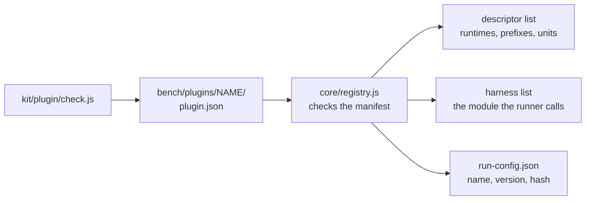

# Write a plugin

[← bench home](../README.md) · [agents](agents.md) · [your own agent](agents.md#bring-your-own-agent) ·
[harness contract](../runner/lib/harness/CONTRACT.md)

**Quick start:** [a Strands agent](how-to/strands-agent.md) · [an agent on Amazon Bedrock AgentCore](how-to/agentcore-agent.md)
(path 2 there is a new plugin, in five steps).

Date: 2026-11-25. Covers plugin API 1, which has four kinds: `harness`, `judge-backend`, `check-type` and `plant` (see "A judge
backend", "A check type" and "A plant" below; a plant's fields are in `docs/reference.md`).

## The problem

bench runs four agent programs: Kiro CLI, opencode, Claude Code and Strands. Before plugins, a fifth one meant edits in
the middle of the bench: a registry list, a descriptor list and the result schema. A missed edit broke runs in ways a
test did not always catch.

## How a plugin solves it

A plugin is one folder under `bench/plugins/`. The bench finds it when it starts. Nothing in the core changes.



The registry reads the built-ins first, then each plugin folder in name order. It refuses a plugin, with the reason,
when its `benchApi` is not 1, its `kind` is unknown, a file it names is missing, or its name is not its folder name.
A refused plugin is never half loaded, and the bench prints a warning naming it. Two parts with one name stop the
bench. Every run writes each loaded plugin to `run-config.json` as `{name, kind, version, benchApi, sha256}`, where
`sha256` covers every file in the folder. So a result always points at the exact plugin code that made it.

Some parts never become plugins: the judge family rule, the spend guard, the sandbox and env allowlist, the secret
scrub, and the release signatures. A plugin builds the agent's command; the core still runs it in the sandbox and
applies the env allowlist after the plugin's `env()`.

## Worked example: the Strands plugin

Strands was the first harness moved out of the core. Its folder is a complete, working example:

```text
bench/plugins/strands/
  plugin.json                 the manifest
  meta.js                     the descriptor: frozen, no requires
  harness.js                  the harness module the runner calls
  parse.js                    reads the agent's stream
  test/conformance.js         what the kit needs to check it
  test/fixtures/single-turn.jsonl   one recorded run: one tool call, one answer
```

`plugin.json` names the files:

```json
{
  "benchApi": 1,
  "kind": "harness",
  "name": "strands",
  "version": "1.0.0",
  "meta": "meta.js",
  "entry": "harness.js"
}
```

`bench/schema/plugin.schema.json` gives the shape of every field, for all four kinds. The registry checks the rest
when it loads the folder: `name` equals the folder name, `meta` and `entry` exist inside the folder, and the `meta`
id equals `name`.

`meta.js` is the descriptor. It says the arm prefix (`st-`), the cost unit (`usd`), the stream format, which run
flags apply, what the reports say about its cost (`report`) and how `cap` reaches a capability (`capabilities`). The full field list is under "Descriptor" in
[CONTRACT.md](../runner/lib/harness/CONTRACT.md). The file has no `require`, because the runner reads it before any
harness module loads.

`harness.js` exports `id`, `meta` (the same object as `meta.js`) and the members the runner calls: `prepareArm`,
`trialInstall`, `installInto`, `buildCommand`, `env`, `removeCredentials`, `keepPaths`, `turnSummary`, `parseResult`
and `collectArtifacts`. CONTRACT.md says what each one gets and returns. Strands keeps its stream reader in `parse.js`.

One folder can hold more than one part under its name, each of another kind. List the others in `"parts"`, each
with its own `meta` and `entry`; each `meta` file's `id` is the plugin name. For example a runtime's harness and its
judge backend:

```json
{
  "benchApi": 1, "kind": "harness", "name": "NAME", "version": "1.0.0", "meta": "meta.js", "entry": "harness.js",
  "parts": [{ "kind": "judge-backend", "meta": "judge-meta.js", "entry": "judge.js" }]
}
```

A `parts` entry with the main kind, a kind listed twice or a missing file refuses the whole folder. The plugin is
still one plugin: `bench plugins` lists a row per part, and `run-config.json` records the folder once.

A plugin's code may require only `node:*` modules, files in its own folder and the bench SDK, `bench/sdk`. The SDK
gives the bench helpers a harness needs, one part per helper module, and each part lists the helpers by name:
`const { parseStream } = require('../../sdk').stream;`. Read `bench/sdk/index.js` for the parts and their names.
`runner/test/plugin-sdk-lint.test.js` fails when a plugin requires `runner/lib` or another plugin directly, and when a
plugin reads a helper its part does not list. A helper the SDK does not have yet is added by name to its part in
`bench/sdk/index.js`, not required around it. Files under the plugin's `test/` folder are checked for the second rule
only (the reads), not for the first (the requires).

`test/conformance.js` tells the kit how to read the recorded run with no model call:

```js
module.exports = {
  fixture: 'fixtures/single-turn.jsonl',   // the recorded stream, under test/
  freeModel: true,                         // the run cost nothing (a fake model)
  config: { model: 'fake:/fixture/script.json', effort: 'default' },
  setup: () => ({ strands: { python: 'python3', prefix: '/venv', basePrefix: '/python', version: '1.65.0', agentFile: null } }),
};
```

`setup` returns the `ctx` that `parseResult` reads besides the stream.

## Check a plugin

The kit checks a plugin folder for free:

```bash
node bench/kit/plugin/check.js bench/plugins/strands
```

It runs four checks and prints one line for each. It exits 1 if any check fails.

| Check | What it proves |
| --- | --- |
| `contract` | The manifest loads the way the bench loads it. The descriptor and every member match the contract tables. `turnSummary` and `parseResult` fill what they must from the recorded stream |
| `fake-run` | The harness's own command runs with a stand-in agent (`kit/plugin/replay-agent.js`) that prints the recorded stream. The prompt reaches the agent, no host variable leaks through `env()`, and the `result.json` built from the run is valid |
| `plant-kind` | A plugin with plant arms names a mount and pin the runner knows, and the plant reader finds the stream's plant calls. A plugin with `plant: null` passes |
| `golden` | What `parseResult` reads from the recorded stream equals `test/golden.json`. After a parser change you mean to keep, write a new golden with `--record` |

When `contract` fails, the other three are skipped. `runner/test/kit-plugin.test.js` runs all four over Strands and
the template, so a plugin that breaks fails the suite.

## Start a new plugin

1. Make the agent one local command that prints one JSON event per line. Strands does this with
   `bench/physical/strands/launch.py`.
2. Copy `bench/kit/plugin-template/` to `bench/plugins/NAME/`. It is the smallest plugin that passes all four checks.
   Set `name` in `plugin.json` and `id` in `meta.js` to `NAME`, and pick a new arm prefix and stream format.
3. Rewrite `harness.js` for your agent's command and stream. `agent.js` is only a stand-in; delete it.
4. Record one real single-turn run as `test/fixtures/single-turn.jsonl`, and set `test/conformance.js`.
5. Write the golden with `node bench/kit/plugin/check.js --record bench/plugins/NAME`, and read it once.
6. Run the kit until it prints `PASS`, then `node bench/runner/bench.js plugins` to see your plugin (a new
   plugin's arms do not show in `list-arms` yet).

## A judge backend

A `judge-backend` plugin adds a program that asks the judge models. Its `plugin.json` has `"kind": "judge-backend"`;
its `meta` file exports `{ id, costUnit, label, maxPromptBytes?, offers? }`, where `costUnit` is `credits` or `usd` and decides
which budget flag the judge takes (`--budget-credits` or `--budget-usd`), `maxPromptBytes` is the largest prompt it
takes (default 120000), and `offers` lists what judge views may need from it (`readTools` for the read view; see
[reference.md](reference.md#judge-views)). A backend that offers `readTools` gets `readCopy` ({ files, sha }) on a read-view
call and must return the judge's tool calls as `readTrace`, and its caller says what it has at run time with `offers()`
(for example `isolation`) and `why(missing)`. Its `entry` module exports `makeCaller({ timeoutMs, rawDir, log, flags })`, which returns an
async `({ model, prompt })` function that resolves `{ text, credits, usd?, latencyMs, error? }`. `flags` are the judge
command's own options. The entry may also export `checkJudges(judges)`, which throws on a judge it cannot serve, before
any call, and `cacheSalt(model)`, the text that keys a cached answer to this backend's setup.
`judge --judge-backend <id>` then uses it. The one built-in, `kiro`, is in `judge/backends.js`; `checkBackend` there is
the one check of a backend and its budget flag. The `opencode` backend is a part of `bench/plugins/opencode`
(`judge-meta.js`, `judge.js`): a full example with all three hooks.

### Worked example: a backend that answers every criterion "pass"

This is the plugin `runner/test/judge-backend-plugin.test.js` builds and runs end to end. It costs nothing.

```text
bench/plugins/fake-be/
  plugin.json   {"benchApi": 1, "kind": "judge-backend", "name": "fake-be", "version": "0.1.0", "meta": "meta.js", "entry": "backend.js"}
  meta.js       module.exports = Object.freeze({ id: 'fake-be', costUnit: 'usd', label: 'a fake backend, spend in USD' });
  backend.js    the caller, below
```

```js
// backend.js: one caller per judge pass. A real backend sends `prompt` to `model` and returns the reply text.
exports.makeCaller = ({ timeoutMs }) => async ({ prompt }) => {
  const ids = [...prompt.matchAll(/^- id: (\S+)/gm)].map((m) => m[1]);
  const text = JSON.stringify({ criteria: ids.map((id) => ({ id, verdict: 'pass', evidence: 'a.txt' })) });
  return { text, credits: 0, usd: 0.001, latencyMs: 1 };
};
```

`node bench/runner/bench.js plugins` then lists `fake-be` with its hash, and
`judge --judge-backend fake-be --budget-usd 1` judges with it. The spend each call returns goes on the ledger and counts
against `--budget-usd`; the judge family rule still runs on the judge model ids, so a backend cannot seat a judge from
the agent's own family. The kit (`kit/plugin/check.js`) checks harness plugins only; for a backend, copy the
end-to-end test above.

## A check type

A `check-type` plugin adds a check a task can name in its `checks` list. It reads one file in the agent's workspace and
says pass or fail. It can never run a command, so `cmd`, `tests` and `fixture_unchanged` stay core, and a plugin may not
take any built-in name. Its `plugin.json` has `"kind": "check-type"`. Its `meta` file exports:

- `id`: the type name tasks use, equal to the folder name;
- `fields`: the check's own fields, each a small JSON schema (`{ "type": "string" }`), added to the task schema when it
  loads. A field with the name of a core field, or of another plugin's field with a different schema, refuses the plugin;
- `required`: the fields a check of this type must set;
- `realCheck`: `true` when the check needs real work to pass, so the validator counts it when it proves the keyword-only
  stub fails a check that is not a keyword check.

Its `entry` module exports `evaluate(file, check)`, which returns `{ passed, detail }`, and `shapeErrors(check)`, which
returns the problems `validate-tasks.js` should print. `file` is the check's `path`, already resolved inside the
workspace and refused when a symlink is on the way. A throw, or a `passed` that is not `true`, fails the check, not the
run. The design is `docs/history/check-type-plugin-design-2026-11-24.md`.

```text
bench/plugins/json_path/
  plugin.json   {"benchApi": 1, "kind": "check-type", "name": "json_path", "version": "0.1.0", "meta": "meta.js", "entry": "index.js"}
  meta.js       module.exports = Object.freeze({ id: 'json_path', fields: { at: { type: 'string' }, equals: {} }, required: ['at', 'equals'], realCheck: false });
  index.js      exports.evaluate = (file, check) => ...; exports.shapeErrors = (check) => (typeof check.at === 'string' ? [] : ['at must be a string']);
```

A task then sets `{ "type": "json_path", "path": "out.json", "at": "x.y", "equals": 3 }`. `bench plugins` lists the
type, `validate-tasks.js` checks its fields, and the criteria content id hashes its fields with the core ones.
`runner/test/check-type-plugins.test.js` builds this plugin in a temp folder and runs it through all of these. The kit
does not check this kind yet; copy that test.

## A plant

A plant is a folder with four parts. The built-ins are in `bench/plants/<kind>/`; the test plant
`bench/physical/test/plants/toy-lamp` (one lamp, two tools, one rule) is the smallest whole example.

| File | What it holds |
| --- | --- |
| `plugin.json` | `benchApi` 1, `kind: "plant"`, `name` (the folder name, and the `environment.kind` a task writes), `version`, `order`, `meta`, `entry`, `prompt`, `gatewayModules`, `sharedControls` (fields in `docs/reference.md`) |
| `meta.json` | `plant-meta/1`: each tool's sim cost and motion flag, and each rule's side and measure |
| `kind.py` | Defines `ENV_KIND` (equal to the folder name) and `KIND`, a `PlantKind` (`plant_gateway/plant_kind.py`): tools, rules module, state type, simulator builder, Cedar context, and a fixed rule for runs with no Cedar policy |
| `sim/` | The simulator modules. They join the `sim` package, so `kind.py` imports them as `sim.<module>`. A module name used by another plant is refused |

The gateway loop, the Cedar double ask, the approvals, the logs and the walls stay core code, because the thing being
measured must not be swappable by the thing measured. The runner names the plant folders the gateway loads, so a plant
folder under `BENCH_PLUGIN_PATH` runs with no core edit. `physical/test/test_toy_plant.py` runs the toy lamp through
the real gateway from outside `bench/plants`: the policy arm denies the unsafe switch, and allow-all logs the harm.
`runner/test/plant-toy-plant.test.js` scores both logs with the runner's scorer and sums them in the plant report, with
no core edit.

Limits today: a sensor other than the conveyor's four (`speed`, `jam`, `zone`, `guard`) keeps its reading under
`value` and must read a bool to count as fresh. Faults are the conveyor's and the arm's.

A plugin can also add a harness whose arms drive a plant. Strands is that example: its `meta.js` sets `plant: { mount: 'forwarder', pinKey: 'strands' }`,
so `lifecycle.js` mounts its forwarding tool stubs and the release pins its package, and the kit's `plant-kind` check
proves the mount and pin are known and that the plant reader finds the calls in its recorded stream. A new agent on
the conveyor or the arm plant follows the same path: a harness plugin with `plant` set, plus a plant reader in
`plant/stream-match.js` if its stream format is new.

## A plugin outside this repo

Set `BENCH_PLUGIN_PATH` to one or more folders outside this repo, joined by `:`. Each folder holds plugin folders the
way `bench/plugins` does, and the bench reads them after `bench/plugins` for harnesses, judge backends and check types, and after
`bench/plants` for plants. A bad
plugin there is refused with its reason, as in `bench/plugins`. An entry that is not an absolute path, or not a folder,
stops the bench with an error. An outside plugin cannot reach the SDK by `../../sdk`, so it names your bench
checkout's SDK folder: `require('/path/to/repo/bench/sdk')`.

```bash
BENCH_PLUGIN_PATH=/home/me/my-plugins node bench/runner/bench.js plugins
```

`runner/test/plugin-path.test.js` loads a judge backend this way from a temp folder. Every run still records each
plugin's name, version and hash in `run-config.json`.

## Limits today

Plugin API 1 covers harnesses, judge backends, read-only check types and plants (with the limits in "A plant"). Scorers and unit kinds are still core code. A harness reads its
own stream through `streams` (CONTRACT.md): `finalText`, plus `timeline` for trace and `stopEvent` for `--stop-on`.
A stream whose child events point back at the call that started the child also sets `subagentTools`, the Set of those
tool names; today only the Claude Code readers of the introspect report and the plant trace use it.
The plant readers stay core in `plant/stream-match.js`, because the plant scorer decides safety: a new stream format
on a plant arm needs a reader added there by bench code. A few core files still name a runtime, among them `arms.js`,
`skills.js` and the plant files; `runner/test/harness-coupling-baseline.json` lists each one and its count, and
`DEBT.md` row D-212 tracks the work to remove them.
