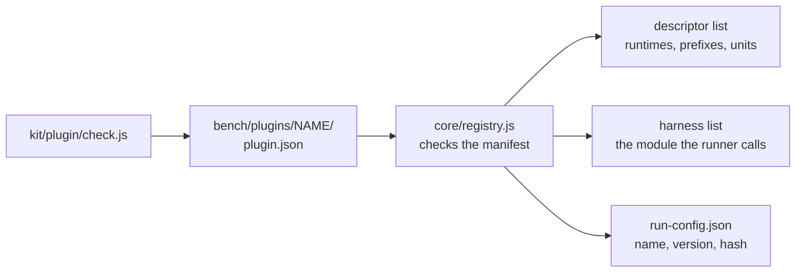

# Write a plugin

[← bench home](../README.md) · [agents](agents.md) · [your own agent](benchmark-your-own-agent.md) ·
[harness contract](../runner/lib/harness/CONTRACT.md)

Date: 2026-11-23. Covers plugin API 1, which has one kind: `harness`.

## The problem

bench runs four agent programs: Kiro CLI, opencode, Claude Code and Strands. Before plugins, a fifth one meant edits in
the middle of the bench: a registry list, a descriptor list and the result schema. A missed edit broke runs in ways a
test did not always catch.

## How a plugin solves it

A plugin is one folder under `bench/plugins/`. The bench finds it when it starts. Nothing in the core changes.



The registry reads the built-ins first, then each plugin folder in name order. It refuses a plugin, with the reason,
when its `benchApi` is not 1, its `kind` is unknown, a file it names is missing, or its name is not its folder name.
A refused plugin is never half loaded, and the bench prints a warning naming it. Two parts with one name stop the
bench. Every run writes each loaded plugin to `run-config.json` as `{name, kind, version, benchApi, sha256}`, where
`sha256` covers every file in the folder. So a result always points at the exact plugin code that made it.

Some parts never become plugins: the judge family rule, the spend guard, the sandbox and env allowlist, the secret
scrub, and the release signatures. A plugin builds the agent's command; the core still runs it in the sandbox and
applies the env allowlist after the plugin's `env()`.

## Worked example: the Strands plugin

Strands was the first harness moved out of the core. Its folder is a complete, working example:

```text
bench/plugins/strands/
  plugin.json                 the manifest
  meta.js                     the descriptor: frozen, no requires
  harness.js                  the harness module the runner calls
  parse.js                    reads the agent's stream
  test/conformance.js         what the kit needs to check it
  test/fixtures/single-turn.jsonl   one recorded run: one tool call, one answer
```

`plugin.json` names the files:

```json
{
  "benchApi": 1,
  "kind": "harness",
  "name": "strands",
  "version": "1.0.0",
  "meta": "meta.js",
  "entry": "harness.js"
}
```

`meta.js` is the descriptor. It says the arm prefix (`st-`), the cost unit (`usd`), the stream format, which run
flags apply, what the reports say about its cost (`report`) and how `cap` reaches a capability (`capabilities`). The full field list is under "Descriptor" in
[CONTRACT.md](../runner/lib/harness/CONTRACT.md). The file has no `require`, because the runner reads it before any
harness module loads.

`harness.js` exports `id`, `meta` (the same object as `meta.js`) and the members the runner calls: `prepareArm`,
`trialInstall`, `installInto`, `buildCommand`, `env`, `removeCredentials`, `keepPaths`, `turnSummary`, `parseResult`
and `collectArtifacts`. CONTRACT.md says what each one gets and returns. Strands keeps its stream reader in `parse.js`.

`test/conformance.js` tells the kit how to read the recorded run with no model call:

```js
module.exports = {
  fixture: 'fixtures/single-turn.jsonl',   // the recorded stream, under test/
  freeModel: true,                         // the run cost nothing (a fake model)
  config: { model: 'fake:/fixture/script.json', effort: 'default' },
  setup: () => ({ strands: { python: 'python3', prefix: '/venv', basePrefix: '/python', version: '1.65.0', agentFile: null } }),
};
```

`setup` returns the `ctx` that `parseResult` reads besides the stream.

## Check a plugin

The kit checks a plugin folder for free:

```bash
node bench/kit/plugin/check.js bench/plugins/strands
```

It prints `PASS` or each problem, and exits 1 on any. It checks the manifest the way the bench does, the descriptor,
every member against the contract tables, and what `turnSummary` and `parseResult` fill from the recorded stream.
`runner/test/harness-contract.test.js` runs the same checks over every plugin, so a plugin that breaks fails the suite.

## Start a new plugin

1. Make the agent one local command that prints one JSON event per line. Strands does this with
   `bench/physical/strands/launch.py`.
2. Copy `bench/plugins/strands/` to `bench/plugins/NAME/`. Set `name` in `plugin.json` and `id` in `meta.js` to
   `NAME`, and pick a new arm prefix.
3. Rewrite `harness.js` and `parse.js` for your agent's command and stream.
4. Record one real single-turn run as `test/fixtures/single-turn.jsonl`, and set `test/conformance.js`.
5. Run the kit until it prints `PASS`, then `node bench/runner/bench.js list-arms` to see your arms.

## Limits today

Plugin API 1 covers harnesses only. Plants, scorers, judge backends and unit kinds are still core code. Some core
files still name a runtime: the stream readers in `judge/bundle.js`, `trace.js`, `stop-watch.js` and
`plant/stream-match.js`, and the runtime branches in `run-cmd.js`, `cap/` and `report/`. A new stream format still
needs a reader in each of those. `DEBT.md` rows D-201, D-205, D-206 and D-211 track the work to remove them.
