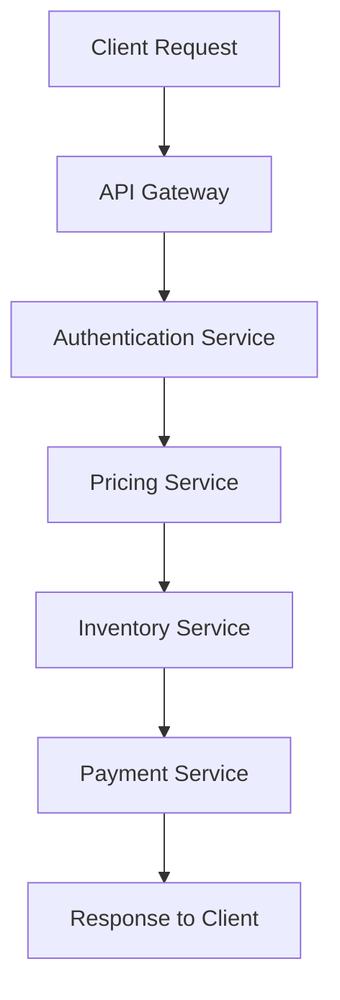
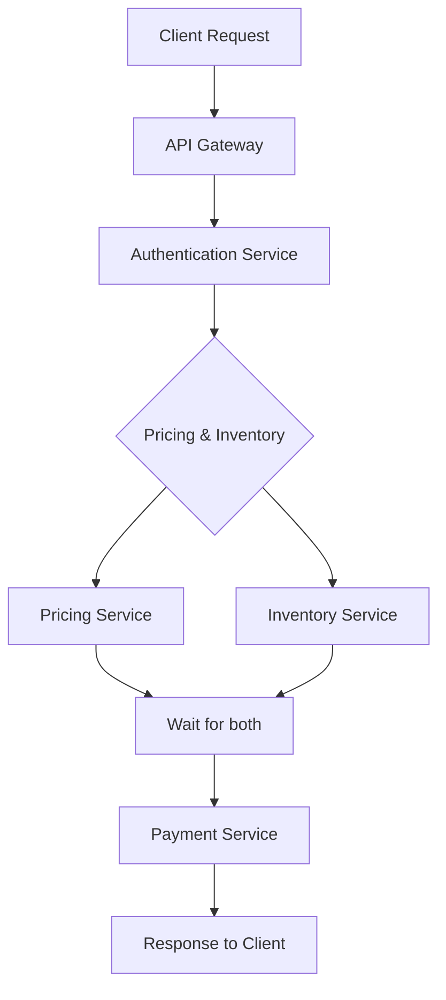
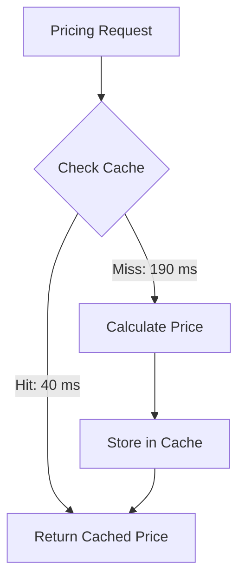

# System Architecture

## Current Architecture

## Service Dependencies

### Sequential Flow (Current)
1. API Gateway (40 ms p99)
2. Authentication (60 ms p99)  
3. Pricing Service (190 ms p99)
4. Inventory Service (150 ms p99)
5. Payment Service (280 ms p99)

**Total sequential latency:** 720 ms p99

### Optimization Opportunities

#### Option A: Parallel Processing
Pricing and inventory services can run in parallel since they have no data dependency:

**Expected improvement:** Maximum latency of pricing/inventory instead of sum: max(190, 150) = 190 ms instead of 340 ms

#### Option B: Caching
Add Redis cache for pricing service calculations:

**Expected improvement:** Pricing latency reduced from 190 ms to 40 ms p99

#### Option C: Combined Approach
Both caching AND parallel processing for maximum reduction.

## Technical Constraints

### Service Dependencies
- Authentication must complete before pricing/inventory (user context needed)
- Payment requires pricing and inventory results
- No dependency between pricing and inventory services

### Data Consistency
- Pricing cache TTL: 5 minutes for dynamic pricing
- Inventory reservations held for 15 minutes
- Payment transactions are atomic and immediate

### Failure Modes
- Pricing service failure: Use last known prices with 10% buffer
- Inventory service failure: Assume items available, validate later
- Payment service failure: Queue transactions for retry