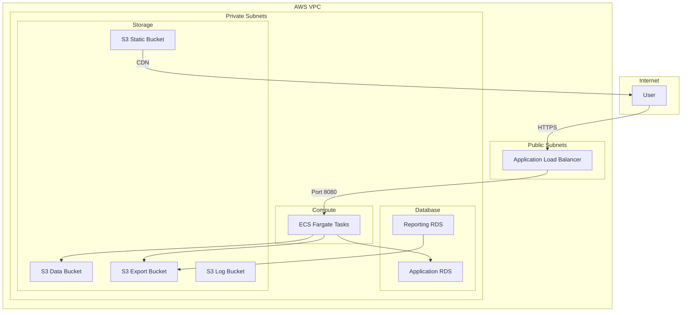

# Architecture Overview

## Components

### Networking
- VPC with CIDR 10.0.0.0/16
- Public subnets for load balancer
- Private subnets for application and databases
- Internet Gateway for outbound traffic
- NAT Gateway (optional for private subnet outbound)

### Compute
- ECS Fargate cluster for container orchestration
- Application Load Balancer with HTTPS termination
- Auto-scaling based on CPU utilization

### Databases
- PostgreSQL RDS for main application (encrypted, private)
- PostgreSQL RDS for reporting (new feature)

### Storage
- S3 bucket for application data (private)
- S3 bucket for report exports (configured for external access)
- S3 bucket for static website (public-read behind CDN)
- S3 bucket for logs

### Security
- IAM roles with least privilege
- Security groups with minimal allowed ports
- KMS for encryption
- CloudTrail for audit logging
- Secrets Manager for credentials

### Monitoring
- CloudWatch metrics and alarms
- VPC Flow Logs
- Application logs to CloudWatch Logs

## Data Flow

1. User requests hit ALB on HTTPS (443)
2. ALB forwards to ECS tasks on port 8080
3. Application reads/writes to RDS database
4. Application stores files in S3 data bucket
5. Reporting tasks write CSV exports to S3 export bucket
6. Static assets served from S3 via CDN
7. All logs go to CloudWatch and S3
8. Audit trails captured by CloudTrail