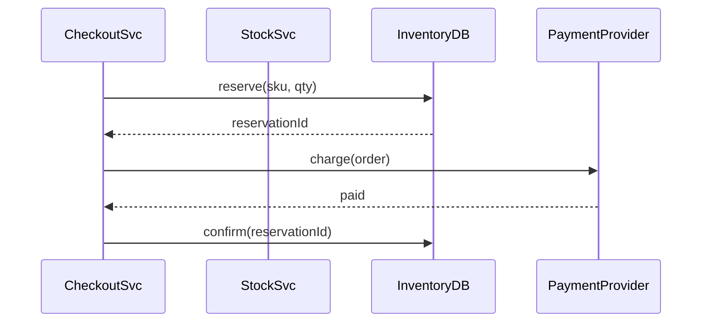

# Design: stock reservations at checkout

Status: proposed. Author: checkout team.

## 1. Problem

Customers pay for items that sold out while they were checking out. Support refunds about 300 orders a week by
hand. We want checkout to reserve stock when the cart opens checkout and release it if the order is not paid.

## 2. Goals and non-goals

Goals: no order is paid for stock that is not there; checkout stays fast; support can refund an order in one step.
Non-goals: changing the warehouse system, multi-currency.

## 3. Architecture

The checkout service owns reservations. It calls the inventory service through the stock cache, which answers
reads and forwards writes. Payments go to the external payment provider. Each checkout node keeps a timer per
reservation and releases it when it expires.

## 4. Reservations

A reservation holds `sku`, `qty`, `orderId`, `expiresAt`, and the customer's email and shipping address so the
confirmation can be sent. It expires 15 minutes after it is made; the node that made it compares `expiresAt` with its
own clock and releases it. Every reserve call carries an idempotency key (the order id), so a retried call does not
reserve twice.

## 5. API

- `POST /checkout/{orderId}/reserve` reserves every line of the order.
- `POST /checkout/{orderId}/pay` charges the order and confirms the reservations.
- `POST /admin/refunds` refunds an order and releases its stock. Used by support.

## 6. Limits

Each customer may call reserve at most 10 times a minute; the API gateway throttles above that.

## 7. Operations

Dashboards show reservations made, confirmed and expired per minute. An alarm fires when expired reservations pass
20% of those made in 15 minutes; the on-call engineer checks the payment provider status page first.

## 8. Data model

New table `reservations`. The `orders.status` column gains the values `reserved` and `released`.
