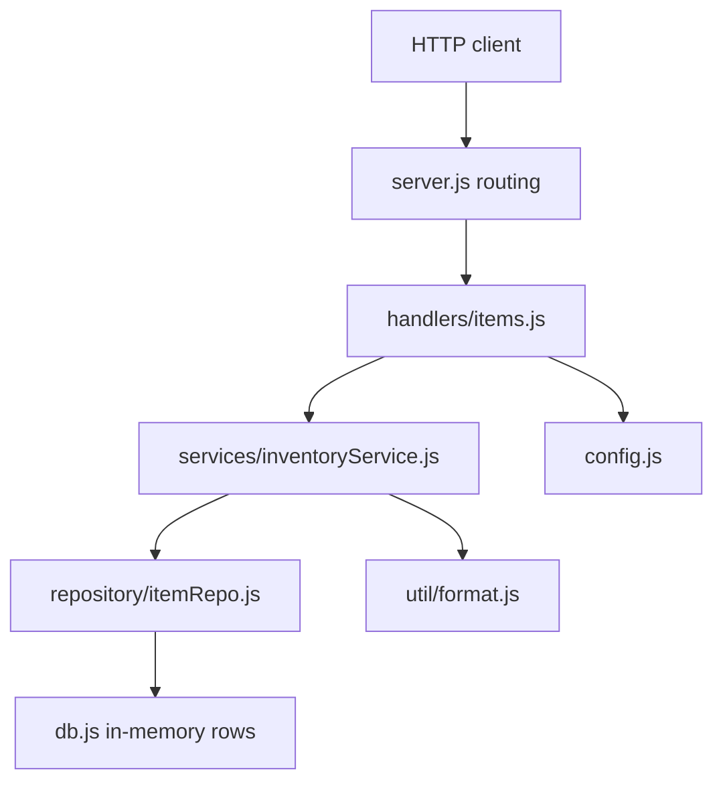
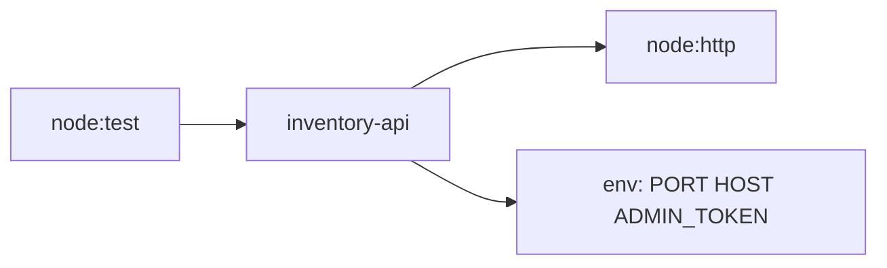

# Codebase analysis: inventory-api

## Executive Summary

inventory-api is a small in-memory inventory service with a clear four-layer structure and about 240 lines of source. The layering is its main strength: routing, handlers, services and data access are separate and easy to follow. The most serious problem is a SQL injection in the search repository function, followed by a stock-change route that skips the admin-token check. Test coverage is thin, with 8 tests that cover only the service and the repository. Overall health is fair for a demo and below the bar for anything exposed to other users.

## Codebase Map

| Path | Role |
|------|------|
| `src/server.js` | HTTP server and routing, JSON body parsing, error response |
| `src/handlers/items.js` | Request handlers returning `{ status, body }`, admin-token check |
| `src/services/inventoryService.js` | Business logic: create, get, adjust stock, reorder report, search |
| `src/repository/itemRepo.js` | Data access: get, list, save, searchByName |
| `src/db.js` | In-memory rows and a stand-in `query` function |
| `src/config.js` | Port, host, admin token, reorder level |
| `src/util/format.js` | Label and price formatting, `getQty` |
| `test/` | Two files: service tests and repository tests |

## Architecture Overview

Requests flow one way, from the server down to `db.js`. Handlers return plain objects and the server turns them into HTTP responses, so handlers can be tested without a socket (they are not tested yet).

## SOLID Evaluation

- Single responsibility: mostly respected. `server.js` mixes routing with body parsing and error formatting. `handlers/items.js` also owns authorization.
- Open/closed: routing is an if-chain in `route`, so a new endpoint means editing it.
- Liskov: not applicable, there is no inheritance.
- Interface segregation: modules export small sets of functions; fine.
- Dependency inversion: handlers and services call concrete modules through `require`. Swapping the repository for a real database means editing the service import, which is acceptable at this size.

## Design Patterns Found

- Layered architecture with a thin repository.
- Handler returning a response object instead of writing to the socket.
- Copy on read in the repository (`{ ...row }`) to avoid callers mutating stored rows.

## Dependencies and Integrations

There are no runtime dependencies; only Node built-ins (`node:http`, `node:test`). The only integration point is HTTP.

## Code Quality and Test Assessment

Code is short and readable. Two comments restate the next line and `getQty` only returns `item.qty`. There are 2 test files and 8 tests, which cover the service happy paths and the repository. The handlers and the server have no tests, so authorization, status codes and error responses are untested. There is no test for injection input, invalid `delta`, concurrent adjustments or the reorder boundary.

## Security and Performance

- SQL injection through string concatenation in `searchByName` (`src/repository/itemRepo.js:22`).
- `adjustStock` has no admin-token check (`src/handlers/items.js:25`).
- No input validation on `delta`, `name` or `qty`.
- The 500 response returns `err.stack` (`src/server.js:50`).
- Fallback admin token in `src/config.js:6`; token comparison is not constant time.
- Performance is not a concern at this size. `reorderReport` and `list` copy every row, which would matter with a real table.

## Technical Debt

- Reorder report uses `<` where the README says "at or below" (`src/services/inventoryService.js:31`).
- Lost update in `adjustStock` because read and write are separate awaits.
- Hard-coded fallback token instead of failing closed.
- Stack trace in the 500 response.
- Duplicate guards (`if (!id)` in the handler and a null check in the service) and a pass-through helper (`getQty`).

## Recommendations

| Priority | Recommendation |
|----------|----------------|
| P0 | Replace the string-built SQL in `searchByName` with a bound parameter and add an injection test. |
| P0 | Add the admin-token check and input validation to `adjustStock` (finite integer, never below zero). |
| P1 | Validate `createItem` input; stop returning `err.stack`; fix the `<=` reorder boundary. |
| P1 | Make stock adjustment atomic in the repository. |
| P2 | Fail startup without `ADMIN_TOKEN`, use a constant-time compare, cap request size. |
| P2 | Add handler and server tests; remove `getQty` and the duplicate guards. |
