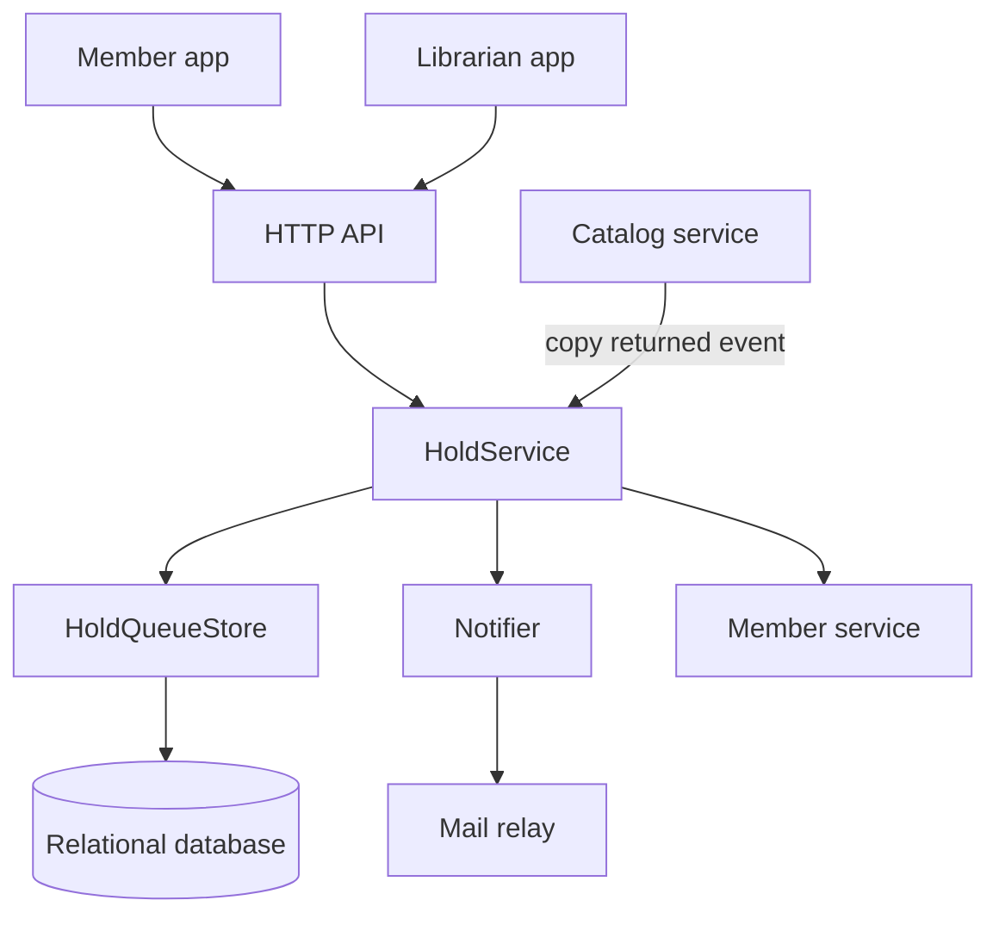

# Design: hold-requests

## Overview

Members place holds on titles that have no available copy. Holds are served first come, first served. When the catalog service reports a returned copy, the first queued member gets the copy reserved for a fixed window and receives an email. Unclaimed reservations expire and pass to the next member. Librarians view and edit each queue.

The reservation window is a setting with a default of 5 days. REQ-3 (7 days) and REQ-6 (5 days) conflict, so the value is flagged for the product owner and is not hard coded.

## Architecture

HoldService is the only component that changes hold state. It runs in the existing API process and uses the existing relational database. A scheduled job in the same service expires reservations once a minute.

## Components and Interfaces

### HoldService

- `placeHold(memberId, titleId)`: checks the title has no available copy and the member has fewer than 5 active holds, then adds a queued hold.
- `cancelHold(holdId, actor)`: sets cancelled; if the hold was reserved, offers the copy to the next member.
- `removeHold(holdId, librarianId, reason)`: same as cancel, but requires a reason.
- `onCopyReturned(titleId, copyId)`: claims the head of the queue and reserves the copy.
- `expireReservations(now)`: expires reserved holds past `reservedUntil` and reserves the next one.

### HoldQueueStore

- `add(hold)`, `listByTitle(titleId)`, `listByMember(memberId)`, `positionOf(holdId)`.
- `claimHead(titleId, reservedUntil)`: one transaction that selects the oldest queued hold with a row lock (`FOR UPDATE SKIP LOCKED`) and sets it to reserved. Two simultaneous returns therefore claim two different holds.

### Notifier

- `sendReady(hold, member)`: sends the "your copy is ready" email and returns success or failure. It never throws into HoldService.

### HTTP API

| Method | Path | Who |
|--------|------|-----|
| POST | /titles/{id}/holds | member |
| GET | /members/me/holds | member |
| DELETE | /holds/{id} | member or librarian (reason required for librarian) |
| GET | /titles/{id}/holds | librarian |

## Data Models

Hold:

| Field | Type | Notes |
|-------|------|-------|
| id | string | primary key |
| titleId | string | indexed with status and createdAt |
| memberId | string | indexed with status |
| status | enum | queued, reserved, fulfilled, cancelled, expired |
| createdAt | timestamp | queue order |
| reservedUntil | timestamp | set when reserved |
| notifyFailed | boolean | set when the email bounces or is not possible |
| removedReason | string | set when a librarian removes the hold |

Status flow: queued, then reserved, then fulfilled. A hold can become cancelled from queued or reserved, and expired from reserved.

Position is computed as the count of queued holds on the title with an earlier `createdAt`, plus one, so it needs no stored value and stays correct when others cancel.

## Error Handling

- Placing a hold when a copy is available: 409 with a message to borrow it.
- Sixth active hold: 409 with the limit in the message.
- Removal without a reason: 400.
- Unknown or already finished hold: 404.
- Email bounce or missing address: the hold stays reserved, `notifyFailed` is set and staff can see it; the reservation and expiry rules do not depend on delivery.
- Mail relay down: retry with backoff up to three times, then mark `notifyFailed`.
- Lost race on `claimHead`: the transaction retries once, then leaves the copy for the next event or the expiry job.

## Testing Strategy

- Unit tests for HoldService rules: the 5-hold limit, duplicate holds, available-copy rejection.
- Store tests against a real database: ordering, position after cancel, `claimHead` with two concurrent callers returning different holds.
- Notifier tests with a fake relay for success, bounce and missing address.
- Expiry tests with an injected clock.
- A load test at 50 write requests per second checking the median under 300 ms.
- API tests for each role and status code above.
