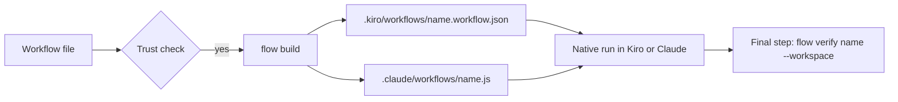

<!-- SPDX-License-Identifier: Apache-2.0 -->

# Workflows: exports

**Status:** Slice 14, not in the first release. Nothing here is built, and no first-release code, test or file depends
on it. The [design](workflows.md), the [specification](workflows-spec.md) and the [plan](workflows-plan.md) describe the
first release. This note holds what an export needs, so that it is not lost and does not weigh on the first release.
The [export-ready invariants](workflows.md#export-ready-invariants) keep the door open.

An **export** is a file in the native workflow format of Kiro CLI or Claude Code, written from a workflow file by
`konductor flow build`. A **target** is where a workflow can go: `runner`, `kiro` or `claude`, the values of the
`targets` key. The runner's own use of `kiro-cli` and `claude` as headless harnesses is not an export and stays in the
first release.

How an export is built and checked:

## The `targets` key

`targets` is a list of `runner`, `kiro` and `claude`, default all three. In the first release it is a reserved key
(slice 14) and reports `NOT_SUPPORTED_BY_THIS_BUILD`. Once slice 14 lands, it lists the targets the author says the
workflow supports. Checking reports an error for every feature a declared target cannot support, and exporting to an
undeclared target is `TARGET_NOT_DECLARED`.

## Decisions for exports

These keep their numbers from [workflows.md](workflows.md#decisions). D11 and D15 have a first-release part there, and
the export part is here. D17 is only here.

- **D11, export part. The Kiro export writes the agent's model into the step's `model` field.** A Kiro workflow step
  does not use the agent file's `model` ([Sources](#sources)). The Claude export uses the agent definition's model. The
  conformance check covers both: Kiro accepts the model id in a step, and the Claude export uses the definition's model.
- **D15, export part. A native run is checked at its end,** by a final `konductor flow verify <name> --workspace` step.
  Why: no Konductor process watches a native run. Rejected: checking only at the end finds a failed check late, which
  is why the runner checks during the run. Consequences: each export gains that step, and `unverified` exits 0, so a
  caller that needs proof reads the result.
- **D17. The Kiro export rejects `{{` in prompt text.** Why: Kiro reads `{{name}}` as a template and documents no
  escape. Rejected: rewriting `{{` changes the agent's text; passing it through changes the prompt or only warns.
  Consequences: a Mustache or Actions snippet cannot appear in a `kiro` prompt.

## Rules

### Stage prompts in an export

The shared text comes from `stage_prompt` ([Stage prompts](workflows-spec.md#stage-prompts), D10) and no export changes
it. An export adds its own ending after a blank line.

- **Kiro braces (D17).** Text that the Kiro export writes into a step prompt and that contains `{{` is
  `KIRO_TEMPLATE_SYNTAX`. That covers `prompt`, `prompt_file` text, `intent.outcome` and a `params` default. Single
  braces are not affected.
- **Claude ending.** The Claude export adds no ending, so its prompt is the shared text.
- **Kiro ending.** The ending has the step report success with `send_message` and reply in one line. A Kiro step with no
  `completion` condition ends after one turn even without `send_message` ([Sources](#sources)), so the ending only makes
  the success explicit. It also keeps the final message, which Kiro captures as the step output, to one line.
- **Goal text.** Each target supplies the goal its own way. Golden tests for the function and both renderers use the
  same shared text.

### Outputs

The `Files this stage must write` line is in the shared text, so every export states the output paths. An export does
not check them, because no Konductor process watches a native run (D15). On Claude, an output path whose basename starts
with report, summary, findings or analysis (any case) and ends in `.md` is `CLAUDE_BLOCKED_OUTPUT_NAME`. The public
issue reports describe the refusal for subagent writes ([Sources](#sources)).

### Harness invocation for exports

- **Kiro export (`kiro`).** Needs a V3 session with `chat.enableWorkflows` on. `konductor doctor` checks that only for a
  `kiro` export.
- **Claude export (`claude`).** `claude -p` shows no approval prompt for the `Workflow` tool call, so the export needs
  one of these routes:
  - a `Workflow` or `Workflow(<name>)` allow rule;
  - auto permission mode;
  - bypass permissions mode;
  - a `PreToolUse` hook that allows the call;
  - a host approval (`--permission-prompt-tool`, or `canUseTool` in the Agent SDK).
- **Versions.** The exports follow Kiro CLI 2.33.1 and Claude Code 2.1.305 ([Sources](#sources)). The conformance check
  runs the exports live on a public release of each tool and pins a minimum version, which `konductor doctor` enforces.

### Commands

| Command                          | Purpose                                                            | Needs trust |
| -------------------------------- | ------------------------------------------------------------------ | ----------- |
| `flow build [<name>]`            | Writes the exports                                                 | yes         |
| `flow verify <name> --workspace` | Runs the checks of workflow `<name>` against the working directory | yes         |

`flow build` writes `.kiro/workflows/<name>.workflow.json` and `.claude/workflows/<name>.js` with a generated-file
header. It writes a target only when `targets` lists it and a matching install harness is installed (`kiro-cli-v2` or
`kiro-v3` for `kiro`, `claude` for `claude`), and it reports and skips a file the user edited. A native export ends with
a step that runs `konductor flow verify <name> --workspace` (D15), so the command finds the workflow by the name the
export embeds. For a project workflow it needs trust like `flow run`, per workflow, and exits 77 when it is not trusted.
Both commands exit with the codes in [the spec](workflows-spec.md#commands-and-exit-codes), and a workflow with errors
exits 65.

### Check state `reported`

A check is `reported` when an agent said it passed and Konductor has not run it. Only an export produces this state.
`flow verify --workspace` turns `reported` and `deferred` into `verified` or a failure. The first-release states are in
[the spec](workflows-spec.md#run-stage-and-check-states).

### Codes

A target-specific code starts with `KIRO_` or `CLAUDE_`. The codes follow [the code
rules](workflows-spec.md#diagnostics-and-codes).

| Code                            | Severity | Raised when                                                                                                   |
| ------------------------------- | -------- | ------------------------------------------------------------------------------------------------------------- |
| `TARGET_NOT_DECLARED`           | error    | Exporting to a target that `targets` does not list; first reported by `flow build`                            |
| `KIRO_PARAM_DEFAULT_BAKED`      | info     | A param default is written into the Kiro prompt text, so a Kiro run cannot override it                        |
| `KIRO_STEP_LIMIT`               | error    | The Kiro export would have more than 50 `step` nodes: stages, generated check steps and the final verify step |
| `KIRO_TEMPLATE_SYNTAX`          | error    | Text written into a Kiro step prompt contains `{{` ([Kiro braces](#stage-prompts-in-an-export))               |
| `CLAUDE_COMMAND_RESULT_RELAYED` | warning  | On Claude, an agent relays the result of a `run` or `file` check that a `done_when` uses                      |
| `CLAUDE_BLOCKED_OUTPUT_NAME`    | error    | A stage output path that Claude refuses to write ([Outputs](#outputs))                                        |

## Feature matrix

What each format key does on each target. There is one row per format key and one column per target: `runner`, `kiro`
and `claude`, the values of `targets`. The canvas is an editor, not a target, and a run started from it uses the
`runner` column. The engine's wire types are the Rust types that define the file and HTTP shapes (D7).

**Slice 14 test.** A test checks that every key in the wire types has a row with a cell for each target, and that each
cell fits the grammar below. The test stops at `params.goal` and `params.<name>`: their sub-keys (`description`,
`default`, `type`, `required`) take the cells of that row. In the first release no matrix exists, and the test that
guards the keys is the one-slice-per-key test in [the plan](workflows-plan.md#rules-for-every-slice). Slice 14 writes
the rows for every key released before it, and a later slice that adds a key adds its row in the same pull request.

Each cell is one of:

- `full`: works as specified in [Keys](workflows-spec.md#keys). Weaker checking that the spec declares and that has no
  code is still `full`, as with the exports and `stages[].outputs`.
- `full, except <code>[, <code>...]`: works as specified, except in the cases the row's note names. In each case the
  engine reports the code that goes with it, with that code's severity.
- `degraded: <warning code>`: every use of the key takes a weaker path that the user should be warned about, and the
  engine reports the warning code.
- `unsupported: <error code>`: an error when the target is declared in `targets`.

A weaker path with a code is `degraded` when every use of the key takes it, and `full, except` when only a named case
does. A weaker path with no code is `full`. On Claude, `done_when` always relays the result of a check, so it is
`degraded`. A check in `intent.accept` is relayed only when a `done_when` uses it, so those rows are `full, except`.

How rows are written, so the check can read them: the first cell is the key path in backticks, `a.b` for an object key,
`a[]` for items of a list and `a[].b` for a key of a list item. A code is upper snake case and appears in the
[first-release code table](workflows-spec.md#diagnostics-and-codes) or in [Codes](#codes) above.

| Key                    | Slice | runner | kiro                                                        | claude                                     |
| ---------------------- | ----- | ------ | ----------------------------------------------------------- | ------------------------------------------ |
| `format`               | 1     | full   | full                                                        | full                                       |
| `name`                 | 1     | full   | full                                                        | full                                       |
| `version`              | 1     | full   | full                                                        | full                                       |
| `intent`               | 1     | full   | full                                                        | full                                       |
| `intent.outcome`       | 1     | full   | full, except KIRO_TEMPLATE_SYNTAX                           | full                                       |
| `intent.accept`        | 1     | full   | full                                                        | full, except CLAUDE_COMMAND_RESULT_RELAYED |
| `intent.accept[].id`   | 1     | full   | full                                                        | full                                       |
| `intent.accept[].file` | 1     | full   | full                                                        | full, except CLAUDE_COMMAND_RESULT_RELAYED |
| `intent.accept[].run`  | 3a    | full   | full                                                        | full, except CLAUDE_COMMAND_RESULT_RELAYED |
| `params`               | 1     | full   | full, except KIRO_PARAM_DEFAULT_BAKED, KIRO_TEMPLATE_SYNTAX | full                                       |
| `params.goal`          | 1     | full   | full, except KIRO_PARAM_DEFAULT_BAKED, KIRO_TEMPLATE_SYNTAX | full                                       |
| `params.<name>`        | 2     | full   | full, except KIRO_PARAM_DEFAULT_BAKED, KIRO_TEMPLATE_SYNTAX | full                                       |
| `stages`               | 1     | full   | full, except KIRO_STEP_LIMIT                                | full                                       |
| `stages[].name`        | 1     | full   | full                                                        | full                                       |
| `stages[].agent`       | 1     | full   | full                                                        | full                                       |
| `stages[].prompt`      | 1     | full   | full, except KIRO_TEMPLATE_SYNTAX                           | full                                       |
| `stages[].prompt_file` | 1     | full   | full, except KIRO_TEMPLATE_SYNTAX                           | full                                       |
| `stages[].outputs`     | 2     | full   | full                                                        | full, except CLAUDE_BLOCKED_OUTPUT_NAME    |
| `stages[].done_when`   | 3a    | full   | full                                                        | degraded: CLAUDE_COMMAND_RESULT_RELAYED    |
| `targets`              | 14    | full   | full                                                        | full                                       |

### Notes

- **Checks and `done_when`.** The runner runs every check itself, after the session ends. On Kiro, a check step runs a
  `run` check, and a `file` check on its result file decides `done_when`. On Claude, the workflow script has no
  filesystem or shell access, so an agent relays the result of a `run` or `file` check that a `done_when` uses, and the
  check stays `reported` until `konductor flow verify <name> --workspace` runs it. That command needs trust for a
  project workflow. A check that only `flow verify` runs is `full` on every target, so the `intent.accept` cells name
  the code for the `done_when` case.
- **`params`.** Kiro recipe inputs have no defaults or required flag ([Sources](#sources)). The export writes a param's
  default into the prompt text, so a Kiro run cannot override it (for `goal`, it becomes every run's goal text), and
  reports the info `KIRO_PARAM_DEFAULT_BAKED`. A param without a default becomes a required Kiro input. A default is
  prompt text too (see Prompt text on Kiro).
- **`stages` on Kiro.** A recipe allows 50 `step` nodes. The stages, the generated check steps and the final verify step
  must all fit, and the export reports `KIRO_STEP_LIMIT` above that. A file within the limit of 40 stages can still
  overflow once those steps are added.
- **Prompt text on Kiro.** `intent.outcome`, `stages[].prompt`, `stages[].prompt_file` and a param default end up in a
  step prompt, so `KIRO_TEMPLATE_SYNTAX` applies to them (D17, rule in [Kiro braces](#stage-prompts-in-an-export)).
  Otherwise the prompt keys are `full` on every target, because the export inlines the text and the shared text is the
  same on all three.
- **`stages[].outputs`.** Every target tells the agent which files to write: the shared stage prompt carries a
  `Files this stage must write` line. Only the runner checks the declared outputs on disk. The Kiro and Claude exports
  do not check them during the run, and `flow verify` checks only `intent.accept`. Every target accepts and validates
  the key and states it in the prompt, so the cells are `full`. On Claude, `CLAUDE_BLOCKED_OUTPUT_NAME` applies to the
  names described under [Outputs](#outputs).

## Threats

| Flow                             | Threat                                          | Mitigation                                                                             | Residual risk                                                    |
| -------------------------------- | ----------------------------------------------- | -------------------------------------------------------------------------------------- | ---------------------------------------------------------------- |
| Exported files with `run` checks | Kiro or Claude runs a check under its own trust | `flow build` needs trust for the workflow (first-release rule); each tool's own prompt | An approval given without reading, or a later edit of the export |
| `--goal` text and param defaults | The Kiro export bakes defaults into its prompts | Defaults sit in the file the trust hash covers                                         | Text that steers an agent reaches every Kiro stage               |

## Sources

Public sources for the facts above about Kiro CLI and Claude Code. The runner's own facts are in
[workflows.md](workflows.md#sources).

| Fact                                                                                                                                                                                                                                                                                                                                                       | Source                                                                                                                             |
| ---------------------------------------------------------------------------------------------------------------------------------------------------------------------------------------------------------------------------------------------------------------------------------------------------------------------------------------------------------- | ---------------------------------------------------------------------------------------------------------------------------------- |
| Kiro recipes: `.kiro/workflows/`, lookup project, user, synced, bundled; at most 50 `step` nodes. Inputs have no default or required flag, and `{{name}}` has no documented escape. A Kiro step's model comes from step, workflow, parent session, agent; an unknown id fails. A step with no `completion` condition ends on a turn without `send_message` | [authoring page](https://kiro.dev/docs/workflows/authoring/)                                                                       |
| Kiro workflows run in V3 sessions and are opt-in (`chat.enableWorkflows`)                                                                                                                                                                                                                                                                                  | [settings page](https://kiro.dev/docs/reference/settings/)                                                                         |
| Interactive V3 asks to trust a folder before loading its workflows (2.33.0)                                                                                                                                                                                                                                                                                | [2.33 changelog](https://kiro.dev/changelog/cli/2-33/)                                                                             |
| The exports follow Kiro CLI 2.33.1 and Claude Code 2.1.305                                                                                                                                                                                                                                                                                                 | [Kiro 2.33.1](https://kiro.dev/changelog/cli/2-33-1/), [Claude Code changelog](https://code.claude.com/docs/en/changelog)          |
| Claude workflows: `.js` in `.claude/workflows/`; the project one wins; no filesystem access. `Workflow` and `Workflow(<name>)` allow rules, and other approval routes, for `claude -p`                                                                                                                                                                     | [workflows page](https://code.claude.com/docs/en/workflows)                                                                        |
| Claude refuses subagent writes to report, summary, findings or analysis `.md` names (issues)                                                                                                                                                                                                                                                               | [44657](https://github.com/anthropics/claude-code/issues/44657), [101519](https://github.com/anthropics/claude-code/issues/101519) |

Observed on one Kiro CLI 2.34 pre-release build (the conformance check repeats it):

| Fact                                                                                                       | How we ran it                                           |
| ---------------------------------------------------------------------------------------------------------- | ------------------------------------------------------- |
| A Kiro step with no `completion` condition ended after one turn when the agent never called `send_message` | One workflow run with one step, one agent and one model |
