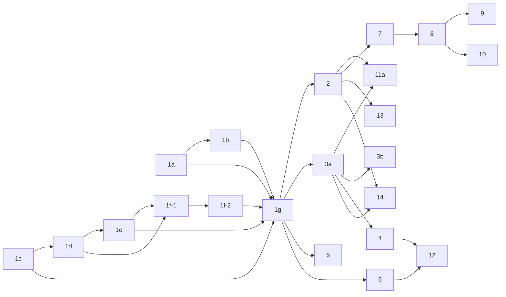

<!-- SPDX-License-Identifier: Apache-2.0 -->

# Workflows: implementation plan

This plan is the one place that says what each slice adds, what it needs and how it is tested. The design, the
[specification](workflows-spec.md) and [the exports note](workflows-exports.md) hold the rules and the decisions (D1
and up) that this plan cites.

The first release is slices 1, 2, 3a and 11a. In slice 1, the canvas track (1a, 1b) and the engine track (1c to 1f-2)
can run in parallel and join at 1g, which needs both tracks, real harnesses included. The release runs the review
workflow ported from the `k-adversarial-pull-request-review` SOP, in sequence, from the CLI. It writes no Kiro or Claude
native files. Those exports are slice 14.

## Slices and steps at a glance

| #    | Adds                                                                                 | You can now ...                                                                                         | Needs                          |
| ---- | ------------------------------------------------------------------------------------ | ------------------------------------------------------------------------------------------------------- | ------------------------------ |
| 1a   | Contract and stub for the first-release format                                       | Check a first-release file against the stub and see later keys named                                    | none                           |
| 1b   | Bring the Designer and Execution UI up to the new contract                           | Edit and save a first-release workflow in the browser without losing a key, and see why a stage blocked | 1a                             |
| 1c   | Format and checks in Rust                                                            | Run `flow check` and `flow show` on `hello-plan.yml`                                                    | none                           |
| 1d   | Stage prompt and the runner on the fake harness                                      | Run a workflow with `--harness fake --fake-script <path>` and get a pass or a halted run                | 1c                             |
| 1e   | Trust                                                                                | Confirm a workflow at a prompt, be asked again after it changes, and get exit 77 with no terminal       | 1d                             |
| 1f-1 | Process launcher, Kiro CLI adapters, Kiro conformance and the `doctor` version pin   | Run `hello-plan` on Kiro CLI                                                                            | 1d, 1e                         |
| 1f-2 | Claude adapter, the tool-to-rule map and Claude's conformance checks                 | Run `hello-plan` on Claude Code                                                                         | 1f-1                           |
| 1g   | Canvas server in Rust and `flow view`                                                | Open the canvas on a real file and run it for real                                                      | 1a, 1b, 1c, 1d, 1e, 1f-1, 1f-2 |
| 2    | Data between stages                                                                  | Pass a file from one stage to the next and set params                                                   | 1g                             |
| 3a   | `run` checks and `done_when`, `flow verify <run-id>`                                 | Make a stage pass only when Konductor has run its checks                                                | 1g                             |
| 11a  | First port of the review SOP                                                         | Run the adversarial review as a workflow                                                                | 2, 3a                          |
| 3b   | `intent.writes` and command stages                                                   | Run a command as a stage, and be warned about stray changes                                             | 3a                             |
| 4    | Loops back to an earlier stage                                                       | Repeat a stage until a check passes, with a limit                                                       | 3a                             |
| 5    | Human gates                                                                          | Pause for approval or an answer                                                                         | 1g                             |
| 6    | Parallel stages                                                                      | Run review passes at the same time                                                                      | 1g                             |
| 7    | Reuse                                                                                | Include or extend another workflow                                                                      | 2                              |
| 8    | Layers and patches                                                                   | Change a shipped workflow without copying it                                                            | 7                              |
| 9    | Canvas patch editing                                                                 | Edit a shipped workflow in the canvas                                                                   | 8                              |
| 10   | Customization in chat                                                                | Ask the agent to adapt a workflow                                                                       | 8                              |
| 11b  | Later SOP ports and `fallback_sop`                                                   | Run more SOPs as workflows                                                                              | 11a, 2 to 7                    |
| 12   | Runner-only features                                                                 | Use conditions, per-item stages, a budget and worktrees                                                 | 4, 6                           |
| 13   | The [planned keys](workflows-spec.md#planned-keys-slice-13)                          | Set `effort`, per-stage `model` and typed params                                                        | 2                              |
| 14   | Exports (14a Kiro, 14b Claude, 14c conformance)                                      | Write native Kiro and Claude files with `flow build`                                                    | 2, 3a                          |

## Order and dependencies

The table above is one valid order. The real dependencies are these:

| Step | Needs                          | Why                                                                                                                                               |
| ---- | ------------------------------ | ------------------------------------------------------------------------------------------------------------------------------------------------- |
| 1a   | none                           | It changes a contract file and a stub. Neither needs Rust.                                                                                        |
| 1b   | 1a                             | 1b changes the Designer and Execution tabs to the new contract, so it needs only 1a.                                                              |
| 1c   | none                           | It needs the spec and `hello-plan.yml`, not the canvas.                                                                                           |
| 1d   | 1c                             | The runner reads a checked workflow.                                                                                                              |
| 1e   | 1d                             | `flow run`, which 1d adds, calls the trust gate. The hash covers the workflow file and its prompt files, which the format defines.                |
| 1f-1 | 1d, 1e                         | A real harness needs the runner, and D14 forbids a run of an unconfirmed project workflow.                                                        |
| 1f-2 | 1f-1                           | The Claude adapter uses the launcher and the harness choice that 1f-1 adds.                                                                       |
| 1g   | 1a, 1b, 1c, 1d, 1e, 1f-1, 1f-2 | The server implements the new contract, passes the 1b Playwright tests, checks files, starts runs on a real harness and answers `trust_required`. |
| 2    | 1g                             | A canvas control and an engine key ship together (D13), so the canvas must already run on the engine.                                             |
| 3a   | 1g                             | A check key is a canvas control and an engine key together (D13), so the canvas must already run on the engine.                                   |
| 11a  | 2, 3a                          | The port uses params, outputs and checks.                                                                                                         |
| 14   | 2, 3a                          | An export states outputs and param defaults (slice 2) and renders the checks (3a).                                                                |

Where the order differs from the obvious one, and why:

- **The canvas starts before the engine.** 1a needs no Rust. The canvas track is 1a and then 1b, which brings the
  Designer and Execution UI up to the new contract. 1g needs both tracks.
- **1c is the first Rust step, not the runner.** A runner without a checked file has nothing to run. The core crate and
  its no-IO test come first.
- **Trust (1e) comes before the real harnesses (1f-1, 1f-2).** A real harness runs commands from the repo, so D14 must
  hold before the first real run.
- **1g waits for the real harnesses.** The canvas server starts real runs, and its demo runs a real harness, so it needs
  1f-1 and 1f-2 as well as the runner.
- **Slice 2 waits for 1g.** Otherwise a key would reach the engine before the canvas could show it (D13).
- **3a does not need slice 2.** The two can be built in parallel. The table lists 2 first.
- **11a comes before 3b.** The first port needs checks, not command stages.
- **Slice 14 needs 2 and 3a, not 11a.** An export states outputs and param defaults (slice 2) and renders the checks
  (3a). It does not need the port.

## Size rule

A slice is one feature with one demo line. It is cut into lettered steps (1a, 1b, 1c) when it cannot be built,
tested and released as one unit, or when parts of it can be built in parallel or released earlier. Each step has its own
tests, demo line and release. Numbers stay stable: a decision, a code or a spec table that cites slice 6 keeps citing
it. A key belongs to a lettered step when the slice's keys arrive in more than one release, so `done_when` is 3a and
`intent.writes` is 3b.

A step that is cut again takes a number after its letter, so 1f is 1f-1 and 1f-2.

Slice 1 is cut into eight steps because the canvas and engine tracks run in parallel, and because trust and the real
harnesses are separate releases. The harnesses are two steps: 1f-1 (the launcher and Kiro CLI) ships before 1f-2
(Claude Code). Slices 3 and 11 are cut in two because their later parts are not in the first release.
Slice 14 is cut into 14a Kiro, 14b Claude and 14c conformance. Slices 11b and 12 bundle several features, and are cut
into lettered steps when they are scheduled.

## Rules for every slice

- **The engine is Rust (D7).** It lives in a Cargo workspace under `workflow-engine/`. The assumed layout is a `core`
  crate and an `adapters` crate, with the `flow` commands wired into `cli/konductor-rs`. The workspace gets its own CI
  job.
- **The core crate does no IO.** A test fails the build if the crate imports file, network, process, environment, clock
  or random code, or depends on a crate outside an allow list. The test is written before the crate has any other code.
  `workflow-canvas/stub-api/core/purity.test.ts` does the same for the stub's core, and is the model.
- **Ports and adapters.** The core talks to the world through ports (traits). Each step adds only the ports it
  needs, and the adapters that implement them live in the `adapters` crate.
- **No sleeps in tests.** Time comes from a clock port, and tests use a fake clock. The stub's `Clock` and
  `fake-clock.ts` are the model.
- **The canvas shows only what the engine honors.** A control ships in the same step as the engine feature behind it
  (D13). Until then the canvas reports the key as `NOT_SUPPORTED_BY_THIS_BUILD`.
- **The subset rule.** A build at slice N validates the keys of slices 1 to N. A key of a later slice is a named error,
  `NOT_SUPPORTED_BY_THIS_BUILD`, that says which slice adds it (D3). The build slice is one constant. A test lists every
  key in the wire types with exactly one slice tag, and fails when a key has none, two, or a tag that no slice has.
- **Tests per step.** Unit tests for the core, functional tests with the fake harness through the real adapters,
  and Playwright tests for any canvas change.
- **A release is a merge to main** that passes CI. The first step that adds a command a user can run (1c) adds a
  `CHANGELOG.md` entry. Docs and an example file ship in the same change as the feature.

## How slice 1 ships

Slice 1 has two tracks. Track A, the canvas on the stub, is 1a and 1b. Track B, the Rust engine, is 1c to 1f-2. They
build against the same OpenAPI contract (`workflow-canvas/api/openapi.yaml`) and join at 1g, where the Rust server
replaces the stub and the 1b tests run against it. The canvas track needs no engine: 1a and 1b only make the Designer
and Execution tabs match the contract. A shared contract with a drift test (`stub-api/core/contract-drift.test.ts`)
keeps the two sides honest.

Each step is its own reviewable change on a branch named `<step>-<slug>`, such as `1a-contract` or `1c-core`. A change
that touches `workflow-canvas/` runs the canvas CI. A change from the engine track runs the new workspace job.

## Slice 1: Skeleton

A file of stages and `file` checks that runs in the runner and opens in the canvas. Slice 1 adds the keys `format`,
`name`, `version`, `intent`, `intent.outcome`, `intent.accept` with `id` and `file`, `params.goal`, `stages` with
`name`, `agent`, `prompt` and `prompt_file`. Its eight steps follow.

### 1a: Contract and stub

- **Why now:** every later step builds against the contract.
- **YAML keys:** all slice 1 keys. Keys of later slices report `NOT_SUPPORTED_BY_THIS_BUILD` with their slice.
- **Canvas:** none.
- **API rows:** the operations in the contract (`createSession`, `getWorkflow`, `saveWorkflow`, `checkWorkflow`,
  `startRun`, `getRun`), changed as [the spec](workflows-spec.md#requirements-on-the-canvas-api-contract) lists.
- **Engine:** none. The stub's validator, fixtures and examples change with the contract, including a workflow whose Run
  answers `trust_required`, the order of the `startRun` 409s, `reason` on `RunStage` and a workspace-wide
  `already_running`. After a save that changes a workflow's bytes, the stub answers that workflow's next Run with
  `trust_required`, as the [canvas rule](workflows-spec.md#trust) says.
- **Tests:** unit: `api/openapi.test.ts`, `stub-api/core/validator.test.ts` and `contract-drift.test.ts` follow the new
  contract. Functional: the stub's HTTP tests in `stub-api/http/`. Playwright: `stub-api.spec.ts` still passes.
- **Demo:** you can post a first-release workflow to the stub, and a file with `stages[].parallel` is refused with the
  slice named.

### 1b: The canvas UI on the new contract

- **Why now:** the Designer and Execution tabs must keep every key of the new format on save (D13) and show what the
  new contract adds.
- **YAML keys:** the slice 1 keys, edited through form controls (D13).
- **Canvas:** the editor keeps a stage's other keys (`prompt`, `prompt_file`, and the later `outputs` and `done_when`)
  when it rewrites that stage, and no save drops `format`, `version`, `params` or a comment outside the stage block. A
  file the editor cannot edit in place is not rewritten whole, and the editor says why. The Execution tab shows a
  blocked stage's `reason`. The page keeps the session token in the `sessionStorage` of its tab, so a reload resumes the
  session. A 401 drops the token and tells the user to start `flow view` again. A `trust_required` answer opens a dialog
  that shows the `fix` command with a copy button and a Run again button. The harness values include `claude` and
  `fake`. Both tabs show only slice 1 keys.
- **API rows:** all six.
- **Engine:** none. The page talks to the stub.
- **Tests:** unit: the editor's writer for each stage layout, with first-release stages that carry `prompt` and
  `prompt_file`, and the test fixtures in the new format. Functional: the page against the stub. Playwright: open, edit,
  save, a refused stale save, a Run that answers `trust_required` after a save, and a run of an unsaved trusted fixture.
- **Demo:** you can edit `hello-plan` in the browser, change a stage's agent, save, and find every other key in the file
  unchanged, see the next Run answer `trust_required` with the `fix` command, and watch a fake run of an unedited
  workflow pass.

### 1c: Format and checks in Rust

- **Why now:** it is the base of every other engine step, and it needs no canvas.
- **YAML keys:** all slice 1 keys, with the [rules for every file](workflows-spec.md#rules-for-every-file).
- **Canvas:** none.
- **API rows:** none. 1g serves `checkWorkflow` from this code.
- **Engine:** the `core` crate: a YAML loader for the supported subset, the key table with slice tags, the checks and
  diagnostic codes, limits and path rules, and `NOT_SUPPORTED_BY_THIS_BUILD`. The `adapters` crate: a file source.
  Ports: `WorkflowSource`. Commands: `flow check`, `flow show` with `--json`. The YAML nesting limit.
  The loader uses the event parser of the `saphyr-parser` crate (MIT or Apache-2.0) with a thin tree builder of our own,
  because the parser gives a start and end position for each scalar. The builder rejects anchors, aliases, tags, extra
  documents and the `<<` key, detects duplicate keys, enforces the nesting limit over the events, converts character
  positions to bytes, and finds the end of a quoted value itself.
- **Tests:** unit: the no-IO test first, then a case per code, YAML nested past the limit, a byte order mark, non-ASCII
  text, CRLF line ends, a quoted value followed by a comment, a block scalar, a file near the size limit, the
  one-slice-per-key test, and byte-identical `--json` whatever the key order. Functional: `flow check` on
  `hello-plan.yml` and on broken files, and `flow check library/x` and `flow show library/x` exit 64 with the message
  that shipped workflows arrive later ([rule](workflows-spec.md#commands-and-exit-codes)). `konductor install`, `update`
  and `uninstall` leave `.konductor/workflows/` alone. Playwright: none.
- **Demo:** you can run `flow check hello-plan` and `flow show hello-plan --json`.

### 1d: Stage prompt and the runner on the fake harness

- **Why now:** it proves the run model (D8, D21) before any real tool is involved.
- **YAML keys:** none new.
- **Canvas:** none.
- **API rows:** none. 1g serves `startRun` and `getRun` from this code.
- **Engine:** `stage_prompt` as a pure function (D10) with golden files; the [stage
  result](workflows-spec.md#stage-result) parser; run, stage and check states; `flow run --harness fake`. Ports:
  `Harness`, `Clock`, `RunStore` and `RunLock`. `RunLock` is the OS file lock on `.konductor/runs/lock` that the
  [dead-owner rule](workflows-spec.md#run-stage-and-check-states) describes (D22). The kernel frees it when the owner
  ends, it is close-on-exec, and whether an owner is alive means whether the lock is held, never its PID. The lock file
  holds the PID, start time and run id for messages only. A reader that finds the lock free takes it, reads the state
  again, and writes `halted` only if the state still says `running`. A reader that finds it held only reads. A new `flow
  run` takes the lock after the trust confirmation that 1e adds, sweeps any other `running` run, then creates its own state. The owner
  record and the run state are written atomically. `flow run` exits 75 when another run holds the lock, when the lock is
  held and its record cannot be read, or when the platform cannot lock
  ([rule](workflows-spec.md#commands-and-exit-codes)). `flow run` takes `--json`. The `fake` harness replays scripted
  replies from the file named by `--fake-script <path>` or `KONDUCTOR_FAKE_SCRIPT`, and is for tests only. The way a
  test server accepts `--harness fake` is a decision recorded by this step
  ([deferred](workflows-spec.md#deferred-to-a-later-slice)) and implemented by the stub and the 1g server. Run state is
  written to `.konductor/runs/<run-id>/` in the project, git-ignored through `.konductor/.gitignore`
  ([rule](workflows-spec.md#run-stage-and-check-states)): `konductor init` writes it, and `flow run` creates it with the
  pattern `runs/` if it is missing. This step wires the `doctor` gitignore check, which is dormant until run state
  exists. The `getRun` of 1g and the `flow verify` of 3a read the same location. A `flow` command finds the project root
  by the [rule in the spec](workflows-spec.md#commands-and-exit-codes), which stops at the git top folder (D25). The
  [limits](workflows-spec.md#limits): the stage time limit decided against the clock port, and the output byte caps.
  `cli/README.md` gets the `75` row and the widened `1` row ([rule](workflows-spec.md#commands-and-exit-codes)).
- **Tests:** unit: golden prompts, a case per way a result line is invalid, state transitions with a fake clock, a stage
  that exceeds its time limit (`TIMEOUT`), a run whose owner is gone reads `halted`, or `passed` if every stage had
  passed, a param or prompt over its cap. Lock tests: two concurrent starts (one gets 75), a held lock with an
  unreadable record (75, `lock_unreadable`), a lock file left by an ended process (does not block a new run), a reader
  that races an owner that finishes (it must not overwrite `passed`), and a real process killed mid-run (the next run
  reads it as `halted`). Functional: a run through the real run store on the fake harness, including a missing result
  line (blocked) and a run that was `running` when the process stopped (`halted`). Root search (D25): inside a git
  folder (the search stops at the folder that holds `.git`, a file in a git worktree, and never reads above it), with
  no git folder (the working folder only), and from a nested folder (a subfolder of the project finds the root above
  it). Playwright: none.
- **Demo:** you can run `hello-plan` with `--harness fake --fake-script <path>` and get `passed`, and a bad reply halts
  the run with exit 1.

### 1e: Trust

- **Why now:** D14 must hold before any real harness runs.
- **YAML keys:** none.
- **Canvas:** none.
- **API rows:** none. 1g adds `trust_required` to `startRun`.
- **Engine:** the [trust rules](workflows-spec.md#trust): the summary and prompt in `flow run`, `flow trust <name>` with
  `--yes` and `--revoke <name>`, `--trust` and `KONDUCTOR_TRUST`, the `trust_hash` of `flow check`, the per-workflow
  hash and the record. The user confirms by typing the first 8 characters of the hash (D23). This step also owns three
  behaviors of the trust rules: the scan limits of the repo tool configuration files, with the refusal
  `tool_config_unreadable` (exit 77); the re-check of those files before each session, which sits in the runner in front
  of the `Harness` port, so every harness gets it; and exit 74 for a record that cannot be kept or changed.
  `cli/README.md` gets the `74` and `77` rows ([rule](workflows-spec.md#commands-and-exit-codes)). The summary lists,
  for each agent, the tools the runner lets it run without asking, and the repo tool configuration files, which the hash
  covers; a repo that has them needs confirmation for shipped and user workflows too. The record is written to a
  temporary file and renamed under a lock, and an unreadable record means nothing is trusted. Ports: `TrustStore`,
  `Terminal` and `AgentCatalog` (finds an agent as the [spec](workflows-spec.md#harness-invocation) says and reads its
  tools). For a Claude agent with no `tools` key, the summary says that every tool is available and none is
  pre-approved, because the runner then passes no `--allowedTools`. The step checks whether the install manifest records
  a hash for each installed file. The hash layout is fixed here, with no frame for an unreadable file
  ([spec](workflows-spec.md#trust)).
- **Tests:** unit: the hash is stable, and changes with the workflow's bytes or a `prompt_file`'s bytes but not with
  another workflow; the loader hashes the bytes it parses. Functional: typing the first 8 characters of the hash records
  trust, a bare `y`, an empty answer or any other text exits 77 and runs nothing, no terminal exits 77 naming both ways,
  `--trust` matches or mismatches, a changed file asks again, revoke removes the record, and the record file has mode
  0600, the summary lists the tools each agent runs without asking, the summary of a Claude agent with no `tools` key
  says every tool is available and none is pre-approved, a repo with a `.claude/settings.json` asks for a shipped
  workflow, two writers do not lose an update, an unreadable record trusts nothing, and `flow trust` on a user or
  shipped workflow exits 0 and writes no record. Scan limits: a link, a folder past the depth or entry limit, a file
  over 1 MiB, an unreadable file and a name that is not UTF-8 each exit 77 with `tool_config_unreadable`, even with
  `--trust`. Re-check, on the fake harness: a tool configuration file changed between two stages halts the run before
  the second session starts (exit 1, `SESSION_FAILED`). Claude agent lookup by `name` (D32): a duplicate `name`, a name
  that differs from the file stem, a file with no `name`, a nested `.claude/agents/` subfolder, and an unrelated
  mismatched file that does not block a run. Exit 74: a record that is not valid JSON, one from a newer
  Konductor and a home folder that is not absolute. Playwright: none.
- **Demo:** you can run an untrusted workflow, confirm at the prompt, edit the file and be asked again, and in a run
  with no terminal get exit 77 with `--trust` named.

### 1f-1: Process launcher and Kiro CLI

- **Why now:** until a real tool runs a stage, no part of the run model is tested against reality. Kiro CLI goes first;
  Claude Code follows in 1f-2.
- **YAML keys:** none.
- **Canvas:** none.
- **API rows:** none.
- **Engine:** the `ProcessLauncher` port and its adapter: a session in its own process group, the stage time limit and
  the kill after the grace period ([limits](workflows-spec.md#limits)). Adapters for `kiro-cli` (V2 with `--v2`, V3 with
  `--v3` and `--trust-tools` ids from the agent's allow list; D16, D19, D30). Harness choice by installed install
  harness ([rule](workflows-spec.md#commands-and-exit-codes)). A stage whose agent the harness cannot see fails before
  the first stage, with the message the spec describes. Every session starts through the runner, which carries the trust
  re-check of step 1e (D23), so this step adds no trust code. Each session records its process group and start time in
  the run state, and a new run ends the groups of a killed owner before it marks that run `halted` (D24). The `doctor`
  check for a minimum tool version, set for Kiro CLI. A version below the minimum is `warn` and does not change
  `doctor`'s exit code. The conformance checks of Kiro CLI (real runs on both engines, `--trust-tools` on V2 and the
  agent id order) pin the minimum (D29), and they run before this step merges. `--harness claude`, or an install with
  only `claude`, exits 64 with a message that the Claude adapter arrives in step 1f-2.
- **Tests:** unit: argument building for Kiro V2 and V3, tool-id mapping for Kiro, the `doctor` version check, and the
  exit 64 for `claude` before 1f-2. Functional: the adapters against a fake executable that prints a scripted reply, a
  process group killed after its grace period, and the orphan sweep: a session's process group, left running by an owner
  killed with SIGKILL, is ended by the next run before the old run reads `halted`, and a group whose start time differs
  is left alone. Conformance, on headless Kiro CLI sessions: `--trust-tools` on V2 (re-tested), a locked and a writer
  agent on each engine, and the agent id order. Playwright: none. By hand: one run on Kiro V2, one on Kiro V3, and one
  with an install made to a `--target` that is neither the project root nor `$HOME`. The conformance check records Kiro
  CLI's order when the repo defines an agent with the same id. Also check the host's command-line argument limit against
  the prompt cap.
- **Demo:** you can run `hello-plan` on Kiro CLI and read `PLAN.md`.
- **Release:** it merges on its own. Kiro CLI users can run workflows before the Claude adapter lands.

### 1f-2: Claude adapter and conformance

- **Why now:** the second runner harness, and the first test of the stage-result and permission rules against Claude
  Code.
- **YAML keys:** none.
- **Canvas:** none.
- **API rows:** none.
- **Engine:** the adapter for `claude -p "<prompt>" --output-format json` with `--agent <agent-id>` and
  `--allowedTools` rules from the definition's `tools` ([invocation](workflows-spec.md#harness-invocation), D19). This
  step owns the map from Claude tools to rules: `Agent(a, b)` becomes `Agent(a),Agent(b)`, and a name that matches
  `[A-Za-z0-9_*:.-]+`, such as `mcp__x__*`, becomes a rule as it is. How the list is read is in the
  [Trust section](workflows-spec.md#trust) (D31). The Claude value of the `doctor` minimum-version check. It uses the
  launcher of 1f-1.
- **Tests:** unit: argument building for Claude and the tool-to-rule mapping, where `Agent(a, b), Read` is two items,
  a `[...]` list with a comma in parentheses is Unknown, unbalanced parentheses are Unknown, and an item outside the
  charset makes the list Unknown with no flag and one stderr note (D31). Functional: the adapter against a fake
  executable that prints a scripted reply. Conformance, on a headless `claude -p` session: `--agent` runs the named
  agent's prompt, model and `tools`; a listed tool runs with no settings rule; an unlisted tool is not available; on an
  agent with no `tools` key, a call that needs approval is denied when the user's settings hold no allow rule for it; a
  settings allow rule for a tool outside `tools` does not make it available; a settings deny rule for a listed tool wins
  over `--allowedTools`; and the prompt is not consumed as an `--allowedTools` rule. Playwright: none. By hand: one run
  on Claude, and one with an install made to a `--target` that is neither the project root nor `$HOME`. Also check
  whether `claude --bare` still loads Konductor's agents (Claude Code's order for a shared agent id is
  [documented](workflows-spec.md#harness-invocation)).
- **Demo:** you can run `hello-plan` on Claude Code and read `PLAN.md`.
- **Release:** it merges after 1f-1. The conformance checks run before it merges.

### 1g: Canvas server in Rust and `flow view`

- **Why now:** this joins the tracks. The stub stops being the server.
- **YAML keys:** none new.
- **Canvas:** none. The page talks to the contract. `WC_API_TARGET` points it at the Rust server.
- **API rows:** all six, from the engine. `startRun` answers `trust_required` with a `fix` that names the exact command,
  for example `konductor flow trust hello-plan`, and `harness_unavailable` covers `claude`. `startRun` answers
  `already_running` while a run holds the lock (D22), and the wording of that rule in `openapi.yaml` changes in this
  step. The canvas cannot grant trust.
- **Engine:** an HTTP adapter on loopback with the launch code and session token, `getRun` reading the run state that 1d
  writes and applying the same [dead-owner rule](workflows-spec.md#run-stage-and-check-states) (a reader that finds the
  lock free takes it, re-reads the state and halts a run that still says `running`, and a reader that finds it held only
  reads; D22), `flow view` (which asks first for an untrusted workflow), saves with `base_hash` that follow the [canvas
  rule](workflows-spec.md#trust) and never move a trust record. Ports: an HTTP adapter only, with no new core port.
- **Tests:** unit: request guards. Functional: the stub's own HTTP test suite pointed at the Rust server, plus the drift
  test. The server sends the Content-Security-Policy header with `frame-ancestors 'none'` on the response that serves
  the page. Playwright: the 1b tests run with `WC_API_TARGET` on the Rust server. A save that changes the workflow, a
  prompt-only edit included, leaves the record, and the next Run answers `trust_required`. A test that runs after a save
  first confirms the workflow with `konductor flow trust <name> --yes`.
- **Demo:** you can run `flow view hello-plan`, edit a prompt in the browser and save, confirm the changed workflow with
  the command the `trust_required` dialog shows, and run it on a real harness.

## Slice 2: Data between stages

- **Why now:** the port needs params and a way to pass work between stages, and slice 1 gives stages no declared way to
  pass data, so they can only share files they happen to write.
- **YAML keys:** `stages[].outputs` as a map of output name to path, `params.<name>` with `type: string`, `description`,
  `default` and `required`, and template references `{run.param}` and `{stage.output}` in prompts, where
  `{stage.output}` renders as the output's path. The escape for literal reference text arrives here
  ([deferred](workflows-spec.md#deferred-to-a-later-slice)).
- **Canvas:** a params panel, an outputs editor on each stage with a row per name and path, and a diagnostic on a bad
  reference.
- **API rows:** `getWorkflow`, `saveWorkflow` and `checkWorkflow` carry the new keys. `startRun` takes the declared
  params, so the contract's `params` object widens beyond `goal`.
- **Engine:** a template parser that runs once at load (no regex substitution), param resolution,
  `flow run --param name=value`, the `Files this stage must write` line in `stage_prompt`, a load-time check that each
  `{stage.output}` names a declared output, and a runner check that each declared output path exists.
- **Tests:** unit: hostile-input tests for templates, a reference to an undeclared output, a reference to a later
  stage's output (`INVALID_VALUE`), references to the same stage's and an earlier stage's outputs (accepted), `{1.5}`
  left literal, output and param names that break their patterns (`INVALID_NAME`), a reference that renders the path and
  not the content, golden prompts with and without `outputs`. Functional: on the fake
  harness, a stage that does not write its output is blocked, a stage whose output existed before and is unchanged is
  blocked, and a stage that creates or modifies it passes. Playwright: add a param, add an output name and path, run.
- **Demo:** you can have a `plan` stage declare `design: DESIGN.md` and an `implement` stage told to read
  `{plan.design}`, which renders as `DESIGN.md`, with the run blocked if the file is missing.

## Slice 3: Checks and command stages

Slice 3 ships in two steps. 3a is in the first release. 3b is not.

### 3a: Checks

- **Why now:** a stage should pass on evidence Konductor gathers itself (D8), and the port needs it.
- **YAML keys:** `intent.accept[].run` and `stages[].done_when`.
- **Canvas:** a check editor for `file` and `run` kinds, and a `done_when` picker.
- **API rows:** `getWorkflow`, `saveWorkflow`, `checkWorkflow`. `getRun` has to report check states, and how it reports
  them is an [open question](#open-questions).
- **Engine:** run a `run` check as argv with no shell in the project root, `done_when` gating a stage, check states
  (`verified`, `deferred`), `flow verify <run-id>` (which asks for trust as `flow run` does, and reads the run state
  that 1d writes) with its three results and exit codes. A `flow` command finds the project root by the
  [rule in the spec](workflows-spec.md#commands-and-exit-codes).
- **Tests:** unit: quoting and argv tests, the result table. Functional: on the fake harness, a failing command fails
  the stage, a check past its time limit blocks it, and `flow verify` repeats it. Playwright: add a check, attach it to
  a stage, see it fail.
- **Demo:** you can attach a `run` check to a stage and see the stage block when the command exits non-zero.

### 3b: Command stages and `intent.writes`

Not in the first release. See [the stubs](#slices-not-in-the-first-release).

## Slice 11a: SOP library, first port

- **Why now:** it is the first release's proof that the format can carry a real procedure.
- **YAML keys:** none new. It uses `params` (`diff_input` required, `pr_url`, and `output_file` with default
  `adversarial-review-report.md`, all strings), sequential agent stages, `outputs` and checks.
- **Canvas:** none. The canvas shows only the workflows in its folder, so it does not open `library/<name>`, and the
  port runs from the CLI only ([deferred](workflows-spec.md#deferred-to-a-later-slice)).
- **API rows:** none new.
- **Engine:** shipped workflows built into the binary and named `library/<name>` (D6), with lookup that reaches them.
  From here `flow check library/<name>` and `flow show library/<name>` find the port instead of exiting 64. The port is
  `library/k-adversarial-pull-request-review`, named by the [rule for SOP
  ports](workflows-spec.md#where-workflows-live). The port's stages follow the SOP's steps (ingest, review passes in
  sequence, reuse, validate, filter, verdict). Parallel review passes wait for slice 6. The review stages must write
  their findings to files (D21), so they use write-capable agents. `k-researcher` is the only shipped agent with no
  shell or file-write tool on either harness, and so it cannot serve them. The port is a shipped workflow, so it needs
  no confirmation in a repo without tool configuration files, and on Claude its agents' `tools` (including `Bash`,
  `Write` and `WebFetch`) run without asking. `flow view library/<name>` exits 64 with the message that shipped
  workflows run from the CLI only ([deferred](workflows-spec.md#deferred-to-a-later-slice)).
- **Tests:** unit: a parity test that each SOP step maps to a stage or is listed as left out, golden files for the
  stages' prompts. Functional: the port on the fake harness end to end, and `flow view library/<name>` exits 64 and
  starts no server. Playwright: none. By hand: one run on each runner harness.
- **Demo:** you can run the shipped review workflow (`library/k-adversarial-pull-request-review`) on a diff and get the
  report file.

## Slices not in the first release

Each stub gives Adds, Needs and Demo. A full section is written when the slice is scheduled.

- **3b, command stages and `intent.writes`.** Adds the stage kind `stages[].run` and the `intent.writes` list with a
  warning for stray changes. Needs 3a. This step adds the first warning code, so it also decides whether a run with a
  warning exits 0 or 6 (`cli/README.md` defines 6 as success with warnings). Demo: you can run a command as a stage and
  be warned when it changes other files.
- **4, loops.** Adds `on_fail`, `max_iterations` and `on_exhausted`. Needs 3a. Demo: you can send a failed stage back to
  an earlier one, with a limit.
- **5, human gates.** Adds the stage kinds `human_review` and `human_input`. Needs 1g. Demo: you can pause a run for an
  approval or an answer in the canvas.
- **6, parallel stages.** Adds `stages[].parallel`. Needs 1g. Demo: you can run the review passes at the same time.
- **7, reuse.** Adds the stage kind `uses`, to include or extend another workflow. Needs 2. Demo: you can build one
  workflow from another.
- **8, layers and patches.** Adds `renamed_from` and `required` and the patch layers. Needs 7. Demo: you can change a
  shipped workflow without copying it.
- **9, canvas patch editing.** Needs 8. Demo: you can edit a shipped workflow in the canvas and save a patch. D12
  rejects edit operations and this slice plans them, so one of them changes first (see
  [open questions](#open-questions)).
- **10, customization in chat.** A skill that adapts a workflow. A workflow written by the chat is untrusted until the
  user confirms it. Needs 8. Demo: you can ask the agent to change a
  workflow and get a patch.
- **11b, later ports and `fallback_sop`.** Adds the remaining SOP ports and the `fallback_sop` key. Needs 11a and slices
  2 to 7. Demo: you can run another SOP as a workflow, and fall back to the SOP on a harness with no workflows.
- **12, runner-only features.** Adds `runner_options`, conditions, per-item stages, a budget and worktrees.
  Needs 4 and 6. Demo: you can cap a run's cost and isolate a stage in a worktree.
- **13, planned keys.** Adds the [slice 13 keys](workflows-spec.md#planned-keys-slice-13). Needs 2. Demo: you can set a
  stage's `effort` and `model` tier.
- **14, exports.** Adds `flow build`, `targets`, the Kiro and Claude renderers, the final verify step, the feature
  matrix and its test, and the conformance check against both tools ([exports note](workflows-exports.md)). Needs 2 and
  3a. Demo: you can run `flow build hello-plan` and run the Kiro and Claude files natively. Cut into 14a Kiro, 14b
  Claude and 14c conformance.

## Definition of done

A step is done when all of these hold:

- The subset table is raised: the build slice constant moves, and the one-slice-per-key test passes.
- Tests pass: unit, functional with the fake harness and, for canvas changes, Playwright.
- The canvas shows nothing the engine does not honor.
- The demo works with the fake harness, and once by hand on each real harness the step adds.
- Docs and an example file ship in the same change.
- Contract tests pass: `npm run api:lint`, the drift test, and the stub test suite against the real server once 1g
  exists.

## Open questions

- The spec's canvas-contract requirements do not say how `getRun` reports check results. Slice 3a needs that answer.
- D12 and slice 9 disagree about edit operations. Resolve before slice 9.
- A shared conformance corpus (workflow files with their expected diagnostics) is run against both the TypeScript stub
  and the Rust loader. 1g builds it, once both loaders exist.
