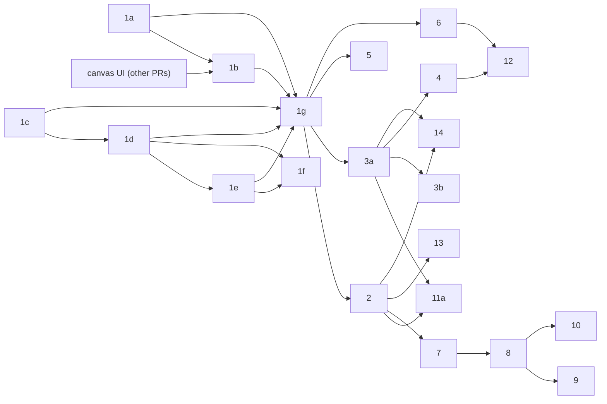
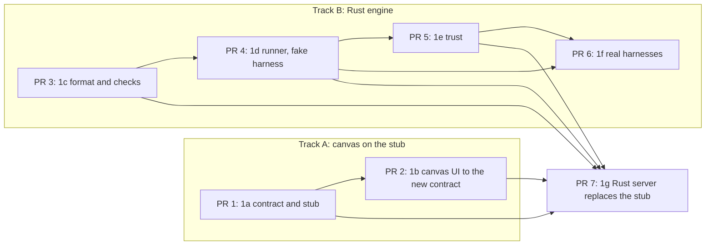

<!-- SPDX-License-Identifier: Apache-2.0 -->

# Workflows: implementation plan

**Status:** Proposed, with the [design](workflows.md). This plan is the one place that says what each slice adds, what
it needs and how it is tested. The design, the [specification](workflows-spec.md) and
[the exports note](workflows-exports.md) hold the rules and the decisions (D1 and up) that this plan cites.

The first release is slices 1, 2, 3a and 11a. In slice 1, the canvas track (1a, 1b) and the engine track (1c to 1f) can
run in parallel and join at 1g. The release runs the review workflow ported from the
`k-adversarial-pull-request-review` SOP, in sequence, from the runner and the canvas. It writes no Kiro or Claude native
files. Those exports are slice 14.

## Slices and steps at a glance

"Already exists" lists what the repo has today, checked by reading `workflow-engine/` and `workflow-canvas/` on this
branch. A row says "not verified" where it could not be confirmed. `workflow-engine/` holds only
`examples/hello-plan.yml`. There is no Rust engine yet, so the proof of concept is the canvas: its API contract, its
TypeScript stub and its tests.

| #   | Adds                                                        | You can now ...                                                                                         | Needs              | Already exists                                                                                                                                                                     |
| --- | ----------------------------------------------------------- | ------------------------------------------------------------------------------------------------------- | ------------------ | ---------------------------------------------------------------------------------------------------------------------------------------------------------------------------------- |
| 1a  | Contract and stub for the first-release format              | Check a first-release file against the stub and see later keys named                                    | none               | `api/openapi.yaml` (six operations) and the stub for the base format, with the 12 shared codes                                                                                     |
| 1b  | Bring the Designer and Execution UI up to the new contract  | Edit and save a first-release workflow in the browser without losing a key, and see why a stage blocked | 1a, canvas UI      | The Designer and Execution tabs, editing and run panels are built in open canvas pull requests that have not merged. Its editor writes only `name` and `agent` for a changed stage |
| 1c  | Format and checks in Rust                                   | Run `flow check` and `flow show` on `hello-plan.yml`                                                    | none               | `examples/hello-plan.yml`; a TypeScript validator in the stub to compare against                                                                                                   |
| 1d  | Stage prompt and the runner on the fake harness             | Run a workflow with `--harness fake` and get a pass or a halted run                                     | 1c                 | The stub's run simulator with an injected clock (it runs nothing)                                                                                                                  |
| 1e  | Trust                                                       | Confirm a workflow at a prompt, be asked again after it changes, and get exit 77 with no terminal       | 1d                 | Not verified: no trust code found in `cli/` or the canvas                                                                                                                          |
| 1f  | Real harnesses: `kiro-cli` (V2 and V3) and `claude`         | Run `hello-plan` on Kiro CLI or Claude Code                                                             | 1d, 1e             | Install harnesses `kiro-cli-v2` and `kiro-v3` exist in `cli/konductor-rs` (synth); no runner                                                                                       |
| 1g  | Canvas server in Rust and `flow view`                       | Open the canvas on a real file and run it for real                                                      | 1a, 1b, 1c, 1d, 1e | The stub's session, token and route code in `stub-api/http/` is the model                                                                                                          |
| 2   | Data between stages                                         | Pass a file from one stage to the next and set params                                                   | 1g                 | Nothing for templates or `outputs`. The stub's `RunRequest` carries `params.goal` only                                                                                             |
| 3a  | `run` checks and `done_when`, `flow verify <run-id>`        | Make a stage pass only when Konductor has run its checks                                                | 1g                 | Nothing. The stub has no `accept` or `done_when` (verified)                                                                                                                        |
| 11a | First port of the review SOP                                | Run the adversarial review as a workflow                                                                | 2, 3a              | The SOP `agent-sops/k-adversarial-pull-request-review.sop.md`; nothing built into the binary                                                                                       |
| 3b  | `intent.writes` and command stages                          | Run a command as a stage, and be warned about stray changes                                             | 3a                 | Nothing                                                                                                                                                                            |
| 4   | Loops back to an earlier stage                              | Repeat a stage until a check passes, with a limit                                                       | 3a                 | Nothing                                                                                                                                                                            |
| 5   | Human gates                                                 | Pause for approval or an answer                                                                         | 1g                 | Nothing                                                                                                                                                                            |
| 6   | Parallel stages                                             | Run review passes at the same time                                                                      | 1g                 | Nothing                                                                                                                                                                            |
| 7   | Reuse                                                       | Include or extend another workflow                                                                      | 2                  | Nothing                                                                                                                                                                            |
| 8   | Layers and patches                                          | Change a shipped workflow without copying it                                                            | 7                  | Nothing                                                                                                                                                                            |
| 9   | Canvas patch editing                                        | Edit a shipped workflow in the canvas                                                                   | 8                  | Nothing                                                                                                                                                                            |
| 10  | Customization in chat                                       | Ask the agent to adapt a workflow                                                                       | 8                  | Nothing                                                                                                                                                                            |
| 11b | Later SOP ports and `fallback_sop`                          | Run more SOPs as workflows                                                                              | 11a, 2 to 7        | Nothing                                                                                                                                                                            |
| 12  | Runner-only features                                        | Use conditions, per-item stages, a budget and worktrees                                                 | 4, 6               | Nothing                                                                                                                                                                            |
| 13  | The [planned keys](workflows-spec.md#planned-keys-slice-13) | Set `effort`, per-stage `model` and typed params                                                        | 2                  | Nothing                                                                                                                                                                            |
| 14  | Exports (14a Kiro, 14b Claude, 14c conformance)             | Write native Kiro and Claude files with `flow build`                                                    | 2, 3a              | Nothing                                                                                                                                                                            |

## Order and dependencies

The table above is one valid order. The real dependencies are these:

| Step | Needs              | Why                                                                                                                                |
| ---- | ------------------ | ---------------------------------------------------------------------------------------------------------------------------------- |
| 1a   | none               | It changes a contract file and a stub. Neither needs Rust.                                                                         |
| 1b   | 1a, canvas UI      | The tabs already exist in the open canvas pull requests. 1b changes them to the new contract, so it needs 1a and that work merged. |
| 1c   | none               | It needs the spec and `hello-plan.yml`, not the canvas.                                                                            |
| 1d   | 1c                 | The runner reads a checked workflow.                                                                                               |
| 1e   | 1d                 | `flow run`, which 1d adds, calls the trust gate. The hash covers the workflow file and its prompt files, which the format defines. |
| 1f   | 1d, 1e             | A real harness needs the runner, and D14 forbids a run of an unconfirmed project workflow.                                         |
| 1g   | 1a, 1b, 1c, 1d, 1e | The server implements the new contract, passes the 1b Playwright tests, checks files, starts runs and answers `trust_required`.    |
| 2    | 1g                 | A canvas control and an engine key ship together (D13), so the canvas must already run on the engine.                              |
| 3a   | 1g                 | A check key is a canvas control and an engine key together (D13), so the canvas must already run on the engine.                    |
| 11a  | 2, 3a              | The port uses params, outputs and checks.                                                                                          |
| 14   | 2, 3a              | An export states outputs and param defaults (slice 2) and renders the checks (3a).                                                 |

Where the order differs from the obvious one, and why:

- **The canvas starts before the engine.** 1a needs no Rust. The Designer and Execution tabs are already built in open
  canvas pull requests, so the canvas track is 1a and then 1b, which brings that UI up to the new contract. 1g needs
  both tracks.
- **1c is the first Rust step, not the runner.** A runner without a checked file has nothing to run. The core crate and
  its no-IO test come first.
- **Trust (1e) comes before the real harnesses (1f).** A real harness runs commands from the repo, so D14 must hold
  before the first real run.
- **Slice 2 waits for 1g.** Otherwise a key would reach the engine before the canvas could show it (D13).
- **3a does not need slice 2.** The two can be built in parallel. The table lists 2 first.
- **11a comes before 3b.** The first port needs checks, not command stages.
- **Slice 14 needs 2 and 3a, not 11a.** An export states outputs and param defaults (slice 2) and renders the checks
  (3a). It does not need the port.

## Size rule

A slice is one feature with one demo line. It is cut into lettered steps (1a, 1b, 1c) when it cannot be built,
tested and released as one unit, or when parts of it can be built in parallel or released earlier. Each step has its own
tests, demo line and release. Numbers stay stable: a decision, a code or a spec table that cites slice 6 keeps citing
it. A key belongs to a lettered step when the slice's keys arrive in more than one release, so `done_when` is 3a and
`intent.writes` is 3b.

Slice 1 is cut into seven steps because the canvas and engine tracks run in parallel, and because trust and the real
harnesses are separate releases. Slices 3 and 11 are cut in two because their later parts are not in the first release.
Slice 14 is cut into 14a Kiro, 14b Claude and 14c conformance.

## Rules for every slice

- **The engine is Rust (D7).** It lives in a Cargo workspace under `workflow-engine/`. The assumed layout is a `core`
  crate and an `adapters` crate, with the `flow` commands wired into `cli/konductor-rs`. The workspace gets its own CI
  job, like the canvas has (`.github/workflows/workflow-canvas.yml`).
- **The core crate does no IO.** A test fails the build if the crate imports file, network, process, environment, clock
  or random code, or depends on a crate outside an allow list. The test is written before the crate has any other code.
  `workflow-canvas/stub-api/core/purity.test.ts` does the same for the stub's core, and is the model.
- **Ports and adapters.** The core talks to the world through ports (traits). Each step adds only the ports it
  needs, and the adapters that implement them live in the `adapters` crate.
- **No sleeps in tests.** Time comes from a clock port, and tests use a fake clock. The stub's `Clock` and
  `fake-clock.ts` are the model.
- **The canvas shows only what the engine honors.** A control ships in the same step as the engine feature behind it
  (D13). Until then the canvas reports the key as `NOT_SUPPORTED_BY_THIS_BUILD`.
- **The subset rule.** A build at slice N validates the keys of slices 1 to N. A key of a later slice is a named error,
  `NOT_SUPPORTED_BY_THIS_BUILD`, that says which slice adds it (D3). The build slice is one constant. A test lists every
  key in the wire types with exactly one slice tag, and fails when a key has none, two, or a tag that no slice has.
- **Tests per step.** Unit tests for the core, functional tests with the fake harness through the real adapters,
  and Playwright tests for any canvas change.
- **A release is a merge to main** that passes CI. The first step that adds a command a user can run (1c) adds a
  `CHANGELOG.md` entry. Docs and an example file ship in the same change as the feature.

## How slice 1 ships

The repo already has the canvas side: the contract (`workflow-canvas/api/openapi.yaml`), the stub that serves it and the
tests around both. The Rust side does not exist. The plan ships the canvas first on the stub and builds the Rust side in
parallel against the same OpenAPI contract. The two tracks join at 1g, where the Rust server replaces the stub and the
1b tests run against it. The reason is that the canvas side needs no engine: the UI is built in open canvas pull
requests, and 1a and 1b only make it match the contract. A shared contract with a drift test
(`stub-api/core/contract-drift.test.ts`) keeps the two sides honest.

| PR  | Branch                 | What it adds                                                                                                      |
| --- | ---------------------- | ----------------------------------------------------------------------------------------------------------------- |
| 1   | `wc/contract-v1`       | 1a: contract changes, stub validator, fixtures and examples for the first-release format                          |
| 2   | `wc/designer`          | 1b: the existing Designer and Execution UI changed to the new contract, with Playwright tests and new screenshots |
| 3   | `engine/core`          | 1c: Cargo workspace, the no-IO test, the format, `flow check`, `flow show`, a CI job                              |
| 4   | `engine/runner`        | 1d: `stage_prompt`, the stage result, run state, `flow run --harness fake`                                        |
| 5   | `engine/trust`         | 1e: `flow trust <name>`, the prompt, the trust hash and record, exit 77                                           |
| 6   | `engine/harnesses`     | 1f: the `kiro-cli` and `claude` adapters                                                                          |
| 7   | `engine/canvas-server` | 1g: the Rust server for the six operations, `flow view`, the stub kept for dev and tests                          |

PRs 1 and 3 can start on day one. PR 2 is cut from `integration/workflow-canvas` after PR 1 and the canvas UI pull
requests have merged, because it needs both and a branch cannot stack on two parents. PR 2 follows PR 1, PR 4 follows PR
3, PR 5 follows PR 4, and PR 6 follows PRs 4 and 5. PR 7 follows PRs 1 to 5, so it waits for both tracks. A canvas PR
targets `main` and runs the existing canvas CI. A PR from the engine track runs the new workspace job.

## Slice 1: Skeleton

A file of stages and `file` checks that runs in the runner and opens in the canvas. Slice 1 adds the keys `format`,
`name`, `version`, `intent`, `intent.outcome`, `intent.accept` with `id` and `file`, `params.goal`, `stages` with
`name`, `agent`, `prompt` and `prompt_file`. Its seven steps follow.

### 1a: Contract and stub

- **Why now:** every later step builds against the contract, and the stub checks only the base format today.
- **YAML keys:** all slice 1 keys. Keys of later slices report `NOT_SUPPORTED_BY_THIS_BUILD` with their slice.
- **Canvas:** none.
- **API rows:** all six operations (`createSession`, `getWorkflow`, `saveWorkflow`, `checkWorkflow`, `startRun`,
  `getRun`), changed as [the spec](workflows-spec.md#requirements-on-the-canvas-api-contract) lists.
- **Engine:** none. The stub's validator, fixtures and examples change with the contract, including a workflow whose
  Run answers `trust_required`, the order of the `startRun` 409s, `reason` on `RunStage` and a workspace-wide
  `already_running`.
- **Tests:** unit: `api/openapi.test.ts`, `stub-api/core/validator.test.ts` and `contract-drift.test.ts` follow the new
  contract. Functional: the stub's HTTP tests in `stub-api/http/`. Playwright: `stub-api.spec.ts` still passes.
- **Demo:** you can post a first-release workflow to the stub, and a file with `stages[].parallel` is refused with the
  slice named.
- **Already in the PoC:** the contract and stub for the base format, with the 12 shared codes (verified).

### 1b: The canvas UI on the new contract

- **Why now:** the Designer and Execution tabs are built in open canvas pull requests against the base contract. They
  must keep every key of the new format on save (D13) and show what the new contract adds.
- **YAML keys:** the slice 1 keys, edited through form controls and a raw YAML editor (D13).
- **Canvas:** the editor keeps a stage's other keys (`prompt`, `prompt_file`, and the later `outputs` and `done_when`)
  when it rewrites that stage, and no save drops `format`, `version`, `params` or a comment outside the stage block. A
  file the editor cannot edit in place is not rewritten whole, and the editor says why. The Execution tab shows a
  blocked stage's `reason`. A 401 drops the stored token and tells the user to start `flow view` again. A
  `trust_required` answer opens a dialog that shows the `fix` command with a copy button and a Run again button. The
  harness values include `claude` and `fake`. Both tabs show only slice 1 keys.
- **API rows:** all six.
- **Engine:** none. The page talks to the stub.
- **Tests:** unit: the editor's writer for each stage layout, with first-release stages that carry `prompt` and
  `prompt_file`, and the test fixtures in the new format. Functional: the page against the stub. Playwright: open, edit,
  save, a refused stale save, run, and a Run that answers `trust_required`.
- **Demo:** you can edit `hello-plan` in the browser, change a stage's agent, save, and find every other key in the file
  unchanged, then watch a fake run pass.
- **Already in the PoC:** the open canvas pull requests build the Designer, the Execution tab, editing and saving, the
  theme and the Playwright tests. Their stage writer writes only `name` and `agent` for a changed stage, and their test
  fixtures use the base format (a one-line `intent`, no `format` or `version`), so they change with 1b.

### 1c: Format and checks in Rust

- **Why now:** it is the base of every other engine step, and it needs no canvas.
- **YAML keys:** all slice 1 keys, with the [rules for every file](workflows-spec.md#rules-for-every-file).
- **Canvas:** none.
- **API rows:** none yet. 1g serves `checkWorkflow` from this code.
- **Engine:** the `core` crate: a YAML loader for the supported subset, the key table with slice tags, the checks and
  diagnostic codes, limits and path rules, and `NOT_SUPPORTED_BY_THIS_BUILD`. The `adapters` crate: a file source.
  Ports: `WorkflowSource`. Commands: `flow check`, `flow show` with `--json`. The YAML nesting limit.
  The loader uses the event parser of the `saphyr-parser` crate (MIT or Apache-2.0) with a thin tree builder of our own.
  The parser gives a start and end position for each scalar and shows anchors, aliases, tags, extra documents and the
  `<<` key, so the builder rejects them. It does not detect duplicate keys, so the builder does, and it enforces the
  nesting limit over the events. Its positions count characters, not bytes, so the builder converts them. The end of a
  double-quoted scalar can run past the closing quote, so the builder finds the end of a quoted value itself. A spike
  compared it with `serde_yaml` (no positions) and `marked-yaml` (accepts duplicate keys, start position only).
- **Tests:** unit: the no-IO test first, then a case per code, YAML nested past the limit, a byte order mark, non-ASCII
  text, CRLF line ends, a quoted value followed by a comment, a block scalar, a file near the size limit, the
  one-slice-per-key test, and byte-identical `--json` whatever the key order. Functional: `flow check` on
  `hello-plan.yml` and on broken files. `konductor install`, `update` and `uninstall` leave `.konductor/workflows/`
  alone. Playwright: none.
- **Demo:** you can run `flow check hello-plan` and `flow show hello-plan --json`.
- **Already in the PoC:** `hello-plan.yml`, and a TypeScript validator, YAML subset reader and source map in
  `stub-api/core/` that model the same checks. How closely they match the spec is not verified.

### 1d: Stage prompt and the runner on the fake harness

- **Why now:** it proves the run model (D8, D21) before any real tool is involved.
- **YAML keys:** none new.
- **Canvas:** none.
- **API rows:** none yet. 1g serves `startRun` and `getRun` from this code.
- **Engine:** `stage_prompt` as a pure function (D10) with golden files; the [stage
  result](workflows-spec.md#stage-result) parser; run, stage and check states; `flow run --harness fake`. Ports:
  `Harness`, `Clock`, `RunStore` and `RunLock` (a per-workspace lock with its owner's PID and start time). The `fake`
  harness replays scripted replies and is for tests only. The
  [limits](workflows-spec.md#limits): the stage time limit decided against the clock port, and the output byte caps.
- **Tests:** unit: golden prompts, a case per way a result line is invalid, state transitions with a fake clock, a stage
  that exceeds its time limit (`TIMEOUT`), a run whose owner is gone reads `halted`, a live owner refuses a second run,
  a param or prompt over its cap. Functional: a run through the real run store on the fake harness, including a missing
  result line (blocked) and a run that was `running` when the process stopped (`halted`). Playwright: none.
- **Demo:** you can run `hello-plan` with `--harness fake` and get `passed`, and a bad reply halts the run with exit 1.
- **Already in the PoC:** the stub's `RunSimulator` fakes runs from a clock, passes every stage and runs nothing.

### 1e: Trust

- **Why now:** D14 must hold before any real harness runs.
- **YAML keys:** none.
- **Canvas:** none.
- **API rows:** none yet. 1g adds `trust_required` to `startRun`.
- **Engine:** the [trust rules](workflows-spec.md#trust): the summary and prompt in `flow run`, `flow trust <name>` with
  `--yes` and `--revoke <name>`, `--trust` and `KONDUCTOR_TRUST`, the `trust_hash` of `flow check`, the per-workflow
  hash and the record. The summary lists each agent's allowed tools and the repo tool configuration files, which the
  hash covers; a repo that has them needs confirmation for shipped and user workflows too. The record is written to a
  temporary file and renamed under a lock, and an unreadable record means nothing is trusted. Ports: `TrustStore`,
  `Terminal` and `AgentCatalog` (finds an agent as the [spec](workflows-spec.md#harness-invocation) says and reads its
  allowed tools). A Claude agent with no `tools` key lists all tools, and approval still comes from the user's settings.
  The step checks whether the install manifest records a hash for each installed file. The hash layout is fixed here
  ([deferred](workflows-spec.md#deferred-to-a-later-slice)).
- **Tests:** unit: the hash is stable, and changes with the workflow's bytes or a `prompt_file`'s bytes but not with
  another workflow; the loader hashes the bytes it parses. Functional: yes records trust, no exits 77 and runs nothing,
  no terminal exits 77 naming both ways, `--trust` matches or mismatches, a changed file asks again, revoke removes the
  record, and the record file has mode 0600, the summary lists each agent's allowed tools, a repo with a
  `.claude/settings.json` asks for a shipped workflow, two writers do not lose an update, an unreadable record trusts
  nothing, and `flow trust` on a user or shipped workflow exits 0 and writes no record. Playwright: none.
- **Demo:** you can run an untrusted workflow, confirm at the prompt, edit the file and be asked again, and in a run
  with no terminal get exit 77 with `--trust` named.
- **Already in the PoC:** not verified. No trust code found.

### 1f: Real harnesses

- **Why now:** until a real tool runs a stage, no part of the run model is tested against reality.
- **YAML keys:** none.
- **Canvas:** none.
- **API rows:** none.
- **Engine:** adapters for `kiro-cli` (V2 with `--v2`, V3 with `--v3` and `--trust-tools` ids from the agent's allow
  list; D16, D19) and `claude -p --output-format json`. Harness choice by installed install harness
  ([rule](workflows-spec.md#commands-and-exit-codes)). A stage whose agent the harness cannot see fails before the first
  stage, with the message the spec describes. Ports: `ProcessLauncher`.
- **Tests:** unit: argument building for each harness, tool-id mapping. Functional: the adapters against a fake
  executable that prints a scripted reply, and a process group killed after its grace period. Playwright: none. By hand:
  one run on each of Kiro V2, Kiro V3 and Claude, and one with an install made to a `--target` that is neither the
  project root nor `$HOME`. Also check, for each tool, which definition runs when the repo defines an agent with the
  same id, whether `claude --bare` still loads Konductor's agents, and the host's command-line argument limit against
  the prompt cap.
- **Demo:** you can run `hello-plan` on Kiro CLI or Claude Code and read `PLAN.md`.
- **Already in the PoC:** `kiro-cli-v2` and `kiro-v3` install harnesses are in `cli/konductor-rs` (synth). No runner.

### 1g: Canvas server in Rust and `flow view`

- **Why now:** this joins the tracks. The stub stops being the server.
- **YAML keys:** none new.
- **Canvas:** none. The page already talks to the contract. `WC_API_TARGET` points it at the Rust server.
- **API rows:** all six, from the engine. `startRun` answers `trust_required` with a `fix` that names the exact command,
  for example `konductor flow trust hello-plan`, and `harness_unavailable` covers `claude`. The canvas cannot grant
  trust.
- **Engine:** an HTTP adapter on loopback with the launch code and session token, `flow view` (which asks first for an
  untrusted workflow), saves with `base_hash` that keep trust under the [canvas rule](workflows-spec.md#trust). Ports:
  an HTTP adapter only, with no new core port.
- **Tests:** unit: request guards. Functional: the stub's own HTTP test suite pointed at the Rust server, plus the drift
  test. Playwright: the 1b tests run with `WC_API_TARGET` on the Rust server. A save that adds `run` argv or changes an
  `agent` leaves the record, and the next Run answers `trust_required`. A prompt-only save keeps trust.
- **Demo:** you can run `flow view hello-plan`, edit a prompt in the browser and run it on a real harness without
  leaving the browser.
- **Already in the PoC:** the stub's session, guard and route code in `stub-api/http/` (verified) is the model.

## Slice 2: Data between stages

- **Why now:** the port needs params and a way to pass work between stages, and slice 1 gives stages no declared way to
  pass data, so they can only share files they happen to write.
- **YAML keys:** `stages[].outputs` as a map of output name to path, `params.<name>` with `type: string`, `description`,
  `default` and `required`, and template references `{run.param}` and `{stage.output}` in prompts, where
  `{stage.output}` renders as the output's path. The escape for literal reference text arrives here
  ([deferred](workflows-spec.md#deferred-to-a-later-slice)).
- **Canvas:** a params panel, an outputs editor on each stage with a row per name and path, and a diagnostic on a bad
  reference.
- **API rows:** `getWorkflow`, `saveWorkflow` and `checkWorkflow` carry the new keys. `startRun` takes the declared
  params, so the contract's `params` object widens beyond `goal`.
- **Engine:** a template parser that runs once at load (no regex substitution), param resolution,
  `flow run --param name=value`, the `Files this stage must write` line in `stage_prompt`, a load-time check that each
  `{stage.output}` names a declared output, and a runner check that each declared output path exists.
- **Tests:** unit: hostile-input tests for templates, a reference to an undeclared output, a reference to a later
  stage's output (`INVALID_VALUE`), references to the same stage's and an earlier stage's outputs (accepted), `{1.5}`
  left literal, output and param names that break their patterns (`INVALID_NAME`), a reference that renders the path and
  not the content, golden prompts with and without `outputs`. Functional: on the fake
  harness, a stage that does not write its output is blocked, a stage whose output existed before and is unchanged is
  blocked, and a stage that creates or modifies it passes. Playwright: add a param, add an output name and path, run.
- **Demo:** you can have a `plan` stage declare `design: DESIGN.md` and an `implement` stage told to read
  `{plan.design}`, which renders as `DESIGN.md`, with the run blocked if the file is missing.
- **Already in the PoC:** nothing. The stub's `RunRequest` carries `params.goal` only (verified).

## Slice 3: Checks and command stages

Slice 3 ships in two steps. 3a is in the first release. 3b is not.

### 3a: Checks

- **Why now:** a stage should pass on evidence Konductor gathers itself (D8), and the port needs it.
- **YAML keys:** `intent.accept[].run` and `stages[].done_when`.
- **Canvas:** a check editor for `file` and `run` kinds, and a `done_when` picker.
- **API rows:** `getWorkflow`, `saveWorkflow`, `checkWorkflow`. `getRun` has to report check states, which the contract
  does not yet say (see [follow-ups](#follow-ups-for-the-design)).
- **Engine:** run a `run` check as argv with no shell in the project root, `done_when` gating a stage, check states
  (`verified`, `deferred`), `flow verify <run-id>` (which asks for trust as `flow run` does) with its three results and
  exit codes.
- **Tests:** unit: quoting and argv tests, the result table. Functional: on the fake harness, a failing command fails
  the stage, a check past its time limit blocks it, and `flow verify` repeats it. Playwright: add a check, attach it to
  a stage, see it fail.
- **Demo:** you can attach a `run` check to a stage and see the stage block when the command exits non-zero.
- **Already in the PoC:** nothing.

### 3b: Command stages and `intent.writes`

Not in the first release. See [the stubs](#slices-not-in-the-first-release).

## Slice 11a: SOP library, first port

- **Why now:** it is the first release's proof that the format can carry a real procedure.
- **YAML keys:** none new. It uses `params` (`diff_input` required, `pr_url`, and `output_file` with default
  `adversarial-review-report.md`, all strings), sequential agent stages, `outputs` and checks.
- **Canvas:** none. The workflow opens like any other.
- **API rows:** none new.
- **Engine:** shipped workflows built into the binary and named `library/<name>` (D6), with lookup that reaches them.
  The port is `library/k-adversarial-pull-request-review`, named by the [rule for SOP
  ports](workflows-spec.md#where-workflows-live). The port's stages follow the SOP's steps (ingest, review passes in
  sequence, reuse, validate, filter, verdict). Parallel review passes wait for slice 6. The stages use agents with no
  write tool, except the stage that writes the report.
- **Tests:** unit: a parity test that each SOP step maps to a stage or is listed as left out, golden files for the
  stages' prompts. Functional: the port on the fake harness end to end. Playwright: open `library/<name>` in the canvas.
  By hand: one run on each runner harness.
- **Demo:** you can run the shipped review workflow (`library/k-adversarial-pull-request-review`) on a diff and get the
  report file.
- **Already in the PoC:** the SOP exists in `agent-sops/` (verified). Nothing is built into the binary.

## Slices not in the first release

Each stub gives Adds, Needs and Demo. A full section is written when the slice is scheduled.

- **3b, command stages and `intent.writes`.** Adds the stage kind `stages[].run` and the `intent.writes` list with a
  warning for stray changes. Needs 3a. This step adds the first warning code, so it also decides whether a run with a
  warning exits 0 or 6 (`cli/README.md` defines 6 as success with warnings). Demo: you can run a command as a stage and
  be warned when it changes other files.
- **4, loops.** Adds `on_fail`, `max_iterations` and `on_exhausted`. Needs 3a. Demo: you can send a failed stage back to
  an earlier one, with a limit.
- **5, human gates.** Adds the stage kinds `human_review` and `human_input`. Needs 1g. Demo: you can pause a run for an
  approval or an answer in the canvas.
- **6, parallel stages.** Adds `stages[].parallel`. Needs 1g. Demo: you can run the review passes at the same time.
- **7, reuse.** Adds the stage kind `uses`, to include or extend another workflow. Needs 2. Demo: you can build one
  workflow from another.
- **8, layers and patches.** Adds `renamed_from` and `required` and the patch layers. Needs 7. Demo: you can change a
  shipped workflow without copying it.
- **9, canvas patch editing.** Needs 8. Demo: you can edit a shipped workflow in the canvas and save a patch. D12
  rejects edit operations and this slice plans them, so one of them changes first (see
  [follow-ups](#follow-ups-for-the-design)).
- **10, customization in chat.** A skill that adapts a workflow. A workflow written by the chat is untrusted until the
  user confirms it. Needs 8. Demo: you can ask the agent to change a
  workflow and get a patch.
- **11b, later ports and `fallback_sop`.** Adds the remaining SOP ports and the `fallback_sop` key. Needs 11a and slices
  2 to 7. Demo: you can run another SOP as a workflow, and fall back to the SOP on a harness with no workflows.
- **12, runner-only features.** Adds `runner_options`, conditions, per-item stages, a budget and worktrees.
  Needs 4 and 6. Demo: you can cap a run's cost and isolate a stage in a worktree.
- **13, planned keys.** Adds the [slice 13 keys](workflows-spec.md#planned-keys-slice-13). Needs 2. Demo: you can set a
  stage's `effort` and `model` tier.
- **14, exports.** Adds `flow build`, `targets`, the Kiro and Claude renderers, the final verify step, the feature
  matrix and its test, and the conformance check against both tools ([exports note](workflows-exports.md)). Needs 2 and
  3a. Demo: you can run `flow build hello-plan` and run the Kiro and Claude files natively. Cut into 14a Kiro, 14b
  Claude and 14c conformance.

## Definition of done

A step is done when all of these hold:

- The subset table is raised: the build slice constant moves, and the one-slice-per-key test passes.
- Tests pass: unit, functional with the fake harness and, for canvas changes, Playwright.
- The canvas shows nothing the engine does not honor.
- The demo works with the fake harness, and once by hand on each real harness the step adds.
- Docs and an example file ship in the same change.
- Contract tests pass: `npm run api:lint`, the drift test, and the stub test suite against the real server once 1g
  exists.

## Follow-ups for the design

Edits that other docs need so nothing is left dead.

- The spec's canvas-contract requirements do not say how `getRun` reports check results. Slice 3a needs that answer.
- The stub reads no files, so it cannot raise `INVALID_VALUE` for a missing `prompt_file`. Decide in 1a whether the
  stub checks only the path rules, and say so in the contract.
- `cli/README.md` changes in 1c (the `flow` commands) and in 1e (the `77` row), as [the
  spec](workflows-spec.md#commands-and-exit-codes) says.
- `README.md` of `workflow-canvas/` says the only harness is `kiro-cli` and lists a base format. It changes in 1a.
- D12 and slice 9 disagree about edit operations. Resolve before slice 9.
