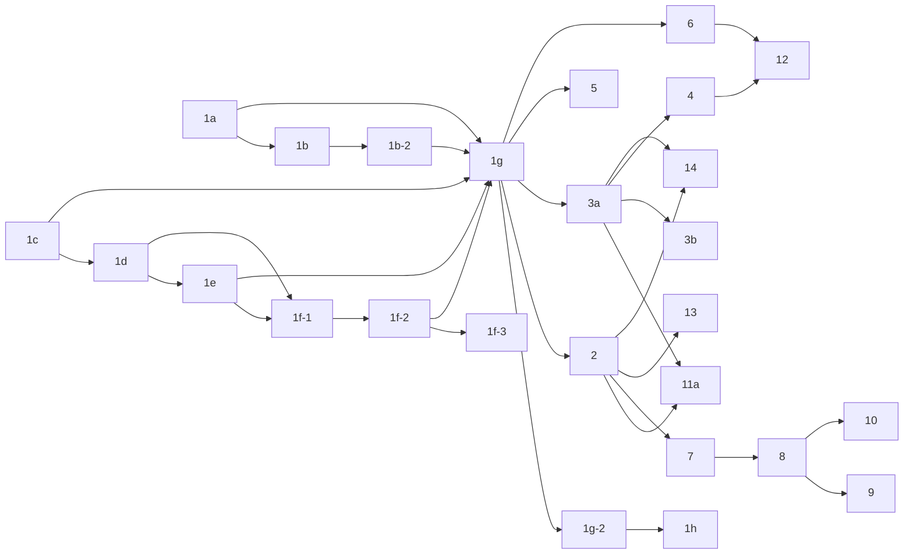

<!-- SPDX-License-Identifier: Apache-2.0 -->

# Workflows: implementation plan

This plan is the one place that says what each slice adds, what it needs and how it is tested. The design, the
[specification](workflows-spec.md) and [the exports note](workflows-exports.md) hold the rules and the decisions (D1
and up) that this plan cites.

The first release is slices 1, 2, 3a and 11a. In slice 1, the canvas track (1a, 1b, 1b-2) and the engine track (1c to
1f-2) can run in parallel and join at 1g, which needs both tracks, real harnesses included. The release runs the review
workflow ported from the `k-adversarial-pull-request-review` SOP, in sequence, from the CLI. It writes no Kiro or
Claude native files. Those exports are slice 14.

## Slices and steps at a glance

| #    | Adds                                                                               | You can now ...                                                                                         | Needs                                |
| ---- | ---------------------------------------------------------------------------------- | ------------------------------------------------------------------------------------------------------- | ------------------------------------ |
| 1a   | Contract and stub for the first-release format                                     | Check a first-release file against the stub and see later keys named                                    | none                                 |
| 1b   | Bring the Designer and Execution UI up to the new contract                         | Edit and save a first-release workflow in the browser without losing a key, and see why a stage blocked | 1a                                   |
| 1b-2 | The multi-line prompt control and a parser-based value writer                      | Edit the prompt of a `>-` stage in the browser and find every other byte unchanged                      | 1b                                   |
| 1c   | Format and checks in Rust                                                          | Run `flow check` and `flow show` on `hello-plan.yml`                                                    | none                                 |
| 1d   | Stage prompt and the runner on the fake harness                                    | Run a workflow with `--harness fake --fake-script <path>` and get a pass or a halted run                | 1c                                   |
| 1e   | Trust                                                                              | Confirm a workflow at a prompt, be asked again after it changes, and get exit 77 with no terminal       | 1d                                   |
| 1f-1 | Process launcher, Kiro CLI adapters, Kiro conformance and the `doctor` version pin | Run `hello-plan` on Kiro CLI                                                                            | 1d, 1e                               |
| 1f-2 | Claude adapter, the tool-to-rule map and Claude's conformance checks               | Run `hello-plan` on Claude Code                                                                         | 1f-1                                 |
| 1f-3 | An optional ACP harness                                                            | Run a workflow on Kiro CLI or Claude Code through ACP                                                   | 1f-2                                 |
| 1g   | Canvas server in Rust and `flow view`                                              | Open the canvas on a real file and run it for real                                                      | 1a, 1b, 1b-2, 1c, 1d, 1e, 1f-1, 1f-2 |
| 1g-2 | The agent list, the field information, the session fields and the run history      | Open the canvas on the real server, pick an agent from a list, and see past runs                        | 1g                                   |
| 1h   | Run events: an event sink on the runner and `events.jsonl` in the run folder       | See a run's stage changes, with times, in the order they happened, as the canvas contract reads them    | 1g-2                                 |
| 2    | Data between stages                                                                | Pass a file from one stage to the next and set params                                                   | 1g                                   |
| 3a   | `run` checks and `done_when`, `flow verify <run-id>`                               | Make a stage pass only when Konductor has run its checks                                                | 1g                                   |
| 11a  | First port of the review SOP                                                       | Run the adversarial review as a workflow                                                                | 2, 3a                                |
| 3b   | `intent.writes` and command stages                                                 | Run a command as a stage, and be warned about stray changes                                             | 3a                                   |
| 4    | Loops back to an earlier stage                                                     | Repeat a stage until a check passes, with a limit                                                       | 3a                                   |
| 5    | Human gates                                                                        | Pause for approval or an answer                                                                         | 1g                                   |
| 6    | Parallel stages                                                                    | Run review passes at the same time                                                                      | 1g                                   |
| 7    | Reuse                                                                              | Include or extend another workflow                                                                      | 2                                    |
| 8    | Layers and patches                                                                 | Change a shipped workflow without copying it                                                            | 7                                    |
| 9    | Canvas patch editing                                                               | Edit a shipped workflow in the canvas                                                                   | 8                                    |
| 10   | Customization in chat                                                              | Ask the agent to adapt a workflow                                                                       | 8                                    |
| 11b  | Later SOP ports and `fallback_sop`                                                 | Run more SOPs as workflows                                                                              | 11a, 2 to 7                          |
| 12   | Runner-only features                                                               | Use conditions, per-item stages, a budget and worktrees                                                 | 4, 6                                 |
| 13   | The [planned keys](workflows-spec.md#planned-keys-slice-13)                        | Set `effort`, per-stage `model` and typed params                                                        | 2                                    |
| 14   | Exports (14a Kiro, 14b Claude, 14c conformance)                                    | Write native Kiro and Claude files with `flow build`                                                    | 2, 3a                                |

## Order and dependencies

The table above is one valid order. The real dependencies are these:

| Step | Needs                                | Why                                                                                                                                                        |
| ---- | ------------------------------------ | ---------------------------------------------------------------------------------------------------------------------------------------------------------- |
| 1a   | none                                 | It changes a contract file and a stub. Neither needs Rust.                                                                                                 |
| 1b   | 1a                                   | 1b changes the Designer and Execution tabs to the new contract, so it needs only 1a.                                                                       |
| 1b-2 | 1b                                   | 1b-2 adds the prompt control to the Designer tab that 1b brings up to the contract, so it needs 1b.                                                        |
| 1c   | none                                 | It needs the spec and `hello-plan.yml`, not the canvas.                                                                                                    |
| 1d   | 1c                                   | The runner reads a checked workflow.                                                                                                                       |
| 1e   | 1d                                   | `flow run`, which 1d adds, calls the trust gate. The hash covers the workflow file and its prompt files, which the format defines.                         |
| 1f-1 | 1d, 1e                               | A real harness needs the runner, and D14 forbids a run of an unconfirmed project workflow.                                                                 |
| 1f-2 | 1f-1                                 | The Claude adapter uses the launcher and the harness choice that 1f-1 adds.                                                                                |
| 1f-3 | 1f-2                                 | A third adapter behind the Harness trait. Nothing needs it. It gives Claude live output, which `claude -p` json does not.                                  |
| 1g   | 1a, 1b, 1b-2, 1c, 1d, 1e, 1f-1, 1f-2 | The server implements the six operations of the contract, checks files, starts runs on a real harness and answers `trust_required`.                        |
| 1g-2 | 1g                                   | It adds what 1g leaves out, and the page needs `stage_fields` to load. `getRunEvents` and its stub-suite skips come off in 1h.                             |
| 1h   | 1g-2                                 | The server reads the log file the runner writes. `capabilities`, which 1g-2 adds, lists `getRunEvents` once it is served.                                  |
| 2    | 1g                                   | A canvas control and an engine key ship together (D13), so the canvas must already run on the engine.                                                      |
| 3a   | 1g                                   | A check key is a canvas control and an engine key together (D13), so the canvas must already run on the engine.                                            |
| 11a  | 2, 3a                                | The port uses params, outputs and checks.                                                                                                                  |
| 14   | 2, 3a                                | An export states outputs and param defaults (slice 2) and renders the checks (3a).                                                                         |

Where the order differs from the obvious one, and why:

- **The canvas starts before the engine.** 1a needs no Rust. The canvas track is 1a and then 1b, which brings the
  Designer and Execution UI up to the new contract, and then 1b-2, which adds the `prompt` control. 1g needs both
  tracks.
- **1c is the first Rust step, not the runner.** A runner without a checked file has nothing to run. The core crate and
  its no-IO test come first.
- **Trust (1e) comes before the real harnesses (1f-1, 1f-2).** A real harness runs commands from the repo, so D14 must
  hold before the first real run.
- **1g waits for the real harnesses.** The canvas server starts real runs, and its demo runs a real harness, so it needs
  1f-1 and 1f-2 as well as the runner.
- **1g waits for the prompt control.** Its demo edits a prompt in the browser, so it needs 1b-2 (D39).
- **1f-3 is optional.** It needs 1f-2, nothing needs it, and it is not in the first release. It is off the critical
  path: slices 2, 3a and 11a, and 1g, do not wait for it.
- **1g-2 follows 1g and ships back to back with it.** 1g builds the contract of its own cut, and 1g-2 adds the later
  operations and fields (D47). The page needs `stage_fields` to load, so the first release needs both. `getRunEvents`
  and the stub-suite skips for it are [1h](#1h-run-events)'s.
- **1h follows 1g-2.** The `capabilities` list that 1g-2 adds is where 1h lists `getRunEvents`.
- **Slice 2 waits for 1g.** Otherwise a key would reach the engine before the canvas could show it (D13).
- **3a does not need slice 2.** The two can be built in parallel. The table lists 2 first.
- **11a comes before 3b.** The first port needs checks, not command stages.
- **Slice 14 needs 2 and 3a, not 11a.** An export states outputs and param defaults (slice 2) and renders the checks
  (3a). It does not need the port.

## Size rule

A slice is one feature with one demo line. It is cut into lettered steps (1a, 1b, 1c) when it cannot be built,
tested and released as one unit, or when parts of it can be built in parallel or released earlier. Each step has its own
tests, demo line and release. Numbers stay stable: a decision, a code or a spec table that cites slice 6 keeps citing
it. A key belongs to a lettered step when the slice's keys arrive in more than one release, so `done_when` is 3a and
`intent.writes` is 3b.

A step that is cut again takes a number after its letter, so 1f is 1f-1, 1f-2 and 1f-3.

Slice 1 is cut into nine steps, an optional tenth, 1f-3, that the first release does not need, a second part of 1g,
1g-2, that adds the later contract operations and fields (D47) and that the first release needs, and 1h, the run
events. The cuts are there because the canvas and engine tracks run in parallel, and because trust and the real
harnesses are separate releases. The prompt control is its own step, 1b-2, because it needs a YAML parser that the other
Designer edits do not (D39). The step stays "1b-2" beside "1b" and is not renamed 1b-1, and "1g" stays "1g" beside
"1g-2". The harnesses are two steps: 1f-1 (the launcher and Kiro CLI) ships before 1f-2 (Claude Code). The optional
1f-3 adds a third adapter. Slices 3 and 11 are cut in two because their later parts are not in the first release. Slice
14 is cut into 14a Kiro, 14b Claude and 14c conformance. Slices 11b and 12 bundle several features, and are cut into
lettered steps when they are scheduled.

## Rules for every slice

- **The engine is Rust (D7).** It lives in a Cargo workspace under `workflow-engine/`. The assumed layout is a `core`
  crate and an `adapters` crate, with the `flow` commands wired into `cli/konductor-rs`. The workspace gets its own CI
  job.
- **The core crate does no IO.** A test fails the build if the crate imports file, network, process, environment, clock
  or random code, or depends on a crate outside an allow list. The test is written before the crate has any other code.
  `workflow-canvas/stub-api/core/purity.test.ts` does the same for the stub's core, and is the model.
- **Ports and adapters.** The core talks to the world through ports (traits). Each step adds only the ports it
  needs, and the adapters that implement them live in the `adapters` crate.
- **No sleeps in tests.** Time comes from a clock port, and tests use a fake clock. The stub's `Clock` and
  `fake-clock.ts` are the model.
- **The canvas shows only what the engine honors.** A control ships in the same step as the engine feature behind it
  (D13). Until then the canvas reports the key as `NOT_SUPPORTED_BY_THIS_BUILD`.
- **The subset rule.** A build at slice N validates the keys of slices 1 to N. A key of a later slice is a named error,
  `NOT_SUPPORTED_BY_THIS_BUILD`, that says which slice adds it (D3). The build slice is one constant. A test lists every
  key in the wire types with exactly one slice tag, and fails when a key has none, two, or a tag that no slice has.
- **Tests per step.** Unit tests for the core, functional tests with the fake harness through the real adapters,
  and Playwright tests for any canvas change.
- **A release is a merge to main** that passes CI. The first step that adds a command a user can run (1c) adds a
  `CHANGELOG.md` entry. Docs and an example file ship in the same change as the feature.

## How slice 1 ships

Slice 1 has two tracks. Track A, the canvas on the stub, is 1a, 1b and 1b-2. Track B, the Rust engine, is 1c to 1f-2.
They build against the same OpenAPI contract (`workflow-canvas/api/openapi.yaml`) and join at 1g, where the Rust server
replaces the stub and the 1b and 1b-2 tests run against it, from 1g-2 on. The canvas track needs no engine: 1a and 1b
only make the Designer and Execution tabs match the contract, and 1b-2 adds one control. A shared contract with a drift
test (`stub-api/core/contract-drift.test.ts`) keeps the two sides honest.

Each step is its own reviewable change on a branch named `<step>-<slug>`, such as `1a-contract`, `1b-2-prompt` or
`1c-core`. A change that touches `workflow-canvas/` runs the canvas CI. A change from the engine track runs the new
workspace job.

## Slice 1: Skeleton

A file of stages and `file` checks that runs in the runner and opens in the canvas. Slice 1 adds the keys `format`,
`name`, `version`, `intent`, `intent.outcome`, `intent.accept` with `id` and `file`, `params.goal`, `stages` with
`name`, `agent`, `prompt` and `prompt_file`. Its nine steps follow, with the optional 1f-3 after 1f-2, and 1g-2 and 1h
after 1g.

### 1a: Contract and stub

- **Why now:** every later step builds against the contract.
- **YAML keys:** all slice 1 keys. Keys of later slices report `NOT_SUPPORTED_BY_THIS_BUILD` with their slice.
- **Canvas:** none.
- **API rows:** the operations in the contract (`createSession`, `getWorkflow`, `saveWorkflow`, `checkWorkflow`,
  `startRun`, `getRun`), changed as [the spec](workflows-spec.md#requirements-on-the-canvas-api-contract) lists.
- **Engine:** none. The stub's validator, fixtures and examples change with the contract, including a workflow whose Run
  answers `trust_required`, the order of the `startRun` 409s, `reason` on `RunStage` and a workspace-wide
  `already_running`. After a save that changes a workflow's bytes, the stub answers that workflow's next Run with
  `trust_required`, as the [canvas rule](workflows-spec.md#trust) says.
- **Tests:** unit: `api/openapi.test.ts`, `stub-api/core/validator.test.ts` and `contract-drift.test.ts` follow the new
  contract. Functional: the stub's HTTP tests in `stub-api/http/`. Playwright: `stub-api.spec.ts` still passes.
- **Demo:** you can post a first-release workflow to the stub, and a file with `stages[].parallel` is refused with the
  slice named.

### 1b: The canvas UI on the new contract

- **Why now:** the Designer and Execution tabs must keep every key of the new format on save (D13) and show what the
  new contract adds.
- **YAML keys:** the slice 1 keys, edited through form controls (D13). 1b edits `name` and `agent`, and 1b-2 edits
  `prompt`.
- **Canvas:** the editor keeps a stage's other keys (`prompt`, `prompt_file`, and the later `outputs` and `done_when`)
  when it rewrites that stage, and no save drops `format`, `version`, `params` or a comment outside the stage block. 1b
  keeps `prompt` and leaves editing it to 1b-2. A file the editor cannot edit in place is not rewritten whole, and the
  editor says why. The Execution tab shows a blocked stage's `reason`. The page keeps the session token in the
  `sessionStorage` of its tab, so a reload resumes the session. A 401 drops the token and tells the user to start
  `flow view` again. A `trust_required` answer opens a dialog that shows the `fix` command with a copy button and a Run
  again button. The harness values include `claude` and `fake`. Both tabs show only slice 1 keys.
- **API rows:** all six.
- **Engine:** none. The page talks to the stub.
- **Tests:** unit: the editor's writer for each stage layout, with first-release stages that carry `prompt` and
  `prompt_file`, and the test fixtures in the new format. Functional: the page against the stub. Playwright: open, edit,
  save, a refused stale save, a Run that answers `trust_required` after a save, and a run of an unsaved trusted fixture.
- **Demo:** you can edit `hello-plan` in the browser, change a stage's agent, save, and find every other key in the file
  unchanged, see the next Run answer `trust_required` with the `fix` command, and watch a fake run of an unedited
  workflow pass.

### 1b-2: The Designer edits a stage `prompt`

- **Why now:** D13 gives every key a control, and no step built the one for `prompt`. The 1g demo edits a prompt in the
  browser (D39).
- **YAML keys:** `prompt` is edited. `prompt_file` is shown read-only.
- **Canvas:** a multi-line prompt control. A new writer finds the range of the value with the `yaml` package and
  replaces only those bytes. The range of a block scalar starts at its `|` or `>` and takes the final line break, so the
  header line is inside it. Empty text removes the key. The line writer stays for names, agents and whole stages.
  `yaml` moves from `devDependencies` to `dependencies` in `workflow-canvas/package.json`.
- **Order of forms:** the writer tries forms in order, parses each result, compares it with what was typed, and keeps
  the first that reads back as typed. If none does, it refuses, and the editor says why. The order depends on where
  the value sits:
  - In an existing block scalar, the writer keeps its style (`|` or `>`), any explicit indentation indicator and any
    comment after the header, with chomping set from the new text. This holds for single-line text too, so it can stay a
    block. If that does not read back, it tries a literal `|` block, then double quotes. An existing `|` makes the first
    two the same try. A folded `>` can read back differently, since it joins single newlines. A header comment is kept
    in a block, folded or literal, and dropped only when the text is double-quoted. Double quotes replace the whole
    block, header line included, and the edit is not refused.
  - Single-line text in a plain or quoted place is plain when it reads back as typed, and double-quoted otherwise. It
    never becomes a literal block. This holds when a comment follows the value on its line.
  - Text with a line break in a plain place or an existing quoted place becomes a literal block, then double-quoted.
    If a comment follows the value on its line, no block is possible and the text is double-quoted.
  - A plain or quoted value is replaced alone, so a comment after it stays after the new value on that line, even for
    a multi-line quoted value that becomes double-quoted. A comment on the line before a block stays too.

  A literal block that reads back differently falls to double quotes, then to a refusal. The writer adds an indentation
  indicator when the first line starts with a space, and does not refuse for that alone.
- **Characters a block cannot hold:** text with a control character (C0 or C1, except tab), U+2028, U+2029, the byte
  order mark, U+FFFE, U+FFFF or a lone surrogate cannot sit in a block, so it is double-quoted with `\u` escapes. In
  an existing block scalar it goes straight to double quotes, which drop the header comment. If that does not read
  back, the writer refuses.
- **Refusals:** the writer refuses a prompt edit, and says why, when a stage has two `prompt` keys, when the prompt
  node is an alias or has an anchor or a tag, or when the file uses a `<<` merge key. The parsers can read these
  differently (see Open questions). Changes to `name` and `agent` still save, even in a file where a prompt edit is
  refused. A save still passes the stub validator, so what the engine refuses stays refused.
- **Line endings:** in a CRLF file the typed text is written with CRLF and compared after the breaks are normalized.
  The editor does not edit a prompt in a file that has a lone carriage return anywhere, in CR-only breaks or among LF
  lines. It also refuses a prompt edit in a file with mixed line endings, any two of LF, CRLF and CR (D40). Each of
  the two refusals gives its own reason.
- **Final newline:** the line break added to a block at the end of a file is CRLF in a CRLF file. A plain or quoted
  prompt on the last line of a file with no final newline changes only its value bytes, and no newline is added (D41
  covers block scalars only). Removing a last-line key in a file with no final newline leaves the file without one.
- **Trust line:** the Designer shows one line near the text area: "Saving a prompt ends trust. The next Run asks
  again." D14 does not change.
- **API rows:** none new. The edit goes through the existing `saveWorkflow`.
- **Engine:** none. The page talks to the stub.
- **Tests:** unit: the writer on block scalars `>`, `>-`, `|` and `|-`, on quoted and plain values, a comment next to
  the value, CRLF line ends, a value at the end of the file with no final newline, the read-back refusal, empty text
  that removes the key, a lone carriage return anywhere in the file (CR-only breaks, and a stray CR among LF lines:
  the editor refuses to edit the prompt, with its own reason), mixed line endings of any two kinds (LF, CRLF, CR: the
  prompt edit is refused, with its own reason), `name`, `agent` and whole-stage edits that still save in such files, a
  block scalar that ends a file with no final newline (the new block ends with a line break inside the value, CRLF in
  a CRLF file, and no byte outside it changes), a plain or quoted prompt on the last line of a file with no final
  newline (only the value bytes change and no newline is added), and `prompt_file` shown read-only. One test per
  refusal (two `prompt` keys, an alias, an anchor or a tag on the prompt node, a `<<` merge key), and one test that a
  save the validator rejects is not written. Header cases: `|` and `>` kept, an explicit indentation indicator kept,
  a comment after the header kept, also on a fall from `>` to a literal block, a block that falls to double quotes
  losing the header comment without a refusal, chomping set from the new text, and an indentation indicator added for
  a first line that starts with a space. Order cases: an existing `>` that would read back differently goes to a
  literal block, then double quotes, then a refusal. An existing `|` goes to double quotes after its own try.
  Single-line text in an
  existing block scalar stays a block, and falls to a literal block, double quotes, then a refusal if it does not read
  back. Single-line text in a plain or quoted place is never written as a literal block. Cases that read back as typed
  stay plain and cases that do not are double-quoted, each with and without a comment after the value, and the comment
  stays on its line after a plain or quoted value. The characters
  that decide this live in `workflow-canvas/src/designer/core/scalar-text.ts` and its tests. Text with a line break in a
  plain place or an existing quoted place is a literal block, then double-quoted, and double-quoted when a comment
  follows the value on its line. A literal block that reads back differently falls to double quotes, then a refusal. One
  case each for a control
  character (C0 and C1, except tab), U+2028, U+2029, the byte order mark, U+FFFE, U+FFFF and a lone surrogate: the text
  is double-quoted with `\u` escapes, and in an existing block scalar it goes straight to double quotes, then a refusal
  if that does not read back. CRLF cases: the typed text written with CRLF, and removing the last-line key in a file
  with no final newline. A test that the trust line is shown. The purity test of the Designer core
  (`workflow-canvas/test-support/designer-purity.test.ts`) allows `yaml` for that one module.
  Functional: the page against the stub. Playwright: edit the prompt of a `>-` stage, save, and compare every other
  byte.
- **Demo:** you can edit the prompt of a `>-` stage in the browser, save, and find every other byte in the file
  unchanged.

### 1c: Format and checks in Rust

- **Why now:** it is the base of every other engine step, and it needs no canvas.
- **YAML keys:** all slice 1 keys, with the [rules for every file](workflows-spec.md#rules-for-every-file).
- **Canvas:** none.
- **API rows:** none. 1g serves `checkWorkflow` from this code.
- **Engine:** the `core` crate: a YAML loader for the supported subset, the key table with slice tags, the checks and
  diagnostic codes, limits and path rules, and `NOT_SUPPORTED_BY_THIS_BUILD`. The `adapters` crate: a file source.
  Ports: `WorkflowSource`. Commands: `flow check`, `flow show` with `--json`. The YAML nesting limit.
  The loader uses the event parser of the `saphyr-parser` crate (MIT or Apache-2.0) with a thin tree builder of our own,
  because the parser gives a start and end position for each scalar. The builder rejects anchors, aliases, tags, extra
  documents and the `<<` key, detects duplicate keys, enforces the nesting limit over the events, converts character
  positions to bytes, and finds the end of a quoted value itself.
- **Tests:** unit: the no-IO test first, then a case per code, YAML nested past the limit, a byte order mark, non-ASCII
  text, CRLF line ends, a quoted value followed by a comment, a block scalar, a file near the size limit, the
  one-slice-per-key test, and byte-identical `--json` whatever the key order. Functional: `flow check` on
  `hello-plan.yml` and on broken files, and `flow check library/x` and `flow show library/x` exit 64 with "Shipped
  workflows (`library/<name>`) are not available yet." ([rule](workflows-spec.md#commands-and-exit-codes)).
  `konductor install`, `update` and `uninstall` leave `.konductor/workflows/` alone. Playwright: none.
- **Demo:** you can run `flow check hello-plan` and `flow show hello-plan --json`.

### 1d: Stage prompt and the runner on the fake harness

- **Why now:** it proves the run model (D8, D21) before any real tool is involved.
- **YAML keys:** none new.
- **Canvas:** none.
- **API rows:** none. 1g serves `startRun` and `getRun` from this code.
- **Engine:** `stage_prompt` as a pure function (D10) with golden files; the [stage
  result](workflows-spec.md#stage-result) parser; run, stage and check states; `flow run --harness fake`. Ports:
  `Harness`, `Clock`, `RunStore` and `RunLock`. `RunLock` is the OS file lock on `.konductor/runs/lock` that the
  [dead-owner rule](workflows-spec.md#run-stage-and-check-states) describes (D22). The kernel frees it when the owner
  ends, it is close-on-exec, and whether an owner is alive means whether the lock is held, never its PID. The lock file
  holds the PID, start time and run id for messages only. A reader that finds the lock free takes it, reads the state
  again. If the state still says `running`, it ends the recorded session groups (a no-op until step 1f-1, D36) and then
  writes `halted`. A reader that finds it held only reads. A new `flow
  run` takes the lock after the trust confirmation that 1e adds, sweeps any other `running` run, then creates its own
  state. The owner record and the run state are written atomically. `flow run` exits 75 when another run holds the lock,
  when the lock is held and its record cannot be read, or when the platform cannot lock
  ([rule](workflows-spec.md#commands-and-exit-codes)). `flow run` takes `--json`. The `fake` harness replays scripted
  replies from the file named by `--fake-script <path>` or `KONDUCTOR_FAKE_SCRIPT`, and is for tests only. The way a
  test server accepts `--harness fake` is a decision recorded by this step
  ([deferred](workflows-spec.md#deferred-to-a-later-slice)) and implemented by the stub and the 1g server. Run state is
  written to `.konductor/runs/<run-id>/` in the project, git-ignored through `.konductor/.gitignore`
  ([rule](workflows-spec.md#run-stage-and-check-states)): `konductor init` writes it, and `flow run` creates it with the
  pattern `runs/` if it is missing, and `runs/` itself, only inside an existing `.konductor/`. This step wires the
  `doctor` gitignore check, which is dormant until run state exists. The `getRun` of 1g and the `flow verify` of 3a read
  the same location. `flow run`, `flow trust` and `flow trust --revoke` find the project root by the [rule in the
  spec](workflows-spec.md#commands-and-exit-codes), which stops at the git top folder (D25). Step 1d owns the `$HOME`
  refusal (exit 77, `project_root_is_home`), the exit 74 (`home_unusable`) for an unset or relative `HOME` in those
  three commands, and the exit 64 for no `.konductor/` in them. One shared function does the root search for all three.
  `flow check` and `flow show` keep using the working folder and do not search upward. The
  [limits](workflows-spec.md#limits): the stage time limit decided against the clock port, and the output byte caps.
  `cli/README.md` gets the `74`, `75` and `77` rows and the widened `1` row
  ([rule](workflows-spec.md#commands-and-exit-codes)).
- **Tests:** unit: golden prompts, a case per way a result line is invalid, state transitions with a fake clock, a stage
  whose harness reports `TimedOut` (`TIMEOUT`), a stage that ends normally after its limit (not `TIMEOUT`, D57),
  a run whose owner is gone reads `halted`, or `passed` if every stage had
  passed, a param or prompt over its cap. Lock tests: two concurrent starts (one gets 75), a held lock with an
  unreadable record (75, `lock_unreadable`), a lock file left by an ended process (does not block a new run), a reader
  that races an owner that finishes (it must not overwrite `passed`), and a real process killed mid-run (the next run
  reads it as `halted`). Functional: a run through the real run store on the fake harness, including a missing result
  line (blocked) and a run that was `running` when the process stopped (`halted`). Root search (D25): inside a git
  folder (the search stops at the folder that holds `.git`, a file in a git worktree, and never reads above it), with no
  git folder (the working folder only), from a nested folder (a subfolder of the project finds the root above it), and
  with a git top folder that is `$HOME` (exit 77, nothing searched), with a working folder that is `$HOME` and no git
  folder (exit 77, `project_root_is_home`), with a symlinked `HOME` (a git top folder that is the real folder behind the
  link exits 77, nothing searched), with an unset or relative `HOME` (exit 74, `home_unusable` under `--json`, from
  `flow run`, `flow trust` and `flow trust --revoke`), and with no `.konductor/` (exit 64, "no .konductor/ found, run
  konductor init", with no code under `--json`, from `flow run`, `flow trust` and `flow trust --revoke`, which removes
  nothing), `flow run library/x` and `flow trust library/x` with no `.konductor/` (exit 64 with the root message) and
  with a `$HOME` root (exit 77), `flow run library/x`, `flow trust library/x` and `flow trust --revoke library/x` with a
  root found (exit 64 with the "not available yet" message, and `--revoke` removes nothing), and
  `flow check` and `flow show` on a loose file outside a project (they work, with no root search and no
  `HOME` needed). Playwright: none.
- **Demo:** you can run `hello-plan` with `--harness fake --fake-script <path>` and get `passed`, and a bad reply halts
  the run with exit 1.

### 1e: Trust

- **Why now:** D14 must hold before any real harness runs.
- **YAML keys:** none.
- **Canvas:** none.
- **API rows:** none. 1g adds `trust_required` to `startRun`.
- **Engine:** the [trust rules](workflows-spec.md#trust): the summary and prompt in `flow run`, `flow trust <name>` with
  `--yes` and `--revoke <name>`, `--trust` and `KONDUCTOR_TRUST`, the `trust_hash` of `flow check`, the per-workflow
  hash and the record. The user confirms by typing the first 8 characters of the hash (D23). This step also owns three
  behaviors of the trust rules: the scan limits of the repo tool configuration files, with the refusal
  `tool_config_unreadable` (exit 77); the re-check of those files before each session, which sits in the runner in front
  of the `Harness` port, so every harness gets it; and exit 74 for a record that cannot be kept or changed.
  Step 1d adds the `74` and `77` rows to `cli/README.md` ([rule](workflows-spec.md#commands-and-exit-codes)), and this
  step keeps them. The summary lists, for each agent, the tools the runner lets it run without asking, and the repo tool
  configuration files, which the hash covers; a repo that has them needs confirmation for shipped and user workflows
  too. The record is written to a temporary file and renamed under a lock, and an unreadable record means nothing is
  trusted. Ports: `TrustStore`, `Terminal` and `AgentCatalog` (finds an agent as the
  [spec](workflows-spec.md#harness-invocation) says and reads its tools). For a Claude agent with no `tools` key, the
  summary says that every tool is available and none is pre-approved, because the runner then passes no
  `--allowedTools`. The step checks whether the install manifest records a hash for each installed file, and leaves a
  recorded file out of the hash only when it is a markdown file whose front matter is readable and has no key that can
  carry config (D59, D68). The hash layout is fixed here, with no frame for
  an unreadable file ([spec](workflows-spec.md#trust)). A link to a regular file is read as that file, and a refusal
  names the path and the cause (D60). Step 1e owns the summary rules of D32, D33, D35, D61, D65, D66, D67, D68, D69, D70 and D71: the
  Claude agent lookup by `name`, the Kiro lookup by the JSON `name`, the keys the summary shows by name, the Unknown
  `tools` list, the Unreadable agent file, the end of the front matter at the first `---`, the mention check on the
  front matter only, and the lossy read of Claude markdown against the lenient Kiro JSON read that fails closed on what
  it shows (D66, D68). Only an ambiguous agent, or an unreadable config entry, exits 77. An agent is ambiguous when two
  files declare it, when a Claude file declares it under another file name, when a Kiro file that cannot be read
  mentions the id, or when an `<id>.json` object has no `name`, or when a Kiro markdown file opens a front matter block with no `name` and has the id for its stem, or has
  front matter that cannot be read in full (D69, D71). A Kiro markdown file with no front matter block is not a
  candidate (D71). A declared Kiro markdown agent is shown as "tools: unreadable" and
  does not refuse (D70). A lone Unreadable agent file is shown with "tools:
  unreadable" and does not refuse, and `flow check` still prints the hash. D68 adds to this step: the 16 MiB cap of the
  scan, the refusal of a link in place of a folder above a covered path, the record check before the prompt (exit 74),
  no `trust_hash` in the refusal for a run with no terminal, the `memory` key, and the documented limits of the guard
  (`--yes`, the last stage, a session in progress). D69 adds the walk of `.kiro/agents` at any depth for `.json` and
  `.md`, the `memory` spellings, `useLegacyMcpJson` and the f64 overflow. The summary, the ambiguity check and the hash scan use the catalog of the harness, so the summary names the
  file each agent was read from and that file is the one the harness runs (D42, D44). The Kiro catalog is the project
  root, then the home folder, the Claude catalog is the one of D32 and D44, and the fake harness uses the Kiro rule. If
  the catalogs would resolve an agent to different files, `flow run` and `flow trust` exit 77 with
  `tool_config_unreadable`.
- **Tests:** unit: the hash is stable, and changes with the workflow's bytes or a `prompt_file`'s bytes but not with
  another workflow; the loader hashes the bytes it parses. Functional: typing the first 8 characters of the hash records
  trust, a bare `y`, an empty answer or any other text exits 77 and runs nothing, no terminal exits 77 naming both ways,
  `--trust` matches or mismatches, a changed file asks again, revoke removes the record, and the record file has mode
  0600, the summary lists the tools each agent runs without asking, the summary of a Claude agent with no `tools` key
  says every tool is available and none is pre-approved, a repo with a `.claude/settings.json` asks for a shipped
  workflow, two writers do not lose an update, an unreadable record trusts nothing, and `flow trust` on a user or
  shipped workflow exits 0 and writes no record. Scan limits: a link to a folder, a link that leads nowhere, a folder
  past the depth or entry limit, a file over 1 MiB, an unreadable file and a name that is not UTF-8 each exit 77 with
  `tool_config_unreadable` and name the path and the cause, even with `--trust`. A link to a regular file is read as
  that file, and its target bytes change the hash (D60). Re-check, on the fake harness: a tool configuration file
  changed between two stages halts the run before the second session starts (exit 1, `SESSION_FAILED`), and the message
  names the first file that differs and why (D60). Claude agent lookup by `name` (D32): a duplicate `name`, a name
  that differs from the file stem, a file with no `name`, a nested `.claude/agents/` subfolder, a name that differs in
  case or has a space, a non-markdown file, and an unrelated mismatched file that does not block a run. For a duplicate
  `name`, `flow check` and `flow show` print the summary with every declaring file named, and `flow run` and `flow
  trust` print the same text and exit 77 with `tool_config_unreadable`. Summary lines: a Claude agent that sets
  `permissionMode`, `hooks` or `mcpServers` shows each set key by name and no value (D33), and an Unknown `tools` list
  reads "tools: unreadable" plus the reason (D35). Agent file front matter (D38): a column-0 list under `skills` and
  `mcpServers` is read, indented lines under an `mcpServers` item belong to the item, and a column-0 item under any
  other key, after a value, or after another key makes the file unreadable. Unreadable agent files (D61): each form
  of the [spec list](workflows-spec.md#harness-invocation) gives an agent with an Unknown `tools` line that names the
  file, and the search does not go on to a home file. A `name:` of another agent that contains the id
  (`k-developer-frontend`) stays readable, and so does a file that never mentions the id. A `---` inside the front
  matter (`name: k-architect---`, D65) gives the same Unknown line when the file stem is the id, counts as a definition
  when another file mentions the id, and is hashed. A Claude agent file that is not UTF-8 is read lossy and checked
  like any other, and a Kiro agent JSON file that is not UTF-8 is Unknown, shows as unreadable when its stem is the id,
  and does not fall through to the home file (D66). A lone file of either form does not exit 77: `flow run` and `flow
  trust` show the summary and ask for the hash, and `flow check` prints the hash. Kiro lookup by the JSON `name` (D67,
  D68): a file with another `name` is not the agent, `other.json` with `"name":"<id>"` is, and two files with that
  name make the agent ambiguous (`flow run` and `flow trust` exit 77 with `tool_config_unreadable`, `flow check` does
  not). A Kiro file with a trailing comma, comments, a repeated key that is not read or nesting to 128 levels is read.
  A file that is not UTF-8, does not parse, or repeats `name` or `allowedTools` is never shown as a definition: it is
  ambiguous when its text mentions the id, as written or once the escapes are decoded, whatever its file name is, and
  unreadable and not ambiguous when it is called `<id>.json` and does not. An `<id>.json` object with no `name` is
  ambiguous. Kiro 3 files (D69, D70): a `.json` file in a subfolder is found by its `name`, and a dotfile too; a markdown agent
  at any depth whose `name` is the id shows "tools: unreadable" with the file named and does not refuse, and `flow
  check` prints the hash; a markdown file that opens a front matter block with no `name` and has the id for its stem, and one whose front
  matter cannot be read and may name the id, exit 77 with `tool_config_unreadable` under `flow run` and `flow trust`; two files that
  declare one id are ambiguous; `1e999` in a JSON file makes it unparseable. Kiro cut (D71): a markdown agent with
  `description: a---b` before `name` is read as that name, `----`, `---x` and `--- # c` close the front matter and an
  indented ` ---` does not, and the same text read with the Claude cut still hides the name. A prompt file `<id>.md` or
  `prompts/<id>.md` with no front matter next to `<id>.json` is hashed and is not a second declaration. Claude `memory` in each spelling (quoted,
  escaped, alias, tag, block scalar, tab and comment, next line) with a `tools` list gives unreadable tools, and
  `memory: none` does not. `useLegacyMcpJson` is named on the "also sets" line. A sibling that names the id only in its body is not a candidate, a `tools:`
  value continued on an indented line is Unknown, and a `*` in a `tools` list is shown as `*` alone (D67). A Claude
  file with `memory: project` and a `tools` list shows its tools as unreadable and lists `memory`, and a manifest line
  does not exempt it (D68). Scan and record (D68): a link in place of `.claude` is refused with its path, files over
  16 MiB in all are refused, a vouched script is hashed, a damaged or newer record is refused with exit 74 before the
  prompt and the terminal is not asked, and the no-terminal refusal under `--json` has no `trust_hash` while the
  mismatch refusal keeps both hashes. A seeded
  test checks the rule
  against a YAML 1.2 reader with anchors and aliases resolved. Install manifest (D59): a manifest line does not exempt a
  settings, MCP or hook file, a Kiro agent JSON file, or a markdown file whose front matter has a carrying key or
  cannot be read, and it does exempt a markdown file that has none of those keys. A manifest line also does not exempt a script under
  `.claude/skills/` or any other file that is not markdown, nor a markdown file with `memory` (D68). A Kiro agent id defined in both the
  working folder and the home folder: the summary names the working folder's file (D42). The summary names the file the
  harness catalog runs, tested with a catalog double: for Kiro, an agent in a folder above the project root is not found
  (D42), and for Claude, a repo file in a folder above the project root is named when Claude's lookup would pick it
  (D44). Two catalogs that pick different files, for Kiro and for Claude, exit 77 with `tool_config_unreadable` under
  `flow run` and `flow trust`, even with `--trust`. Exit 74, on the trust record side: a
  record that is not valid JSON, one from a newer Konductor and a home folder that is not absolute (the
  `home_unusable` exit of the three commands is tested in 1d). Playwright: none.
- **Demo:** you can run an untrusted workflow, confirm at the prompt, edit the file and be asked again, and in a run
  with no terminal get exit 77 with `--trust` named.

### 1f-1: Process launcher and Kiro CLI

- **Why now:** until a real tool runs a stage, no part of the run model is tested against reality. Kiro CLI goes first;
  Claude Code follows in 1f-2.
- **YAML keys:** none.
- **Canvas:** none.
- **API rows:** none.
- **Engine:** the `ProcessLauncher` port and its adapter: a session in its own process group, the stage time limit and
  the kill after the grace period ([limits](workflows-spec.md#limits)). The launcher starts the session program under
  `timeout -k 10 <limit in seconds>`, or `gtimeout` where it exists, so the deadline is enforced without the owner and
  the kill grace is 10 seconds. The launcher runs `timeout --version` once per path, with a 2 second bound, caches the
  answer, and treats output with "GNU coreutils" as GNU and anything else as the weaker flavor (D56). Under `timeout`,
  the launcher reports a status of 124 or 137 as `TimedOut` only when its own clock has reached the limit (D52), and a
  stage is `TIMEOUT` only on `TimedOut` (D57). A launch may also ask the launcher to keep the first bytes of stdout
  (`keep_head_bytes`, default 0), and the launcher then returns them as `head`. The Kiro harness asks for none, and the
  Claude harness of 1f-2 asks for 64 KiB (D77; #231 is merged, squash `fa0694023`, and #232 is open).
  With neither on the PATH it starts the program directly and prints one warning. `timeout`, `gtimeout` and `kiro-cli`
  are looked up in the absolute folders of `PATH` only, and `kiro-cli` not found exits 64, in `doctor` too. With no
  `/bin/kill` or `/usr/bin/kill`, no session starts (D78; #231 is merged, squash `fa0694023`). The
  recorded group carries its absolute deadline (D51). Adapters for `kiro-cli` (V2 with `--v2`, V3 with
  `--v3`, and no `--trust-tools` flag on either; D16, D19, D43). Harness choice by installed install harness
  ([rule](workflows-spec.md#commands-and-exit-codes)). A stage whose agent the harness cannot see fails before the first
  stage, with the message the spec describes. The harness finds a Kiro agent by its JSON `name` with the lookup and
  parse of the trust summary, so the two never read different files, and a Kiro markdown agent, two candidate files or
  a file this build cannot read has no engine, and a V2-shaped file below the top level of `.kiro/agents/` has none
  either, because Kiro 2 loads top-level files only: the check fails before the first stage with exit 64 and no
  session starts (D73, D76). Whenever the catalog of `flow trust` is not the Kiro catalog (no install index, only `claude`, both runners, or
  neither), whatever the index says, `flow trust` also compares, for each agent, the file of the search from the
  working folder with the file of the Kiro project-root search, and exits 77 with `tool_config_unreadable` naming both
  files and recording no hash when they differ, when only one search finds a file, or when either is ambiguous (D76;
  the behavior of #231, merged with squash `fa0694023`). Every session starts through the runner, which carries the trust re-check
  of step 1e (D23), so this step adds no trust rule beyond the catalog comparison of D76. Each session records its process group and start time in the run
  state, and a new run ends the groups of a killed owner before it marks that run `halted` (D24). A reader that halts a
  dead owner's run calls the same sweep first (D36). The launcher records the group right after the spawn. If it cannot
  be recorded, the launcher stops the group and the stage fails as `SESSION_FAILED` with a message that the session was
  not started (D49). While a session runs, the owner handles SIGINT, SIGTERM and SIGHUP, and SIGQUIT on `kiro-cli`: it ends the
  recorded group (terminate, grace, kill), marks the stage `blocked` with `SESSION_FAILED`, writes the run as `halted`
  and exits 1, with no separate interrupted status (D49, D78). The
  sweep never ends a group whose leader has ended: it warns once and drops the record (D49). The
  runner shows the last 4 KiB of a session's stderr, with the failure line, on the terminal only (D50).
  The `doctor` check for a minimum tool version, set for Kiro CLI. A version below the minimum is `warn` and does not
  change `doctor`'s exit code. The conformance checks of Kiro CLI (real
  runs on both engines, and the working folder's definition winning over the home folder's) pin the minimum (D29), and
  they run before this step merges. `--harness claude`, or an install with only `claude`, exits 64 with a message that
  the Claude adapter arrives in step 1f-2.
- **Tests:** unit: argument building for Kiro V2 and V3, where the arguments never hold `--trust-tools` or
  `--trust-all-tools` (D43), the `doctor` version check, and the exit 64 for `claude` before 1f-2. Functional: a Kiro agent in a
  file with another name than its id, such as `k-developer.json` named `dev-old` beside `team/dev.json` named
  `k-developer`, runs the file that the summary names, and a Kiro markdown agent, and a V2-shaped file in a subfolder, exit 64 before the first stage and start no session
  (D73, D76). With no index, only `claude`, both runners, or neither, `flow trust` exits 77 and records no hash when the nearest
  file and the Kiro project-root file differ or either is ambiguous, and it compares nothing when only a Kiro runner
  is recorded (D76). The adapters against a fake executable that prints a scripted reply, a process group killed after its grace period, and
  the orphan sweep: a session's process group, left running by an owner killed with SIGKILL, is ended by the next run
  before the old run reads `halted`, and a group whose start time differs is left alone. The same group is ended by a
  reader that halts the run (D36). A signal to the owner, SIGQUIT included, ends the session group and halts the run with exit 1 (D49, D78). A group that cannot be recorded is stopped, and the stage fails as `SESSION_FAILED` with a message that
  the session was not started (D49). A group whose leader has ended is not ended: the sweep warns once and drops the
  record, and a second run does not warn (D49). A program that ends by itself with a background child after the owner
  was killed leaves such a group too. `kiro-cli` in a relative `PATH` entry is not found, and a missing `kill` starts
  no session (D78). The stderr tail is bounded at 4 KiB and is not in the run state (D50).
  With GNU `timeout`, the whole group is gone after the deadline with the owner killed. A fake `timeout` on the PATH
  stands in where a test cannot run a real one, and the flavor probe has a case for each output (D56). With the other
  flavor, the owner loop ends the group while the owner lives, and no test needs the strict guarantee.
  The fallback prints one warning and the limit then depends on the owner. The record carries the deadline (D51). A
  status of 124 or 137 before the limit is `SESSION_FAILED` and one at the limit is `TIMEOUT`, and without `timeout` a
  status is never reinterpreted (D52). The sweep ends no group for a passed deadline alone (D54).
  Conformance, on headless Kiro CLI sessions: a locked and a writer agent on each engine, with only the agent file's
  allow rules and no flag (D43), and the working folder's definition winning over the
  home folder's. Playwright: none. By hand: one run on Kiro V2, one on Kiro V3, and one with an install made to a
  `--target` that is neither the project root nor `$HOME`. The conformance check confirms that the working folder's
  definition wins when the working folder and the home folder define the same agent id (D42). Also check the host's
  command-line argument limit against the prompt cap.
- **Demo:** you can run `hello-plan` on Kiro CLI and read `PLAN.md`.
- **Release:** it merges on its own. Kiro CLI users can run workflows before the Claude adapter lands.

### 1f-2: Claude adapter and conformance

- **Why now:** the second runner harness, and the first test of the stage-result and permission rules against Claude
  Code.
- **YAML keys:** none.
- **Canvas:** none.
- **API rows:** none.
- **Engine:** the adapter for `claude -p "<prompt>" --output-format json` with `--agent <agent-id>` and `--allowedTools`
  rules from the definition's `tools` ([invocation](workflows-spec.md#harness-invocation), D19). This step owns the map
  from Claude tools to rules: `Agent(a, b)` becomes `Agent(a),Agent(b)`, and a name that matches `[A-Za-z0-9_*:.-]+` and
  does not start with `-` (D63), such as `mcp__x__*`, becomes a rule as it is. How the list is read is in the [Trust
  section](workflows-spec.md#trust) (D31, D35, D38). The Claude value of the `doctor` minimum-version check is 2.1.323
  (D34). The adapter passes no `--bare` (D34). The agent it names is the one the Claude catalog of step 1e found (D44). Whenever the catalog that `flow trust` builds
  its summary from is not the Claude catalog, whatever the install index says, `flow trust` also compares, for each
  agent, the resolved path of the summary's file with that of the Claude catalog, and exits 77 with
  `tool_config_unreadable` naming both files and recording no hash when they differ, when only one finds a file, or
  when either is ambiguous (D79; #232 is open). The check that the agent is visible uses
  that lookup by front matter `name`, not an `<id>.md` file name (D74).
  It uses the launcher of 1f-1, and keeps the last 16 MiB of the reply instead of the 1 MiB of the other harnesses. It also keeps the first 64 KiB, and when the whole reply does not parse and the exit status is 0 it reads the
  top-level `result` string from that head (D77; #232 is open, and the launcher change is in #231, merged with squash `fa0694023`).
  When a reply cannot be read and the output hit the cap, the failure note says it was truncated and names the cap
  (D64).
- **Tests:** unit: argument building for Claude and the tool-to-rule mapping, where `Agent(a, b), Read` is two items, a
  `[...]` list with a comma in parentheses is Unknown, unbalanced parentheses are Unknown, and an item outside the
  charset makes the list Unknown with no flag and one stderr note (D31), such as `Bash(git status)` or a quoted item in
  a `[...]` list, and so does an item that starts with `-`, such as `--some-flag` (D63), while an empty list (`tools:`
  with no items, or `[]`) gets no flag (D35). The `doctor` check names 2.1.323, and the arguments never hold `--bare`
  (D34). Functional: with no install index, only `kiro-cli`, both runners, or neither, `flow trust` exits 77 and records
  no hash when the summary's file and the Claude catalog's file differ by resolved path or either is ambiguous, and a
  link and a relative label for the same file are not a mismatch (D79). The adapter against a fake executable that prints a scripted reply, a reply over 1 MiB that still
  reads, and a reply over 16 MiB that fails the stage with a note that names the cap (D64). A reply that is cut but has
  `result` in its first 64 KiB, with exit status 0, passes the stage, and one with a non-zero exit status or no
  `result` in the head still fails (D77). Conformance, on a headless
  `claude -p` session: `--agent` runs the named agent's prompt, model and `tools`; a listed tool runs with no settings
  rule; an unlisted tool is not available; on an agent with no `tools` key, a call that needs approval is denied when
  the user's settings hold no allow rule for it; a settings allow rule for a tool outside `tools` does not make it
  available; a settings deny rule for a listed tool wins over `--allowedTools`; the prompt is not consumed as an
  `--allowedTools` rule; `--agent` runs the file that the Claude catalog of step 1e names, including a repo file in a
  folder above the working directory (D44); and `--bare` does not load a project agent, so Claude exits 1 for it (D34).
  Playwright: none. By hand: one run on Claude, and one with an install made to a `--target` that is neither the project
  root nor `$HOME`.
- **Demo:** you can run `hello-plan` on Claude Code and read `PLAN.md`.
- **Release:** it merges after 1f-1. The conformance checks run before it merges. The conformance and hand runs used
  the agents with the model name `claude-sonnet-5-5`. The shipped agent specs name `claude-sonnet-5.5`, and an install
  writes `claude-sonnet-5-5` into each Claude agent file, converted by `claude_model_id` in `synth/` (#105, D58).

### 1f-3: ACP harness (optional)

- **Why now:** it is not needed for the first release, and it blocks nothing. It gives live stage output, which the
  CLI harnesses cannot give (see [1h](#1h-run-events); the `claude -p` json output has no live lines), and one client
  can drive any agent that speaks ACP. The Agent Client Protocol (ACP) is a JSON-RPC protocol
  over stdio. The client starts an agent program and drives it with `initialize`, `session/new` and `session/prompt`.
  The agent sends `session/update` notifications while it works and `session/request_permission` when it asks. The
  client can send `session/cancel`. The adapter commands and what was checked about agent selection are in
  [Sources](workflows.md#sources). The two CLI harnesses stay the default and the fallback. The core, the runner, the
  run state, trust, the canvas and 1g do not change.
- **YAML keys:** none new.
- **Canvas:** none.
- **API rows:** none.
- **Agent selection (checked on one build of each adapter).** Each harness selects the agent that the catalog of step
  1e names (D42, D44), and the agent runs with that file's prompt, model and tools. There is no fallback to a default
  agent. The answer to `session/new` confirms the agent, and a stage whose answer does not name it fails before the
  prompt is sent.
  - **Kiro.** `kiro-cli acp --agent <id> --agent-engine v2` runs a V2 file. A V3 file runs with `--agent-engine v3`, and
    the agent is the session mode, set through `session/new` `_meta.kiro.modeId`. That route is not in the public ACP
    specification, so the answer is the check.
  - **Claude.** `session/new` `_meta.claudeCode.options.agent` selects the agent, and the `agent` config option of the
    answer must equal the id. The catalog is the project root and the folders above it up to the git top folder, with
    no user folder (D44). An agent defined only in the user folder is not found by the adapter, so that is a usage
    error (exit 64) before the first stage, and not exit 77. The user folder is not in this catalog, so an agent that
    exists in the project catalog (the root or a folder above it) and in the user folder is the project file, and the
    trust summary and hash cover that file. What stays not verified is the adapter itself: it was not tried with the
    same name in both places.
- **Cases (not in the verified runs).**
  - A project `.claude/agents` file that is a link to a regular file: the catalog and the scan read it as that file
    (D60). A link to a folder, or one that leads nowhere, is refused with exit 77 and `tool_config_unreadable`, as for
    any such link in the scan.
- **Engine:** a third adapter behind the `Harness` trait, next to the Kiro and Claude adapters, using the launcher of
  1f-1. It speaks ACP over the adapter's stdio, with the standard library only unless the step shows that it cannot.
  Rules (D45):
  - **Names and choice.** `kiro-cli-acp` and `claude-acp` are separate `--harness` values. They are never chosen
    automatically, and the order of the [harness choice rule](workflows-spec.md#commands-and-exit-codes) does not
    change. `flow run` takes them. `flow view` does not, because the canvas lists no ACP harness (out of scope below).
  - **Install and minimum.** The engine installs nothing. `konductor doctor` checks that the adapter's version is at
    least the minimum of [Versions](workflows-spec.md#harness-invocation), with no upper bound, as for the Kiro and
    Claude minimums (D29, D34). It checks the version only. A version below the minimum is a `warn` and does not
    change the exit code of `doctor`. A missing adapter ends a run with the same exit as a missing CLI, and the run
    does not fall back to the CLI harness.
  - **Protocol.** ACP v1 only, and the verified adapters serve v1. An adapter that serves only v2 is refused when the
    first session starts: the stage is blocked with `SESSION_FAILED` and a message that names the version, and the run
    halts as usual (exit 1). Reevaluate if the adapters serve a later version.
  - **Process control.** One adapter serves one stage, and it ends with its process group when the stage ends. The
    adapter starts in its own process group, and the runner records the group and its start time in the run state, so
    the sweep of a killed owner, and a signal that the owner handles, end it like any other session (D24, D36, D49). At
    the stage limit the runner sends `session/cancel` and terminates the group in the same step, then kills it after
    the one 10 second wait of [Limits](workflows-spec.md#limits). On SIGINT, SIGTERM or SIGHUP the owner kills the
    adapter group (terminate, grace, kill) and sends no `session/cancel` (D53).
  - **Output.** The runner keeps the last 1 MiB of the agent's message text, which it builds from the updates, as it
    keeps the last 1 MiB of stdout for the CLI harnesses. The stage result is read from that text as before. Live
    updates feed the event sink of [1h](#1h-run-events) once it exists, and are dropped until then. Updates are display
    data and never evidence (D8).
  - **Agent file check.** The runner hashes the agent file before and after each stage, and a change fails the stage.
  - **Permissions (D46).** No `--trust-tools` flag exists over ACP (D43). The runner answers each
    `session/request_permission` from the agent's own allow rules only: Kiro's `allowedTools` or `permissions.rules`,
    and the rules that step 1f-2 derives from a Claude definition's `tools`. It allows when a rule matches. Otherwise it
    denies, blocks the stage with the reason `SESSION_FAILED` and the denied tool in the stage message, and halts the
    run. It never grants more than the agent file, and the trust summary and hash do not change. A rule matches by an
    exact tool name, `Agent(<id>)`, or a prefix only for rules ending in `_*`, `/*`, `:*` or `.*`. Other rule text
    matches nothing, so the matching is stricter than on the CLI harnesses. The answer is the one-time option, chosen
    by its `kind` and never by its id. On Kiro the allow rules of the agent file apply with no request, an unlisted
    tool sends one, and the default policy adds no allows. The Claude adapter starts in mode `auto`, which runs a
    listed `Write` with no request, so the runner sets mode `default` with `session/set_config_option` and fails the
    stage if it cannot confirm it. Any later change by the adapter to a different mode value also fails the stage.
    Setting `default` again is not a change.
    `settingSources: ["project"]` turns off the allow rules of local settings. In the verified runs, an allow rule in a
    project `.claude/settings.json` did not apply and a deny rule in it did, and the cause is unknown. The agent file
    stays the only source of allows. The trust summary and hash cover that file.
- **Known limit.** On the verified build, Kiro rewrites a writable agent file at session start, so every
  `kiro-cli-acp` stage fails the agent file check unless the agent file and its folder are read-only. This is accepted,
  and the step is optional.
- **Not verified:** Kiro with non-empty persistent permission stores (a rule in one could allow a tool that the agent
  file does not list). Conformance against the real adapters: not verified, not a gate; the step is optional.
- **Open questions:**
  - How the adapter is located (on the PATH, or a Node entry point versus a standalone binary): not verified.
- **Out of scope:** changing the CLI harnesses, an ACP crate decision beyond "standard library only unless the step
  shows it cannot", ACP in the canvas, a permission prompt in the canvas, and ACP v2.
- **Tests:** unit: the frames for `initialize`, `session/new`, `session/prompt` and `session/cancel`, a v2-only
  adapter refused when the first session starts, the answer to a permission request (allow on a matching rule, deny and
  block with no match, and no grant beyond the agent file), a later change to a different mode value that fails the
  stage, the `doctor` check of the minimum version, the missing-adapter exit with no fallback, and for `claude-acp` an
  agent only in the user folder, which is exit 64 before the first stage. Each limit of
  [Limits](workflows-spec.md#limits) for the adapter has a test, and so has the agent file check. Functional: the
  adapter against a fake ACP agent that speaks scripted frames over stdio, a timeout that sends `session/cancel` and the
  terminate in one step and kills after 10 seconds, a signal to the owner that ends the group with no
  `session/cancel`, the sweep of an adapter group left by a killed owner (D24), updates dropped when no events step
  exists, and the 1 MiB cap on message text. Conformance on the real adapters is not verified. Playwright: none. By
  hand: one run through each adapter.
- **Demo:** you can run `hello-plan` with `--harness kiro-cli-acp` and with `--harness claude-acp`, and read `PLAN.md`.
- **Release:** it merges after 1f-2, on its own. A harness that cannot select the named agent is not released.

### 1g: Canvas server in Rust and `flow view`

- **Why now:** this joins the tracks. The stub stops being the server.
- **YAML keys:** none new.
- **Canvas:** none. The page talks to the contract. `WC_API_TARGET` points it at the Rust server.
- **API rows:** all six, from the engine. `startRun` answers `trust_required` with a `fix` that names the exact command,
  for example `konductor flow trust hello-plan`, and `harness_unavailable` covers `claude`. `startRun` answers
  `already_running` while a run holds the lock (D22), and the wording of that rule in `openapi.yaml` changes in this
  step. The canvas cannot grant trust.
- **Engine:** an HTTP adapter on loopback with the launch code and session token, `getRun` reading the run state that 1d
  writes and applying the same [dead-owner rule](workflows-spec.md#run-stage-and-check-states) (a reader that finds the
  lock free takes it, re-reads the state and, for a run that still says `running`, ends the recorded session groups
  and then writes `halted`, and a reader that finds it held only reads; D22, D36), `flow view` (with no trust
  confirmation), saves with `base_hash` that follow the [canvas rule](workflows-spec.md#trust) and never move a trust
  record. Ports: an HTTP adapter only, with no new core port. `flow view` works on a loose file like `flow check` and
  `flow show`: no project root, no `HOME`, and no exit 64 or 77 for the root (D25). A name that does not resolve to a
  file exits 64 and starts no server (D37). The server implements the six operations of 1a and the fields they carry,
  and also returns each stage's `kind` and `range` (D47, D48). It sends no `stage_fields` and no session fields, which
  1g-2 adds, so the page does not load against it until 1g-2 is in.
- **Tests:** unit: request guards. Functional: the stub's own HTTP test suite pointed at the Rust server, plus the drift
  test. The corpus fixtures carry each stage's `kind` and `range`, because the corpus tests of the stub run against the
  integration branch (D48). The cases for `listAgents`, the field information, the session fields and `listRuns` are
  in [1g-2](#1g-2-agent-list-fields-and-history), and the real-server run of the stub's suite skips them, each with its
  reason, until 1g-2 (and for `getRunEvents`, [1h](#1h-run-events)). The page tests that need `stage_fields` are not
  skipped. They fail until 1g-2 is in, and 1g and 1g-2 merge back to back. The real server does not serve the library list,
  entry and copy operations of the contract (1.11.0), so the 34 library cases of the stub suite are skipped on it, each
  with its reason, and the 3 run cases that need the `name` of `POST /api/run` (1.12.0) are fixed inside the 1g
  run-endpoint commit when the fix is small and needs no design choice, and skipped with a reason otherwise (D75;
  #327 and #356 are open). `flow view library/<name>` before 11a exits
  64 with the "not available yet" message and starts no server, and so does `flow view <name>` for a name that matches
  no file (D37). `getRun` on a run whose owner was killed ends the recorded session groups before it reads `halted`
  (D36). The server sends the Content-Security-Policy header with `frame-ancestors 'none'` on the response that serves
  the page. Playwright: the 1b and 1b-2 tests run with `WC_API_TARGET` on the Rust server, with 1g-2 in. A save that
  changes the workflow, a prompt-only edit included, leaves the record, and the next Run answers `trust_required`. A
  test that runs after a save first confirms the workflow with `konductor flow trust <name> --yes`.
- **Demo:** you can run `flow view hello-plan`, edit a prompt in the browser and save, confirm the changed workflow with
  the command the `trust_required` dialog shows, and run it on a real harness.

### 1g-2: Agent list, fields and history

- **Why now:** the canvas contract has grown since 1g was cut. 1g builds the contract of its own cut, and this step adds
  what 1g leaves out, so the page loads on the real server, the canvas can offer the agents a stage may name, show what
  each editable key takes and list past runs (D47). The build calls this step `1g-3`, because its pull request is the
  third of 1g, after the contract view and the server. It needs 1g and nothing else, and it merges back to back with
  1g, because the page does not load against 1g alone.
- **YAML keys:** none new.
- **Canvas:** the page loads, because it needs `stage_fields`. It offers the agents of `listAgents` for a stage's
  `agent`, and a stage may still name an id that is not on the list, which the page keeps as it is. It reads the field
  information to show what each editable key takes. The contract gives the data and does not fix the controls.
- **API rows:**
  - `listAgents`: the specialist agents in the order of their ids, each with a short line. An orchestrator is not
    listed, and the server does not look up whether a named agent exists. The list is a fixed table in the server,
    because the agent catalog of step 1e finds one agent by its id and cannot list, and a test compares the table with
    the contract's example.
  - The field information: `stage_fields` in the answer of `getWorkflow`. For each kind of stage it names the editable
    keys and what each takes. It is built from the limits the checker enforces, so a form and the check cannot differ,
    and it is the same for every text.
  - The session fields: `konductor_version`, `capabilities` and `limits` in the answer of `createSession`. The limits
    are the checker's constants.
  - `listRuns`: the runs of the open workflow, newest first, at most `limit` of them (1 to 200, default 50), each with
    its goal cut at 2048 characters (D62).
  - `getRunEvents` is not in this step. 1h serves it.
- **Engine:** the operations on the HTTP adapter of 1g, with no new core port. The run state gains the `goal` key, and a
  state document with no goal reads as empty (D62). `getRun` and `listRuns` share one function for the
  [dead-owner rule](workflows-spec.md#run-stage-and-check-states), so a run whose owner is gone reads `halted` in both.
  `flow view` passes the version of the program to the server for the session. `capabilities` lists the operations the
  server serves, as the contract says a client reads it. The server leaves `getRunEvents` out of `capabilities` until
  [1h](#1h-run-events), so a client can tell. A server lists the operations it serves, in `capabilities`. The owner of
  the canvas API may reword the contract line that says a server lists every operation of the document.
- **Tests:** unit: the agent list against the contract's example, the field information against the contract, a state
  document with no goal, and the order of runs that start in one second (by the creation time of their folders, then
  by id). Functional: the stub's cases for these operations, pointed at the Rust server, with the skips of the
  real-server run taken off, and the drift test. A test calls each operation in `capabilities` on its path and checks
  that an operation that is not listed is not answered. The `getRunEvents` cases and their skips come off in 1h. The
  skips that remain name their reason, among them the library cases (D75). Playwright: the 1b and 1b-2 tests pass on the Rust server, and a test picks an
  agent from the list and saves.
- **Demo:** you can open `flow view hello-plan`, see the page load, pick an agent for a stage from a list, and see what
  each editable key takes.
- **Release:** it merges after 1g, back to back with it, and before 1h. The merge order of the two is chosen at merge
  time, and the pair must not stay half merged.

### 1h: Run events

- **Why now:** the canvas wants to show a run as it goes, and `state.json` holds only the current state. Owner: the
  user. Status: not started. The brief is `handoff/workflows-build/events-step-brief.md` in the build handoff folder
  (not in the repo). It follows 1g-2.
- **YAML keys:** none new.
- **Canvas:** none. The page talks to the contract.
- **API rows:** `getRunEvents` is served by the real server, and `capabilities` lists it. The route is
  `GET /api/runs/{id}/events` with the query `after` and `wait`, and it answers `events`, `next` and `finished`. The
  event types are `stage_state`, `console` and `run_finished`.
- **Engine:**
  - An event sink on the runner, with a no-op default. The runner calls it when a stage changes state and for each
    line of stage output.
  - An append-only `events.jsonl` next to `state.json`, one line per kept event, each with `seq`, `run_id`, `at` and
    `type`. `state.json` keeps only the current state.
  - Redaction of values that look like secrets, and the cap of 8192 bytes of UTF-8 at a character boundary, happen
    in the sink, not in the runner.
  - Console lines are live only. They are never stored, and a run that ended more than 60 seconds ago has none.
  - The 1g server reads the file. There is no new core port.
  - The README and the changelog describe the new file.
- **Tests:** unit: the sink, the no-op default, redaction, the cap and the order of `seq`. Functional: the stub's
  `getRunEvents` cases pointed at the Rust server, and the drift test. The real-server run of the stub's suite stops
  skipping them. The fake harness emits console lines, so the tests have lines to read.
- **Demo:** you can run `hello-plan`, ask for its events with `getRunEvents`, and read the stage changes in order.
- **Release:** it merges after 1g-2, on its own.
- **Open points for the write-up:** see [the open question on events](#open-questions).

## Slice 2: Data between stages

- **Why now:** the port needs params and a way to pass work between stages, and slice 1 gives stages no declared way to
  pass data, so they can only share files they happen to write.
- **YAML keys:** `stages[].outputs` as a map of output name to path, `params.<name>` with `type: string`, `description`,
  `default` and `required`, and template references `{run.param}` and `{stage.output}` in prompts, where
  `{stage.output}` renders as the output's path. The escape for literal reference text arrives here
  ([deferred](workflows-spec.md#deferred-to-a-later-slice)).
- **Canvas:** a params panel, an outputs editor on each stage with a row per name and path, and a diagnostic on a bad
  reference.
- **API rows:** `getWorkflow`, `saveWorkflow` and `checkWorkflow` carry the new keys. `startRun` takes the declared
  params, so the contract's `params` object widens beyond `goal`.
- **Engine:** a template parser that runs once at load (no regex substitution), param resolution,
  `flow run --param name=value`, the `Files this stage must write` line in `stage_prompt`, a load-time check that each
  `{stage.output}` names a declared output, and a runner check that each declared output path exists.
- **Tests:** unit: hostile-input tests for templates, a reference to an undeclared output, a reference to a later
  stage's output (`INVALID_VALUE`), references to the same stage's and an earlier stage's outputs (accepted), `{1.5}`
  left literal, output and param names that break their patterns (`INVALID_NAME`), a reference that renders the path and
  not the content, golden prompts with and without `outputs`. Functional: on the fake
  harness, a stage that does not write its output is blocked, a stage whose output existed before and is unchanged is
  blocked, and a stage that creates or modifies it passes. Playwright: add a param, add an output name and path, run.
- **Demo:** you can have a `plan` stage declare `design: DESIGN.md` and an `implement` stage told to read
  `{plan.design}`, which renders as `DESIGN.md`, with the run blocked if the file is missing.

## Slice 3: Checks and command stages

Slice 3 ships in two steps. 3a is in the first release. 3b is not.

### 3a: Checks

- **Why now:** a stage should pass on evidence Konductor gathers itself (D8), and the port needs it.
- **YAML keys:** `intent.accept[].run` and `stages[].done_when`.
- **Canvas:** a check editor for `file` and `run` kinds, and a `done_when` picker.
- **API rows:** `getWorkflow`, `saveWorkflow`, `checkWorkflow`. `getRun` has to report check states, and how it reports
  them is an [open question](#open-questions).
- **Engine:** run a `run` check as argv with no shell in the project root, `done_when` gating a stage, check states
  (`verified`, `deferred`), `flow verify <run-id>` (which asks for trust as `flow run` does, and reads the run state
  that 1d writes) with its three results and exit codes. A `flow` command finds the project root by the
  [rule in the spec](workflows-spec.md#commands-and-exit-codes).
- **Tests:** unit: quoting and argv tests, the result table. Functional: on the fake harness, a failing command fails
  the stage, a check past its time limit blocks it, and `flow verify` repeats it. Playwright: add a check, attach it to
  a stage, see it fail.
- **Demo:** you can attach a `run` check to a stage and see the stage block when the command exits non-zero.

### 3b: Command stages and `intent.writes`

Not in the first release. See [the stubs](#slices-not-in-the-first-release).

## Slice 11a: SOP library, first port

- **Why now:** it is the first release's proof that the format can carry a real procedure.
- **YAML keys:** none new. It uses `params` (`diff_input` required, `pr_url`, and `output_file` with default
  `adversarial-review-report.md`, all strings), sequential agent stages, `outputs` and checks.
- **Canvas:** none. The canvas shows only the workflows in its folder, so it does not open `library/<name>`, and the
  port runs from the CLI only ([deferred](workflows-spec.md#deferred-to-a-later-slice)).
- **API rows:** none new.
- **Engine:** shipped workflows built into the binary and named `library/<name>` (D6), with lookup that reaches them.
  From here `flow check library/<name>` and `flow show library/<name>` find the port instead of exiting 64. The port is
  `library/k-adversarial-pull-request-review`, named by the [rule for SOP
  ports](workflows-spec.md#where-workflows-live). The port's stages follow the SOP's steps (ingest, review passes in
  sequence, reuse, validate, filter, verdict). Parallel review passes wait for slice 6. The review stages must write
  their findings to files (D21), so they use write-capable agents. `k-researcher` is the only shipped agent with no
  shell or file-write tool on either harness, and so it cannot serve them. The port is a shipped workflow, so it needs
  no confirmation in a repo without tool configuration files, and on Claude its agents' `tools` (including `Bash`,
  `Write` and `WebFetch`) run without asking. From here `flow view library/<name>` exits 64 with the message that
  shipped workflows run from the CLI only, where before it gave the "not available yet" message
  ([deferred](workflows-spec.md#deferred-to-a-later-slice)).
- **Tests:** unit: a parity test that each SOP step maps to a stage or is listed as left out, golden files for the
  stages' prompts. Functional: the port on the fake harness end to end, and `flow view library/<name>` exits 64 and
  starts no server. Playwright: none. By hand: one run on each runner harness.
- **Demo:** you can run the shipped review workflow (`library/k-adversarial-pull-request-review`) on a diff and get the
  report file.

## Slices not in the first release

Each stub gives Adds, Needs and Demo. A full section is written when the slice is scheduled.

- **3b, command stages and `intent.writes`.** Adds the stage kind `stages[].run` and the `intent.writes` list with a
  warning for stray changes. Needs 3a. This step adds the first warning code, so it also decides whether a run with a
  warning exits 0 or 6 (`cli/README.md` defines 6 as success with warnings). Demo: you can run a command as a stage and
  be warned when it changes other files.
- **4, loops.** Adds `on_fail`, `max_iterations` and `on_exhausted`. Needs 3a. Demo: you can send a failed stage back to
  an earlier one, with a limit.
- **5, human gates.** Adds the stage kinds `human_review` and `human_input`. Needs 1g. Demo: you can pause a run for an
  approval or an answer in the canvas.
- **6, parallel stages.** Adds `stages[].parallel`. Needs 1g. Demo: you can run the review passes at the same time.
- **7, reuse.** Adds the stage kind `uses`, to include or extend another workflow. Needs 2. Demo: you can build one
  workflow from another.
- **8, layers and patches.** Adds `renamed_from` and `required` and the patch layers. Needs 7. Demo: you can change a
  shipped workflow without copying it.
- **9, canvas patch editing.** Needs 8. Demo: you can edit a shipped workflow in the canvas and save a patch. D12
  rejects edit operations and this slice plans them, so one of them changes first (see
  [open questions](#open-questions)).
- **10, customization in chat.** A skill that adapts a workflow. A workflow written by the chat is untrusted until the
  user confirms it. Needs 8. Demo: you can ask the agent to change a
  workflow and get a patch.
- **11b, later ports and `fallback_sop`.** Adds the remaining SOP ports and the `fallback_sop` key. Needs 11a and slices
  2 to 7. Demo: you can run another SOP as a workflow, and fall back to the SOP on a harness with no workflows.
- **12, runner-only features.** Adds `runner_options`, conditions, per-item stages, a budget and worktrees.
  Needs 4 and 6. Demo: you can cap a run's cost and isolate a stage in a worktree.
- **13, planned keys.** Adds the [slice 13 keys](workflows-spec.md#planned-keys-slice-13). Needs 2. Demo: you can set a
  stage's `effort` and `model` tier.
- **14, exports.** Adds `flow build`, `targets`, the Kiro and Claude renderers, the final verify step, the feature
  matrix and its test, and the conformance check against both tools ([exports note](workflows-exports.md)). Needs 2 and
  3a. Demo: you can run `flow build hello-plan` and run the Kiro and Claude files natively. Cut into 14a Kiro, 14b
  Claude and 14c conformance.

## Definition of done

A step is done when all of these hold:

- The subset table is raised: the build slice constant moves, and the one-slice-per-key test passes.
- Tests pass: unit, functional with the fake harness and, for canvas changes, Playwright.
- The canvas shows nothing the engine does not honor.
- The demo works with the fake harness, and once by hand on each real harness the step adds.
- Docs and an example file ship in the same change.
- Contract tests pass: `npm run api:lint`, the drift test, and the stub test suite against the real server once 1g
  exists.

## Open questions

- The spec's canvas-contract requirements do not say how `getRun` reports check results. Slice 3a needs that answer.
- D12 and slice 9 disagree about edit operations. Resolve before slice 9.
- A shared conformance corpus (workflow files with their expected diagnostics) is run against both the TypeScript stub
  and the Rust loader. 1g builds it, once both loaders exist.
- 1b-2: the `yaml` package (the Designer) and the Rust loader can read some files differently: anchors, aliases, tags,
  `<<` merge keys and duplicate keys. Until the shared conformance corpus above runs against both loaders, the 1b-2
  writer's refusals are the answer, and the stub validator still checks every save.
- Run state is read and written under the working folder by `flow view`, and under the project root, found by an upward
  search, by `flow run`. Run from a subfolder, the two use different `.konductor/runs/` folders. This is for a later
  change.
- How the built canvas page ships is undecided. The recommendation is to install the built page next to the binary,
  under the install manifest, because the server refuses a writable `dist/`. The decision is made before release.
- The harness values of the canvas contract do not include the ACP values. The run state records `kiro-cli-acp` or
  `claude-acp` (step 1f-3), and the `Harness` enum lists `kiro-cli`, `claude` and `fake`. The enum grows in a later
  canvas change, and `flow view` does not take the ACP values until then.
- Five points for the write-up of [1h](#1h-run-events), the run events:
  - Who appends the halt event: the reader that writes `halted` for a dead owner appends it first, under the run lock,
    once per run, stage and kind, so a retry adds nothing.
  - The append rule: one JSON line per event in one write, and a torn last line is skipped on read.
  - Numbering after a server restart: the next number is the last valid line plus one.
  - Threats: `events.jsonl` is display data and never evidence, and the runner never reads it back for a decision.
  - Claude: its `claude -p` json output has no live lines, so it gives state events only, unless 1f-2 moves to
    `--output-format stream-json`. Console events are Kiro-only for now.
- A cargo feature gate for the fake harness, so a release build has no `--harness fake`. It must land before the first
  release and needs CI and release changes (D57).
- Whether the members of a leaderless session group can be found by a marker, Linux first (issue #388). A group is
  leaderless when `timeout` is killed with the owner, and also when the program ends by itself with a background
  child after the owner was killed. Open. Until then the sweep warns once and drops the record (D49).
