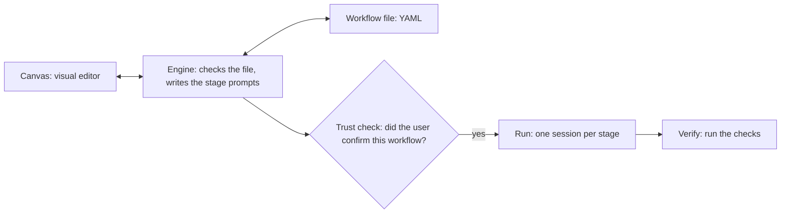
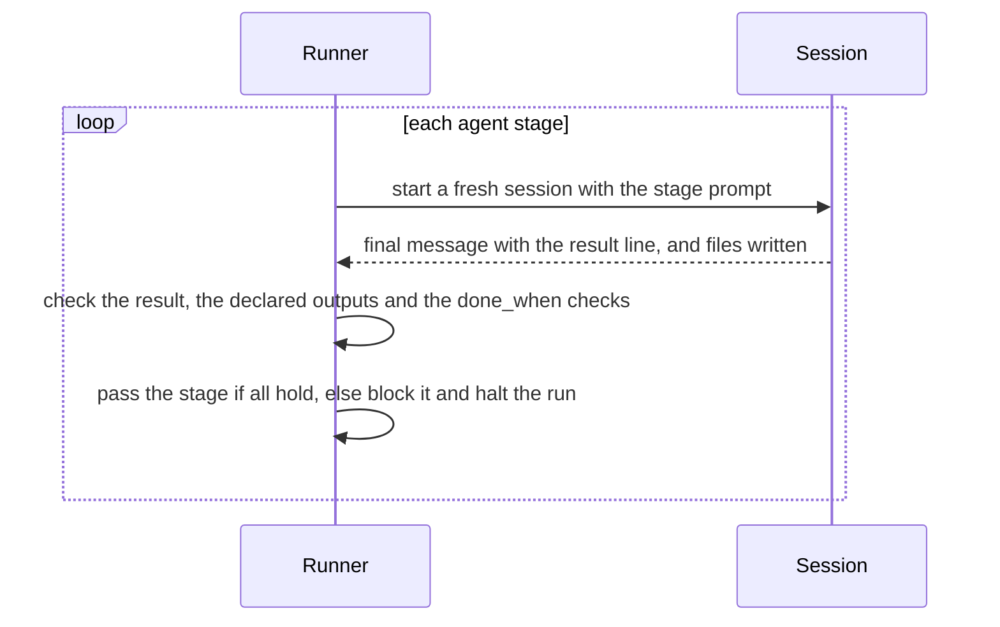
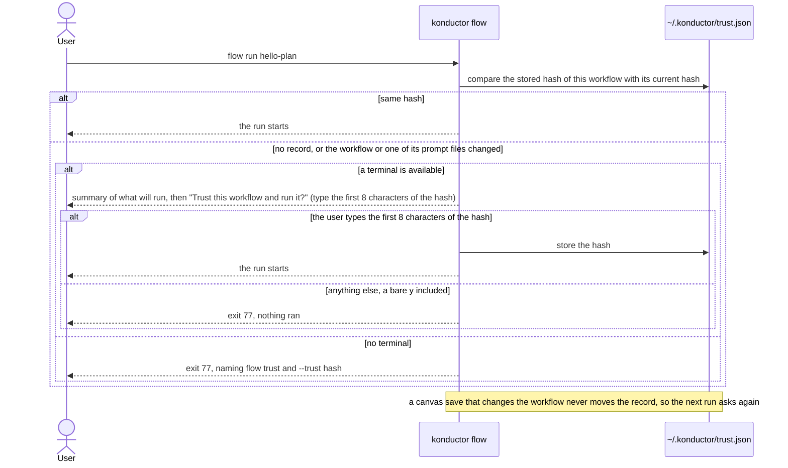

<!-- SPDX-License-Identifier: Apache-2.0 -->

# Workflows: design

Code and tests build against this note, the [specification](workflows-spec.md) and the [plan](workflows-plan.md).
Exports to Kiro CLI and Claude Code are [slice 14](workflows-exports.md), not part of the first release. A decision
changes here, in the same pull request as the change that needs it.

## Problem

A Konductor SOP (standard operating procedure) is a Markdown procedure that an agent follows from the chat. Konductor
installs each SOP once for both Kiro CLI and Claude Code, so authoring is shared, but checking is not. Nothing confirms
that the agent ran a step, ran the steps in order, or produced what a step promised. An agent can skip or reorder a
step, or report a step done that it never did, and the user finds out by reading the chat. In a live check, a headless
Kiro CLI session had its only tool call denied. It exited 0, and the agent wrote in prose that it could not create the
file. Anything that trusted the exit status would have marked the step done.

## Goals and non-goals

Goals:

- Write a process once and run it in Konductor, on Kiro CLI or Claude Code. Exporting it to their native formats is
  [later](workflows-exports.md).
- Pass a step only on proof that Konductor checks itself, never on the agent's say-so.
- Run no project workflow, none of the commands it names, and no workflow in a repo that carries tool settings, until
  the user confirms it.

Non-goals: replacing SOPs, mixing tools inside one workflow, reading the visual editor's earlier file format, and
keeping Kiro CLI and Claude Code from loading a repo's own tool settings. The runner asks before it runs with them
present.

## Summary

A workflow file makes the order of a process and the proof of each step explicit. It is a YAML file that names an
outcome and lists, in order, the stages that reach it and the checks (tests of the outcome) that `konductor flow verify`
runs. Each stage hands work to one Konductor agent. Konductor runs the file with its own program, the runner. The
canvas, the visual editor, edits the file through the engine, the Rust code that checks files and builds stage prompts.

How a workflow file reaches a run. The trust check applies to project workflows:



## Decision requested

Approve this note, with the specification and the plan, as the contract for building workflows, so that the three
goals above hold. Approving also approves the [decisions](#decisions) below.

The first release lets a user run the review workflow ported from the `k-adversarial-pull-request-review` SOP end to
end. The SOP runs its review passes in parallel, and the port runs them in sequence until slice 6 (a numbered unit of
delivery) adds parallel stages ([First release](#first-release); [all 14 slices](workflows-spec.md#slices)).

## Example

`workflow-engine/examples/hello-plan.yml`, abridged (no prompts or `params`). On an installed runner harness,
`konductor flow run hello-plan --goal "..."` runs both stages, then `flow verify` passes if `PLAN.md` exists:

```yaml
format: konductor/1
name: hello-plan
version: 0.1.0
intent:
  outcome: A short plan for the goal is written to PLAN.md, and the first step of it is done.
  accept: [{ id: plan-exists, file: PLAN.md }]
stages:
  - { name: plan, agent: k-architect }
  - { name: implement, agent: k-developer }
```

## Terms

- **Stage**: one step of a workflow, with a stable `name`. An **agent stage** hands work to one installed Konductor
  agent. The **runner** starts one fresh session per agent stage (D21).
- **Check**: a test of the outcome in `intent.accept`. A `file` check passes when the file exists and a `run` check when
  a program exits 0. A stage can require some with `done_when`, and `flow verify` runs them.
- **Evidence** of a stage: a valid [stage result](workflows-spec.md#stage-result) from the session and every output the
  stage declares, created or changed during the stage. An exit status of 0 is never evidence (D8).
- **Harness**: a **runner harness** is the program the runner starts for an agent stage: `kiro-cli`, `claude` or `fake`
  (tests only), the values of `flow run --harness`. An **install harness** is an agent file format that
  `konductor install --harness` installs: `kiro-cli-v2`, `kiro-v3` or `claude`. Neither appears in a workflow file.
- **Engine**: the Rust workspace in `workflow-engine/` that checks files and builds stage prompts.

## Decisions

| Id  | Decision                                                                                    | Where                                                          |
| --- | ------------------------------------------------------------------------------------------- | -------------------------------------------------------------- |
| D1  | One YAML file per workflow, with an ordered list of stages                                  | [Keys](workflows-spec.md#keys)                                 |
| D2  | The workflow name is the file name                                                          | [Where workflows live](workflows-spec.md#where-workflows-live) |
| D3  | Keys of later slices are reserved                                                           | [Reserved keys](workflows-spec.md#reserved-keys)               |
| D4  | Diagnostic codes are public API                                                             | [Diagnostics](workflows-spec.md#diagnostics-and-codes)         |
| D5  | Lookup is nearest-first                                                                     | [Where workflows live](workflows-spec.md#where-workflows-live) |
| D6  | Shipped workflows are built into the binary                                                 | [Where workflows live](workflows-spec.md#where-workflows-live) |
| D7  | The engine is a Rust workspace under `workflow-engine/`                                     | [Terms](#terms)                                                |
| D8  | A stage passes on evidence, not on exit status                                              | [Stage result](workflows-spec.md#stage-result)                 |
| D9  | Runner harness and install harness stay separate                                            | [Terms](#terms)                                                |
| D10 | One function builds every agent stage's prompt                                              | [Stage prompts](workflows-spec.md#stage-prompts)               |
| D11 | A stage uses its agent's model                                                              | [Keys](workflows-spec.md#keys)                                 |
| D12 | A save writes the whole file with `base_hash`                                               | [Saving a file](workflows-spec.md#saving-a-file)               |
| D13 | The canvas keeps up with the format, through one validator                                  | [Editing and the canvas](#editing-and-the-canvas)              |
| D14 | Project workflows run only after the user confirms them, once per workflow                  | [Trust](#trust)                                                |
| D15 | The runner checks during the run                                                            | [Commands](workflows-spec.md#commands-and-exit-codes)          |
| D16 | The runner supports Kiro V2 and V3 and sets the engine flag                                 | [Harness invocation](workflows-spec.md#harness-invocation)     |
| D17 | The Kiro export rejects `{{` in prompt text (slice 14)                                      | [Exports](workflows-exports.md#decisions-for-exports)          |
| D18 | `effort`, typed params, the string form of `intent` and per-stage `model` wait for slice 13 | [Planned keys](workflows-spec.md#planned-keys-slice-13)        |
| D19 | The runner grants no tool access of its own                                                 | [Runner](#runner)                                              |
| D20 | The format only grows                                                                       | [Keys](workflows-spec.md#keys)                                 |
| D21 | A fresh headless session per agent stage                                                    | [Runner](#runner)                                              |
| D22 | One OS file lock per workspace says whether a run is alive                                  | [Run states](workflows-spec.md#run-stage-and-check-states)     |
| D23 | Trust is confirmed by typing the first 8 characters of the hash                             | [Trust](workflows-spec.md#trust)                               |
| D24 | A new run ends the sessions that a killed owner left behind                                 | [Run states](workflows-spec.md#run-stage-and-check-states)     |
| D25 | The project root search stops at the git top folder                                         | [Commands](workflows-spec.md#commands-and-exit-codes)          |
| D26 | `flow check` prints no trust hash when the tool configuration cannot be read                | [Trust](workflows-spec.md#trust)                               |
| D27 | Kiro finds an agent in its working directory, then the home folder (see D42)                | [Harness invocation](workflows-spec.md#harness-invocation)     |
| D28 | A V3 agent file under `--v2` is not refused                                                 | [Harness invocation](workflows-spec.md#harness-invocation)     |
| D29 | The `doctor` pin for `kiro-cli` is 3.3.0                                                    | [Harness invocation](workflows-spec.md#harness-invocation)     |
| D30 | How `--trust-tools` behaves on each Kiro engine (superseded by D43)                         | [Harness invocation](workflows-spec.md#harness-invocation)     |
| D31 | How the `tools` list of a Claude agent file is read                                         | [Trust](workflows-spec.md#trust)                               |
| D32 | How the Claude agent for a stage is found, by its `name` field                              | [Harness invocation](workflows-spec.md#harness-invocation)     |
| D33 | The trust summary shows the front matter keys of a Claude agent file                        | [Trust](workflows-spec.md#trust)                               |
| D34 | The `doctor` pin for `claude` is 2.1.323, and the runner does not use `--bare`              | [Harness invocation](workflows-spec.md#harness-invocation)     |
| D35 | An empty `tools` list pre-approves nothing, and a space or a quote makes it Unknown         | [Trust](workflows-spec.md#trust)                               |
| D36 | A reader that halts a dead owner's run ends its sessions first                              | [Run states](workflows-spec.md#run-stage-and-check-states)     |
| D37 | `flow view` refuses a name that does not resolve to a file                                  | [Commands](workflows-spec.md#commands-and-exit-codes)          |
| D38 | A Claude agent file may hold column-0 lists under `tools`, `skills` and `mcpServers`        | [Trust](workflows-spec.md#trust)                               |
| D39 | The Designer edits a stage `prompt` with a parser-based value writer (step 1b-2)            | [Saving a file](workflows-spec.md#saving-a-file)               |
| D40 | The Designer refuses a prompt edit in a file with a lone CR anywhere or mixed line endings  | [Saving a file](workflows-spec.md#saving-a-file)               |
| D41 | A block scalar at the end of a file gets a final newline inside the value                   | [Saving a file](workflows-spec.md#saving-a-file)               |
| D42 | Kiro: the trust summary, the hash scan and the harness use one catalog                      | [Harness invocation](workflows-spec.md#harness-invocation)     |
| D43 | The runner passes no `--trust-tools`, and the agent file is the one source                  | [Harness invocation](workflows-spec.md#harness-invocation)     |
| D44 | Claude: the trust summary, the ambiguity check and the hash scan use the Claude catalog     | [Harness invocation](workflows-spec.md#harness-invocation)     |
| D45 | An ACP harness is an optional step, 1f-3, behind the Harness trait                          | [Harness invocation](workflows-spec.md#harness-invocation)     |
| D46 | Over ACP, permission requests are answered from the agent file's own allow rules            | [Harness invocation](workflows-spec.md#harness-invocation)     |
| D47 | 1g builds the contract it was cut for, and a follow-up step catches up                      | [1g-2](workflows-plan.md#1g-2-agent-list-fields-and-events)    |
| D48 | 1g adds each stage's kind and range and the three session fields                            | [1g](workflows-plan.md#1g-canvas-server-in-rust-and-flow-view) |
| D49 | A session group is on record at spawn, and the owner ends it on SIGINT, SIGTERM or SIGHUP   | [Run states](workflows-spec.md#run-stage-and-check-states)     |
| D50 | The runner shows a 4 KiB tail of a session's stderr on the terminal only                    | [Limits](workflows-spec.md#limits)                             |
| D51 | A session's deadline holds without its owner, through `timeout`                             | [Limits](workflows-spec.md#limits)                             |
| D52 | Under `timeout`, 124 or 137 is TIMEOUT only at the limit, grace is 10 s                     | [Limits](workflows-spec.md#limits)                             |
| D53 | An owner signal ends the ACP adapter group with no `session/cancel`                         | [1f-3](workflows-plan.md#1f-3-acp-harness-optional)            |
| D54 | The sweep ends no group for a passed deadline alone                                         | [Run states](workflows-spec.md#run-stage-and-check-states)     |
| D55 | Comments above the first stage travel with it on delete or move                             | [1b decisions](workflows-1b-decisions.md#saving-in-place)      |
| D56 | The strict whole-group deadline holds for GNU `timeout` only                                | [Limits](workflows-spec.md#limits)                             |
| D57 | A stage is TIMEOUT only when the harness reports TimedOut                                   | [Limits](workflows-spec.md#limits)                             |

- **D1. One YAML file per workflow, with an ordered list of stages.** Why: a flat list reads in order, and it maps onto
  Kiro's `sequence` and Claude's `pipeline()`, which keeps exports possible. Rejected: Kiro's node tree, which authors
  nest; JSON, which has no comments. Consequences: loops and parallel stages (slices 4 and 6) need new stage kinds.
- **D2. The workflow name is the file name.** Why: a separate `name` key lets lookup, the canvas and the runner
  disagree, so `flow run a` could run workflow `b`. Rejected: a winning `name` key lets two files claim one name.
  Consequences: a file rename renames the workflow.
- **D3. Keys of later slices are reserved.** Such a key reports `NOT_SUPPORTED_BY_THIS_BUILD` with its slice. Why: a
  file naming a missing feature must fail, not run without it. Rejected: `UNKNOWN_KEY`, which reads as a typo.
  Consequences: the spec lists each planned key with its slice.
- **D4. Diagnostic codes are public API.** Why: tests and the canvas API contract depend on the names (12 are shared).
  Rejected: message text breaks on rewording; numeric codes are unreadable in logs. Consequences: a misnamed code stays;
  a changed rule keeps its code, and a new case gets a new one.
- **D5. Lookup is nearest-first.** Why: Konductor resolves a bare name to the project file, then the user file, then the
  shipped workflow. Kiro and Claude Code also prefer the project's workflow on a name clash
  ([Sources](workflows-exports.md#sources)), and an export would keep the same order. Rejected: user first lets a
  personal file override what a team committed. Consequences: a user file named like a shipped one wins a bare-name
  lookup, so `library/<name>` exists.
- **D6. Shipped workflows are built into the binary.** Why: an installed folder can be edited, deleted or drift from the
  binary. Rejected: a folder on disk, which is easy to patch but open to that. Consequences: a fix to a shipped
  workflow, even one prompt line, ships only in a new binary release.
- **D7. The engine is a Rust workspace under `workflow-engine/`** that holds the format rules.
  Why: the core stays free of IO and the canvas shares the generated types. Rejected: a library in `cli/konductor-rs`,
  tied to the CLI's release cadence. Consequences: a second CI workspace and a drift test against the canvas contract.
- **D8. A stage passes on evidence, not on exit status.** Why: a headless Kiro session with every tool call denied still
  exits 0. Rejected: taking the session's result unchecked, since a model can report a file it never wrote.
  Consequences: a stage whose final message has no valid result line is blocked even if the work is done.
- **D9. Runner harness and install harness stay separate.** Why: a workflow file names neither, so it survives changes
  to the runner program or agent-file format. Rejected: renaming `kiro-cli` to `kiro` in the canvas contract, which
  merges them. Consequences: `kiro-cli` runs, `kiro-cli-v2` and `kiro-v3` install. A run uses one runner harness, chosen
  with `--harness` or by what is installed.
- **D10. One function builds every agent stage's prompt** from a fixed preamble and the authored prompt. Why: every
  run gets the same shared text, tested by one golden file (a stored expected output). Rejected: treating every `{`
  as an error blocks JSON shapes like `{severity, file, line}`. Consequences: a preamble change updates every golden.
- **D11. A stage uses its agent's model.** The runner uses the model in the installed agent file or definition. Why: a
  canvas stage is a name and an agent, so its model is the agent's. Rejected: per-stage tiers (`fast`, `frontier`),
  since no first-release workflow sets one. Consequences: no per-stage override until slice 13. To use another model
  today, name another agent. An export adds a rule ([D11, export part](workflows-exports.md#decisions-for-exports)).
- **D12. A save writes the whole file with `base_hash`.** Why: a blind overwrite loses an edit made elsewhere, and a
  hash of the bytes read catches that for any key. Rejected: small edit operations send less, but every key needs one
  and the canvas drifts from the file. Consequences: the second of two editors to save is refused, and nothing merges.
- **D13. The canvas keeps up with the format, through one validator.** Why: a key the canvas cannot hold blocks the file
  or is dropped on save. Rejected: a second canvas validator, which can disagree with the runner. Consequences: a key is
  done when the canvas accepts, keeps and shows it, in the slice that adds it, with a control. A control may instead be
  built in a named step after that slice, and a value edit may use the `yaml` parser (D39).
- **D14. Project workflows run only after the user confirms them, once per workflow,** and anything a headless run loads
  from the repo takes effect only after trust. Why: three things execute instructions from the repo: the runner, `run`
  checks and the tool configuration a headless run loads from it (Claude's `.claude/settings.json` and
  `.claude/settings.local.json` hooks, `.mcp.json` servers, agent files for Claude and Kiro, and Claude's skills and
  commands).
  The runner asks on a terminal and shows what will run. A repo that carries tool configuration files needs confirmation
  for every workflow in it, shipped ones included. `flow view` never asks and never records trust. A Run from the
  canvas on a workflow that is still untrusted gets `trust_required` with the exact command, and the user answers that
  command's prompt in the terminal. The canvas never grants trust, and a [canvas save](workflows-spec.md#trust) that
  changes the workflow ends it, because script in the page or another holder of the session token can make that save.
  Rejected: each tool's own trust prompt, which covers neither the runner nor `run` checks; trust per repository, which
  a `git pull` that touches any workflow ends for all of them; a refusal that shows nothing about what will run and
  gives no way to confirm in place; keeping trust across a canvas save that adds no command and changes no agent,
  because the agents this design runs allow shell and file-write tools (`shell`, `fs_write` on Kiro; `Bash`, `Write` on
  Claude), so a prompt edit can run commands. Consequences: a change to a workflow or to one of its prompt files ends
  trust for that workflow only, from a `git pull` or a canvas save alike, and the next run asks again; approval pins the
  command line and not the code it runs, so a `run` check that calls a script runs whatever that script holds now; no
  setting turns trust off; the runner's design may add further files to the hash.
  Reverse: let a canvas Run on a loose file offer the trust prompt with the working folder as the root.
- **D15. The runner checks during the run.** Why: Konductor watches the run, so a failed check halts the stage at once.
  Rejected: checking only at the end finds a failed check late. Consequences: `flow verify <run-id>` runs the checks
  again later, and `unverified` exits 0, so a caller that needs proof reads the result. A native run is checked at its
  end ([D15, export part](workflows-exports.md#decisions-for-exports)).
- **D16. The runner supports Kiro V2 and V3 and sets the engine flag itself.** Why: a `kiro-v3` file under `--v2` runs
  with no allow rules (D28), and V3 upgrades project `kiro-cli-v2` files in place. Rejected: V3 only drops V2 users,
  though Kiro plans V3 as the default. Consequences: two permission paths to test ([Harness
  invocation](workflows-spec.md#harness-invocation)).
- **D17.** Moved to [the exports note](workflows-exports.md#decisions-for-exports) with its number, because only an
  export needs it.
- **D18. `effort`, typed params, the string form of `intent` and per-stage `model` wait for slice 13.** Why: no
  first-release workflow uses them, and each needs a canvas control (D13). `params.<name>` stays because the ported SOP
  takes `diff_input` (required), `pr_url` and `output_file` (default `adversarial-review-report.md`), all strings.
  Rejected: shipping them early fixes shapes nothing exercises. Consequences: each reports
  `NOT_SUPPORTED_BY_THIS_BUILD`.
- **D19. The runner grants no tool access of its own.** It allows only the tools the agent's own definition lists. On
  Kiro the agent file is the single source of what the session may do without asking, and the runner passes no
  `--trust-tools` (D43). On Claude Code it passes `--allowedTools` with a rule for each tool in the agent definition's
  `tools`. On Claude Code, under `--agent`, a definition with a `tools` key caps the tools the
  session has, so the settings can only deny there. It never passes `--trust-all-tools` or a permission mode. Why: the
  agent's list and the user's settings record what the user allows, and with no allow rules a headless `claude -p`
  denies every call that needs approval. Rejected: `--trust-all-tools` or a broad permission mode, which allow every
  tool; asking users to widen their global Claude settings, which affects every Claude session. Consequences: a stage
  fails when its agent lacks a tool it needs. On a stock Claude install, `hello-plan` can write `PLAN.md`, because
  `Write` is in `k-architect`'s `tools`. Claude has no approval list separate from `tools`, so under the runner every
  tool a Claude definition makes available runs without asking. That is wider than the Kiro allow list of the same
  agent: `k-architect` on Claude also runs `WebFetch`, `WebSearch` and every `mcp__aws-mcp__*` tool without asking, and
  `k-architect` and `k-quality-assurance` also run `Agent`, which starts subagents.
- **D20. The format only grows.** Releases add keys, stage kinds and codes, and a key never changes meaning. Why: a
  workflow someone wrote or shipped keeps working after an upgrade. Rejected: a `format` bump per breaking change, which
  needs a migrator for each saved file, and nothing provides one. Consequences: a released key name is final.
- **D21. A fresh headless session per agent stage.** Why: a session starts with one agent's model and tool allow list,
  so stages that name different agents need separate sessions. A review or verify stage should also not see the
  reasoning of the stage it checks, and text an earlier stage handled stays out of the next stage's context unless it
  was written to a file. Each stage can be timed out, killed and re-run on its own. Rejected: one session for all
  stages, which cannot switch agents and lets a checker see the maker's reasoning. Consequences: each stage pays a whole
  session (6 to 11 s in 14 one-file runs). Evidence still comes from the files and checks, not the session (D8). A
  shared session could be an opt-in later for consecutive stages with the same agent and no independence need, which
  adds a key and changes no released one (D20).
- **D22. One OS file lock per workspace says whether a run is alive.** A run holds a lock on
  `<project root>/.konductor/runs/lock` for its whole run, and the kernel frees it when the owner ends. Why: a
  kernel-freed lock has no stale state to detect, and a reused PID cannot fool it. Rejected: a PID file with a start
  time check, which needs a dead-owner test that can misjudge a reused PID. Consequences: the PID, start time and run id
  in the lock file are for messages only. A reader that finds the lock free takes it and re-reads the state. If the
  state still says `running`, it ends the recorded session groups (D36) and then writes `halted`. A reader that finds it
  held only reads. A new `flow run` sweeps any
  other `running` run before it creates its own state. A refused run exits 75, and so does a platform that cannot lock
  (some network filesystems). Deleting the lock file by hand during a run is unsupported. Rules: [the dead-owner
  rule](workflows-spec.md#run-stage-and-check-states), [exit codes](workflows-spec.md#commands-and-exit-codes), plan
  steps [1d](workflows-plan.md#1d-stage-prompt-and-the-runner-on-the-fake-harness) and
  [1g](workflows-plan.md#1g-canvas-server-in-rust-and-flow-view). Reverse: go back to PID and start-time detection.
  Change the spec's dead-owner rule, its one-run-per-workspace text and the exit 75 row, the plan text of 1d and 1g, and
  the 1d lock tests.
- **D23. Trust is confirmed by typing the first 8 characters of the hash, and step 1e owns the checks around it.** Why:
  a key pressed before the summary was on screen is already waiting in the input, and a bare `y` would confirm what the
  user has not seen. Rejected: a y/N prompt. Consequences: a file that cannot be read has no hash, so there is no frame
  for it: a prompt file is exit 65, and a tool configuration file is exit 77 with `tool_config_unreadable`. Step 1e owns
  the scan limits, the re-check before each session, which sits in the runner in front of the harness port so every
  harness gets it, and exit 74 for a trust record that cannot be kept or changed. Step 1d owns the exit 74 for
  `home_unusable` (D25). Steps 1f-1 and 1f-2 only start sessions through the runner. Rules:
  [Trust](workflows-spec.md#trust), plan step [1e](workflows-plan.md#1e-trust). Reverse: restore the y/N prompt and the
  `u` frame. Change the spec's trust layout and asking text and the plan text and tests of 1e.
- **D24. A new run ends the sessions that a killed owner left behind.** Why: each session runs in its own process
  group, so a hard kill of the owner leaves it running, and only step 1f-1 has real sessions to track. Rejected: leaving
  them running and documenting the limit. Consequences: step 1f-1 records each session's process group and start time
  in the run state. A new run, after it takes the lock and before it marks the old run `halted`, terminates each
  recorded group that still exists and whose start time matches. A reader that halts a dead owner's run does the same
  sweep (D36). A normal exit still kills the groups directly, and step 1d needs no change. Rules: [sessions that outlive
  a killed owner](workflows-spec.md#run-stage-and-check-states), plan step
  [1f-1](workflows-plan.md#1f-1-process-launcher-and-kiro-cli). Reverse: drop the sweep and document the limit.
  Restore the spec sentence "when the owner exits, its sessions and checks are killed" and remove the sweep from the
  plan text of 1f-1.
- **D25. The project root search stops at the git top folder,** the folder that holds `.git` (a file or a folder). It
  never goes above that folder and never reads the home folder. With no git folder, only the working folder is used.
  When the search finds no `.konductor/` (up to the git top folder, or in the working folder with no git folder), `flow
  run`, `flow trust` and `flow trust --revoke` exit 64 with "no .konductor/ found, run konductor init". This is a plain
  usage error with no code under `--json`, and `flow trust --revoke` removes nothing. `flow check` and `flow show` use
  the working folder directly, as they do on a loose file outside a project, and do not search upward. They do not
  refuse a `$HOME` root and need no `HOME`, and neither does `flow view`. A command that needs `HOME` is one that reads
  or writes the trust store or the Kiro home folder, or has to compare the project root with `HOME`: `flow run`, `flow
  trust` and `flow trust --revoke`. An unset or relative `HOME` there exits 74, with the code `home_unusable` under
  `--json`, as the trust store does. That check comes first. Those commands then compare `$HOME` with the git top
  folder, or with the working folder when there is no git folder. Equal paths match. Otherwise both paths are
  canonicalized (symlinks resolved), and a path that cannot be canonicalized matches only when the paths are equal.
  Canonicalizing also covers case-insensitive file systems, with no extra rule. A git top folder that is `$HOME`, or a
  working folder that is `$HOME` with no git folder, is refused with exit 77 and the code `project_root_is_home` under
  `--json`, and nothing is searched. These two codes are the only `--json` codes of the root rules. Why: it keeps the
  search inside the repository the user opened, and anything above it is outside what the trust record covers. A
  repository at `$HOME`, such as a dotfiles repo, would make every file in the home folder part of the project. A
  missing `.konductor/` means the project was never set up, so the command says so and creates nothing in a folder the
  user did not choose. Rejected: also stopping at the home folder, which still lets a search climb through folders the
  repository does not own. Also rejected: falling back to the working folder when no `.konductor/` is found, which would
  put run state and the lock in a folder the user did not set up. Consequences: widening the rule later is a small
  change, and narrowing it later could break users. A loose file outside a project still works with `flow check` and
  `flow show`. The tool configuration scan in [Trust](workflows-spec.md#trust) searches up to the same folder. `flow
  run` creates `runs/` and `.konductor/.gitignore` only inside an existing `.konductor/`. A script that gets exit 64
  from `flow run` in a repo that was never set up must run `konductor init` first. Rules: [project
  root](workflows-spec.md#commands-and-exit-codes), plan step
  [1d](workflows-plan.md#1d-stage-prompt-and-the-runner-on-the-fake-harness). Reverse: widen the stop rule and update
  its tests: the spec's project root paragraph and Trust section, and the 1d tests (inside a git folder, no git folder,
  a nested folder, a git top folder that is `$HOME`, a working folder that is `$HOME` with no git folder, a symlinked
  `HOME`, an unset or relative `HOME`, no `.konductor/`, and `flow check` and `flow show` on a loose file outside a
  project). To reverse the exit 64, fall back to the working folder and drop the test for the exit 64 when no
  `.konductor/` is found, and the spec sentence. To widen `flow check` and `flow show` to the same root search, update
  the spec's project root paragraph and the 1d tests. To widen `flow view` to the root search, do it with step 1g.
- **D26. `flow check` prints no trust hash when the repo tool configuration cannot be read in full.** It prints "trust
  hash: none" with the reason, leaves `trust_hash` out of its `--json` output and keeps its normal exit code. Why:
  `flow check` is not a trust command, so it is the smallest change, its output stays stable and no new code is
  invented. Rejected: printing an error or exiting 77 from `flow check`, which would make a read-only check act as a
  trust command. Consequences: `flow run` and `flow trust` still refuse with exit 77 and `tool_config_unreadable`. A
  script that reads `trust_hash` from `--json` must handle a missing field. Rules: [Trust](workflows-spec.md#trust),
  plan step [1e](workflows-plan.md#1e-trust). On a loose file, `flow check` prints the hash from the scan that starts at
  the working folder. Reverse: print the hash or an error instead. Change the spec sentence and
  the 1e tests that check the output and the JSON field.
- **D27. Kiro finds an agent file in its working directory or the home folder, and the working folder's definition
  wins.** Before D42, the trust summary also searched the folders above the project root. D42 supersedes that search:
  the summary uses the catalog Kiro uses (see D42 under [Decisions](#decisions)). The order stays: if the working
  folder and the home folder both define the same Kiro agent id, the working folder's definition wins, as Kiro does,
  and the trust summary names the file used. Rules: D42.
- **D28. A V3 agent file under `--v2` is not refused.** The runner picks the engine flag from the shape of the agent
  file: `allowedTools` is V2 and `permissions.rules` is V3. A file with neither or both exits 64. Kiro runs a V3 file
  under `--v2` with no allow rules, because it ignores `permissions`, so there is no exit 4. Why: the file is what the
  engine reads, and the install index can be wrong or missing. Rejected: refusing that pair with exit 4, which Kiro does
  not do and the runner would have to add. Consequences: the runner never starts that pair, because it passes the flag
  that matches the file. Run by hand, that pair gives an agent with no allow rules, and the trust summary of its tools
  would list rules that the engine ignores, which is never more than the session gets. Rules:
  [Kiro CLI](workflows-spec.md#harness-invocation), plan step
  [1f-1](workflows-plan.md#1f-1-process-launcher-and-kiro-cli). Reverse: refuse a V3 file under `--v2` with exit 4, and
  restore the spec sentence.
- **D29. The `doctor` pin for `kiro-cli` is 3.3.0.** `konductor doctor` reports a lower version as a `warn`. Why: it is
  the one version the conformance checks cover, and it may not be a public release, so the pin is re-checked on a public
  release before release. Rejected: a pin that no run supports. Consequences: the 1f-1 tests of the version check name
  3.3.0. Rules: [Versions](workflows-spec.md#harness-invocation), plan step
  [1f-1](workflows-plan.md#1f-1-process-launcher-and-kiro-cli). Reverse: change the pin and the 1f-1 tests that name it.
- **D30. How `--trust-tools` behaves on each Kiro engine.** D30 decided what the flag does on V3 and on V2 and which
  ids the runner could map from the agent's tools. D43 supersedes it: the runner passes no `--trust-tools` on either
  engine (see D43 under [Decisions](#decisions)). Rules: D43.

- **D31. The `tools` list of a Claude agent file is read in one way, and an item the runner cannot turn into a rule
  makes the whole list Unknown.** In a bare or whole-quoted one-line value, a comma inside parentheses does not split,
  so `Agent(a, b), Read` is two items. In the `[...]` form, a comma inside parentheses makes `tools` Unknown, because
  Claude itself reads that form as a YAML list. Unbalanced or stray parentheses are Unknown in every form, and block
  lists are read as before. The runner builds `--allowedTools` rules only from names that match `[A-Za-z0-9_*:.-]+`,
  plus the one `Agent(...)` form. Any other item makes the whole list Unknown: no `--allowedTools` flag, one stderr
  note, and the summary line "tools: unreadable" plus the reason (D35). Why: the first draft could grant more tools than
  the trust summary shows, which breaks "less, never more" (D19). Both changes only narrow what a session gets.
  Rejected: guessing the intended items from a list that does not parse, because a wrong guess can grant a tool that the
  summary does not show. Consequences: the trust hash comes from file bytes, so existing trust records stay valid and
  only the summary text changes. An Unknown list pre-approves nothing, because the runner passes no flag. Rules:
  [Trust](workflows-spec.md#trust), plan step [1f-2](workflows-plan.md#1f-2-claude-adapter-and-conformance). Reverse:
  restore the plain comma split and the unchecked pass-through.
- **D32. The catalog finds a Claude agent by its `name` field, the way Claude does.** Claude resolves `--agent <id>` by
  the `name` in an agent file's front matter, and it scans `.claude/agents/` and its subfolders. A repo could ship a
  benign `<id>.md` and another file whose `name` is `<id>`, for example with `permissionMode: bypassPermissions`. The
  trust summary would show the benign file while Claude runs the other. The hash covers every file under
  `.claude/agents/`, so the gap is the summary, not the hash. Why: the summary must describe the agent that runs.
  Rejected: keeping the lookup by file name, which lets a repo file run that the summary never describes. Consequences:
  the hash is unchanged, so existing trust records stay valid. Only the summary and one new exit 77 case change: two
  repo files that declare the requested `name`, or a declaring file whose stem differs from that name, make the agent
  Unknown, and `flow run` and `flow trust` exit 77 with `tool_config_unreadable`. For a duplicate `name`, the trust
  summary names every file that declares it. `flow check` and `flow show` print that summary, and `flow run` and `flow
  trust` print the same text, then exit 77. The unreadable message prints the files. `flow check` still prints the hash.
  A file with no `name` is not an agent of that id. A name matches as an exact string, with no trimming and no case
  folding, and only `.md` files with front matter count. An unrelated agent whose name differs from its file stem blocks
  nothing. D44 sets which folders the Claude catalog searches and the exit 77 case for two catalogs. Rules:
  [Finding the agent](workflows-spec.md#harness-invocation), plan step [1e](workflows-plan.md#1e-trust).
  The duplicate-name summary is human text with no `--json` shape. The 1g contract (`openapi.yaml`) fixes one if the
  Designer needs it. Reverse: keep the lookup by file name and accept the gap. Restore the spec's `<id>.md` wording and
  drop the 1e tests of the `name` lookup. To give the summary a `--json` shape, add a field with the contract.
- **D33. The trust summary shows which of `permissionMode`, `hooks` and `mcpServers` a Claude agent file sets.** It
  lists the key names only, as it does for a settings file, and no values. There is no new refusal: the user sees the
  keys and confirms the hash. Why: an agent file can widen what its session does, for example with `permissionMode:
  bypassPermissions`, and the summary showed only its tools (D32). Rejected: refusing a file that sets one of these
  keys, which blocks agents that need them and cannot judge a value from a key name. Consequences: the hash is
  unchanged, so existing trust records stay valid. A user who confirms without reading sees the key names and not the
  values, so a value such as `bypassPermissions` is read in the file. Rules: [Trust](workflows-spec.md#trust), plan step
  [1e](workflows-plan.md#1e-trust). Reverse: add a refusal for `bypassPermissions`. Change the spec's summary bullet and
  the 1e tests of the summary lines.
- **D34. The `doctor` pin for `claude` is 2.1.323, and the runner does not use `--bare`.** `konductor doctor` reports a
  lower version as a `warn`. Why: 2.1.323 is the lowest build the checks ran on, and it may not be a public release, so
  the pin is re-checked on a public release before release. `--bare` does not load project agents, and Claude then exits
  1 for a project agent. Rejected: a pin that no run supports; `--bare` to skip repo hooks and servers, which would hide
  the stage's own agent. Consequences: the 1f-2 tests of the version check name 2.1.323, and a run still loads the
  repo's hooks and servers, so the trust rules of D14 stay. Rules: [Versions](workflows-spec.md#harness-invocation),
  plan step [1f-2](workflows-plan.md#1f-2-claude-adapter-and-conformance). Reverse: change the pin and the 1f-2 tests
  that name it. Allow `--bare` only if project agents load under it.
- **D35. An empty `tools` list pre-approves nothing, and a space or a quoted item makes the list Unknown.** An empty
  list (`tools:` with no items, or `[]`) pre-approves no tool and gets no `--allowedTools` flag. A scoped rule with a
  space, such as `Bash(git status)`, or a quoted item in a `[...]` list makes the whole list Unknown, because only names
  that match `[A-Za-z0-9_*:.-]+`, plus the one `Agent(...)` form, pass (D31). The summary line of an Unknown list reads
  "tools: unreadable" plus the reason, and the same line covers front matter the build cannot read in full. Why: each
  rule narrows what a session gets, and none grants a tool that the summary does not show (D19). Rejected: reading the
  space or the quote to build a rule, because a wrong reading can grant a tool the summary does not show. Consequences:
  the hash is unchanged. An agent that uses such an item has an Unknown list until it is rewritten, and its session gets
  no pre-approved tools. Rules: [Trust](workflows-spec.md#trust), plan step
  [1f-2](workflows-plan.md#1f-2-claude-adapter-and-conformance). Reverse: accept spaces and quoted items by extending
  the charset and the reading rule. Update the spec sentence and the 1f-2 tests.
- **D36. A reader that halts a dead owner's run ends its recorded sessions first.** `getRun` on a run whose owner is
  dead takes the lock and re-reads the state. If the state still says `running`, it ends the recorded session groups,
  the same sweep as a new run (D24), and then writes `halted`. Why: halting alone would orphan the session, and the
  canvas reads the run before any new run starts. Rejected: halting only, which leaves the sweep to a later `flow run`
  that may not come. Consequences: the sweep comes before the write, so a reader that stops halfway leaves the state
  `running` and the next reader tries again. A reader that finds the lock held only reads and sweeps nothing. The reader
  rule of D22 is otherwise unchanged. Step 1d has no real sessions, so the sweep code arrives with step 1f-1, and
  `getRun` in step 1g calls it. Rules: [the dead-owner rule](workflows-spec.md#run-stage-and-check-states), plan steps
  [1d](workflows-plan.md#1d-stage-prompt-and-the-runner-on-the-fake-harness),
  [1f-1](workflows-plan.md#1f-1-process-launcher-and-kiro-cli) and
  [1g](workflows-plan.md#1g-canvas-server-in-rust-and-flow-view). Reverse: halt only. Drop the sweep from the reader,
  and change the spec sentence of the dead-owner rule and the 1g tests.
- **D37. `flow view <name>` exits 64 when the name does not resolve to a file.** It starts no server. Why: `flow check`
  and `flow show` treat a name that matches no file as a usage error (exit 64), so the three commands agree, and a
  mistyped name shows at once instead of as an empty canvas. Rejected: a root with no file yet, which would let `flow
  view` open a new workflow. Consequences: the canvas API contract allows a root with no file yet, and the server of
  step 1g is stricter than the contract. `flow view` cannot start a new workflow. Rules:
  [Commands](workflows-spec.md#commands-and-exit-codes), plan step
  [1g](workflows-plan.md#1g-canvas-server-in-rust-and-flow-view). Reverse: allow a root with no file yet, so that `flow
  view` opens a new workflow. Change the spec sentence in Commands and the 1g test.
- **D38. The front matter of a Claude agent file may hold column-0 `- item` lists under `tools`, `skills` and
  `mcpServers`.** Indented lines under an `mcpServers` item belong to that item. A column-0 item under any other key,
  after a value, or after another key still makes the whole agent file unreadable. Why: installed Claude agent files,
  such as k-architect and k-developer, write `skills:` and `mcpServers:` as column-0 lists, and the old rule showed
  their `tools` as unreadable. Rejected: reading column-0 lists under any key, which would hide a malformed file.
  Consequences: the trust hash comes from file bytes, so existing trust records stay valid. Only the summary text
  changes, for files whose column-0 lists were unreadable before. Rules: [Trust](workflows-spec.md#trust), plan step
  [1e](workflows-plan.md#1e-trust). Reverse: allow the column-0 form only under `tools`. Change the spec sentence and
  the 1e test sentence.
- **D39. The Designer edits a stage `prompt` with a parser-based value writer, in step 1b-2.** Why: D13 gives every
  key a control, and the plan row for 1b only keeps `prompt`, so no step builds its control, while the 1g demo edits a
  prompt in the browser. A prompt is often a block scalar such as `>-`, and a review asked for a real YAML parser so
  that it can be edited. The 1b decisions note had deferred that question. Decision: step 1b-2, stacked on 1b, adds a
  multi-line prompt control and a writer that finds a value's range with the `yaml` package and replaces only those
  bytes. The line writer stays for `name`, `agent` and for adding, deleting and moving stages. The purity test of the
  Designer core allows `yaml` for that one module, and `yaml` moves from `devDependencies` to `dependencies`.
  `prompt_file` is shown read-only. Empty text removes the key. A read-back check parses each result and keeps the first
  form that reads back as typed. An existing block scalar keeps its style, then a
  literal block, then double quotes. A header comment is kept in a block, folded or literal, and dropped only when the
  text is double-quoted, which replaces the whole block without a refusal.
  Single-line text in a plain or quoted place is plain when it reads back as typed,
  else double-quoted, and never a literal block, also when a comment follows the value on its line. Text with a line
  break in a plain place or an existing quoted place is a literal block, then double-quoted, and double-quoted when a
  comment follows the value on its line, since no block is possible there. A comment after a plain or quoted value
  stays after the new value on its line. If no form reads back as typed, the
  writer refuses. Rejected: editing prompt text with the line writer, which cannot find the end of a block scalar.
  Consequences: a prompt edit is a canvas save that changes workflow content, so it ends trust as every such save does
  ([canvas rule](workflows-spec.md#trust), D14). The Rust loader and the `yaml` package may read some YAML differently,
  and the read-back check guards that on the canvas side only. `yaml` becomes a runtime dependency and the page bundle
  grows. The writer refuses a prompt edit, with a reason, for two `prompt` keys, an alias, anchor or tag on the prompt
  node, or a `<<` merge key, and the Designer shows "Saving a prompt ends trust. The next Run asks again." near the text
  area. Rules: [Saving a file](workflows-spec.md#saving-a-file), plan step
  [1b-2](workflows-plan.md#1b-2-the-designer-edits-a-stage-prompt). Reverse: drop the 1b-2 row and section from the
  plan, and change the 1b note bullet "The writer is a line writer for `name`, `agent` and whole stages, plus a `yaml`
  range pass for the `prompt` value" to a line writer alone. To keep the step and relax it, drop the refusals and the
  trust line from the 1b-2 section; the read-back check alone stays.
- **D40. The Designer refuses a prompt edit in a file that has a lone carriage return anywhere, or mixed line
  endings.** Why: the spec accepts a lone CR as a line break, but the `yaml` package does not read a lone carriage
  return as a line break, so no range of a value can be found, and the writer never guesses. A stray CR among LF lines
  is the same case. For mixed endings, the writer needs one line ending for the typed text, and a file with two kinds
  gives it none. Decision: keep the refusal. Each of the two refusals gives its own reason. It covers a lone CR
  anywhere in the file (CR-only breaks, or a stray CR among LF lines) and mixed endings of any two kinds (LF, CRLF,
  CR). Changes to
  `name`, `agent` and whole stages still save. Rejected: a lone-CR path in the writer, which adds a second line-break
  reader for a layout the package cannot read. Consequences: a person whose file has a lone CR or mixed endings edits
  the prompt in a text editor. The reason is shown in the Designer. Rules: [Saving a
  file](workflows-spec.md#saving-a-file), plan step [1b-2](workflows-plan.md#1b-2-the-designer-edits-a-stage-prompt).
  Reverse: add a lone-CR path to the writer that finds the ranges and writes with `\r`.
- **D41. A block scalar that ends a file with no final newline gets a final newline inside the edited value.** Why:
  the spec says a save adds no final newline, but the span of such a block runs to the end of the file. A clipped or
  kept block needs its last line break to read back as typed, and that break sits inside the span being replaced.
  Decision: accept it for block scalars only, and name it as the one exception in "Saving a file". It is inside the
  edited value, and no byte outside the value changes. In a CRLF file the added break is CRLF. A plain or quoted prompt
  on the last line of such a file changes only its value bytes, and no newline is added. Rejected: refusing the edit,
  which blocks every prompt edit on the last line of a file with no final newline. Consequences: after an edit of a
  block scalar, and only then, the file ends with a line break that it did not have. A plain or quoted prompt leaves the
  file without one. The save with no edit still returns the input byte for byte. Removing a key on the last line of a
  file with no final newline is a different case and still leaves the file without one. Rules: [Saving a
  file](workflows-spec.md#saving-a-file), plan step [1b-2](workflows-plan.md#1b-2-the-designer-edits-a-stage-prompt).
  Reverse: refuse such an edit with a reason.
- **D42. For Kiro, the trust summary, the ambiguity check and the hash scan use the catalog the harness uses.** The
  Kiro catalog is the project root, then the home folder, and the first definition wins. The file the summary names is
  the file the session runs. For Claude the catalog is the one of D44, and the fake harness uses the rule of step 1e.
  If the summary's catalog and the harness would resolve an agent to different files, `flow run` and `flow trust` exit
  77 with `tool_config_unreadable`. Why: a summary of a file that does not run tells the user nothing true, and the
  search above the project root could list an agent that Kiro will not run. This only reduces what a session can be
  granted or hidden from the user (D19), because the summary can no longer describe a file other than the one that
  runs. Rejected: keeping the folders-above search for Kiro, because the user would confirm text about a file that
  Kiro does not read. Consequences: an agent in a folder above the project root is not found for Kiro, and `flow run`
  fails before the first stage with the not-found message. A repo file can still shadow a home folder agent with the
  same id, and the summary names the file so the user can see which one runs. D42 supersedes the summary rule of D27.
  Rules: [Finding the agent](workflows-spec.md#harness-invocation), plan steps [1e](workflows-plan.md#1e-trust) and
  [1f-1](workflows-plan.md#1f-1-process-launcher-and-kiro-cli). Reverse: build the summary from the folders-above
  catalog again and list both files. To change the same-id order, refuse with exit 77 when both files exist.
- **D43. The runner passes no `--trust-tools` flag on Kiro V2 or V3.** The agent file is the single source of what the
  session may do without asking, and the summary lists the agent's own allow rules. Why: the flag was a second source
  next to the agent file, it did nothing on V2, and it needed a map from tools to ids to keep right. This only reduces
  what a session can be granted (D19), because nothing is added to the agent file's rules. Rejected: keeping the flag
  on V3 with ids from the agent's list, because it adds a second source and a map to maintain for no new access.
  Consequences: a tool that the agent file does not allow is not allowed. The conformance check no longer tests the
  flag, and the spec and the plan hold no id mapping. D43 supersedes D30. Rules:
  [Kiro permissions](workflows-spec.md#harness-invocation), plan step
  [1f-1](workflows-plan.md#1f-1-process-launcher-and-kiro-cli). Reverse: restore the flag with a corrected mapping.
- **D44. For Claude, the trust summary, the ambiguity check and the hash scan use the Claude catalog.** The catalog is
  the project root, then each folder above it up to the git top folder (D25), then the user folder, and an agent is
  found by its `name` (D32). If two catalogs would pick different files, `flow run` and `flow trust` exit 77 with
  `tool_config_unreadable`. Why: D32 made the summary describe the agent that Claude runs, and the same must hold for
  the folder it comes from. This only reduces what a session can be granted or hidden from the user (D19). Rejected:
  building the summary from one catalog and accepting that it may differ from what Claude runs, because the user would
  confirm a file that may not run. Carve-out for `claude-acp` (D45): the adapter loads the project root and the folders
  above it up to the git top folder, with no user folder, so that is its catalog. An agent that exists only in the user
  folder is a usage error, exit 64, before the first stage, and exit 77 does not apply to it. The user folder is not in
  this catalog, so an agent that exists in the project catalog and in the user folder is the project file, and the trust
  summary and the hash cover that file. Not verified: that the adapter runs the project file in that case, because it
  was not tried with the same name in both places. Consequences: the hash
  scan reads `.claude/agents/` in each folder of the catalog, as before, so existing trust records stay valid. D44 is
  the Claude twin of D42. Rules:
  [Finding the agent](workflows-spec.md#harness-invocation), plan steps [1e](workflows-plan.md#1e-trust) and
  [1f-2](workflows-plan.md#1f-2-claude-adapter-and-conformance). Reverse: build the summary from one catalog and accept
  that it may differ from what the harness runs.
- **D45. The ACP harness is an optional step, 1f-3, behind the existing Harness trait.** The Agent Client Protocol (ACP)
  is a JSON-RPC protocol over stdio. The step adds a third adapter next to the Kiro and Claude adapters, as two
  `--harness` values, `kiro-cli-acp` and `claude-acp`. Why: today a stage is one process that the runner waits on and
  reads at the end, so a stage's output is not live, and Claude gives none. ACP gives live updates and lets one client
  drive any agent that speaks it. Consequences: the core, the runner, the run state, trust, the canvas and 1g do not
  change. The CLI harnesses stay the default and the fallback. The step needs 1f-2, blocks nothing and is not in the
  first release. The adapters, their commands, their protocol version and their agent selection were checked by hand on
  one build of each ([Sources](#sources)). Both select the named agent. A harness that cannot select it is not
  released, with no fallback to a default agent. The same catalog as the trust summary must pick the file (D42, D44).
  Rules: names and choice (the values are never chosen automatically, and the existing order stays); install and
  minimum (the engine installs nothing, `doctor` checks the minimum version only, with no upper bound, a version below
  the minimum is a `warn` that never changes the exit code, and a missing adapter at run time exits as a missing CLI
  does, with no silent fallback); protocol
  (ACP v1 only, the verified adapters serve v1, a v2-only adapter is refused when the first session starts, which
  blocks the stage with `SESSION_FAILED` and halts the run as usual, reevaluate if the adapters serve a later version);
  process control (one adapter serves one stage and ends with its process group when the stage ends, the group is
  recorded for the sweep as in D24, and at the stage limit the runner sends `session/cancel` and terminates the
  group in the same step, then kills it after one 10 second wait, while an owner signal sends no `session/cancel`,
  D53); output (the last 1 MiB, live updates go to the
  events sink only if that step exists, and updates are display data and never evidence, D8); limits on the adapter
  (in [Limits](workflows-spec.md#limits), and any breach ends the stage as `SESSION_FAILED`); agent file check (the
  runner hashes the agent file before and after each stage, and a change fails the stage). The text is in plan step
  [1f-3](workflows-plan.md#1f-3-acp-harness-optional) and the [Harness
  invocation](workflows-spec.md#harness-invocation) bullet points to it. Reverse: drop step 1f-3 and its rows (the CLI
  harnesses stay), use two waits (cancel then terminate then kill), or probe a v2 adapter once before the adapter
  starts and refuse it before the first stage.
- **D46. Over ACP, the runner answers each permission request from the agent file's own allow rules only.** The agent
  file stays the single source of what a stage may do (D19, D43), so there is no flag and no second source. The runner
  answers each `session/request_permission` by allowing it when a rule of the agent file matches. Otherwise it denies
  it, blocks the stage with the reason `SESSION_FAILED` and the denied tool in the stage message, and halts the run. It
  never grants more than the agent file, and any later change by the adapter to a different mode value fails the stage
  (setting `default` again is not a change). Why: ACP has no
  `--trust-tools` flag, and a request is the only place where a grant could be made. This only reduces what a session
  can be granted (D19). Consequences: a stage whose agent lacks a tool it needs fails, as under the CLI harnesses. The
  trust summary and the hash do not
  change. Matching is stricter than on the CLI harnesses, which hand their rules to Kiro or Claude Code: a rule
  matches a tool by its exact name, as `Agent(<id>)`, or as a prefix only when it ends in `_*`, `/*`, `:*` or `.*`, and
  any other rule text matches nothing. A canvas prompt for a permission is out of scope. Rules: plan step
  [1f-3](workflows-plan.md#1f-3-acp-harness-optional). Reverse: restore the adapter's own prompts (not recommended), or
  change the matching function. A reason code of its own for a denied permission can be added later, if the step shows
  it is needed.
- **D47. 1g builds the contract it was cut for, and one follow-up step, 1g-2, catches up.** The canvas contract on the
  integration branch has grown since step 1g was cut. It gained the listing of the agents a stage may name, a
  description of what each editable key of a stage takes, run events, the kind and the lines of each stage, and three
  session fields. The Rust server of 1g implements the contract of its own cut: the six operations of 1a
  (`createSession`, `getWorkflow`, `saveWorkflow`, `checkWorkflow`, `startRun`, `getRun`) and the fields they carry. 1g
  does not catch up with the later additions. Step 1g-2 needs 1g and adds the listing of agents (`listAgents`), the
  field information (the description of what each editable key takes) and `getRunEvents`. `getRunEvents` also waits for
  the events step ([1h](workflows-plan.md#1h-run-events), the event sink and `events.jsonl`). Why: 1g's tests and demo need the
  six operations only, and `getRunEvents` has to wait for the events step, which 1g should not.
  Rejected: pulling the catch-up into 1g, which would make 1g wait for the events step and stretch it further.
  Consequences: before 1g-2 is built, a server of 1g does not list `listAgents` or `getRunEvents` in
  `capabilities`, so a client can tell, and the page offers no agent list. Rules: plan steps
  [1g](workflows-plan.md#1g-canvas-server-in-rust-and-flow-view) and
  [1g-2](workflows-plan.md#1g-2-agent-list-fields-and-events). Reverse: pull the catch-up into 1g. Drop the 1g-2 row,
  section and graph node, move its API rows and tests into 1g, make 1g wait for the events step, and serve the full
  events after the events step.
- **D48. When 1g meets the grown contract, it also adds each stage's kind and range, and the three session fields.**
  The corpus tests of the canvas stub run against the integration branch. So 1g's corpus fixtures and the Rust server's
  stage output carry each stage's `kind` (the key that names the stage's kind) and `range` (the lines the stage takes
  up), and the server returns the session fields: the Konductor version, the capabilities and the limits. Step 1g-2
  keeps `listAgents`, the field information and `getRunEvents` (D47). Why: the corpus cases that check `kind` and
  `range` would fail against a server that leaves them out. Rejected: leaving `kind` and `range` to 1g-2 and skipping
  the six corpus cases with a stated reason, which leaves 1g with a corpus it cannot fully run. Consequences:
  `capabilities` in 1g lists the six operations it serves. The spec rule "Stage kind and lines" already says the Rust
  server keeps each stage's source lines when it builds the view. Rules: plan step
  [1g](workflows-plan.md#1g-canvas-server-in-rust-and-flow-view) and the
  [contract requirements](workflows-spec.md#requirements-on-the-canvas-api-contract). Reverse: leave `kind` and `range`
  to 1g-2 and skip the six corpus cases with a stated reason.
- **D49. A session group is on record right after its spawn, and the owner ends it on SIGINT, SIGTERM or SIGHUP.** While
  a session runs, the owner handles the three signals. It ends the recorded session group (terminate, grace, kill),
  writes the run as `halted` with an interrupted status, and exits with that status. The launcher records the group
  right after the spawn. If it cannot be recorded, the launcher stops the group and the stage fails as `SESSION_FAILED`
  with a message that the session was not started. The sweep never ends a group whose leader has ended, because its start
  time cannot be read once the leader is gone. It warns once and drops the record, so the next run does not warn
  again. Why: a session has its own process group (D24), so Ctrl-C, SIGTERM or SIGHUP reaches only the owner. The
  owner's deadline dies with it, and a session with pre-approved write and shell tools keeps changing the tree. The
  sweep ends a group only when it can match the recorded start time, so it never stops an unrelated process.
  Rejected: relying on the sweep alone, which covers a hard kill only. Consequences: a session group ends in one of
  three ways: the owner's normal exit, a signal that the owner handles, or the next run's sweep (D24, D36). SIGKILL
  cannot be handled and takes the third way. If `timeout` itself is killed (D51), its group has no leader, so the
  sweep does not end it. This is a known gap. A marker could close it (an open question in the plan). A second signal
  during the grace, a signal during the sweep and SIGPIPE are not decided here. A deadline that holds without the owner
  is D51. Rules: [sessions that outlive a killed
  owner](workflows-spec.md#run-stage-and-check-states), [Limits](workflows-spec.md#limits), plan step
  [1f-1](workflows-plan.md#1f-1-process-launcher-and-kiro-cli). Reverse: drop the signal handling and keep the sweep
  only. Revert the recorded-on-spawn rule. For a group whose leader has ended, keep the record and warn on every run.
  Change the sweep paragraph of the spec and the engine text and tests of 1f-1.
- **D50. The runner shows a bounded tail of a session's stderr on the terminal and never writes it to the run state.**
  The tail is the last 4 KiB, and it is shown with the failure line. Why: with a session's stderr discarded, every
  first-run failure, such as a login that is missing or an old flag, read "exit status 1". Consequences: a run with
  no terminal shows no stderr. The tail is display data and never evidence (D8). Rules:
  [Limits](workflows-spec.md#limits), plan step [1f-1](workflows-plan.md#1f-1-process-launcher-and-kiro-cli). Reverse:
  show no stderr. Drop the Limits sentence, the engine clause of 1f-1 and its test.
- **D51. A session's deadline holds without its owner, because the session program runs under `timeout`.** The
  launcher starts the session program under `timeout` (GNU `timeout`, or `gtimeout` where it exists), with the stage's
  deadline and a kill grace of 10 seconds. `timeout` is the group leader. GNU `timeout` ends the whole group at the
  deadline, and D56 says what the other flavor does.
  If neither program is on the PATH, the launcher runs the program directly and prints one warning, and the limit
  then depends on the owner. The recorded group carries its absolute deadline. Why: the deadline lives only in the
  owner's loop, so only a process that outlives the owner can hold the limit, and `timeout` is the smallest change that
  does it. Rejected: a watchdog of our own, a second process with its own failure modes that needs a design of its own.
  Consequences: this replaces the plan's open question about a deadline that outlives the owner. D56 refines the
  whole-group guarantee. A killed `timeout` leaves a group that D49 does not end, and finding the members of such a
  group is an open question in the plan. Rules:
  [Limits](workflows-spec.md#limits), [sessions that outlive a killed
  owner](workflows-spec.md#run-stage-and-check-states), plan step
  [1f-1](workflows-plan.md#1f-1-process-launcher-and-kiro-cli). Reverse: run the program directly and accept a
  deadline that holds only while the owner lives. Drop the `timeout` text of Limits and the engine text and tests of 1f-1.
- **D52. Under `timeout`, a session exit status of 124 or 137 is `TIMEOUT` only at the limit, and the kill grace is 10
  seconds.** Under `timeout`, the launcher reports a session exit status of 124 or 137 as `TimedOut` (D57) only when its
  own clock has reached the limit. An earlier 124 or 137 is a normal exit and becomes `SESSION_FAILED`. Without
  `timeout` (the fallback), an exit status is never reinterpreted. The launcher runs `timeout -k 10 <limit in seconds>`,
  so the kill grace is 10 seconds. Only the session program of the Kiro and Claude harnesses runs under `timeout`. The
  ACP adapter does not, and its limit stays owner-based (D45). The checks, with their 10 minute limit, keep the
  owner-based limit. Why: a session that exits early can return 124 or 137, so the status alone is not proof of a
  time-out. Wider wrapping than the Kiro and Claude session programs can come later. Consequences: an ACP adapter or a
  check has no deadline that outlives a killed owner. Running them under `timeout` is on the [deferred
  list](workflows-spec.md#deferred-to-a-later-slice). Rules: [Limits](workflows-spec.md#limits), plan step
  [1f-1](workflows-plan.md#1f-1-process-launcher-and-kiro-cli). Reverse: run the ACP adapters and the checks under
  `timeout` too, a wider wrapper. Or read every 124 or 137 as `TIMEOUT`.
- **D53. On SIGINT, SIGTERM or SIGHUP the owner ends the ACP adapter group and sends no `session/cancel`.** The owner
  kills the adapter group (terminate, grace, kill) as it does for any session group (D49). `session/cancel` is sent only
  at the stage limit, with the terminate signal (D45). Consequences: [Limits](workflows-spec.md#limits) and plan step
  [1f-3](workflows-plan.md#1f-3-acp-harness-optional) say the same, and D45 names the stage limit only. Rules: plan step
  1f-3 and Limits. Reverse: send `session/cancel` on the owner signals before ending the group.
- **D54. The sweep does not end a group because it is past its recorded deadline.** It already ends the group of any
  dead owner whatever the deadline, and a live owner enforces its own limit. The deadline in the record is only named
  in the sweep's note. Why: the sweep ends a dead owner's group whatever its deadline, so the recorded deadline adds
  nothing. Consequences: a leaderless group stays as D49 and D51 say. Rules:
  [sessions that outlive a killed owner](workflows-spec.md#run-stage-and-check-states). Reverse: end a group that is
  past its deadline, and change the sweep paragraph of the spec and the tests of 1f-1.
- **D55. Comments above the first `-` of the stages list travel with the first stage when it is deleted or moved.** The
  rule is the same as for later stages, blank lines included. Why: a comment that introduces the first stage would
  otherwise stay behind and read as a note on another stage. Consequences: the line writer takes that run with the first
  item. Rules: [1b decisions](workflows-1b-decisions.md#saving-in-place), [Saving a
  file](workflows-spec.md#saving-a-file). Reverse: stop the run at a blank line for every stage.
- **D56. The strict whole-group deadline holds for GNU `timeout` only, and the launcher tells the flavors apart.** The
  `timeout` program has two flavors. GNU coreutils `timeout` ends the whole process group at the limit. The uutils
  `timeout` only signals the group with TERM, so a descendant that ignores TERM can outlive the limit when the owner is
  dead. The launcher runs `timeout --version` once per path, with a 2 second bound, and caches the answer for the
  process. Output with "GNU coreutils" means GNU, and anything else is the weaker flavor. The strict guarantee is stated
  for GNU only. With the other flavor, the owner loop still kills the group while the owner lives. Why: GNU `timeout`
  ends the whole group, the other flavor only signals it, and a watchdog is a second process with its own failure modes.
  Rejected: a watchdog of our own (D51). Consequences: this refines D51. D49 and D52 keep their rules, and a watchdog
  stays on [the deferred list](workflows-spec.md#deferred-to-a-later-slice). Rules: [Limits](workflows-spec.md#limits),
  [sessions that outlive a killed owner](workflows-spec.md#run-stage-and-check-states), plan step
  [1f-1](workflows-plan.md#1f-1-process-launcher-and-kiro-cli). Reverse: build the watchdog and state the guarantee for
  both flavors.
- **D57. A stage is `TIMEOUT` only when the harness reports that the session timed out.** The harness verdict is
  `SessionEnd::TimedOut`. The runner reads that verdict and never compares elapsed time itself. Under `timeout`, the
  launcher reports a status of 124 or 137 as `TimedOut` only when its own clock has reached the limit (D52), so the
  clock can veto a status but never supplies the verdict. Why: a suspend or a clock step must not turn a finished stage
  into a blocked one. Consequences: a stage that ends normally after the limit is not `TIMEOUT`. The fake harness is for
  tests only, and the spec's [`--harness` rule](workflows-spec.md#commands-and-exit-codes) says how the CLI marks its
  summary. A cargo feature gate for the fake harness is a follow-up that must land before the first release, listed in
  the plan's [open questions](workflows-plan.md#open-questions). Rules: [Stage result](workflows-spec.md#stage-result),
  [Limits](workflows-spec.md#limits), plan steps
  [1d](workflows-plan.md#1d-stage-prompt-and-the-runner-on-the-fake-harness) and
  [1f-1](workflows-plan.md#1f-1-process-launcher-and-kiro-cli). Reverse: restore the elapsed check. The fake harness
  suffix is text only.

## How it works

### Runner

How a run executes:



- Every agent stage runs on the harness that `flow run` picks ([rule](workflows-spec.md#commands-and-exit-codes)): a
  headless Kiro CLI session with one agent or a headless Claude Code session. `fake` stands in for tests.
- The runner sets the engine flag (D16) and adds no tool access beyond the agent's own tool list (D19). It runs on the
  agent's model (D11) and reads the [stage result](workflows-spec.md#stage-result) from the reply
  ([invocation](workflows-spec.md#harness-invocation)).

### Exports

Exports to Kiro CLI and Claude Code are [slice 14](workflows-exports.md). The first release does not write native
workflow files.

### Trust

How the runner decides whether a project workflow may run:



The runner asks once per workflow (D14). The [trust rules](workflows-spec.md#trust) say what the hash covers, where the
record lives and how a run without a terminal proceeds, and the [commands](workflows-spec.md#commands-and-exit-codes)
list which ones need trust. A Run from the canvas gets `trust_required` and does not grant trust. Which other repo files
count toward trust is left to the runner's design.

### Editing and the canvas

The canvas edits the file through the engine's validator, which replaces its TypeScript validator (D13), and saves the
whole file with `base_hash` (D12, [byte rules](workflows-spec.md#saving-a-file)). The canvas API contract needs
[these changes](workflows-spec.md#requirements-on-the-canvas-api-contract).

## First release

[The plan](workflows-plan.md) holds what each slice adds, what it needs and its tests. In short:

| Slice                                                                  | What the user gets                                                                     |
| ---------------------------------------------------------------------- | -------------------------------------------------------------------------------------- |
| [1 Skeleton](workflows-plan.md#slice-1-skeleton)                       | A file of stages and `file` checks that runs in the runner and opens in the canvas     |
| [2 Data between stages](workflows-plan.md#slice-2-data-between-stages) | `outputs`, templates and string params, so a stage reads what earlier stages wrote     |
| [3a Checks](workflows-plan.md#slice-3-checks-and-command-stages)       | `run` checks and `done_when`, so a stage passes only when Konductor has run its checks |
| [11a First port](workflows-plan.md#slice-11a-sop-library-first-port)   | The review workflow ported from the SOP, run in sequence                               |

### Export-ready invariants

Exports are later, so the first release must not close them off. It keeps these:

- `stage_prompt` stays a pure function of its inputs (D10), so an export can reuse the shared text.
- The format only grows (D20), so a workflow written now can be exported later without a migration.
- Evidence is defined by what exists (a result, declared files, checks), not by how the runner collects it.
- No first-release key has a runner-only meaning that an export could not express. A key an export can only state and
  not enforce, such as `outputs`, is fine.

## Threats

| Flow                                          | Threat                                                                                                                                                                                           | Mitigation                                                                                                                                                                                                                                                                                                                                                                                                                                                                                                                                                                                                                                                                                                                                                                                                                                          | Residual risk                                                                                                                                                                                                                                                                                                                                                                                                                                                                                                                                   |
| --------------------------------------------- | ------------------------------------------------------------------------------------------------------------------------------------------------------------------------------------------------ | --------------------------------------------------------------------------------------------------------------------------------------------------------------------------------------------------------------------------------------------------------------------------------------------------------------------------------------------------------------------------------------------------------------------------------------------------------------------------------------------------------------------------------------------------------------------------------------------------------------------------------------------------------------------------------------------------------------------------------------------------------------------------------------------------------------------------------------------------- | ----------------------------------------------------------------------------------------------------------------------------------------------------------------------------------------------------------------------------------------------------------------------------------------------------------------------------------------------------------------------------------------------------------------------------------------------------------------------------------------------------------------------------------------------- |
| Repo workflow files and `run` checks          | A cloned repo runs commands on checkout                                                                                                                                                          | No run before the user confirms the workflow, and the confirmation lists each `run` check; the hash covers the workflow file and its prompt files; `run` is argv with no shell                                                                                                                                                                                                                                                                                                                                                                                                                                                                                                                                                                                                                                                                      | A user who confirms without reading, or a script that a check runs and that changes after approval                                                                                                                                                                                                                                                                                                                                                                                                                                              |
| Trust record in `~/.konductor/`               | A process forges trust for a workflow                                                                                                                                                            | The record is outside every repo, so a clone cannot ship one, and the file has mode 0600                                                                                                                                                                                                                                                                                                                                                                                                                                                                                                                                                                                                                                                                                                                                                            | Any process of the same user can write it, and so can a stage agent with a broad write tool                                                                                                                                                                                                                                                                                                                                                                                                                                                     |
| Run state in `.konductor/runs/`               | A stage agent with a write tool edits or deletes its own run state, so a stage looks passed, a check looks `verified`, or the lock is lost                                                       | The runner decides `passed` and `verified` from its own in-memory results and from evidence it checks after the stage (declared outputs on disk, `done_when` run by Konductor), never from a value read back from the state files during the run. `flow verify` reruns the checks from the workflow file, whose trust hash it re-checks, not from commands copied into the run state                                                                                                                                                                                                                                                                                                                                                                                                                                                                | A run state edited after the run can mislead `getRun` and any reader of it. A deleted lock lets a second run start. Worktree isolation (slice 12) is the fix                                                                                                                                                                                                                                                                                                                                                                                    |
| Repo tool configuration a headless run loads  | `claude -p` loads the repo's `.claude/settings.json` and `.claude/settings.local.json` hooks and `.mcp.json` servers with no trust prompt, and Kiro agent files in the repo set tool permissions | Trust covers what a headless run loads from the repo (D14): the hash covers `.claude/settings.json`, `.claude/settings.local.json`, `.mcp.json`, `.kiro/settings/mcp.json` and the files under `.kiro/agents/`, `.claude/agents/`, `.claude/commands/`, `.claude/skills/` and `.claude/hooks/`, and a repo that has them needs confirmation for every workflow. The files are read again before each session starts, and a change halts the run. An entry the scan cannot read in full (a link, a folder over the file or depth limit, an unreadable file or name) refuses the run, whatever hash is passed. `--bare` is unused (D34), and the summary and the hash scan use the catalog of the harness, so the file shown is the file that runs (D42, D44; [spec](workflows-spec.md#harness-invocation))                                           | A user who confirms without reading. A tool may load repo files this list does not name, such as the script a hook runs from outside `.claude/hooks/`; `CLAUDE.md` and steering text are not covered. A repo that is already an install target and ships its own `.konductor/manifest`, or a `git pull` that changes an installed agent file and the manifest together, is not asked about those files. The fix is for the install to keep its own record of file hashes outside the repo ([spec](workflows-spec.md#deferred-to-a-later-slice)) |
| `--goal` text and param defaults              | They go into every stage prompt, so text that steers an agent reaches every stage                                                                                                                | The goal is capped at 2048 characters, and defaults sit in the file the trust hash covers                                                                                                                                                                                                                                                                                                                                                                                                                                                                                                                                                                                                                                                                                                                                                           | An agent follows instructions in any goal or default, so the person who writes or pastes one is the source. The agents' shell and file-write tools (`shell`, `fs_write` on Kiro; `Bash`, `Write` on Claude) let that text run commands                                                                                                                                                                                                                                                                                                          |
| Run params, such as the review's `diff_input` | A pull request author's text is rendered into every stage prompt, so it can instruct every agent                                                                                                 | A cap of 64 KiB per param and 100 KiB per stage prompt. Nothing else: the port needs no trust in a repo without tool configuration files                                                                                                                                                                                                                                                                                                                                                                                                                                                                                                                                                                                                                                                                                                            | Accepted until worktree isolation (slice 12): text in a diff can lead to commands, file writes and network calls through the agents' shell, file-write and web tools                                                                                                                                                                                                                                                                                                                                                                            |
| A `KONDUCTOR_RESULT` line from an agent       | A forged or quoted line makes a stage look successful                                                                                                                                            | The runner takes the last such line only, and reported `outputs` are not proof: it checks declared outputs on disk and runs the `done_when` checks ([Stage result](workflows-spec.md#stage-result))                                                                                                                                                                                                                                                                                                                                                                                                                                                                                                                                                                                                                                                 | A stage with no declared output and no `done_when` check passes on its result line alone                                                                                                                                                                                                                                                                                                                                                                                                                                                        |
| `prompt_file`                                 | A path leaves its folder or follows a symlink                                                                                                                                                    | Regular UTF-8 files inside the workflow's folder, under the trust hash                                                                                                                                                                                                                                                                                                                                                                                                                                                                                                                                                                                                                                                                                                                                                                              | The prompt can still tell an agent to do harm                                                                                                                                                                                                                                                                                                                                                                                                                                                                                                   |
| Stage output read by the next stage           | One stage's file steers the next agent                                                                                                                                                           | Declared `outputs` and `done_when` checks                                                                                                                                                                                                                                                                                                                                                                                                                                                                                                                                                                                                                                                                                                                                                                                                           | An agent can follow instructions in that file                                                                                                                                                                                                                                                                                                                                                                                                                                                                                                   |
| Tools in a stage                              | An agent uses a tool its author did not expect                                                                                                                                                   | Only the agent's own list and the user's settings: the agent file's allow list on Kiro, with no `--trust-tools` (D43); `--allowedTools` from the definition's `tools` on Claude Code; no `--trust-all-tools` or permission mode (D19)                                                                                                                                                                                                                                                                                                                                                                                                                                                                                                                                                                                                               | The list or settings are trusted as written. A Claude agent runs every tool in its `tools` without asking, which is wider than its Kiro allow list (web, all `aws-mcp` tools and the subagents it may start)                                                                                                                                                                                                                                                                                                                                    |
| User-level workflows in `~/.konductor/`       | A file placed there runs in any repo with no trust                                                                                                                                               | None: user and shipped workflows need no trust, except in a repo with tool configuration files (first-release rule)                                                                                                                                                                                                                                                                                                                                                                                                                                                                                                                                                                                                                                                                                                                                 | Accepted risk. A synced dotfiles directory is the user's own                                                                                                                                                                                                                                                                                                                                                                                                                                                                                    |
| The canvas HTTP server                        | Another local process or web page calls the API                                                                                                                                                  | Requirements: loopback only; launch code; a token per session, kept only in the `sessionStorage` of the browser tab and the copies the browser makes of it; repo text rendered as plain text under a strict content security policy that a server sends as an HTTP header with `frame-ancestors 'none'` ([terms](workflows-spec.md#canvas-server)). A canvas save that changes a workflow ends its trust ([rule](workflows-spec.md#trust))                                                                                                                                                                                                                                                                                                                                                                                                          | A process of the same user that learns the token, or script in the page, can save a changed workflow, which then runs only after the user confirms it again in a terminal. A user who confirms without reading the summary                                                                                                                                                                                                                                                                                                                      |
| Secrets in messages and logs                  | A diagnostic or run log quotes a secret                                                                                                                                                          | A message never quotes a value that looks like a secret                                                                                                                                                                                                                                                                                                                                                                                                                                                                                                                                                                                                                                                                                                                                                                                             | A secret that does not look like one, or one an agent writes to a file                                                                                                                                                                                                                                                                                                                                                                                                                                                                          |

## Sources

Public sources for the facts above about Kiro CLI and Claude Code. The facts that only an export needs are in
[the exports note](workflows-exports.md#sources).

| Fact                                                                                                                                                                                                        | Source                                                                                                               |
| ----------------------------------------------------------------------------------------------------------------------------------------------------------------------------------------------------------- | -------------------------------------------------------------------------------------------------------------------- |
| Kiro flags: `--v2`, `--v3`, `--agent-engine` (v1, v2, v3), `--no-interactive`, `--agent`, `--trust-all-tools`                                                                                               | [commands page](https://kiro.dev/docs/reference/cli-commands/), [headless page](https://kiro.dev/docs/cli/headless/) |
| V3 skips V2 agent profiles until upgraded; it is planned as the default with CLI 3.0                                                                                                                        | [agent config](https://kiro.dev/docs/cli/v3/agent-config/), [CLI 3 post](https://kiro.dev/blog/cli-3/)               |
| In `claude -p`, an unapproved call is denied, and `--output-format json` returns the text in `result`                                                                                                       | [headless page](https://code.claude.com/docs/en/headless)                                                            |
| When subagents share a name, Claude Code uses, in order: managed settings, `--agents`, the project's `.claude/agents/` (the closest directory wins), `~/.claude/agents/`, plugins                           | [subagents page](https://code.claude.com/docs/en/sub-agents)                                                         |
| `claude --agent <name>` runs the session as that agent; `--allowedTools` lists tools that run without a permission prompt                                                                                   | [CLI reference](https://code.claude.com/docs/en/cli-reference)                                                       |
| Without `--bare`, `claude -p` runs the hooks in `.claude/settings.json` and connects the servers in `.mcp.json` in a folder never trusted; `--bare` skips them                                              | [headless page](https://code.claude.com/docs/en/headless)                                                            |
| ACP: local agents run as sub-processes of the editor and talk by JSON-RPC over stdio                                                                                                                        | [Agent Client Protocol](https://agentclientprotocol.com)                                                             |

Observed on one pre-release build, with the write tool only (the conformance check repeats them):

| Fact                                                                                                                                                                                                                | How we ran it                                                                                                      |
| ------------------------------------------------------------------------------------------------------------------------------------------------------------------------------------------------------------------- | ------------------------------------------------------------------------------------------------------------------ |
| A `kiro-v3` agent file run with `--v2` ran with no allow rules, because Kiro ignored its `permissions`                                                                                                              | One headless run of a `kiro-v3` agent with `--v2`                                                                  |
| V3 upgraded project `kiro-cli-v2` agent files in place at first launch, with `.bak` copies. Global agents not tried                                                                                                 | The first V3 launch in a project that held V2 agent files                                                          |
| Allow rules in the agent file work on both engines                                                                                                                                                                  | Headless runs of a locked and a writer agent on each engine                                                        |
| A headless session whose only tool call was denied exits 0 on both engines, with the failure only in prose                                                                                                          | Headless runs, empty allow list, each engine. Partial denial not tried                                             |
| A headless Kiro session prints the agent's final message on stdout, and a one-file run took 6 to 11 s end to end                                                                                                    | 14 such runs across both engines; a 15th exited 4 after 5 s, before any model turn                                 |
| `--bare` does not load project agents, and Claude exits 1 for a project agent under it                                                                                                                              | One headless `claude -p` run with `--bare` and an agent file in `.claude/agents/`                                  |

Observed on one build of each ACP adapter, run by hand through a small stdio driver in scratch folders. Agent files
were in the project, and the Kiro CLI was signed in:

| Fact                                                                                                                                                                              | How we ran it                                                                                                                                                                                                                      |
| --------------------------------------------------------------------------------------------------------------------------------------------------------------------------------- | ---------------------------------------------------------------------------------------------------------------------------------------------------------------------------------------------------------------------------------- |
| The Kiro CLI serves ACP v1 with `kiro-cli acp`                                                                                                                                    | `kiro-cli acp --help`, then every frame logged by a small stdio driver                                                                                                                                                             |
| `kiro-cli acp --agent <id> --agent-engine v2` runs a V2 file (`allowedTools`), and `modes.currentModeId` in the answer to `session/new` equals the id                             | `kiro-cli acp --agent probe-v2 --agent-engine v2`                                                                                                                                                                                  |
| A V3 file (`permissions.rules`) runs with `--agent-engine v3`, and the agent is the session mode, set by `_meta.kiro.modeId` in `session/new`                                     | `kiro-cli acp --agent-engine v3`; the answer's `agentMode` equals the id                                                                                                                                                           |
| The `_meta.kiro.modeId` route is not in the public ACP specification, so the answer is the check. `session/set_mode` after `session/new` also works                               | The same V3 run, and one run with `session/set_mode` after `session/new`                                                                                                                                                           |
| The agent file's allow rules apply with no request, and an unlisted tool sends `session/request_permission`                                                                       | One agent per engine, with a listed and an unlisted tool                                                                                                                                                                           |
| Permission options are matched by `kind`, never by id. A V2 request carries a title and no tool id, so it can never match a rule                                                  | The options seen in the V2 and V3 requests                                                                                                                                                                                         |
| The default policy adds no allows: `cat` and `git status` each sent a request for an agent with empty `permissions.rules`                                                         | A V3 agent with empty rules, shell and write tools                                                                                                                                                                                 |
| The Claude ACP adapter serves ACP v1, and `_meta.claudeCode.options.agent` in `session/new` selects the agent, with the answer's `agent` config option equal to the id            | Adapter installed in a scratch folder; `claude-agent-acp --version`; `session/new`                                                                                                                                                 |
| The Claude adapter starts in mode `auto`, which runs a listed `Write` with no request. `session/set_config_option` with `configId: mode` and `value: default` fixes it            | A `Write` agent in mode `auto`, then `session/set_config_option`                                                                                                                                                                   |
| With `settingSources: ["project"]`, an allow rule in `.claude/settings.local.json` is not loaded and a request is sent. With the default sources it runs the tool with no request | A project agent with no `tools` key, a `touch` prompt, each source setting                                                                                                                                                         |
| An agent defined only in `~/.claude/agents` is not found with `settingSources: ["project"]`                                                                                       | The same project, with the agent file only in the home folder                                                                                                                                                                      |
| In a project `.claude/settings.json`, an allow rule did not apply and a deny rule did. The cause is unknown                                                                       | The rule was in the project `.claude/settings.json`, with the settings sources at their default and at project only. A permission request was sent in every run, so the allow rule did not apply. A deny rule in the same file did |
