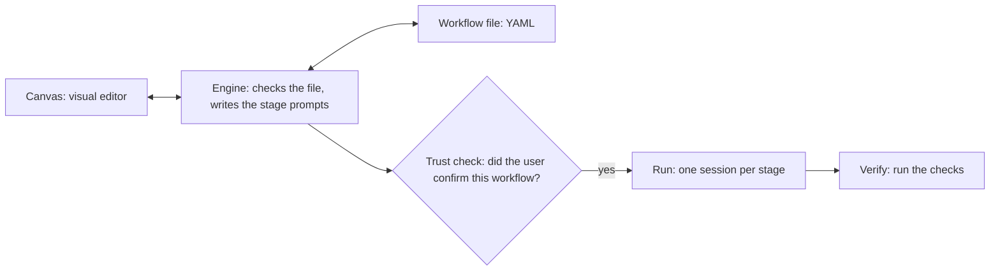
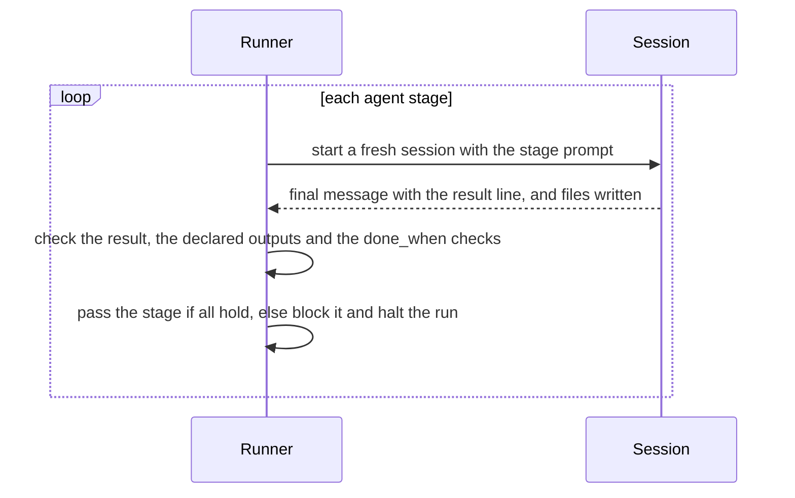
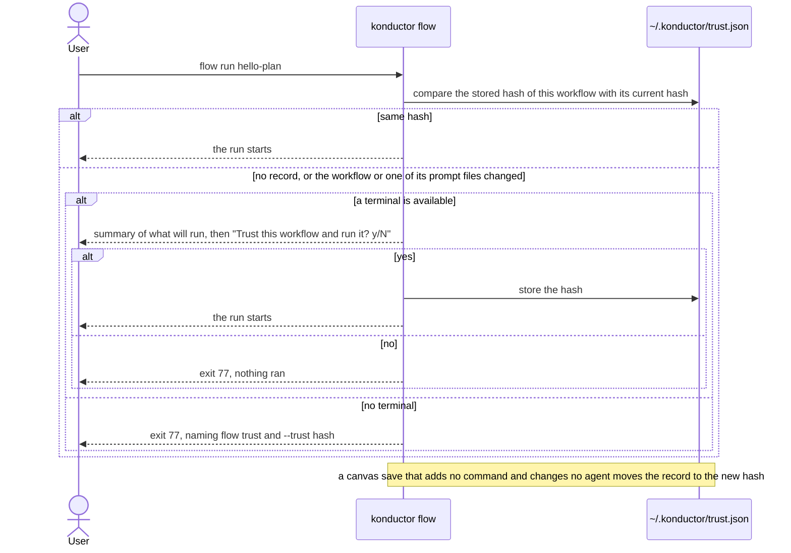

<!-- SPDX-License-Identifier: Apache-2.0 -->

# Workflows: design

**Status:** Proposed, not yet implemented. Code and tests build against this note, the
[specification](workflows-spec.md) and the [plan](workflows-plan.md). Exports to Kiro CLI and Claude Code are
[slice 14](workflows-exports.md), not part of the first release. A decision changes here, in the same pull request as
the change that needs it.

## Problem

A Konductor SOP (standard operating procedure) is a Markdown procedure that an agent follows from the chat. Konductor
installs each SOP once for both Kiro CLI and Claude Code, so authoring is shared, but checking is not. Nothing confirms
that the agent ran a step, ran the steps in order, or produced what a step promised. An agent can skip or reorder a
step, or report a step done that it never did, and the user finds out by reading the chat. In a live check, a headless
Kiro CLI session had its only tool call denied. It exited 0, and the agent wrote in prose that it could not create the
file. Anything that trusted the exit status would have marked the step done.

## Goals and non-goals

Goals:

- Write a process once and run it in Konductor, on Kiro CLI or Claude Code. Exporting it to their native formats is
  [later](workflows-exports.md).
- Pass a step only on proof that Konductor checks itself, never on the agent's say-so.
- Run no project workflow, none of the commands it names, and no workflow in a repo that carries tool settings, until
  the user confirms it.

Non-goals: replacing SOPs, mixing tools inside one workflow, reading the visual editor's earlier file format, and
keeping Kiro CLI and Claude Code from loading a repo's own tool settings. The runner asks before it runs with them
present.

## Summary

A workflow file makes the order of a process and the proof of each step explicit. It is a YAML file that names an
outcome and lists, in order, the stages that reach it and the checks (tests of the outcome) that `konductor flow verify`
runs. Each stage hands work to one Konductor agent. Konductor runs the file with its own program, the runner. The
canvas, the visual editor, edits the file through the engine, the Rust code that checks files and builds stage prompts.

How a workflow file reaches a run. The trust check applies to project workflows:



## Decision requested

Approve this note, with the specification and the plan, as the contract for building workflows, so that the three
goals above hold. Approving also approves the [decisions](#decisions), all Proposed.

The first release lets a user run the review workflow ported from the `k-adversarial-pull-request-review` SOP end to
end. The SOP runs its review passes in parallel, and the port runs them in sequence until slice 6 (a numbered unit of
delivery) adds parallel stages ([First release](#first-release); [all 14 slices](workflows-spec.md#slices)).

## Example

`workflow-engine/examples/hello-plan.yml`, abridged (no prompts or `params`). On an installed runner harness,
`konductor flow run hello-plan --goal "..."` runs both stages, then `flow verify` passes if `PLAN.md` exists:

```yaml
format: konductor/1
name: hello-plan
version: 0.1.0
intent:
  outcome: A short plan for the goal is written to PLAN.md, and the first step of it is done.
  accept: [{ id: plan-exists, file: PLAN.md }]
stages:
  - { name: plan, agent: k-architect }
  - { name: implement, agent: k-developer }
```

## Terms

- **Stage**: one step of a workflow, with a stable `name`. An **agent stage** hands work to one installed Konductor
  agent. The **runner** starts one fresh session per agent stage (D21).
- **Check**: a test of the outcome in `intent.accept`. A `file` check passes when the file exists and a `run` check when
  a program exits 0. A stage can require some with `done_when`, and `flow verify` runs them.
- **Evidence** of a stage: a valid [stage result](workflows-spec.md#stage-result) from the session and every output the
  stage declares, created or changed during the stage. An exit status of 0 is never evidence (D8).
- **Harness**: a **runner harness** is the program the runner starts for an agent stage: `kiro-cli`, `claude` or `fake`
  (tests only), the values of `flow run --harness`. An **install harness** is an agent file format that
  `konductor install --harness` installs: `kiro-cli-v2`, `kiro-v3` or `claude`. Neither appears in a workflow file.
- **Engine**: the Rust workspace in `workflow-engine/` that checks files and builds stage prompts.

## Decisions

| Id  | Decision                                                                                    | Status   | Where                                                          |
| --- | ------------------------------------------------------------------------------------------- | -------- | -------------------------------------------------------------- |
| D1  | One YAML file per workflow, with an ordered list of stages                                  | Proposed | [Keys](workflows-spec.md#keys)                                 |
| D2  | The workflow name is the file name                                                          | Proposed | [Where workflows live](workflows-spec.md#where-workflows-live) |
| D3  | Keys of later slices are reserved                                                           | Proposed | [Reserved keys](workflows-spec.md#reserved-keys)               |
| D4  | Diagnostic codes are public API                                                             | Proposed | [Diagnostics](workflows-spec.md#diagnostics-and-codes)         |
| D5  | Lookup is nearest-first                                                                     | Proposed | [Where workflows live](workflows-spec.md#where-workflows-live) |
| D6  | Shipped workflows are built into the binary                                                 | Proposed | [Where workflows live](workflows-spec.md#where-workflows-live) |
| D7  | The engine is a Rust workspace under `workflow-engine/`                                     | Proposed | [Terms](#terms)                                                |
| D8  | A stage passes on evidence, not on exit status                                              | Proposed | [Stage result](workflows-spec.md#stage-result)                 |
| D9  | Runner harness and install harness stay separate                                            | Proposed | [Terms](#terms)                                                |
| D10 | One function builds every agent stage's prompt                                              | Proposed | [Stage prompts](workflows-spec.md#stage-prompts)               |
| D11 | A stage uses its agent's model                                                              | Proposed | [Keys](workflows-spec.md#keys)                                 |
| D12 | A save writes the whole file with `base_hash`                                               | Proposed | [Saving a file](workflows-spec.md#saving-a-file)               |
| D13 | The canvas keeps up with the format, through one validator                                  | Proposed | [Editing and the canvas](#editing-and-the-canvas)              |
| D14 | Project workflows run only after the user confirms them, once per workflow                  | Proposed | [Trust](#trust)                                                |
| D15 | The runner checks during the run                                                            | Proposed | [Commands](workflows-spec.md#commands-and-exit-codes)          |
| D16 | The runner supports Kiro V2 and V3 and sets the engine flag                                 | Proposed | [Harness invocation](workflows-spec.md#harness-invocation)     |
| D17 | The Kiro export rejects `{{` in prompt text (slice 14)                                      | Proposed | [Exports](workflows-exports.md#decisions-for-exports)          |
| D18 | `effort`, typed params, the string form of `intent` and per-stage `model` wait for slice 13 | Proposed | [Planned keys](workflows-spec.md#planned-keys-slice-13)        |
| D19 | The runner grants no tool access of its own                                                 | Proposed | [Runner](#runner)                                              |
| D20 | The format only grows                                                                       | Proposed | [Keys](workflows-spec.md#keys)                                 |
| D21 | A fresh headless session per agent stage                                                    | Proposed | [Runner](#runner)                                              |

- **D1. One YAML file per workflow, with an ordered list of stages.** Why: a flat list reads in order, and it maps onto
  Kiro's `sequence` and Claude's `pipeline()`, which keeps exports possible. Rejected: Kiro's node tree, which authors
  nest; JSON, which has no comments. Consequences: loops and parallel stages (slices 4 and 6) need new stage kinds.
- **D2. The workflow name is the file name.** Why: a separate `name` key lets lookup, the canvas and the runner
  disagree, so `flow run a` could run workflow `b`. Rejected: a winning `name` key lets two files claim one name.
  Consequences: a file rename renames the workflow.
- **D3. Keys of later slices are reserved.** Such a key reports `NOT_SUPPORTED_BY_THIS_BUILD` with its slice. Why: a
  file naming a missing feature must fail, not run without it. Rejected: `UNKNOWN_KEY`, which reads as a typo.
  Consequences: the spec lists each planned key with its slice.
- **D4. Diagnostic codes are public API.** Why: tests and the canvas API contract depend on the names (12 are shared).
  Rejected: message text breaks on rewording; numeric codes are unreadable in logs. Consequences: a misnamed code stays;
  a changed rule keeps its code, and a new case gets a new one.
- **D5. Lookup is nearest-first.** Why: Konductor resolves a bare name to the project file, then the user file, then the
  shipped workflow. Kiro and Claude Code also prefer the project's workflow on a name clash
  ([Sources](workflows-exports.md#sources)), and an export would keep the same order. Rejected: user first lets a
  personal file override what a team committed. Consequences: a user file named like a shipped one wins a bare-name
  lookup, so `library/<name>` exists.
- **D6. Shipped workflows are built into the binary.** Why: an installed folder can be edited, deleted or drift from the
  binary. Rejected: a folder on disk, which is easy to patch but open to that. Consequences: a fix to a shipped
  workflow, even one prompt line, ships only in a new binary release.
- **D7. The engine is a Rust workspace under `workflow-engine/`** that holds the format rules.
  Why: the core stays free of IO and the canvas shares the generated types. Rejected: a library in `cli/konductor-rs`,
  tied to the CLI's release cadence. Consequences: a second CI workspace and a drift test against the canvas contract.
- **D8. A stage passes on evidence, not on exit status.** Why: a headless Kiro session with every tool call denied still
  exits 0. Rejected: taking the session's result unchecked, since a model can report a file it never wrote.
  Consequences: a stage whose final message has no valid result line is blocked even if the work is done.
- **D9. Runner harness and install harness stay separate.** Why: a workflow file names neither, so it survives changes
  to the runner program or agent-file format. Rejected: renaming `kiro-cli` to `kiro` in the canvas contract, which
  merges them. Consequences: `kiro-cli` runs, `kiro-cli-v2` and `kiro-v3` install. A run uses one runner harness, chosen
  with `--harness` or by what is installed.
- **D10. One function builds every agent stage's prompt** from a fixed preamble and the authored prompt. Why: every
  run gets the same shared text, tested by one golden file (a stored expected output). Rejected: treating every `{`
  as an error blocks JSON shapes like `{severity, file, line}`. Consequences: a preamble change updates every golden.
- **D11. A stage uses its agent's model.** The runner uses the model in the installed agent file or definition. Why: a
  canvas stage is a name and an agent, so its model is the agent's. Rejected: per-stage tiers (`fast`, `frontier`),
  since no first-release workflow sets one. Consequences: no per-stage override until slice 13. To use another model
  today, name another agent. An export adds a rule ([D11, export part](workflows-exports.md#decisions-for-exports)).
- **D12. A save writes the whole file with `base_hash`.** Why: a blind overwrite loses an edit made elsewhere, and a
  hash of the bytes read catches that for any key. Rejected: small edit operations send less, but every key needs one
  and the canvas drifts from the file. Consequences: the second of two editors to save is refused, and nothing merges.
- **D13. The canvas keeps up with the format, through one validator.** Why: a key the canvas cannot hold blocks the file
  or is dropped on save. Rejected: a second canvas validator, which can disagree with the runner. Consequences: a key is
  done when the canvas accepts, keeps and shows it, in the slice that adds it, with a control or the raw YAML editor.
- **D14. Project workflows run only after the user confirms them, once per workflow,** and anything a headless run loads
  from the repo takes effect only after trust. Why: three things execute instructions from the repo: the runner, `run`
  checks and the tool configuration a headless run loads from it (Claude's `.claude/settings.json` hooks and `.mcp.json`
  servers, and Kiro agent files). The runner asks on a terminal and shows what will run. A repo that carries tool
  configuration files needs confirmation for every workflow in it, shipped ones included. `flow view` asks at start for
  an untrusted workflow. A Run from the canvas on a workflow that is still untrusted gets `trust_required` with the
  exact command, and the user answers that command's prompt in the terminal. The canvas never grants trust, but a save
  that adds no command and changes no agent keeps it, because the user who edits a workflow in the canvas is its author.
  Rejected: each tool's own trust prompt, which covers neither the runner nor `run` checks; trust per repository, which
  a `git pull` that touches any workflow ends for all of them; a refusal that shows nothing about what will run and
  gives no way to confirm in place; carrying trust across every canvas save, which would let script in the page add a
  command. Consequences: a change to a workflow or to one of its prompt files ends trust for that workflow only, even a
  `git pull`, except a [canvas save](workflows-spec.md#trust) that widens nothing; approval pins the command line and
  not the code it runs, so a `run` check that calls a script runs whatever that script holds now; no setting turns trust
  off; the runner's design may add further files to the hash.
- **D15. The runner checks during the run.** Why: Konductor watches the run, so a failed check halts the stage at once.
  Rejected: checking only at the end finds a failed check late. Consequences: `flow verify <run-id>` runs the checks
  again later, and `unverified` exits 0, so a caller that needs proof reads the result. A native run is checked at its
  end ([D15, export part](workflows-exports.md#decisions-for-exports)).
- **D16. The runner supports Kiro V2 and V3 and sets the engine flag itself.** Why: a `kiro-v3` file under `--v2` exits
  4, and V3 upgrades project `kiro-cli-v2` files in place. Rejected: V3 only drops V2 users, though Kiro plans V3 as the
  default. Consequences: two permission paths to test ([Harness invocation](workflows-spec.md#harness-invocation)).
- **D17.** Moved to [the exports note](workflows-exports.md#decisions-for-exports) with its number, because only an
  export needs it.
- **D18. `effort`, typed params, the string form of `intent` and per-stage `model` wait for slice 13.** Why: no
  first-release workflow uses them, and each needs a canvas control (D13). `params.<name>` stays because the ported SOP
  takes `diff_input` (required), `pr_url` and `output_file` (default `adversarial-review-report.md`), all strings.
  Rejected: shipping them early fixes shapes nothing exercises. Consequences: each reports
  `NOT_SUPPORTED_BY_THIS_BUILD`.
- **D19. The runner grants no tool access of its own.** On Kiro it uses the agent file's allow list, on Claude Code the
  user's settings. It never passes `--trust-all-tools`. On V3 the `--trust-tools` ids come from the agent's own allow
  list, so the ids add nothing to that list. Why: the list and the settings record what the user allows. Rejected:
  `--trust-all-tools`, which allows every tool. Consequences: a stage fails when its agent lacks a tool it needs.
- **D20. The format only grows.** Releases add keys, stage kinds and codes, and a key never changes meaning. Why: a
  workflow someone wrote or shipped keeps working after an upgrade. Rejected: a `format` bump per breaking change, which
  needs a migrator for each saved file, and nothing provides one. Consequences: a released key name is final.
- **D21. A fresh headless session per agent stage.** Why: a stage reads only files that earlier stages left, so a
  skipped step cannot hide in one long chat. Rejected: one session for all stages, which leaves the order to the agent,
  the risk in the Problem. Consequences: each stage pays a whole session (6 to 11 s in 14 one-file runs). A shared
  session could be an opt-in later, which adds a key and changes no released one (D20).

## How it works

### Runner

How a run executes:



- Every agent stage runs on the harness that `flow run` picks ([rule](workflows-spec.md#commands-and-exit-codes)): a
  headless Kiro CLI session with one agent or a headless Claude Code session. `fake` stands in for tests.
- The runner sets the engine flag (D16) and adds no tool access beyond the agent's own allow list (D19). It runs on the
  agent's model (D11) and reads the [stage result](workflows-spec.md#stage-result) from the reply
  ([invocation](workflows-spec.md#harness-invocation)).

### Exports

Exports to Kiro CLI and Claude Code are [slice 14](workflows-exports.md). The first release does not write native
workflow files.

### Trust

How the runner decides whether a project workflow may run:



The runner asks once per workflow (D14). The [trust rules](workflows-spec.md#trust) say what the hash covers, where the
record lives and how a run without a terminal proceeds, and the [commands](workflows-spec.md#commands-and-exit-codes)
list which ones need trust. A Run from the canvas gets `trust_required` and does not grant trust. Which other repo files
count toward trust is left to the runner's design.

### Editing and the canvas

The canvas edits the file through the engine's validator, which replaces its TypeScript validator (D13), and saves the
whole file with `base_hash` (D12, [byte rules](workflows-spec.md#saving-a-file)). The canvas API contract needs
[these changes](workflows-spec.md#requirements-on-the-canvas-api-contract).

## First release

[The plan](workflows-plan.md) holds what each slice adds, what it needs and its tests. In short:

| Slice                                                                  | What the user gets                                                                     |
| ---------------------------------------------------------------------- | -------------------------------------------------------------------------------------- |
| [1 Skeleton](workflows-plan.md#slice-1-skeleton)                       | A file of stages and `file` checks that runs in the runner and opens in the canvas     |
| [2 Data between stages](workflows-plan.md#slice-2-data-between-stages) | `outputs`, templates and string params, so a stage reads what earlier stages wrote     |
| [3a Checks](workflows-plan.md#slice-3-checks-and-command-stages)       | `run` checks and `done_when`, so a stage passes only when Konductor has run its checks |
| [11a First port](workflows-plan.md#slice-11a-sop-library-first-port)   | The review workflow ported from the SOP, run in sequence                               |

### Export-ready invariants

Exports are later, so the first release must not close them off. It keeps these:

- `stage_prompt` stays a pure function of its inputs (D10), so an export can reuse the shared text.
- The format only grows (D20), so a workflow written now can be exported later without a migration.
- Evidence is defined by what exists (a result, declared files, checks), not by how the runner collects it.
- No first-release key has a runner-only meaning that an export could not express. A key an export can only state and
  not enforce, such as `outputs`, is fine.

## Threats

| Flow                                          | Threat                                                                                                                                                         | Mitigation                                                                                                                                                                                                                                                                                                                                  | Residual risk                                                                                                                                                                                                                                                      |
| --------------------------------------------- | -------------------------------------------------------------------------------------------------------------------------------------------------------------- | ------------------------------------------------------------------------------------------------------------------------------------------------------------------------------------------------------------------------------------------------------------------------------------------------------------------------------------------- | ------------------------------------------------------------------------------------------------------------------------------------------------------------------------------------------------------------------------------------------------------------------ |
| Repo workflow files and `run` checks          | A cloned repo runs commands on checkout                                                                                                                        | No run before the user confirms the workflow, and the confirmation lists each `run` check; the hash covers the workflow file and its prompt files; `run` is argv with no shell                                                                                                                                                              | A user who confirms without reading, or a script that a check runs and that changes after approval                                                                                                                                                                 |
| Trust record in `~/.konductor/`               | A process forges trust for a workflow                                                                                                                          | The record is outside every repo, so a clone cannot ship one, and the file has mode 0600                                                                                                                                                                                                                                                    | Any process of the same user can write it, and so can a stage agent with a broad write tool                                                                                                                                                                        |
| Repo tool configuration a headless run loads  | `claude -p` loads the repo's `.claude/settings.json` hooks and `.mcp.json` servers with no trust prompt, and Kiro agent files in the repo set tool permissions | Trust covers what a headless run loads from the repo (D14): the hash covers `.claude/settings.json`, `.mcp.json` and the agent files under `.kiro/agents/` and `.claude/agents/`, and a repo that has them needs confirmation for every workflow. Step 1f checks `--bare` and which agent definition runs when the repo defines the same id | A user who confirms without reading. A tool may load repo files this list does not name                                                                                                                                                                            |
| `--goal` text and param defaults              | They go into every stage prompt, so text that steers an agent reaches every stage                                                                              | The goal is capped at 2048 characters, defaults sit in the file the trust hash covers, and the agent's allow list still limits its tools (D19)                                                                                                                                                                                              | An agent follows instructions in any goal or default, so the person who writes or pastes one is the source                                                                                                                                                         |
| Run params, such as the review's `diff_input` | A pull request author's text is rendered into every stage prompt, so it can instruct every agent                                                               | A cap of 64 KiB per param and 100 KiB per stage prompt; the review port's stages use agents with no write tool except to write the report                                                                                                                                                                                                   | An agent follows instructions in text it is given                                                                                                                                                                                                                  |
| A `KONDUCTOR_RESULT` line from an agent       | A forged or quoted line makes a stage look successful                                                                                                          | The runner takes the last such line only, and reported `outputs` are not proof: it checks declared outputs on disk and runs the `done_when` checks ([Stage result](workflows-spec.md#stage-result))                                                                                                                                         | A stage with no declared output and no `done_when` check passes on its result line alone                                                                                                                                                                           |
| `prompt_file`                                 | A path leaves its folder or follows a symlink                                                                                                                  | Regular UTF-8 files inside the workflow's folder, under the trust hash                                                                                                                                                                                                                                                                      | The prompt can still tell an agent to do harm                                                                                                                                                                                                                      |
| Stage output read by the next stage           | One stage's file steers the next agent                                                                                                                         | Declared `outputs` and `done_when` checks                                                                                                                                                                                                                                                                                                   | An agent can follow instructions in that file                                                                                                                                                                                                                      |
| Tools in a stage                              | An agent uses a tool its author did not expect                                                                                                                 | Only what the tool itself allows: the agent file's allow list on Kiro, the user's settings on Claude Code; no `--trust-all-tools` (D19)                                                                                                                                                                                                     | The allow list or settings are trusted as written                                                                                                                                                                                                                  |
| User-level workflows in `~/.konductor/`       | A file placed there runs in any repo with no trust                                                                                                             | None: user and shipped workflows need no trust, except in a repo with tool configuration files (first-release rule)                                                                                                                                                                                                                         | Accepted risk. A synced dotfiles directory is the user's own                                                                                                                                                                                                       |
| The canvas HTTP server                        | Another local process or web page calls the API                                                                                                                | Requirements: loopback only; launch code; a token per session; repo text rendered as plain text under a strict content security policy ([terms](workflows-spec.md#canvas-server))                                                                                                                                                           | A canvas save that adds no command and changes no agent keeps trust, so a process of the same user that learns the token, or script in the page, can still change the prompts and params of a trusted workflow. The agent's allow list bounds what a prompt can do |
| Secrets in messages and logs                  | A diagnostic or run log quotes a secret                                                                                                                        | A message never quotes a value that looks like a secret                                                                                                                                                                                                                                                                                     | A secret that does not look like one, or one an agent writes to a file                                                                                                                                                                                             |

## Sources

Public sources for the facts above about Kiro CLI and Claude Code. The facts that only an export needs are in
[the exports note](workflows-exports.md#sources).

| Fact                                                                                                                                                                  | Source                                                                                                               |
| --------------------------------------------------------------------------------------------------------------------------------------------------------------------- | -------------------------------------------------------------------------------------------------------------------- |
| Kiro flags: `--v2`, `--v3`, `--agent-engine` (v1, v2, v3), `--no-interactive`, `--agent`, `--trust-all-tools`. `--trust-tools`: exact ids on V3, its own names on 2.x | [commands page](https://kiro.dev/docs/reference/cli-commands/), [headless page](https://kiro.dev/docs/cli/headless/) |
| V3 skips V2 agent profiles until upgraded; it is planned as the default with CLI 3.0                                                                                  | [agent config](https://kiro.dev/docs/cli/v3/agent-config/), [CLI 3 post](https://kiro.dev/blog/cli-3/)               |
| In `claude -p`, an unapproved call is denied, and `--output-format json` returns the text in `result`                                                                 | [headless page](https://code.claude.com/docs/en/headless)                                                            |
| Without `--bare`, `claude -p` runs the hooks in `.claude/settings.json` and connects the servers in `.mcp.json` in a folder never trusted; `--bare` skips them        | [headless page](https://code.claude.com/docs/en/headless)                                                            |

Observed on one Kiro CLI 2.34 pre-release build, with the write tool only (the conformance check repeats them):

| Fact                                                                                                                                                                                                                | How we ran it                                                                                                      |
| ------------------------------------------------------------------------------------------------------------------------------------------------------------------------------------------------------------------- | ------------------------------------------------------------------------------------------------------------------ |
| A `kiro-v3` agent file run with `--v2` exits 4 with `Mode '<name>' not found`                                                                                                                                       | One headless run of a `kiro-v3` agent with `--v2`                                                                  |
| V3 upgraded project `kiro-cli-v2` agent files in place at first launch, with `.bak` copies. Global agents not tried                                                                                                 | The first V3 launch in a project that held V2 agent files                                                          |
| `--trust-tools` had no effect on V2 for `fs_write`, `write`, `@builtin/write`, `@builtin`, a list, the space form and `*`; `--trust-tools=fs_write` works on V3. Allow rules in the agent file work on both engines | Headless runs of an agent with an empty allow list, one per form on V2; a locked and a writer agent on each engine |
| A headless session whose only tool call was denied exits 0 on both engines, with the failure only in prose                                                                                                          | Headless runs, empty allow list, each engine. Partial denial not tried                                             |
| A headless Kiro session prints the agent's final message on stdout, and a one-file run took 6 to 11 s end to end                                                                                                    | 14 such runs across both engines; a 15th exited 4 after 5 s, before any model turn                                 |
