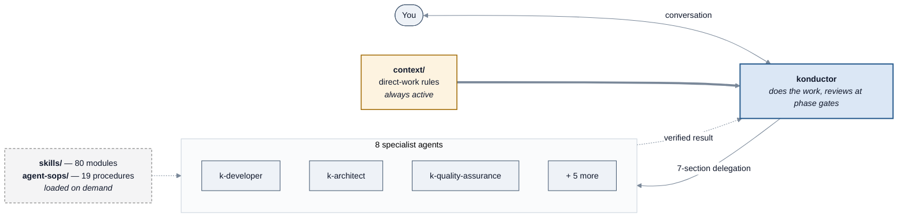

<!-- SPDX-License-Identifier: Apache-2.0 -->

# Core concepts

[← Back to guide index](README.md)

This section defines every term Konductor uses. It assumes only that you can open a
terminal and type a command. Each concept gets one short section; every term is defined the
first time it appears.

---

## Contents

- [Runtime](#runtime)
- [Agent](#agent)
- [Agent spec](#agent-spec)
- [Skill](#skill)
- [SOP](#sop-standard-operating-procedure)
- [Context file](#context-file)
- [Orchestrator and delegation](#orchestrator-and-delegation)
- [Maker-checker](#maker-checker)
- [Konductor CLI](#konductor-cli)
- [How it all fits together](#how-it-all-fits-together)

---

## Runtime

A **runtime** is the program that actually runs an AI agent on your machine. Konductor does
not include one — it configures one you already have:

| Runtime | What it is | Install with |
| --- | --- | --- |
| **Kiro CLI** | Amazon's command-line AI assistant, invoked as `kiro-cli` | `--harness kiro-cli-v2` |
| **Kiro IDE** | Amazon's AI editor | `--harness kiro-v3` |
| **Claude Code** | Anthropic's command-line AI assistant, invoked as `claude` | `--harness claude` |

**Kiro CLI and Kiro IDE are one harness or two depending on the Kiro version.** In Kiro v2 the
CLI and the IDE are separate products: `kiro-cli-v2` installs CLI-only content and does not work
in the IDE at all. In Kiro v3 they are unified into a single product, so the one `kiro-v3` harness
covers both — there is no separate CLI-versus-IDE choice to make.

Konductor ships each agent with per-runtime settings, so the same agent behaves correctly in
any of them. In `agents/*.agent-spec.json` these live under `clientConfig.kiroCli` and
`clientConfig.claudeCli`. The two differ in real ways — for example, the Kiro CLI
configuration for `k-architect` lists tools as `["@builtin", "@aws-mcp"]`,
while the Claude Code configuration lists `["Read", "Write", "Edit", "Bash", "Glob", "Grep",
"WebFetch", "WebSearch", "TodoWrite", "Skill", "mcp__aws-mcp__*"]`.

## Agent

An **agent** is a configured AI assistant with a job. Concretely, it is three things bundled
together:

1. A **system prompt** — instructions establishing its role, workflow, and guardrails.
2. A **tool allowlist** — exactly which actions it may take (read files, write files, run
   shell commands, search the web).
3. **Dependencies** — the skills, SOPs, and context files it can draw on.

Konductor ships 11. Three are orchestrators (coordinators); eight are specialists.

| Agent | What it does |
| --- | --- |
| `konductor` | The main entry point. Does the work itself and spawns one reviewer per phase gate; spawns specialists for tools it lacks or parallel work. |
| `konductor-mux-orchestrator` | Same coordination, but dispatches specialists into parallel tmux or zellij terminal panes. |
| `konductor-cmux-orchestrator` | Same coordination, but dispatches specialists into parallel cmux surfaces. |
| `k-product-manager` | User stories, requirements, decision research, sprint planning. |
| `k-architect` | System designs, API models, data models, threat models, design review. |
| `k-developer` | Task breakdown, backend/frontend implementation, code review, git operations, builds. |
| `k-quality-assurance` | Test-coverage analysis, E2E test strategy, security test generation, UI text validation. |
| `k-researcher` | External documentation and web research. |
| `k-tpm` | Program plans, status reports, risk tracking, effort estimation. |
| `k-browser` | Browser automation via Playwright — navigation, forms, screenshots, E2E runs. |
| `k-media-analyzer` | Interprets PDFs, images, and diagrams. |

For each agent's model, tools, write and shell access, declared skills and SOPs, and delegation
targets, see the [Agents reference](agents.md).

## Agent spec

An **agent spec** is the JSON file that defines one agent, named
`agents/<agent-name>.agent-spec.json`. Its top-level shape:

```text
schemaVersion   "1"
name            e.g. "konductor"
config          description, model, systemPrompt
dependencies    agentSops, context, mcpRegistry, skills
clientConfig    kiroCli { tools, allowedTools, toolsSettings, hooks, resources }
                claudeCli { tools, skills }
```

You do not need to edit these to use Konductor. You do need to know they exist, because the
`dependencies.agentSops` list is what determines **which agent can run which SOP** — see
[SOP workflows](sop-workflows/README.md).

## Skill

A **skill** is a self-contained module of knowledge an agent loads *on demand*. At session
start only each skill's name and one-line description are in the agent's memory; the full
content loads when the agent decides it is relevant. This keeps the agent's working memory
free for your actual problem.

A skill lives at `skills/<name>/SKILL.md` and starts with YAML frontmatter:

```yaml
---
name: delegation-protocol
description: Use when spawning a subagent, choosing the agent for a piece of work, running agents in parallel or in sequence, or handing off artifacts between agents. Defines the mandatory 8-field delegation prompt format, agent registry, and handoff patterns.
version: 1.4.0
tags: [skill, behavioral, orchestration, delegation, multi-agent]
---
```

Some skills also ship helper scripts alongside `SKILL.md` — for example
`skills/legacy-to-agentic-estimate/` contains `scripts/` and `evals/` directories.

**The package ships 80 skills** — 80 directories under `skills/`, each with a `SKILL.md`. All 80
are catalogued, grouped, with a when-to-use note each, in the [Skills catalog](skills.md).

## SOP (standard operating procedure)

A **SOP** — also called an agent script — is a written multi-step procedure an agent follows
to complete a complex task the same way every time. Where a skill is *knowledge* ("here is
how to think about threat models"), a SOP is *procedure* ("do step 1, then step 2, do not
proceed until X").

SOPs live at `agent-sops/<name>.sop.md` and share a consistent structure:

```text
# Title
## Overview      — what it does, when to use it
## Parameters    — required and optional inputs, with defaults
## Steps         — numbered steps, each with:
                   a description
                   **Constraints:** MUST / MUST NOT / SHOULD rules
                   **Expected Output:** what the step produces
## Quality Gate  — (some SOPs) the conditions for "done"
## Troubleshooting — (some SOPs)
```

The `MUST` / `MUST NOT` / `SHOULD` wording is deliberate — it follows RFC 2119, the internet
standards convention for requirement levels, so an agent can tell a hard rule from a
preference.

**The package ships 19 SOPs.** Eighteen are meant for you to invoke; `k-delegate` is
internal machinery the orchestrator uses to format its own delegations.

## Context file

A **context file** is Markdown loaded into an agent's memory *at session start* and kept
active for the whole session — unlike a skill, which loads on demand. Context files are for
rules that must never be missed.

There are four today. `context/k-core-rules.md` holds the NEVER DO rules, the writing-habits
rule, and the engineering practices, and all 11 agents load it. `context/k-direct-work.md` is loaded by `konductor`;
`context/k-orchestrator-routing-rules.md` is loaded by the mux and cmux orchestrators (see
Orchestration shapes); `context/k-orchestrator-shared.md` holds the handoff, split, denial, brief and
capability-routing rules, and all three orchestrators load it. The routing rules file contains the coordinator rules and three `[CODE RED]`
rules, including this one:

> **NEVER MUTATE DIRECTLY — DELEGATE INSTEAD.** You are a read-only orchestrator. You NEVER
> directly execute mutating operations or shell commands.

That is why the mux and cmux orchestrators hand file edits and shell commands to `k-developer`
rather than doing them themselves.

`context/k-coordinator-digest.md` also lives in `context/`, but no agent loads it: the session-start hook prints it into a `coordinator` session. In that mode `konductor` also reads the routing rules file (see Orchestration shapes).

## Orchestration shapes

`konductor` ships in its single-writer shape: it reads, writes and runs commands itself and spawns a
fresh `k-*` reviewer when a phase closes (a lookup, a listing or a one-file change of at most 50 lines that builds, tests and lints clean needs none, reported with the diff stat). This shape is the `auto` orchestration mode, the default.
The coordinator shape, where the orchestrator never writes and every change goes to a specialist, is
what `konductor-mux-orchestrator` and `konductor-cmux-orchestrator` use, and what `konductor` uses
in the `coordinator` mode. Set the mode by hand in your user config; there is no command for it:

```yaml
# ~/.konductor/config.yml
orchestration:
  mode: coordinator   # or auto (the default)
```

Only this file is read; a value in a project's `.konductor/config.yml` is ignored, and
`konductor doctor` reports it. The change applies from the next session, with no reinstall, and
stays until you edit the file again. A session-start hook that `install` wires reads it. Under
`coordinator` the hook injects a short digest, `context/k-coordinator-digest.md`, and tells
`konductor` to read the full routing rules file first. Under `auto` it injects nothing on startup; on a Claude Code resume or compact it prints `Orchestration: auto`.

The first reply of every `konductor` session states the mode: `Orchestration: coordinator`,
`Orchestration: auto (default)`, or `Orchestration: auto (fallback: <reason>)` when the hook could
not apply `coordinator`. `Orchestration: auto (default)` with `coordinator` set means no hook
output arrived; run `konductor doctor`, then see
[Troubleshooting](troubleshooting.md#9-the-first-reply-says-orchestration-auto-but-i-set-coordinator).
Kiro CLI v3 and Claude Code installed with `konductor install` are supported; the Claude Code plugin does not wire the hook, so coordinator mode is not available there. The hook acts only for the install that wired it; see [where the hook may point](../../cli/README.md#orchestration-mode). Kiro CLI v2 is not: the hook is wired there but untested,
and a v2 session the hook does not reach runs as `auto`.

## Orchestrator and delegation

**`konductor`**, as the orchestrator, is the hub. Specialists hold no spawn tool in any
runtime (see [Who can delegate to whom](agents.md#who-can-delegate-to-whom)), so every piece of
work passes through `konductor`, which does it itself or, for a step it cannot do, spawns the owner
and checks the result. A specialist does its own part, then returns a note naming the next role, or
a proposed parallel split that gives each part's agent, inputs and files, and `konductor` does that
step or spawns for it as its direct-work rules allow.

A **delegation** is not a casual instruction — it is a fixed 7-section format defined by the
`k-delegate` SOP and the `delegation-protocol` skill:

```text
1. TASK          — exactly one atomic action
2. EXPECTED OUTCOME — concrete, verifiable deliverables
3. REQUIRED SKILLS
4. REQUIRED TOOLS   — an explicit allowlist, to prevent tool sprawl
5. MUST DO          — exhaustive requirements, nothing implicit
6. MUST NOT DO      — prohibitions, including a response size limit
7. CONTEXT          — paths, patterns, directories to ignore
```

After the specialist returns, the orchestrator runs a verification checklist. If a check
fails, it re-delegates, **up to 2 fix cycles** (`k-delegate` step 8). A review finding gets one fix, a fresh build and test run for code, and one re-review of every first-review CRITICAL or IMPORTANT finding plus the fix and what depends on it; a first-review finding in the task's own output still open, or any CRITICAL or IMPORTANT finding the re-review reports in the task's own output, carried over or new, or caused by the fix, blocks done, and the orchestrator stops and reports it to you; a finding in code the task did not add or change, and the fix did not cause, is listed for you as pre-existing, not put in the fix brief. An SOP's own fix scope and limit on fix rounds win; a finding it leaves open is reported to you as unresolved, never dropped. An artifact that passed review is not reviewed again unless it changes. When `konductor` made the artifact itself, a CRITICAL or IMPORTANT finding it would reject goes to you first and blocks done until you answer.

## Maker-checker

**Maker-checker** means the same agent that produces an artifact then evaluates it against
explicit criteria before showing it to you. It is a self-review pass with a rubric, not a
vibe check.

For example, `k-architect`'s system prompt instructs it: after generating a threat model,
apply the threat-modeling criteria; after creating a design document, apply the
`design-doc-guidelines` criteria. Findings are presented ordered **CRITICAL → IMPORTANT →
SUGGESTION**, followed by: `Fix these issues? [y/n]`.

## Konductor CLI

The **Konductor CLI** is a separate command-line program named `konductor`. It handles setup, content
build, lifecycle, and diagnostics for a Konductor-managed repository: `install`, `update`,
`uninstall`, `doctor`, `init`, `synth`, `verify-run`, and `metrics`.

It does **not** run SDLC workflows. Running a workflow means talking to an agent, not typing a
`konductor` subcommand.

Full detail in the [CLI reference](reference.md).


---

## How it all fits together



*Hub-and-spoke: you talk only to `konductor`; its direct-work rules are always active; skills
and SOPs load on demand.*

Reading the diagram in words:

1. You describe what you want to the `konductor` agent.
2. Its always-active direct-work rules have it do the work itself, or name an SOP for a
   multi-phase request.
3. It spawns a specialist only for a tool, skill or SOP it lacks or for parallel work on disjoint
   files.
4. The specialist loads whichever skills and SOPs the task needs, does the work, and applies
   its own maker-checker pass.
5. When a phase closes, `konductor` spawns a fresh `k-*` reviewer, fixes the CRITICAL and
   IMPORTANT findings once, and re-reviews the fix plus the code that uses it.

---

[← Back to guide index](README.md) · [Next: Prerequisites →](prerequisites.md)
