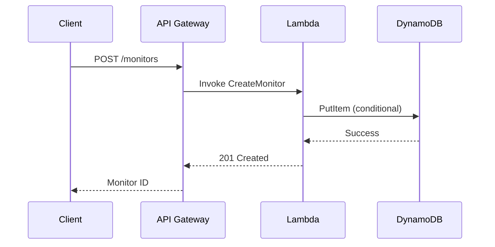
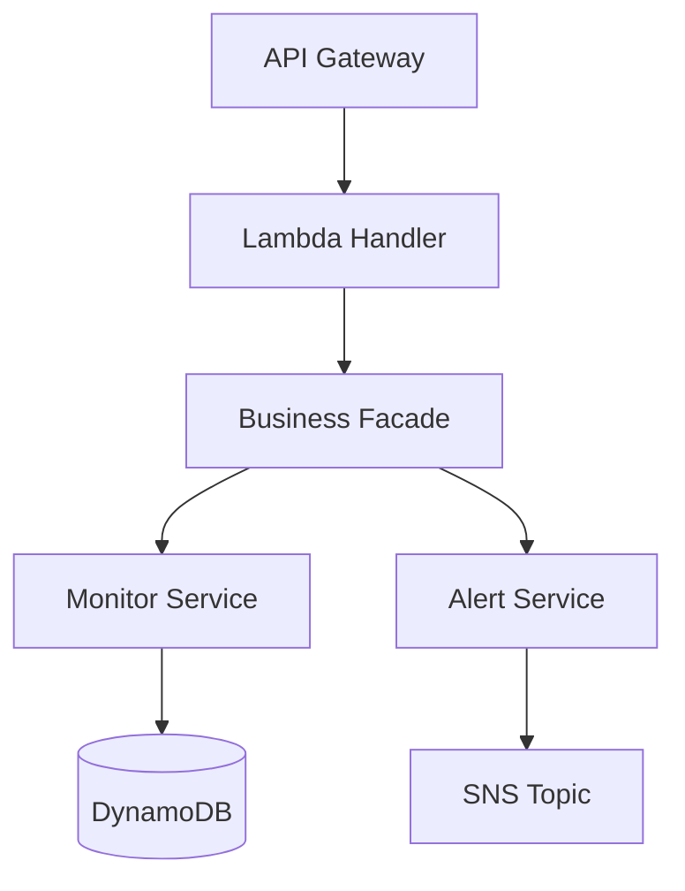

# Kiro Design Generation

## Overview

Decomposes high-level system design artifacts into per-feature low-level designs for Kiro IDE. Takes the system-level architecture (from `system-design-patterns`), threat models, DynamoDB designs, and API specs, then produces a focused `design.md` for each feature that addresses only the components relevant to that feature's requirements.

This skill sits between requirements and implementation — after `kiro-requirements-generation` produces `requirements.md` and before `kiro-task-generation` breaks the design into implementation tasks. The output drives Kiro IDE's spec-driven development, where design.md is the blueprint for task generation.

Two parameters change the order and the shape:

- `workflow` (optional): `requirements-first` (default) reads an approved `requirements.md`. `design-first` writes design.md first, from the system design alone, then links it to the requirements once `kiro-requirements-generation` has derived them. Kiro offers both orders for feature specs. See Step 6.
- `spec_type` (optional): `feature` (default) or `bugfix`. A bugfix design reads `bugfix.md`, centers on the root cause and the fix, and has its own section list. See [Bugfix Designs](#bugfix-designs).

## Usage

Use this skill when:

- `requirements.md` (or `bugfix.md`) is approved and ready for design decomposition
- A design-first spec starts, and the system design plus the feature scope or user stories are ready
- A system design exists (from `system-design-patterns`) and needs per-feature breakdown
- Starting the design phase of a Kiro IDE spec-driven workflow
- Converting existing architecture documents into Kiro IDE design format

Do NOT use when:

- A requirements-first or bugfix spec has no approved `requirements.md` or `bugfix.md` yet: use `kiro-requirements-generation` first
- A feature spec has no system design: use `system-design-patterns` first
- You need to generate implementation tasks — use `kiro-task-generation` after this skill

## Input

This skill consumes multiple upstream artifacts:

1. **requirements.md** from `kiro-requirements-generation` — EARS-format requirements for the feature at `{spec_dir}/requirements.md` (`bugfix.md` for a bugfix spec; absent on a design-first spec's first pass)
2. **System Design** from `system-design-patterns` — High-level architecture, component diagrams, data flow
3. **Threat Model** from `threat-modeling` — STRIDE analysis, security controls, trust boundaries
4. **DynamoDB Design** from `dynamodb-design` — Table schemas, PK/SK design, GSIs, access patterns
5. **API Specs** from `smithy-modeling` — Smithy service definitions, operation signatures, input/output shapes

Input can come from:

- Handoff files in `.konductor/handoff/` (e.g., `architect-system-design.md`)
- Design documents provided directly in conversation
- Existing architecture artifacts referenced by the user

Not all inputs are required — use what is available. At minimum: `requirements.md` and a system design for a requirements-first spec; the system design and the feature scope or user stories for a design-first spec's first pass; `bugfix.md` and the code on the failing path for a bugfix spec.

## Output

```
{spec_dir}/design.md
```

`spec_dir` (optional): where spec artifacts live. Defaults to `.kiro/specs/{feature-name}/`; when the caller passes one, this skill MUST read and write there instead.

One `design.md` per feature, placed alongside the corresponding `requirements.md` in the same `spec_dir`.

Example directory structure after both skills run, using the default `spec_dir`:

```
.kiro/specs/
├── network-monitoring/
│   ├── requirements.md
│   └── design.md
├── vpc-analyzer/
│   ├── requirements.md
│   └── design.md
```

## Required Sections

Every feature `design.md` starts with `# Design Document` and MUST contain these 7 `##` sections in this order, the order the design.md Kiro writes uses: Overview, Architecture, Components and Interfaces, Data Models, Correctness Properties, Error Handling, Testing Strategy. Use `###` sub-headings inside a section as needed.

### 1. Overview

High-level description of the feature design. Includes:

- What the feature does and why (1-2 paragraphs)
- Which requirements from `requirements.md` this design addresses
- Key design decisions and their rationale
- Scope boundaries — what is and is not included

### 2. Architecture

System architecture and component relationships for this feature. Includes:

- Component diagram showing how this feature's components interact
- Integration points with existing system components
- Data flow for the primary use case
- Mermaid diagrams (SHOULD include at least one)

Example Mermaid sequence diagram:

````markdown

````

Example Mermaid architecture diagram:

````markdown

````

### 3. Components and Interfaces

Detailed component descriptions with API interfaces and function signatures. For each component:

- Purpose and responsibility
- Public interface (function signatures with types)
- Dependencies on other components
- Configuration parameters

Example:

```typescript
// MonitorService - manages monitor lifecycle
interface MonitorService {
  createMonitor(input: CreateMonitorInput): Promise<Monitor>;
  getMonitor(monitorId: string): Promise<Monitor | null>;
  updateMonitor(monitorId: string, input: UpdateMonitorInput): Promise<Monitor>;
  deleteMonitor(monitorId: string): Promise<void>;
  listMonitors(filters: MonitorFilters): Promise<PaginatedResult<Monitor>>;
}
```

### 4. Data Models

Database schemas, data structures, and relationships. Includes:

- DynamoDB table design (PK, SK, GSIs) if applicable
- TypeScript interfaces for domain entities
- Request/response shapes for API operations
- Relationships between entities

Example:

```typescript
interface Monitor {
  monitorId: string; // PK: MONITOR#<id>
  accountId: string; // SK: ACCOUNT#<id>
  name: string;
  status: 'ACTIVE' | 'PAUSED' | 'ERROR';
  config: MonitorConfig;
  createdAt: string; // ISO 8601
  updatedAt: string; // ISO 8601
}
```

When no DynamoDB design handoff exists and the feature needs a table, load the `dynamodb-design` skill before designing keys and indexes, and apply its quality gate, including write sharding for low-cardinality keys and hot partitions. For depth it does not carry, such as Streams, backup or the cost calculator, load the AWS MCP server's `amazon-dynamodb` skill with `aws___retrieve_skill` or through `find-aws-skills`.

### 5. Correctness Properties

The properties that tie the requirements to automated tests. Kiro extracts properties like these from the requirements and generates property-based tests from them. Open the section with this sentence, then one `###` block per property:

```markdown
## Correctness Properties

*A property is a characteristic that should hold across all valid executions of the system. Properties link the requirements to automated tests.*

### Property 1: Created notes are well-formed and retrievable

*For any* valid title and body, creating a note SHALL return 201 with a note whose title is the input title after trimming and whose body equals the input body.

**Validates: Requirements 1.1, 1.4, 1.6**

### Property 2: Note ids are unique

*For any* sequence of successful creations, all returned ids SHALL be distinct.

**Validates: Requirements 1.2**
```

Rules:

- Each property states a universally quantified claim, `*For any* <inputs> ... SHALL <outcome>`, over the inputs a test generator can draw, including the boundary values the criteria name
- `**Validates: Requirements N.M, ...**` lists the acceptance criteria the property checks, by number. Every number must exist in requirements.md (bugfix.md items for a bugfix design)
- Number properties from 1 in order. `kiro-task-generation` gives each property one test task and copies its title and Validates line
- Every acceptance criterion is validated by at least one property, or is named in Testing Strategy as covered by an example, integration or fault-injection test instead. Criteria about a single fixed case (a missing header, a 405 on one method) usually fit an example test better

### 6. Error Handling

Error scenarios and handling strategies. For each error scenario:

- What triggers the error
- How the system responds
- What the user sees
- Recovery strategy (retry, fallback, escalate)

Cover at minimum:

- Input validation errors (400)
- Authentication/authorization failures (401/403)
- Resource not found (404)
- Conflict/race conditions (409)
- Downstream service failures (502/503)
- Throttling (429)

### 7. Testing Strategy

Property-based, unit, integration, and E2E testing approach for this feature. Includes:

- Property-based test setup: the library for the design's language (for example Hypothesis or fast-check), at least 100 examples per property, the generators for each input, and which layer each property runs against
- Unit test scope — what to mock, what to test in isolation
- Integration test scope — which component interactions to verify
- E2E test scope — critical user journeys to validate
- Test data strategy — fixtures, factories, seed data

Example:

```
Unit Tests:
- MonitorService.createMonitor: validates input, calls repository, returns monitor
- MonitorService.createMonitor: throws ConflictError on duplicate name

Integration Tests:
- POST /monitors → creates monitor in DynamoDB → returns 201
- POST /monitors with duplicate name → returns 409

E2E Tests:
- Create monitor → verify in dashboard → receive first alert
```

## Decomposition Rules

When extracting per-feature design from the system-level design:

### Requirement Mapping

- Each requirement from `requirements.md` MUST map to at least one component in the design
- Create a traceability note in the Overview section listing which requirements are addressed
- If a requirement cannot be addressed by the design, flag it explicitly
- Put gaps and assumptions in design.md itself, in an "Assumptions and Gaps" list inside the Overview (not a new `##` section), not only in your chat reply. A gap is a requirement that names an operation or behavior the upstream design does not define, a conflict between requirements and the system design, or an expected input that is missing (no threat model, DynamoDB design or API spec handoff). For each, say what you assumed
- When a requirement denies callers who do not own a resource, design an explicit ownership check. Return 404 both for ids that do not exist and for ids the caller does not own, so responses do not reveal which ids exist. Return 403 only when the caller can already see the resource but lacks permission for this action (for example, read-only on a shared item)
- Do not add behavior the requirements do not ask for (quotas, exports, alerting). If you add something, list it under Assumptions and Gaps

### Feature Scoping

- Include only components that are directly involved in this feature
- For shared components (e.g., auth middleware, logging), reference them but do not duplicate their full design
- Use a brief description: "Uses the shared AuthMiddleware (see system design) for JWT validation"

### Cross-Feature References

- If this feature depends on another feature's components, reference the other feature's design.md
- Example: "Depends on the Alert entity from `.kiro/specs/alert-management/design.md`"
- Do not copy component designs across features — reference and extend
- Reuse the keys, indexes and TTLs the system design already defines. Replace one only when it cannot meet a requirement, and say why in the Overview

### Granularity

- Each design.md should be self-contained enough to generate implementation tasks
- A developer reading only this design.md (plus requirements.md) should understand what to build
- Target 100-400 lines per design.md, Correctness Properties included; a design-first design.md runs longer because it carries the function-level detail. Split a feature that needs more into sub-features

## Bugfix Designs

For `spec_type: bugfix`, the input is `{spec_dir}/bugfix.md` and the codebase, and the design is about one defect. Read the code on the failing path before writing. A bugfix design.md does not use the 7 feature sections. It uses these `##` sections, in the order the bugfix design.md Kiro writes uses, under a `# {Bug Title} Bugfix Design` title:

1. **Overview**: the defect, the fix in one or two sentences, and how fix checking and preservation checking split the validation
2. **Glossary**: `Bug_Condition (C)`, `Property (P)`, `Preservation`, the functions involved, and the name for the fixed function (for example `f'`)
3. **Bug Details**: `### Bug Condition`, with prose and a `**Formal Specification:**` pseudocode block for `isBugCondition`, then `### Examples`, with actual and expected results and the edge cases outside the condition
4. **Expected Behavior**: `### Preservation Requirements`, listing the unchanged behaviors and the scope of inputs the fix must not affect
5. **Hypothesized Root Cause**: the candidate causes, numbered, each confirmed or ruled out with the evidence
6. **Correctness Properties**: one paragraph per property, headed by a plain line such as `Property 1: Bug Condition - <title>` or `Property 2: Preservation - <title>`, then `_For any_ ... SHALL ...` and `**Validates: Requirements 2.1, 3.2**` citing bugfix.md items by `section.item`
7. **Fix Implementation**: `### Changes Required`, naming each file and function and each specific change, including what to leave alone
8. **Testing Strategy**: `### Validation Approach`, `### Input Domain and Generators` (the inputs the properties draw and how to generate them), `### Exploratory Bug Condition Checking` (tests run on the unfixed code that are expected to fail, with the counterexamples expected), `### Fix Checking` and `### Preservation Checking` (each with pseudocode), then unit, property-based and integration tests

The quality gate's section check applies to this list for a bugfix design.

## Mermaid Diagrams

Design documents SHOULD include Mermaid diagrams for visual clarity:

- **Sequence diagrams** for key request/response flows (API calls, async processing)
- **Architecture diagrams** (graph TD/LR) for component relationships
- **State diagrams** for entities with lifecycle states (e.g., Monitor: ACTIVE → PAUSED → ERROR)
- **ER diagrams** for complex data relationships

Keep diagrams focused — one diagram per concept. A single complex diagram is harder to understand than 2-3 focused ones.

## Execution

When this skill is activated, follow these steps:

### Step 1: Read requirements.md

In a design-first spec, `requirements.md` does not exist yet: skip this step, take the scope from the feature scope or user stories the caller passes, and go to Step 2. For a bugfix design, read `{spec_dir}/bugfix.md` instead.

Otherwise, read the approved `requirements.md` from `{spec_dir}/requirements.md`. Extract:

- All requirements and their acceptance criteria
- The feature scope and user personas
- Any NFRs or constraints mentioned in the introduction

### Step 2: Read System Design

Read the system-level design artifacts. Sources (in priority order):

1. Handoff file: `.konductor/handoff/architect-system-design.md`
2. Design documents provided directly in conversation
3. Existing architecture artifacts referenced by the user

Also read supplementary artifacts if available:

- Threat model from `.konductor/handoff/architect-threat-model.md`
- DynamoDB design from `.konductor/handoff/architect-dynamodb-design.md`
- API specs from `.konductor/handoff/architect-api-specs.md`

Record each one that is missing; it goes in the Overview's Assumptions and Gaps list.

### Step 3: Identify Feature-Specific Components

From the system design, extract only the components relevant to this feature:

1. Map each requirement (each in-scope user story, design-first) to the components that implement it
2. Identify the data flow path for the feature's primary use case
3. Note shared components that are used but not owned by this feature
4. Identify integration points with external services or other features

### Step 4: Write design.md

Write the design document with all 7 required sections. For a bugfix design, write the 8 sections in [Bugfix Designs](#bugfix-designs) instead, with each property citing bugfix.md items:

1. **Overview**: summarize the feature design, list addressed requirements, state key design decisions
2. **Architecture**: draw component relationships, include at least one Mermaid diagram
3. **Components and Interfaces**: define each component's interface with typed function signatures
4. **Data Models**: specify schemas, entities, and relationships with typed definitions in the design's language
5. **Correctness Properties**: write the `*For any* ... SHALL ...` properties, each with its `**Validates: Requirements N.M**` line
6. **Error Handling**: cover error scenarios per the acceptance criteria plus standard HTTP errors
7. **Testing Strategy**: define property-based, unit, integration and E2E scope with concrete test case examples

In a design-first spec, write the properties without their Validates lines and without the Overview's requirement list. Step 6 adds both. Until then, Kiro's format check warns once per property that has no Validates line; that is expected at this point.

A design-first design.md is the low-level design the requirements are derived from, so it carries more detail. Kiro's own design-first design.md adds these `##` sections to the 7: `Request Flows` after Architecture, `Key Functions with Formal Specifications` (preconditions and postconditions per function) and `Algorithmic Pseudocode` after Data Models, `Example Usage` before Correctness Properties, and `Performance Considerations`, `Security Considerations` and `Dependencies` after Testing Strategy. Add the ones the feature needs; keep the 7 required sections in their order.

### Step 5: Validate

Before presenting output, verify:

- [ ] All 7 required sections are present, non-empty and in order (the 8 bugfix sections, for a bugfix design)
- [ ] Every requirement from requirements.md is addressed by at least one component (for a bugfix design, every Expected and Unchanged Behavior item by the fix or a preservation property)
- [ ] At least one Mermaid diagram is included (sequence or architecture)
- [ ] Every property has a `*For any*` statement (`_For any_` in a bugfix design) and a Validates line whose numbers exist in requirements.md (bugfix.md), and every criterion is covered by a property or a named test in Testing Strategy (in a design-first spec, after Step 6)
- [ ] Error handling covers validation, auth, not-found, conflict, and downstream failures (feature design)
- [ ] Testing strategy covers unit, integration, and E2E levels (a bugfix design: exploratory, fix and preservation checking)
- [ ] Component interfaces use typed signatures (not vague descriptions)
- [ ] Data models include field types and constraints
- [ ] design.md is placed alongside requirements.md (or bugfix.md) in `{spec_dir}`
- [ ] Gaps, missing inputs and assumptions are written in design.md
- [ ] Line count checked with `wc -l` (report the real number) and headings checked with `grep -n '^## '`

### Step 6: Link Requirements (Design-First Only)

After `kiro-requirements-generation` has derived `requirements.md` from this design:

1. Read both files
2. Add the requirement numbers to the Overview's traceability note and a `**Validates: Requirements N.M**` line to each property
3. Add a property or a Testing Strategy entry for every criterion nothing covers yet, and list any design element no requirement uses under Assumptions and Gaps
4. Run Step 5's checks again

## Quality Gate

**CRITICAL (must fix before done):**

- Missing any of the 7 required sections (Overview, Architecture, Components and Interfaces, Data Models, Correctness Properties, Error Handling, Testing Strategy), or sections out of that order. A bugfix design is checked against the 8 sections in [Bugfix Designs](#bugfix-designs)
- A property whose Validates line cites a criterion that does not exist, or a requirements-first design whose properties have no Validates lines
- Design does not address all requirements from requirements.md — every requirement must trace to at least one component
- Component interfaces missing typed function signatures
- Data models missing field types
- design.md placed in wrong directory (must be alongside requirements.md)

**IMPORTANT (should fix):**

- No Mermaid diagrams — at least one sequence or architecture diagram should be included
- Missing error scenarios for operations that call external services or accept user input
- Testing strategy missing one of the three levels (unit, integration, E2E), or no property-based test setup for the properties
- An acceptance criterion covered by neither a property nor a named test
- Shared components fully duplicated instead of referenced
- A requirements-first design exceeds 400 lines without splitting into sub-features

**SUGGESTION:**

- Could add design decision rationale (why this approach over alternatives)
- Could add state diagrams for entities with lifecycle states
- Could add performance considerations (expected latency, throughput)
- Could add a "Future Considerations" section for known extensions

Present findings as: CRITICAL → IMPORTANT → SUGGESTION. Ask: "Fix these issues? [y/n]", unless `scope_confirmed` is true, in which case report all the findings and leave fixing to the caller, without asking. If the user said not to ask questions, fix CRITICAL and IMPORTANT findings yourself and finish without the prompt. If both apply, `scope_confirmed` wins: the caller owns the fix step, so report the findings and leave fixing to the caller. Fix the findings yourself only in no-questions mode without `scope_confirmed`.
