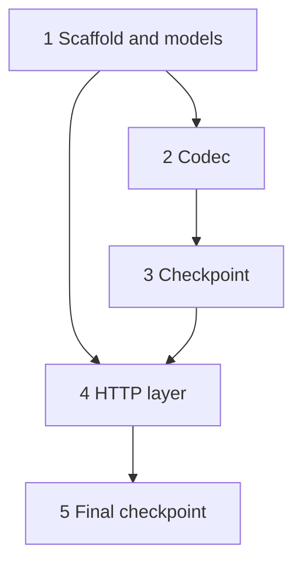

# Kiro Task Generation

## Overview

Produces `{spec_dir}/tasks.md`, a structured implementation task list for Kiro IDE's spec-driven development workflow. Each task is a coding or test task designed for a code-generation LLM to execute one at a time, with explicit references back to requirements.md (bugfix.md for a bugfix spec) and to the design's correctness properties.

`spec_dir` (optional): where spec artifacts live. Defaults to `.kiro/specs/{feature-name}/`; when the caller passes one, this skill MUST read and write there instead.

This skill is the final step in the Kiro spec workflow, after `kiro-requirements-generation` produces requirements.md (or bugfix.md) and `kiro-design-generation` produces design.md. A design-first spec writes design.md before requirements.md; the task list is built the same way.

## Usage

Use this skill when:

- requirements.md (or bugfix.md) and design.md are approved for a feature
- Generating the implementation plan for Kiro IDE spec-driven development
- Creating tasks.md alongside them in `{spec_dir}`

Do NOT use when:

- Splitting features for independent engineering → use `task-decomposition`
- Requirements are not yet written → use `kiro-requirements-generation`
- Design is not yet written → use `kiro-design-generation`

## Output Format

The headings, checkbox forms, reference lines and dependency graph below follow the tasks.md Kiro itself writes for a feature spec. Kiro's spec format check rejects a feature tasks.md that has no `## Task Dependency Graph` section, so the section is required there. A bugfix spec uses a shorter form; see [Bugfix specs](#bugfix-specs).

````markdown
# Implementation Plan: {feature-name}

## Overview

[2-4 sentences: the build order and the stack the design chose.]

## Tasks

- [ ] 1. Set up project structure and core data models
  - Create the package layout and the test directory
  - Define the data models from the design's Data Models section
  - _Requirements: 1.4, 3.9_

- [ ] 2. Implement note serialization and parsing
  - [ ] 2.1 Implement `serialize_note` and `parse_note`
    - Serialize to an object with exactly the fields the design names
    - Collect every parse problem before raising
    - _Requirements: 5.1, 5.2, 5.3_
  - [ ]* 2.2 Write property test for serialization round-trip
    - **Property 4: Note serialization round-trip**
    - **Validates: Requirements 5.1, 5.3**

- [ ] 3. Checkpoint - pure logic
  - Ensure all tests pass, ask the user if questions arise.

- [ ] 4. Implement the HTTP layer
  - [ ] 4.1 Implement `POST /notes`
    - Apply the request checks in the order the design gives
    - _Requirements: 1.1, 2.6_
  - [ ]* 4.2 Write example tests for HTTP edge cases
    - Missing content type, payload at and over the size cap
    - _Requirements: 2.7, 2.8_

- [ ] 5. Final checkpoint - full suite
  - Ensure all tests pass, ask the user if questions arise.

## Task Dependency Graph



```json
{
  "waves": [
    {"id": 0, "tasks": ["1"]},
    {"id": 1, "tasks": ["2.1"]},
    {"id": 2, "tasks": ["2.2"]},
    {"id": 3, "tasks": ["3"]},
    {"id": 4, "tasks": ["4.1"]},
    {"id": 5, "tasks": ["4.2"]},
    {"id": 6, "tasks": ["5"]}
  ]
}
```

## Notes

- Tasks marked with `*` are optional and can be skipped for a faster MVP, but they carry the requirement coverage for the correctness properties.
- Each property test references its design property and the requirements it validates.
````

## Format Rules

### Tasks

- Numbered checkbox list: `- [ ] N.` for top-level, `- [ ] N.M` for sub-tasks
- Sub-tasks indented 2 spaces under their parent, their detail bullets 4 spaces
- Max 2 levels of hierarchy (top-level + one sub-level)
- Each task includes: clear objective, sub-bullets with details, and its reference line
- Implementation tasks end with `_Requirements: X.Y_`, listing the acceptance criteria (requirements.md) or behavior items (bugfix.md) they satisfy
- A property-based test task names its design property and the requirements that property validates, as two bold lines: `**Property N: <title from design.md>**`, then `**Validates: Requirements N.M, ...**`. Copy both from design.md's Correctness Properties so the three documents agree
- Example and unit test tasks end with `_Requirements: X.Y_`, like implementation tasks
- Each task builds incrementally on previous tasks and ends with code wired into what came before
- Tasks are designed for a code-generation LLM to execute one at a time
- Tasks are coding and test tasks, plus checkpoints. Leave out deployment, documentation and manual user testing unless a requirement asks for them
- Each implementation task is one coherent code change. Put the tests for that code in sub-tasks of the same parent, right after the implementation sub-task; only cross-component and integration tests get a top-level task of their own
- When the design specifies a mechanism for a criterion (a concurrency guard, conditional write, idempotency check, retry rule), give that mechanism its own sub-task, titled for it, with the test that proves it. Folded into a generic "implement the service" task, it is the part the executing LLM is most likely to get wrong or skip

### Optional tasks

- Mark a task optional with `- [ ]*`, for a sub-task `  - [ ]* 2.2 ...`. Kiro's Run all Tasks runs only the incomplete tasks marked required and skips the optional ones
- Test tasks are the usual optional tasks, property tests in particular. Implementation tasks stay required
- No implementation task depends on an optional task. A checkpoint can follow optional test tasks; it checks whichever of them ran

### Checkpoint tasks

- A checkpoint is a top-level task with no sub-tasks, titled `Checkpoint - <stage>`, with the single bullet `Ensure all tests pass, ask the user if questions arise.`
- Put one after each stage that leaves the code testable (for example pure logic, storage, HTTP), and end the list with `Final checkpoint - full suite`
- Checkpoints carry no requirement reference. They are part of the format, not a coverage gap

### Task Dependency Graph

`## Task Dependency Graph` follows `## Tasks` and holds two fenced blocks:

1. A `mermaid` `flowchart TD` over the **top-level** tasks. Node ids are `T<N>`, labels `<N> <short title>`, and an edge `TA --> TB` means B cannot start until A is done
2. A `json` block with one key, `waves`: an ordered array of `{"id": <int>, "tasks": [<task ids>]}`, ids counting from 0

Wave rules:

- Wave entries are **leaf** task ids, as strings: a sub-task (`"2.1"`) or a top-level task without sub-tasks (`"1"`, a checkpoint such as `"3"`). A parent that has sub-tasks never appears itself
- Every leaf task, optional ones included, appears in exactly one wave
- A task sits in a later wave than every task it depends on. A sub-task waits for every leaf of each parent its own parent depends on in the flowchart, and for the earlier sub-tasks of its parent that it uses
- Tasks in one wave are independent; Kiro runs each wave's tasks concurrently
- A checkpoint gets a wave after every leaf of the tasks it checks

### Bugfix specs

When the spec has `bugfix.md` instead of `requirements.md`, follow the bugfix tasks.md Kiro writes. It has the `# Implementation Plan` title and the task list only: no Overview, no Notes, and no `## Task Dependency Graph`, because the tasks run strictly in order. No task is optional. Kiro's format check gives this form three warnings (no `## Overview`, `## Tasks` or `## Notes`), the same ones it gives Kiro's own bugfix tasks.md; they are advisory, not errors.

1. `Write bug condition exploration test`: the design's bug-condition property, as `**Property 1: Bug Condition** - <title>`. It encodes the expected behavior, so it MUST FAIL on the unfixed code, and that failure confirms the bug. Say so in bold in the task, say not to fix the test or the code when it fails, and have the task record the counterexamples (`_Requirements: 1.x, 2.x_`)
2. `Write preservation property tests (BEFORE implementing fix)`: `**Property 2: Preservation** - <title>`. Observe and record what the unfixed code does for inputs outside the bug condition, then pin it. These tests MUST PASS on the unfixed code (`_Requirements: 3.x_`)
3. Any other property that fails on the unfixed code gets its own test task here, before the fix
4. A parent task for the fix, with sub-tasks:
   - `Implement the fix`: each file and line to change and what to leave alone, with `_Bug_Condition: ..._`, `_Expected_Behavior: ..._` and `_Preservation: ..._` lines drawn from the design, then `_Requirements: ..._`
   - One `Verify ... now passes` sub-task per earlier test task: re-run that SAME test, do not write a new one, and expect it to pass
5. `Checkpoint - Ensure all tests pass`

## Task Ordering

1. **Foundation**: project structure, interfaces, shared utilities
2. **Core**: main feature implementation (data models, services, API), each followed by its tests
3. **Polish**: error handling, edge cases, validation, integration tests
4. Checkpoints between stages and at the end

## Execution Steps

1. Resolve `spec_dir` — the caller's value if given, otherwise the default `.kiro/specs/{feature-name}/`
2. Read requirements.md (or bugfix.md) from `{spec_dir}`
3. Read design.md from `{spec_dir}`, including its Correctness Properties
4. Map each acceptance criterion to implementation tasks, and each correctness property to one test task
5. Order tasks by dependency (foundation → core → polish), add checkpoints, then build the dependency graph and the waves from that order
6. Write tasks.md to `{spec_dir}/tasks.md`
7. Check it: every cited criterion and property exists, every property has a test task, and every leaf task id appears in exactly one wave. `grep -n '^ *- \[ \]' tasks.md` lists the tasks to compare with the waves
8. Present to user for approval. If user requests changes, revise and re-present (max 2 cycles). If the user said not to ask questions, skip approval: state your assumptions in the final message and finish.

## Quality Gate

**CRITICAL (must fix):**

- Tasks have circular dependencies
- In a feature spec, `## Task Dependency Graph` missing, or its `waves` JSON is invalid, omits a leaf task, lists one twice, lists a parent task, or puts a task in the same or an earlier wave than a task it depends on
- An implementation or test task without its requirement reference (checkpoints are exempt)
- A reference to an acceptance criterion or property that does not exist
- tasks.md written anywhere other than `{spec_dir}`

**IMPORTANT (should fix):**

- Tasks too large (should be completable by an LLM in one pass)
- A design-specified mechanism folded into a broader task instead of having its own sub-task
- No clear ordering — foundation tasks should come before core tasks
- Sub-tasks at same indentation as parent (must be indented 2 spaces)
- A correctness property in design.md with no test task
- An implementation task that depends on an optional task
- No final checkpoint
- Deployment, documentation or manual testing tasks that no requirement asks for

**SUGGESTION:**

- Could add effort estimates per task
- Could add a checkpoint after a long stage that has none
